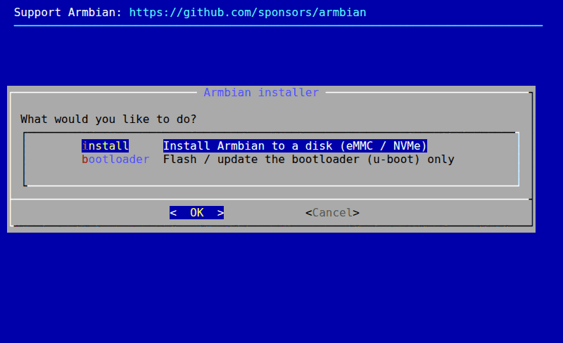
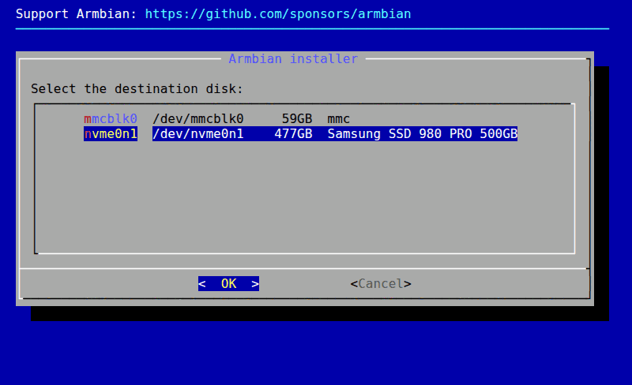
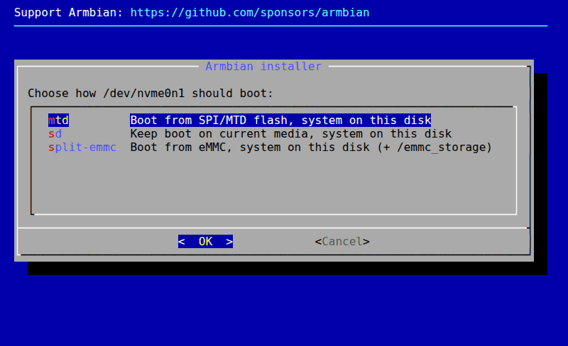
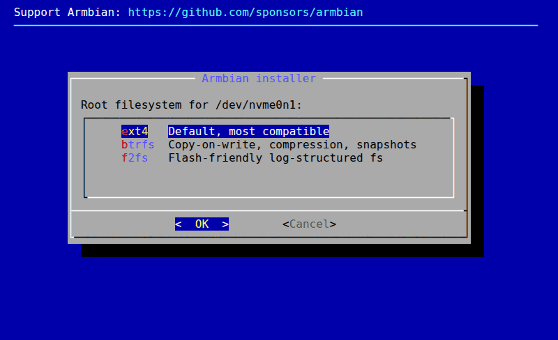
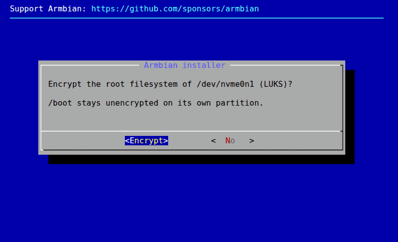
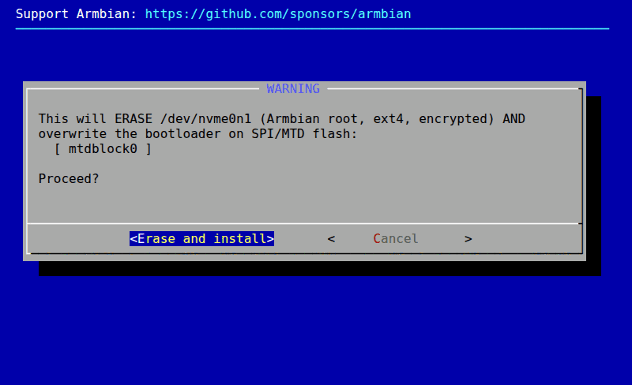
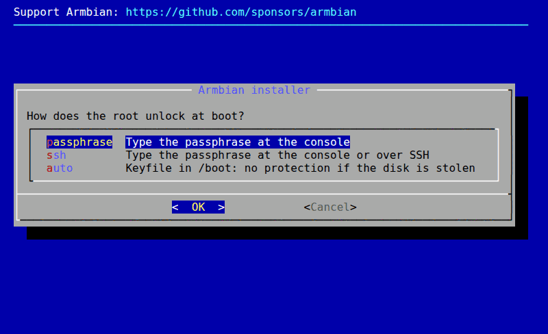
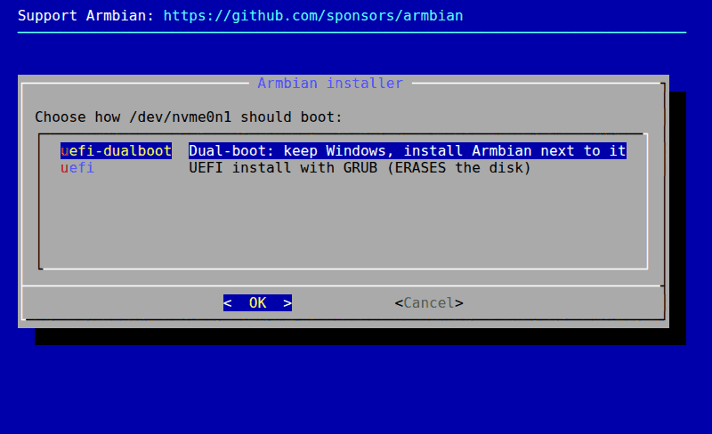
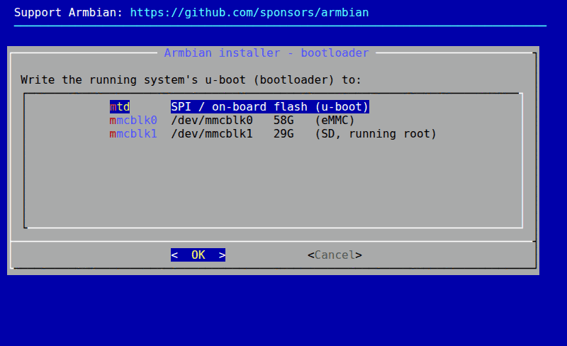

# Installing to internal storage

`armbian-install` copies the running system to a different disk. It can also flash only the bootloader. Run it from the SD card or USB stick that you booted:

    sudo armbian-install

The installer shows only the options that the board supports.

!!! warning "Back up your data"

    The installer erases the target disk. The only exception is the Windows dual-boot mode.

## Steps

1. **Select an action.** The installer asks for an action only when the board supports more than one.

    

2. **Select the destination disk.** The list shows SD, eMMC, NVMe, SATA, USB and UFS disks. A disk that is in use does not show.

    

3. **Select the boot mode.** See [Boot modes](#boot-modes).

    

4. **Select the root file system.** See [File systems](#file-systems).

    

5. **Select encryption.** You can encrypt the root file system. See [Encrypted root](#encrypted-root-luks).

    

6. **Confirm.** The installer partitions the disk, copies the system and writes the bootloader.

    

Reboot. Remove the boot media, except in the `sd` and `standalone` modes.

## Boot modes

The installer offers each mode only when the hardware and the bootloader support it.

| Mode | Target disk | Result |
|---|---|---|
| `emmc` | eMMC or SD | Bootloader and system on this device. |
| `sd` | any | Bootloader stays on the current media. The system goes to the target disk. Keep the current media in the board. |
| `split-emmc` | NVMe, SATA, USB | Bootloader and `/boot` on the internal eMMC. System on the target disk. The rest of the eMMC mounts at `/emmc_storage`. |
| `mtd` | NVMe, SATA, USB, UFS | The installer writes the bootloader to SPI flash. Full system on the target disk. |
| `spi` | NVMe, SATA, USB | The bootloader is already in the on-board SPI flash, for example on the SpacemiT K3. Full system on the target disk. The installer does not change the SPI flash. |
| `standalone` | NVMe, SATA, USB | The current bootloader can load `/boot` from the target disk. Full system on the target disk. The installer does not change the current media. |
| `ufs` | UFS | Bootloader on the UFS boot LU. System on the UFS disk. |
| `native` | any | Self-contained install for boards without U-Boot, for example Raspberry Pi. |
| `uefi` | any | UEFI install with GRUB. |
| `bios` | any | Legacy BIOS install with GRUB. |
| `uefi-dualboot` | disk with Windows | Install next to Windows 10 or 11. See [Dual-boot with Windows](#dual-boot-with-windows). |

For boards with SPI flash and an NVMe disk, `mtd` or `spi` is the recommended mode. The board then does not need the SD card.

## File systems

* `ext4`: the default. Select it if you are not sure.
* `btrfs`: copy-on-write, compression and snapshots. The installer creates the root subvolume `@` and installs `armbian-snapshots`.
* `f2fs`: a file system for flash storage.

The installer shows `btrfs` and `f2fs` only when the running kernel supports them. U-Boot cannot read `btrfs`, `f2fs` or an encrypted root. For these roots, the installer adds a small `ext4` `/boot` partition.

## Encrypted root (LUKS)

The installer can encrypt the root file system with LUKS. `/boot` stays on its own unencrypted partition. The `sd` mode does not support encryption.

Select how the root unlocks at boot:

* **passphrase**: type the passphrase on the console.
* **ssh**: type the passphrase on the console or over SSH. The initramfs runs dropbear on port 2022 by default. Put your public key in `/root/.ssh/authorized_keys` first.
* **auto**: a keyfile in `/boot` unlocks the root. This option gives no protection if somebody steals the disk.

## Dual-boot with Windows

On UEFI systems, the installer offers `uefi-dualboot` when the disk holds Windows. Windows stays on the disk, and GRUB lets you select the system at boot.

* The installer uses free space first. Then it shrinks the Windows partition.
* The installer can also replace the partitions of an earlier Linux install.
* BitLocker volumes cannot shrink. Run `manage-bde -off C:` in Windows and wait for the decryption to complete.
* Disable Fast Startup and hibernation in Windows.

## Bootloader only

Use this option to install or update U-Boot without a change to the system. Select **Flash / update the bootloader only** in the first menu, or use the command line:

    sudo armbian-install bootloader --target mtd --yes            # SPI flash
    sudo armbian-install bootloader --target ufs --yes            # UFS boot LU
    sudo armbian-install bootloader --target /dev/mmcblk1 --yes   # SD or eMMC

## Non-interactive install

Use command line options for scripts or for installs over SSH. The installer changes the disk only with `--yes`.

    sudo armbian-install --target /dev/nvme0n1 --boot spi --fs ext4 --yes

Encrypted NVMe install. The installer asks for the passphrase:

    sudo armbian-install --target /dev/nvme0n1 --boot spi --fs ext4 --encrypt --yes

Dual-boot with 32 GiB for Armbian:

    sudo armbian-install --target /dev/nvme0n1 --boot uefi-dualboot --fs ext4 --size 32 --yes

Run `armbian-install --help` for all options. The installer writes its log to `/var/log/armbian-install.log`.

---

**Previous:** [First steps after login](first-steps.md)

**Next:** [Keeping Armbian up to date](updating.md)

Back to the [Getting Started](index.md) overview.
