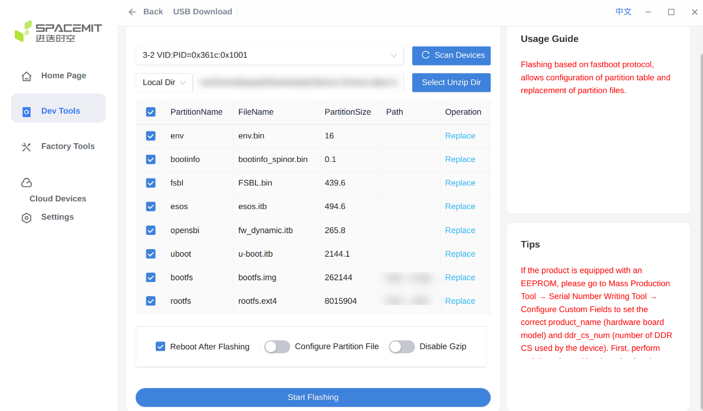
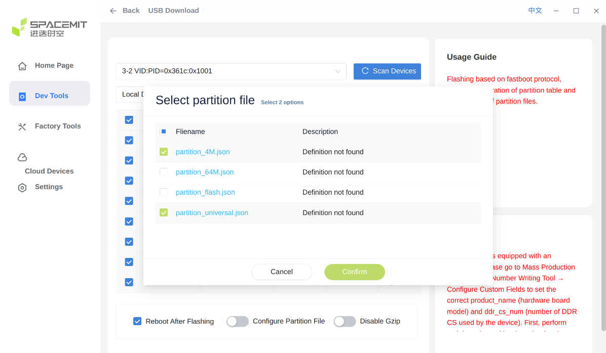

# Writing the image to your media

There are multiple ways to deploy the image to your board. The easiest and most common option is to write the Armbian Image to your SD-Card.

## Flash to SD Card

Use **[Armbian Imager](https://imager.armbian.com/)** to flash the image.

Armbian Imager can:

- download official Armbian images
- flash **already downloaded `.img`, `.img.xz`, or custom images**
- automatically verify written data
- protect your system disks from accidental overwrite

Steps:

1. Install and open **Armbian Imager**
2. Select your board or choose a local/custom image
3. Select your SD card or USB drive
4. Flash and wait for verification to finish

!!! warning "Other tools"

    We are aware that many programs can be used for this step. However, tools without proper verification and safe target selection can hide problems such as bad cards, faulty readers, partial writes, or accidentally selecting the wrong drive. These issues have caused too many avoidable error reports.

    For this reason, **Armbian Imager is the recommended tool**.

    Due to reports of image corruption caused by decompression issues, [balenaEtcher](https://www.balena.io/etcher/) is not recommended.

## Flash to Internal Memory

Flash to Internal Memory allows you to write Armbian image directly to the device’s built‑in storage. This process completely replaces the existing system and erases all current data on the target drive. Use with caution, as once started, the operation cannot be undone.

### Rockchip

When a Rockchip device is placed into **Maskrom mode**, you can use `rkdeveloptool` to flash an image directly to its internal storage (**eMMC**, **UFS**, or **SPI**) over USB.

=== "Debian"

    Install requirements for `rkdeveloptool`

    ``` bash
    sudo apt-get update
    sudo apt-get install -y build-essential git wget
    sudo apt-get install -y libudev-dev libusb-1.0-0-dev dh-autoreconf pkg-config libusb-1.0
    ```

    Download & Compile `rkdeveloptool`

    ``` bash
    git clone https://github.com/rockchip-linux/rkdeveloptool
    cd rkdeveloptool
    autoreconf -i
    ./configure
    make -j $(nproc)
    ```

    Optionally install `rkdeveloptool` systemwide:

    ``` bash
    sudo cp rkdeveloptool /usr/local/sbin/
    ```

=== "MacOS"

    First make sure you have [brew](https://brew.sh) installed. Then you can run the following commands to install rkdeveloptool:

    Install requirements

    ``` bash
    brew install automake autoconf libusb pkg-config git wget
    ```

    Download & Compile `rkdeveloptool`

    ``` bash
    git clone https://github.com/rockchip-linux/rkdeveloptool
    cd rkdeveloptool
    autoreconf -i
    ./configure
    make -j $(nproc)
    ```

    Optionally install `rkdeveloptool` systemwide:

    ``` bash
    cp rkdeveloptool /opt/homebrew/bin/
    ```

1. Connect & Boot your Board into Maskrom mode. Usually there is a button to hold for 5 seconds during boot else check your manufactures website.
2. Run `rkdeveloptool ld` to list all connected devices
3. Extract your image `unxz Armbian-YourBoard.img.xz`
4. Flash the RK3XXX_loader.bin (check your SoC) via `rkdeveloptool db RK3XXX_loader.bin` which stands for download boot
5. Erase the current storage medium (usually EMMC) via `rkdeveloptool ef` which stands for erase flash
6. Now you can flash the extracted image with `sudo rkdeveloptool wl 0 Armbian-YourBoard.img` (make sure the file ends with **.img**)
7. Reboot your board with `sudo rkdeveloptool rd` which stands for (power) reset device

### Qualcomm

Qualcomm boards are flashed with **[Armbian Imager](https://imager.armbian.com/)** over
**EDL** (Emergency Download Mode), so no extra tooling is needed. Imager writes
straight to the board's built-in **eMMC** or **UFS**, depending on the board.

Which boards can be flashed this way, which storage each one uses, and how each
one enters EDL all come from the Armbian board registry, so the list grows
without an Imager update. Boards covered so far include the **Arduino UNO Q**
(QRB2210, eMMC) and the **Radxa Dragon** series &mdash; **Q6A** (QCS6490, UFS)
and **Q8B** (SC8280XP, UFS).

Steps:

1. Put the board into **EDL mode**. Imager tells you which method your board
   uses &mdash; either place the jumper on the **JCTL** pins, or hold the **EDL**
   button while powering on.
2. Connect the board to your computer with a USB cable.
3. Open **Armbian Imager** and select your board and image.
4. Flash. Imager uploads the firmware loader, then writes the partitions.

!!! warning "UFS images are a separate download"

    Boards that flash to UFS need an image built for UFS &mdash; its filename
    carries a `-ufs` marker. An ordinary SD-card image will not boot from UFS.

!!! question "Linux: `USB access denied`"

    An EDL device appears as USB ID `05c6:9008`, and the in-tree `qcserial`
    driver claims that same ID. Give your user access to the device and stop
    `qcserial` from taking it:

    ``` bash
    echo 'SUBSYSTEM=="usb", ATTR{idVendor}=="05c6", ATTR{idProduct}=="9008", MODE="0660", GROUP="plugdev", TAG+="uaccess"' | sudo tee /etc/udev/rules.d/51-qdl.rules
    echo 'blacklist qcserial' | sudo tee /etc/modprobe.d/blacklist-qcserial.conf
    sudo udevadm control --reload-rules
    ```

    `uaccess` covers you when you are logged in at the machine itself; over SSH,
    add yourself to `plugdev` with `sudo usermod -aG plugdev $USER` and log back
    in.

    The blacklist only stops `qcserial` loading in future &mdash; it does not
    release a board it has already taken. If the module is loaded, unplug the
    board, unload it, then plug the board back in:

    ``` bash
    sudo modprobe -r qcserial
    ```

    Reboot instead if it will not unload. Note that the blacklist is permanent
    and also stops `qcserial` driving other Qualcomm serial devices, such as USB
    modems; delete `/etc/modprobe.d/blacklist-qcserial.conf` to undo it.

!!! tip "`No EDL device found`"

    The board is not in EDL mode, or the cable is data-only. Re-enter EDL mode as
    in step 1, try a different USB cable or port, and reconnect.

### SpacemiT

SpacemiT boards such as the **Firefly AIBOX-K3** keep their bootloader in SPI
NOR flash. Their vendor U-Boot may not enumerate removable media, so the image
is written directly to the board's **UFS** storage with SpacemiT's flashing
suite, **TitanTools / TitanFlasher**, over USB. The suite runs on Windows, and
on Linux as an AppImage.

1. Download the Armbian image and unpack it if it is compressed, for example
   with `unxz`.

2. Split the image into its two partitions. On the AIBOX-K3 the layout is
   fixed by the vendor firmware: `bootfs` starts at 12 MiB and is 256 MiB,
   `rootfs` starts at 268 MiB and fills the rest of the image.

    Read the sector size and the sector counts from the image. The AIBOX-K3
    image uses 4 KiB sectors, so pass the sector size to `fdisk`; otherwise it
    reports only the protective MBR:

    ``` bash
    fdisk --sector-size 4096 -l Armbian-...-aibox-k3-....img
    ```

    Copy exactly the partition. The image ends with a backup copy of the
    partition table, so a copy without `count` also puts that backup into
    `rootfs.ext4`:

    ``` bash
    dd if=Armbian-...-aibox-k3-....img of=bootfs.img  bs=4096 skip=<start> count=<sectors>
    dd if=Armbian-...-aibox-k3-....img of=rootfs.ext4 bs=4096 skip=<start> count=<sectors>
    ```

3. Download the firmware package that the board vendor provides and unpack it.
   It contains the partition layout and the bootloader images.

4. Connect the PC to the board's **Type-C USB 3.0** port. Do not use the USB
   serial port. Then hold the **Boot** button, connect the 12 V power and
   release the button after 2~3 seconds.

    Without this order, TitanFlasher may not detect the board.

5. Open TitanFlasher and go to **Dev Tools** and **USB Download**. Click
   **Scan Devices** and select the board, which is detected as a DFU device.
   Choose the unpacked vendor directory with **Local Dir**, or the archive with
   **Local File**. If no partition list appears, enable **Configure Partition
   File** and select `partition_universal.json` (UFS layout).

    

6. TitanFlasher lists every partition of the layout. Press **Replace** next to
   `bootfs` and `rootfs` and select the files from step 2. Leave the other
   partitions as they are.

7. Press **Start Flashing** and wait until the tool reports that flashing is
   complete. If **Reboot After Flashing** is enabled, the board restarts by
   itself; otherwise power-cycle it after the tool is done.

    Do not remove the cable or cut power while the flash is running. An
    interrupted write can leave the UFS unbootable.

!!! note "Replacing the bootloader"

    Only `bootfs` and `rootfs` belong to Armbian. Leave the remaining
    partitions selected only if you also want to restore the vendor
    bootloader into SPI NOR. In that case enable **Configure Partition File**
    and select both `partition_4M.json` (NOR) and `partition_universal.json`
    (UFS).



!!! note "Sector size"

    Armbian images for these boards use 4 KiB sectors because the UFS reports
    4096-byte logical sectors. A 512-byte image cannot mount its boot partition
    on this storage.

!!! tip "Vendor manual"

    See the [SpacemiT flashing tool manual](https://www.spacemit.com/community/document/info?lang=en&nodepath=tools%2Fuser_guide%2Fflasher_user_guide.md)
    and the [Firefly AIBOX-K3 firmware upgrade guide](https://community.t-firefly.com/en/docs/products/computers/AIBOX-K3/upgrade-firmware)
    for the full description of the interface.

---

**Previous:** [Choosing an Armbian image](choosing-an-image.md)

**Next:** [First boot and login](first-boot-and-login.md)

Back to the [Getting Started](index.md) overview.
