# Tested boards

Every board in the Armbian test datacenter runs an automated pipeline — a nightly **upgrade**, a **reboot**, hardware **performance** and **DVFS** checks and a **network** throughput test — before being restored to the stable release. Boards are grouped **failures first**, each with its per-module results, timings and power shown inline; use the table of contents on the right to jump straight to a board. The set is the **current status**: the most recent test of every board.

The list is refreshed automatically by the Armbian autotests fleet: a scheduled job reads the fleet's rolling test results and opens a pull request to update this page — the same mechanism used for the [datacenter boards](/status/boards/) and [Wi-Fi performance](/status/wifi-performance/) pages.

Legend: ✅ pass · ❌ fail · ⏭️ skipped · ➖ not run.

<!-- FLEET-START -->

**71** boards — **64** passed, **7** failed. Most recent test of every board; failures first.

## ❌ Failed (7)

### ❌ Khadas VIM1S 01

`khadas-vim1s` · **inplace** · image `26.8.3` · 0 ✅ · 1 ❌ · 0 ⏭️

| Module | Status | Time | Detail |
|:--|:--:|--:|:--|
| reachable | ❌ | — | ip=10.0.50.19 · reachable=False · port=22 |

**Power** — min 1.7 W · avg 1.7 W · peak 1.7 W · 45 samples

```mermaid
xychart-beta
    title "Power — Khadas VIM1S 01"
    x-axis "sample" 1 --> 45
    y-axis "W" 1.5 --> 2.0
    line [1.7, 1.7, 1.7, 1.7, 1.7, 1.7, 1.7, 1.7, 1.7, 1.7, 1.7, 1.7, 1.7, 1.7, 1.7, 1.7, 1.7, 1.7, 1.7, 1.7, 1.7, 1.7, 1.7, 1.7, 1.7, 1.7, 1.7, 1.7, 1.7, 1.7, 1.7, 1.7, 1.7, 1.7, 1.7, 1.7, 1.7, 1.7, 1.7, 1.7]
```

### ❌ Khadas VIM4 01

`khadas-vim4` · **inplace** · image `26.11.0-trunk.83` · 0 ✅ · 1 ❌ · 0 ⏭️

| Module | Status | Time | Detail |
|:--|:--:|--:|:--|
| reachable | ❌ | — | ip=10.0.50.14 · reachable=False · port=22 |

### ❌ Nanopi M6 01

`friendlyelec-rk3588` · **inplace** · image `26.11.0-trunk` · 0 ✅ · 1 ❌ · 0 ⏭️

| Module | Status | Time | Detail |
|:--|:--:|--:|:--|
| reachable | ❌ | — | ip=10.0.50.65 · reachable=False · port=22 |

**Power** — min 1.5 W · avg 1.5 W · peak 1.8 W · 42 samples

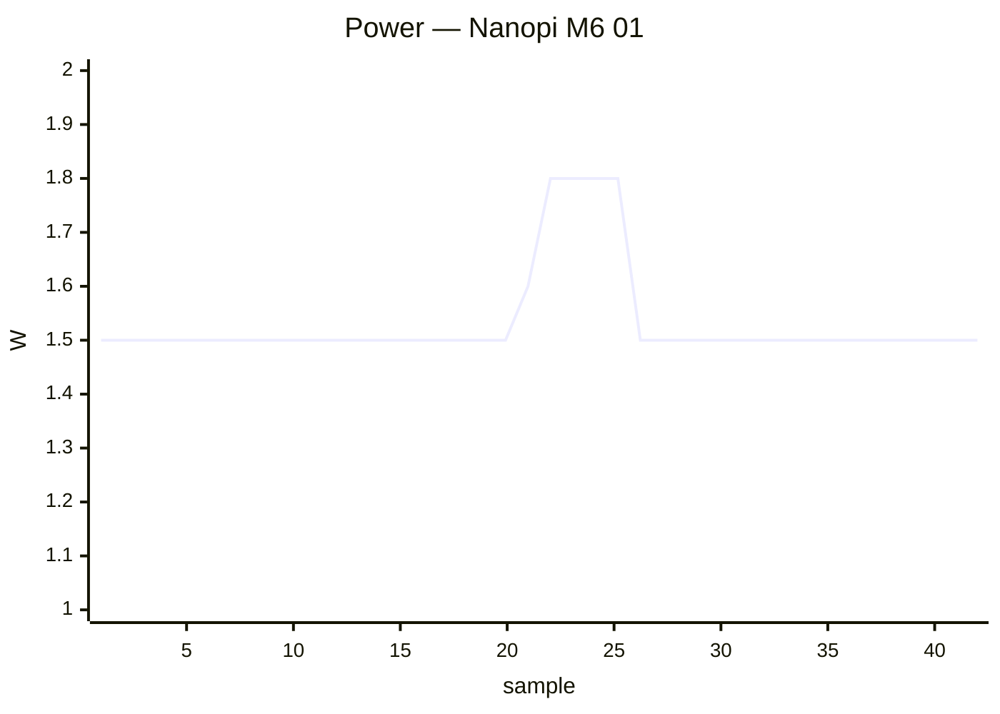

### ❌ Orange Pi Prime 01

`orangepiprime` · **inplace** · image `26.11.0-trunk.90` · 0 ✅ · 1 ❌ · 0 ⏭️

| Module | Status | Time | Detail |
|:--|:--:|--:|:--|
| reachable | ❌ | — | ip=10.0.50.68 · reachable=False · port=22 |

### ❌ ROCK 2F 01

`rock-2f` · **inplace** · image `26.8.1` · 8 ✅ · 2 ❌ · 6 ⏭️

| Module | Status | Time | Detail |
|:--|:--:|--:|:--|
| upgrade | ✅ | 867 s | nightly · 26.8.1 → 26.11.0-trunk.81 |
| reboot | ✅ | 13 s | power-cycle |
| kernel-switch | ✅ | 42 s | branch=vendor · family=rk35xx · installed=26.11.0-trunk.81 · boot_image=/boot/vmlinuz-6.1.172-vendor-rk35xx · kernel_before=6.1.115-vendor-rk35xx |
| reboot | ✅ | 43 s | power-cycle · 1/2 boots · up 21 s |
| hw-performance | ✅ | 22 s | AES 814 · mem 5900 · disk W 54 / R 65 MB/s · 57.7 °C · 2016 MHz |
| dvfs | ✅ | 23 s | ondemand · 408–2016 MHz (peak 2016) |
| network-iperf | ✅ | 45 s | wlan0 ↑214/↓274 (Wi-Fi 6) Mbps |
| store-versions | ✅ | 5 s | 26.11.0-trunk.81 · 6.1.172-vendor-rk35xx |
| kernel-switch | ❌ | 814 s | branch=edge · phase=install · dpkg_state=absent |
| reboot | ❌ | 229 s | power-cycle · 0/2 boots |
| hw-perf | ⏭️ | — | board down after reboot/power-cycle |
| dvfs | ⏭️ | — | — |
| net-iperf | ⏭️ | — | board down after reboot/power-cycle |
| store-versions | ⏭️ | — | — |
| kernel-switch | ⏭️ | — | skipped=board down after reboot/power-cycle |
| reboot | ⏭️ | — | reboot |

### ❌ Rock 5B 02

`rock-5b` · **inplace** · image `26.11.0-trunk.83` · 2 ✅ · 1 ❌ · 19 ⏭️

| Module | Status | Time | Detail |
|:--|:--:|--:|:--|
| upgrade | ⏭️ | 11 s | — |
| reboot | ✅ | 166 s | power-cycle · up 129 s |
| kernel-switch | ✅ | 19 s | branch=vendor · family=rk35xx · installed=26.11.0-trunk.90 · boot_image=/boot/vmlinuz-6.1.172-vendor-rk35xx · kernel_before=6.1.172-vendor-rk35xx |
| reboot | ❌ | 306 s | power-cycle · 2/2 boots · up 110 s |
| hw-perf | ⏭️ | — | board down after reboot/power-cycle |
| dvfs | ⏭️ | — | — |
| net-iperf | ⏭️ | — | board down after reboot/power-cycle |
| store-versions | ⏭️ | — | — |
| kernel-switch | ⏭️ | — | skipped=board down after reboot/power-cycle |
| reboot | ⏭️ | — | reboot |
| hw-perf | ⏭️ | — | board down after reboot/power-cycle |
| dvfs | ⏭️ | — | — |
| net-iperf | ⏭️ | — | board down after reboot/power-cycle |
| store-versions | ⏭️ | — | — |
| kernel-switch | ⏭️ | — | skipped=board down after reboot/power-cycle |
| reboot | ⏭️ | — | reboot |
| hw-perf | ⏭️ | — | board down after reboot/power-cycle |
| dvfs | ⏭️ | — | — |
| net-iperf | ⏭️ | — | board down after reboot/power-cycle |
| store-versions | ⏭️ | — | — |
| kernel-switch | ⏭️ | — | skipped=board down after reboot/power-cycle |
| reboot | ⏭️ | — | reboot |

**Power** — min 0.6 W · avg 3.8 W · peak 9.4 W · 331 samples

```mermaid
xychart-beta
    title "Power — Rock 5B 02"
    x-axis "sample" 1 --> 331
    y-axis "W" 0.5 --> 9.5
    line [4.5, 4.2, 3.2, 3.1, 4.2, 5.0, 3.4, 3.3, 3.3, 3.3, 3.3, 3.3, 3.6, 3.3, 4.3, 4.8, 4.1, 4.2, 4.5, 3.4, 3.4, 3.3, 3.3, 3.3, 3.3, 3.5, 3.4, 3.3, 3.3, 3.3, 3.5, 4.0, 5.0, 4.1, 4.0, 3.9, 3.9, 3.9, 3.9, 4.1]
```

### ❌ SpacemiT MusePi Pro 01

`musepipro` · **inplace** · image `26.11.0-trunk.89` · 0 ✅ · 1 ❌ · 0 ⏭️

| Module | Status | Time | Detail |
|:--|:--:|--:|:--|
| reachable | ❌ | — | ip=10.0.50.24 · reachable=False · port=22 |

**Power** — min 2.6 W · avg 2.7 W · peak 2.7 W · 43 samples

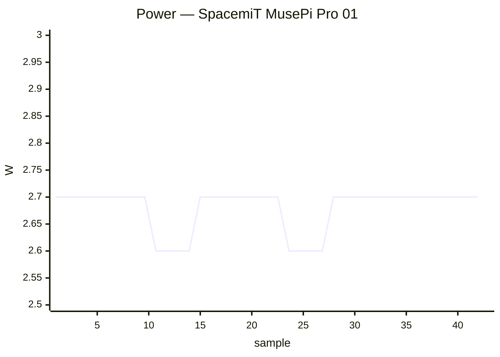

## ✅ Passed (64)

### ✅ Arduino UNO Q 01

`arduino-uno-q` · **inplace** · image `26.11.0-trunk.89` · 8 ✅ · 0 ❌ · 0 ⏭️

| Module | Status | Time | Detail |
|:--|:--:|--:|:--|
| upgrade | ✅ | 283 s | nightly · 26.11.0-trunk.89 → 26.11.0-trunk.90 |
| reboot | ✅ | 73 s | power-cycle · up 38 s |
| kernel-switch | ✅ | 44 s | branch=edge · family=qrb2210 · installed=26.11.0-trunk.90 · boot_image=? · kernel_before=7.2.3-edge-qrb2210 |
| reboot | ✅ | 124 s | power-cycle · 2/2 boots · up 38 s |
| hw-performance | ✅ | 26 s | AES 940 · mem 5100 · disk W 185 / R 262 MB/s · 38.4 °C · 2016 MHz |
| dvfs | ✅ | 31 s | schedutil · 300–2016 MHz (peak 2016) |
| network-iperf | ✅ | 276 s | wlan0 ↑26/↓7 (Wi-Fi 5) · usb0 ↑?/↓? Mbps |
| store-versions | ✅ | 7 s | 26.11.0-trunk.90 · 7.2.3-edge-qrb2210 |

### ✅ Banana Pi CM4IO 01

`bananapicm4io` · **inplace** · image `26.11.0-trunk.83` · 16 ✅ · 0 ❌ · 0 ⏭️

| Module | Status | Time | Detail |
|:--|:--:|--:|:--|
| upgrade | ✅ | 34 s | nightly · 26.11.0-trunk.90 → 26.11.0-trunk.90 |
| reboot | ✅ | 62 s | power-cycle · up 25 s |
| kernel-switch | ✅ | 31 s | branch=current · family=meson64 · installed=26.11.0-trunk.90 · boot_image=/boot/vmlinuz-6.18.56-current-meson64 · kernel_before=6.18.56-current-meson64 |
| reboot | ✅ | 84 s | power-cycle · 2/2 boots · up 27 s |
| hw-performance | ✅ | 32 s | AES 1362 · mem 6100 · disk W 9 / R 22 MB/s · 58.9 °C · 2016 MHz |
| dvfs | ✅ | 15 s | performance · 1000–2016 MHz (peak 2400) |
| network-iperf | ✅ | 81 s | end0 ↑936/↓940 (1GE) · wlan0 ↑43/↓36 (Wi-Fi 5) Mbps |
| store-versions | ✅ | 3 s | 26.11.0-trunk.90 · 6.18.56-current-meson64 |
| kernel-switch | ✅ | 120 s | branch=edge · family=meson64 · installed=26.11.0-trunk.90 · boot_image=/boot/vmlinuz-7.3.0-rc6-edge-meson64 · kernel_before=6.18.56-current-meson64 |
| reboot | ✅ | 82 s | power-cycle · 2/2 boots · up 25 s |
| hw-performance | ✅ | 33 s | AES 1365 · mem 6200 · disk W 8 / R 22 MB/s · 60.1 °C · 2016 MHz |
| dvfs | ✅ | 17 s | performance · 1000–2016 MHz (peak 2400) |
| network-iperf | ✅ | 106 s | end0 ↑938/↓941 (1GE) · wlan0 ↑34/↓22 (Wi-Fi 5) Mbps |
| store-versions | ✅ | 4 s | 26.11.0-trunk.90 · 7.3.0-rc6-edge-meson64 |
| kernel-switch | ✅ | 117 s | branch=current · family=meson64 · installed=26.11.0-trunk.90 · boot_image=/boot/vmlinuz-6.18.56-current-meson64 · kernel_before=7.3.0-rc6-edge-meson64 |
| reboot | ✅ | 53 s | power-cycle · up 25 s |

**Power** — min 1.9 W · avg 4.6 W · peak 10.8 W · 690 samples

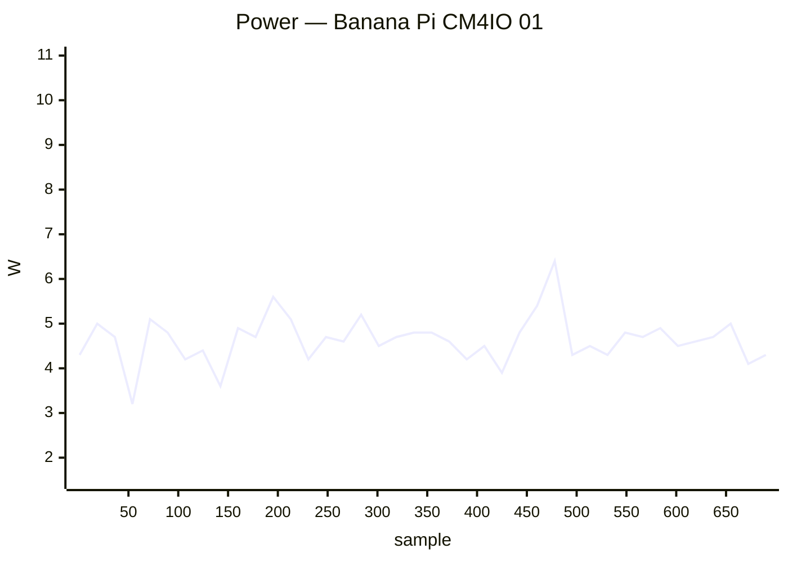

### ✅ Banana Pi M2 Ultra 01

`bananapim2ultra` · **inplace** · image `26.11.0-trunk.83` · 16 ✅ · 0 ❌ · 0 ⏭️

| Module | Status | Time | Detail |
|:--|:--:|--:|:--|
| upgrade | ✅ | 104 s | nightly · 26.11.0-trunk.90 → 26.11.0-trunk.90 |
| reboot | ✅ | 46 s | warm · up 26 s |
| kernel-switch | ✅ | 69 s | branch=current · family=sunxi · installed=26.11.0-trunk.90 · boot_image=/boot/vmlinuz-6.18.56-current-sunxi · kernel_before=6.18.56-current-sunxi |
| reboot | ✅ | 85 s | warm · 2/2 boots · up 28 s |
| hw-performance | ✅ | 39 s | AES 23 · mem 2100 · disk W 11 / R 42 MB/s · 50.6 °C · 1200 MHz |
| dvfs | ✅ | 34 s | ondemand · 720–1200 MHz (peak 1200) |
| network-iperf | ✅ | 110 s | end0 ↑807/↓941 (1GE) · wlan0 ↑21/↓33 (Wi-Fi 4) Mbps |
| store-versions | ✅ | 8 s | 26.11.0-trunk.90 · 6.18.56-current-sunxi |
| kernel-switch | ✅ | 187 s | branch=edge · family=sunxi · installed=26.11.0-trunk.90 · boot_image=/boot/vmlinuz-7.2.10-edge-sunxi · kernel_before=6.18.56-current-sunxi |
| reboot | ✅ | 80 s | warm · 2/2 boots · up 25 s |
| hw-performance | ✅ | 38 s | AES 23 · mem 2100 · disk W 13 / R 42 MB/s · 51.1 °C · 1200 MHz |
| dvfs | ✅ | 37 s | ondemand · 720–1200 MHz (peak 1200) |
| network-iperf | ✅ | 115 s | end0 ↑805/↓933 (1GE) · wlan0 ↑25/↓37 (Wi-Fi 4) Mbps |
| store-versions | ✅ | 8 s | 26.11.0-trunk.90 · 7.2.10-edge-sunxi |
| kernel-switch | ✅ | 194 s | branch=current · family=sunxi · installed=26.11.0-trunk.90 · boot_image=/boot/vmlinuz-6.18.56-current-sunxi · kernel_before=7.2.10-edge-sunxi |
| reboot | ✅ | 44 s | warm · up 25 s |

### ✅ Banana Pi M2Pro 01

`bananapim2pro` · **inplace** · image `26.11.0-trunk.75` · 16 ✅ · 0 ❌ · 0 ⏭️

| Module | Status | Time | Detail |
|:--|:--:|--:|:--|
| upgrade | ✅ | 46 s | nightly · 26.11.0-trunk.90 → 26.11.0-trunk.90 |
| reboot | ✅ | 141 s | power-cycle · up 103 s |
| kernel-switch | ✅ | 30 s | branch=current · family=meson64 · installed=26.11.0-trunk.90 · boot_image=/boot/vmlinuz-6.18.56-current-meson64 · kernel_before=6.18.56-current-meson64 |
| reboot | ✅ | 249 s | power-cycle · 2/2 boots · up 103 s |
| hw-performance | ✅ | 20 s | AES 981 · mem 5300 · disk W 40 / R 158 MB/s · 47.4 °C · 2100 MHz |
| dvfs | ✅ | 19 s | ondemand · 1000–2100 MHz (peak 2100) |
| network-iperf | ✅ | 264 s | end0 ↑940/↓941 (1GE) Mbps |
| store-versions | ✅ | 4 s | 26.11.0-trunk.90 · 6.18.56-current-meson64 |
| kernel-switch | ✅ | 95 s | branch=edge · family=meson64 · installed=26.11.0-trunk.90 · boot_image=/boot/vmlinuz-7.3.0-rc6-edge-meson64 · kernel_before=6.18.56-current-meson64 |
| reboot | ✅ | 247 s | power-cycle · 2/2 boots · up 102 s |
| hw-performance | ✅ | 20 s | AES 981 · mem 5300 · disk W 38 / R 149 MB/s · 49.3 °C · 2100 MHz |
| dvfs | ✅ | 22 s | ondemand · 1000–2100 MHz (peak 2100) |
| network-iperf | ✅ | 121 s | end0 ↑940/↓941 (1GE) Mbps |
| store-versions | ✅ | 4 s | 26.11.0-trunk.90 · 7.3.0-rc6-edge-meson64 |
| kernel-switch | ✅ | 94 s | branch=current · family=meson64 · installed=26.11.0-trunk.90 · boot_image=/boot/vmlinuz-6.18.56-current-meson64 · kernel_before=7.3.0-rc6-edge-meson64 |
| reboot | ✅ | 143 s | power-cycle · up 105 s |

**Power** — min 1.4 W · avg 2.9 W · peak 5.0 W · 1210 samples

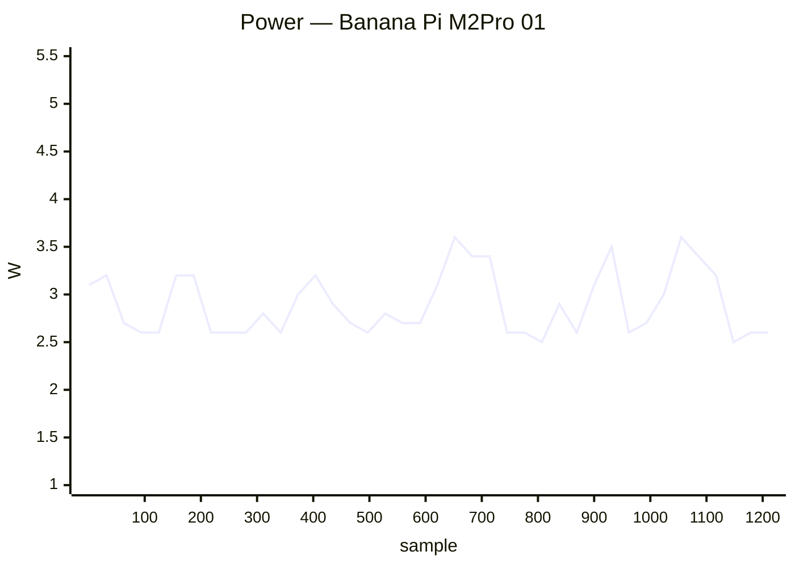

### ✅ Banana Pi M5 01

`bananapim5` · **inplace** · image `26.11.0-trunk.75` · 16 ✅ · 0 ❌ · 0 ⏭️

| Module | Status | Time | Detail |
|:--|:--:|--:|:--|
| upgrade | ✅ | 62 s | nightly · 26.11.0-trunk.90 → 26.11.0-trunk.90 |
| reboot | ✅ | 165 s | warm · up 149 s |
| kernel-switch | ✅ | 41 s | branch=current · family=meson64 · installed=26.11.0-trunk.90 · boot_image=/boot/vmlinuz-6.18.56-current-meson64 · kernel_before=6.18.56-current-meson64 |
| reboot | ✅ | 318 s | warm · 2/2 boots · up 145 s |
| hw-performance | ✅ | 37 s | AES 980 · mem 5200 · disk W 10 / R 16 MB/s · 52.8 °C · 2100 MHz |
| dvfs | ✅ | 21 s | ondemand · 1000–2100 MHz (peak 2100) |
| network-iperf | ✅ | 186 s | end0 ↑940/↓941 (1GE) · wlx000f13960190 ↑21/↓28 (Wi-Fi 4) Mbps |
| store-versions | ✅ | 5 s | 26.11.0-trunk.90 · 6.18.56-current-meson64 |
| kernel-switch | ✅ | 165 s | branch=edge · family=meson64 · installed=26.11.0-trunk.90 · boot_image=/boot/vmlinuz-7.3.0-rc6-edge-meson64 · kernel_before=6.18.56-current-meson64 |
| reboot | ✅ | 104 s | warm · 2/2 boots · up 24 s |
| hw-performance | ✅ | 38 s | AES 979 · mem 5200 · disk W 1 / R 15 MB/s · 55.9 °C · 2100 MHz |
| dvfs | ✅ | 24 s | ondemand · 1000–2100 MHz (peak 2100) |
| network-iperf | ✅ | 64 s | end0 ↑940/↓941 (1GE) · wlx000f13960190 ↑22/↓19 (Wi-Fi 4) Mbps |
| store-versions | ✅ | 5 s | 26.11.0-trunk.90 · 7.3.0-rc6-edge-meson64 |
| kernel-switch | ✅ | 166 s | branch=current · family=meson64 · installed=26.11.0-trunk.90 · boot_image=/boot/vmlinuz-6.18.56-current-meson64 · kernel_before=7.3.0-rc6-edge-meson64 |
| reboot | ✅ | 131 s | warm · up 114 s |

### ✅ Banana Pi M7 01

`bananapim7` · **inplace** · image `26.11.0-trunk.90` · 22 ✅ · 0 ❌ · 0 ⏭️

| Module | Status | Time | Detail |
|:--|:--:|--:|:--|
| upgrade | ✅ | 26 s | nightly · 26.11.0-trunk.90 → 26.11.0-trunk.90 |
| reboot | ✅ | 57 s | power-cycle · up 20 s |
| kernel-switch | ✅ | 19 s | branch=vendor · family=rk35xx · installed=26.11.0-trunk.90 · boot_image=/boot/vmlinuz-6.1.172-vendor-rk35xx · kernel_before=6.1.172-vendor-rk35xx |
| reboot | ✅ | 71 s | power-cycle · 2/2 boots · up 17 s |
| hw-performance | ✅ | 14 s | AES 1258 · mem 13700 · disk W 832 / R 1083 MB/s · 60.1 °C · 1800 MHz |
| dvfs | ✅ | 17 s | ondemand · 1800–1800 MHz (peak 2256) |
| network-iperf | ✅ | 51 s | enP2p33s0 ↑2352/↓2267 (2.5GE) · enP4p65s0 ↑2348/↓2345 (2.5GE) Mbps |
| store-versions | ✅ | 4 s | 26.11.0-trunk.90 · 6.1.172-vendor-rk35xx |
| kernel-switch | ✅ | 47 s | branch=current · family=rockchip64 · installed=26.11.0-trunk.90 · boot_image=/boot/vmlinuz-6.18.56-current-rockchip64 · kernel_before=6.1.172-vendor-rk35xx |
| reboot | ✅ | 239 s | power-cycle · 2/2 boots · up 100 s |
| hw-performance | ✅ | 14 s | AES 1255 · mem 7500 · disk W 919 / R 1587 MB/s · 64.7 °C · 1800 MHz |
| dvfs | ✅ | 15 s | ondemand · 408–1800 MHz (peak 2400) |
| network-iperf | ✅ | 237 s | enP2p33s0 ↑2353/↓2354 (2.5GE) · enP4p65s0 ↑2297/↓1866 (2.5GE) Mbps |
| store-versions | ✅ | 4 s | 26.11.0-trunk.90 · 6.18.56-current-rockchip64 |
| kernel-switch | ✅ | 46 s | branch=edge · family=rockchip64 · installed=26.11.0-trunk.90 · boot_image=/boot/vmlinuz-7.3.0-rc6-edge-rockchip64 · kernel_before=6.18.56-current-rockchip64 |
| reboot | ✅ | 234 s | power-cycle · 2/2 boots · up 101 s |
| hw-performance | ✅ | 14 s | AES 1251 · mem 5000 · disk W 916 / R 1558 MB/s · 69.3 °C · 1800 MHz |
| dvfs | ✅ | 17 s | ondemand · 408–1800 MHz (peak 2400) |
| network-iperf | ✅ | 105 s | enP2p33s0 ↑2353/↓2353 (2.5GE) · enP4p65s0 ↑319/↓2321 (2.5GE) Mbps |
| store-versions | ✅ | 4 s | 26.11.0-trunk.90 · 7.3.0-rc6-edge-rockchip64 |
| kernel-switch | ✅ | 42 s | branch=vendor · family=rk35xx · installed=26.11.0-trunk.90 · boot_image=/boot/vmlinuz-6.1.172-vendor-rk35xx · kernel_before=7.3.0-rc6-edge-rockchip64 |
| reboot | ✅ | 52 s | power-cycle · up 15 s |

**Power** — min 0.6 W · avg 7.0 W · peak 13.7 W · 867 samples

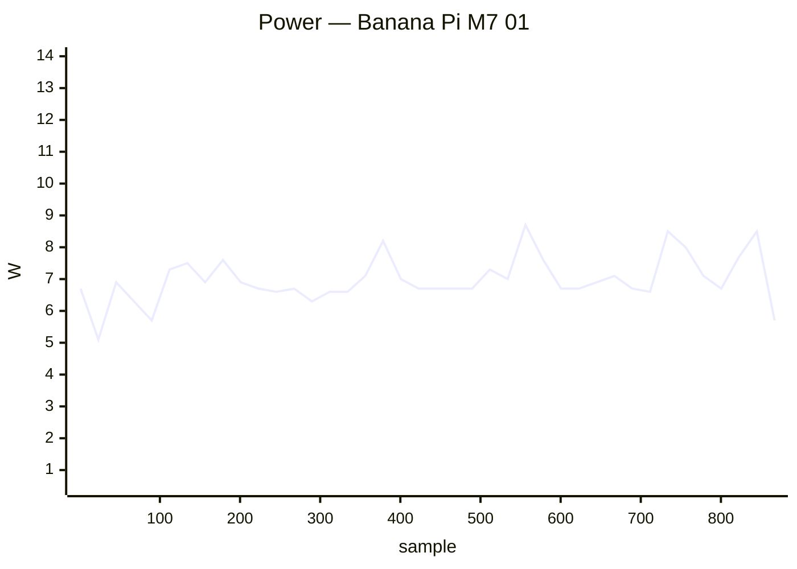

### ✅ Banana Pi R2 01

`bananapir2` · **inplace** · image `26.11.0-trunk.88` · 16 ✅ · 0 ❌ · 0 ⏭️

| Module | Status | Time | Detail |
|:--|:--:|--:|:--|
| upgrade | ✅ | 261 s | nightly · 26.11.0-trunk.88 → 26.11.0-trunk.90 |
| reboot | ✅ | 75 s | power-cycle · up 35 s |
| kernel-switch | ✅ | 61 s | branch=current · family=mt7623 · installed=26.11.0-trunk.90 · boot_image=/boot/vmlinuz-6.18.56-current-mt7623 · kernel_before=6.18.56-current-mt7623 |
| reboot | ✅ | 115 s | power-cycle · 2/2 boots · up 35 s |
| hw-performance | ✅ | 44 s | AES 25 · mem 1600 · disk W 18 / R 22 MB/s · 49.2 °C · 1300 MHz |
| dvfs | ✅ | 40 s | ondemand · 98–1300 MHz (peak 1300) |
| network-iperf | ✅ | 315 s | lan2 ↑938/↓924 Mbps |
| store-versions | ✅ | 9 s | 26.11.0-trunk.90 · 6.18.56-current-mt7623 |
| kernel-switch | ✅ | 139 s | branch=edge · family=mt7623 · installed=26.11.0-trunk.90 · boot_image=/boot/vmlinuz-7.2.10-edge-mt7623 · kernel_before=6.18.56-current-mt7623 |
| reboot | ✅ | 115 s | power-cycle · 2/2 boots · up 36 s |
| hw-performance | ✅ | 44 s | AES 25 · mem 1600 · disk W 20 / R 22 MB/s · 51.1 °C · 1300 MHz |
| dvfs | ✅ | 43 s | ondemand · 98–1300 MHz (peak 1300) |
| network-iperf | ✅ | 53 s | lan2 ↑915/↓929 Mbps |
| store-versions | ✅ | 9 s | 26.11.0-trunk.90 · 7.2.10-edge-mt7623 |
| kernel-switch | ✅ | 140 s | branch=current · family=mt7623 · installed=26.11.0-trunk.90 · boot_image=/boot/vmlinuz-6.18.56-current-mt7623 · kernel_before=7.2.10-edge-mt7623 |
| reboot | ✅ | 78 s | power-cycle · up 38 s |

**Power** — min 2.0 W · avg 5.1 W · peak 6.5 W · 1233 samples


### ✅ Banana Pi R3 Mini 01

`bananapir3mini` · **inplace** · image `26.11.0-trunk` · 4 ✅ · 0 ❌ · 2 ⏭️

| Module | Status | Time | Detail |
|:--|:--:|--:|:--|
| upgrade | ⏭️ | 19 s | — |
| reboot | ✅ | 74 s | power-cycle · up 37 s |
| hw-performance | ✅ | 20 s | AES 935 · mem 3200 · disk W 77 / R 91 MB/s · 73.8 °C · None MHz |
| dvfs | ➖ | 2 s | no cpufreq |
| network-iperf | ✅ | 306 s | eth0 ↑2353/↓2356 (2.5GE) · eth1 ↑2353/↓2272 (2.5GE) · wlan0 ↑5/↓24 (Wi-Fi 6) · wlan1 ↑401/↓213 (Wi-Fi 6) Mbps |
| store-versions | ✅ | 6 s | 26.11.0-trunk · 6.18.52-current-filogic-mt7986 |

**Power** — min 1.8 W · avg 8.3 W · peak 13.7 W · 291 samples

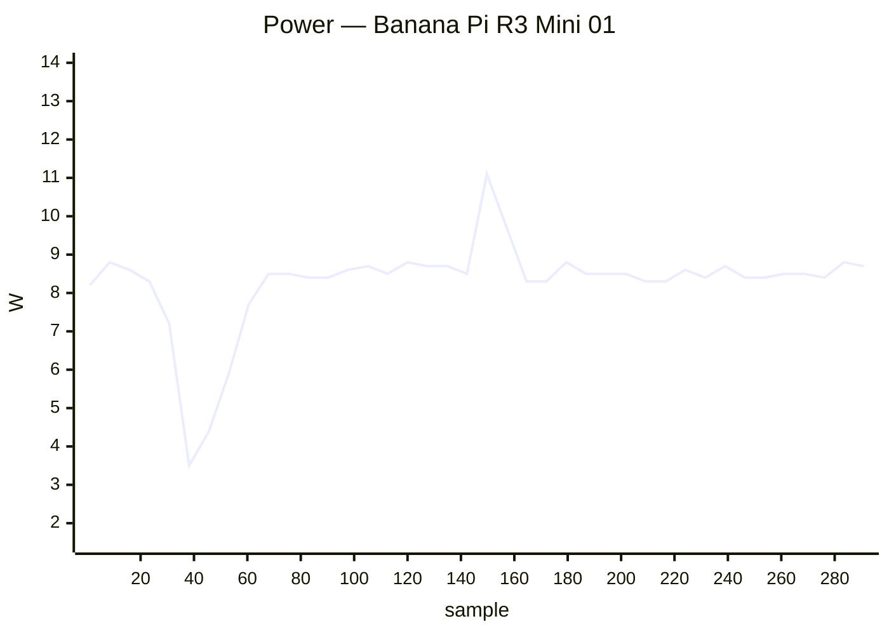

### ✅ Banana Pi R4 01

`bananapir4` · **inplace** · image `26.11.0-trunk.83` · 8 ✅ · 0 ❌ · 0 ⏭️

| Module | Status | Time | Detail |
|:--|:--:|--:|:--|
| upgrade | ✅ | 159 s | nightly · 26.11.0-trunk.83 → 26.11.0-trunk.90 |
| reboot | ✅ | 47 s | power-cycle · up 20 s |
| kernel-switch | ✅ | 31 s | branch=current · family=filogic · installed=26.11.0-trunk.90 · boot_image=/boot/vmlinuz-6.12.108-current-filogic · kernel_before=6.12.108-current-filogic |
| reboot | ✅ | 78 s | power-cycle · 2/2 boots · up 17 s |
| hw-performance | ✅ | 27 s | AES 1024 · mem 6200 · disk W 20 / R 22 MB/s · 39.2 °C · 1800 MHz |
| dvfs | ✅ | 19 s | schedutil · 800–1800 MHz (peak 1800) |
| network-iperf | ✅ | 170 s | eth2 ↑7647/↓5286 (10GE) · lan2 ↑941/↓941 (1GE) Mbps |
| store-versions | ✅ | 4 s | 26.11.0-trunk.90 · 6.12.108-current-filogic |

### ✅ BananaPi BPI-F3 01

`musepipro` · **inplace** · image `26.11.0-trunk.83` · 6 ✅ · 0 ❌ · 0 ⏭️

| Module | Status | Time | Detail |
|:--|:--:|--:|:--|
| upgrade | ✅ | 74 s | nightly · 26.11.0-trunk.90 → 26.11.0-trunk.90 |
| reboot | ✅ | 57 s | power-cycle · up 19 s |
| hw-performance | ✅ | 25 s | AES 27 · mem 3000 · disk W 35 / R 82 MB/s · 46 °C · 1600 MHz |
| dvfs | ✅ | 24 s | performance · 614–1600 MHz (peak 1600) |
| network-iperf | ✅ | 223 s | eth0 ↑941/↓941 (1GE) · wlan0 ↑239/↓202 (Wi-Fi 6) · wlan1 ↑229/↓242 (Wi-Fi 5) Mbps |
| store-versions | ✅ | 5 s | 26.11.0-trunk.90 · 6.18.56-current-spacemit |

**Power** — min 3.6 W · avg 5.2 W · peak 8.0 W · 323 samples

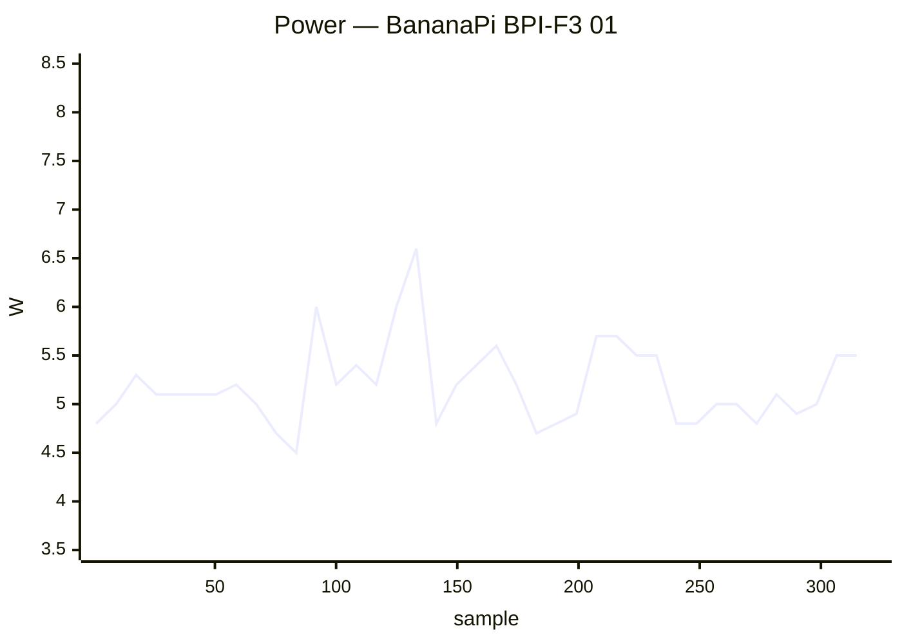

### ✅ BananaPi BPI-M4-Zero 01

`bananapim4zero` · **inplace** · image `26.11.0-trunk.74` · 8 ✅ · 0 ❌ · 0 ⏭️

| Module | Status | Time | Detail |
|:--|:--:|--:|:--|
| upgrade | ✅ | 120 s | nightly · 26.11.0-trunk.74 → 26.11.0-trunk.74 |
| reboot | ✅ | 75 s | power-cycle · up 24 s |
| kernel-switch | ✅ | 51 s | branch=current · family=sunxi64 · installed=26.11.0-trunk.74 · boot_image=/boot/vmlinuz-6.18.55-current-sunxi64 · kernel_before=6.18.55-current-sunxi64 |
| reboot | ✅ | 407 s | power-cycle · 1/2 boots · up 33 s |
| hw-performance | ✅ | 33 s | AES 652 · mem 3600 · disk W 13 / R 22 MB/s · 54.1 °C · 1416 MHz |
| dvfs | ✅ | 42 s | ondemand · 480–1416 MHz (peak 1416) |
| network-iperf | ✅ | 66 s | wlan0 ↑83/↓102 (Wi-Fi 5) Mbps |
| store-versions | ✅ | 6 s | 26.11.0-trunk.74 · 6.18.55-current-sunxi64 |

### ✅ Cubie A5E 01

`radxa-cubie-a5e` · **inplace** · image `26.11.0-trunk.83` · 14 ✅ · 0 ❌ · 2 ⏭️

| Module | Status | Time | Detail |
|:--|:--:|--:|:--|
| upgrade | ✅ | 85 s | nightly · 26.11.0-trunk.90 → 26.11.0-trunk.90 |
| reboot | ✅ | 70 s | power-cycle · up 31 s |
| kernel-switch | ✅ | 56 s | branch=current · family=sunxi64 · installed=26.11.0-trunk.90 · boot_image=? · kernel_before=6.18.56-current-sunxi64 |
| reboot | ✅ | 103 s | power-cycle · 2/2 boots · up 33 s |
| hw-performance | ✅ | 34 s | AES 358 · mem 2000 · disk W 21 / R 23 MB/s · 61.7 °C · None MHz |
| dvfs | ➖ | 3 s | no cpufreq |
| network-iperf | ✅ | 193 s | end0 ↑825/↓939 (1GE) · end1 ↑941/↓940 (1GE) · wlan0 ↑120/↓128 (Wi-Fi 6) Mbps |
| store-versions | ✅ | 6 s | 26.11.0-trunk.90 · 6.18.56-current-sunxi64 |
| kernel-switch | ✅ | 562 s | branch=edge · family=sunxi64 · installed=26.11.0-trunk.90 · boot_image=? · kernel_before=6.18.56-current-sunxi64 |
| reboot | ✅ | 104 s | power-cycle · 2/2 boots · up 32 s |
| hw-performance | ✅ | 34 s | AES 358 · mem 2000 · disk W 21 / R 23 MB/s · 69 °C · None MHz |
| dvfs | ➖ | 3 s | no cpufreq |
| network-iperf | ✅ | 163 s | end0 ↑831/↓941 (1GE) · end1 ↑941/↓940 (1GE) · wlan0 ↑120/↓129 (Wi-Fi 6) Mbps |
| store-versions | ✅ | 6 s | 26.11.0-trunk.90 · 7.2.10-edge-sunxi64 |
| kernel-switch | ✅ | 567 s | branch=current · family=sunxi64 · installed=26.11.0-trunk.90 · boot_image=? · kernel_before=7.2.10-edge-sunxi64 |
| reboot | ✅ | 68 s | power-cycle · up 32 s |

**Power** — min 1.9 W · avg 4.1 W · peak 6.2 W · 1639 samples

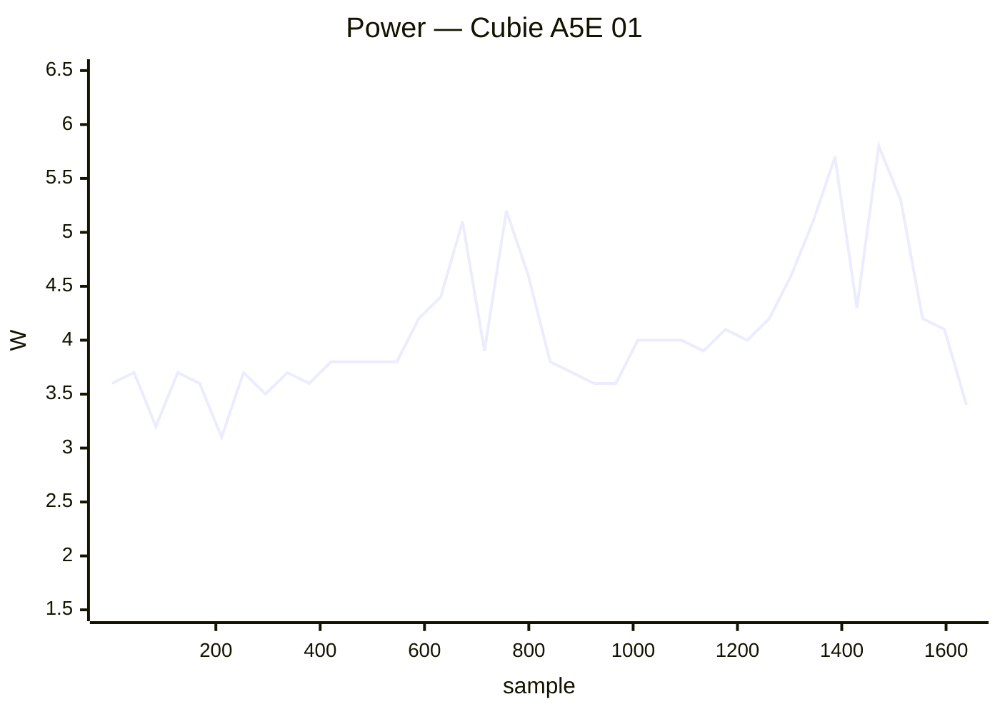

### ✅ Cubietruck 01

`cubietruck` · **inplace** · image `26.11.0-trunk.83` · 16 ✅ · 0 ❌ · 0 ⏭️

| Module | Status | Time | Detail |
|:--|:--:|--:|:--|
| upgrade | ✅ | 142 s | nightly · 26.11.0-trunk.90 → 26.11.0-trunk.90 |
| reboot | ✅ | 67 s | warm · up 42 s |
| kernel-switch | ✅ | 91 s | branch=current · family=sunxi · installed=26.11.0-trunk.90 · boot_image=/boot/vmlinuz-6.18.56-current-sunxi · kernel_before=6.18.56-current-sunxi |
| reboot | ✅ | 124 s | warm · 2/2 boots · up 42 s |
| hw-performance | ✅ | 59 s | AES 18 · mem 1700 · disk W 14 / R 21 MB/s · 49.4 °C · 960 MHz |
| dvfs | ✅ | 56 s | ondemand · 528–960 MHz (peak 960) |
| network-iperf | ✅ | 331 s | end0 ↑724/↓716 (1GE) · wlan0 ↑17/↓20 (Wi-Fi 4) Mbps |
| store-versions | ✅ | 12 s | 26.11.0-trunk.90 · 6.18.56-current-sunxi |
| kernel-switch | ✅ | 228 s | branch=edge · family=sunxi · installed=26.11.0-trunk.90 · boot_image=/boot/vmlinuz-7.2.10-edge-sunxi · kernel_before=6.18.56-current-sunxi |
| reboot | ✅ | 123 s | warm · 2/2 boots · up 41 s |
| hw-performance | ✅ | 58 s | AES 19 · mem 1600 · disk W 13 / R 22 MB/s · 50 °C · 960 MHz |
| dvfs | ✅ | 57 s | ondemand · 528–960 MHz (peak 960) |
| network-iperf | ✅ | 191 s | end0 ↑724/↓891 (1GE) · wlan0 ↑17/↓22 (Wi-Fi 4) Mbps |
| store-versions | ✅ | 12 s | 26.11.0-trunk.90 · 7.2.10-edge-sunxi |
| kernel-switch | ✅ | 223 s | branch=current · family=sunxi · installed=26.11.0-trunk.90 · boot_image=/boot/vmlinuz-6.18.56-current-sunxi · kernel_before=7.2.10-edge-sunxi |
| reboot | ✅ | 66 s | warm · up 43 s |

### ✅ Cubox i2eX/i4 01

`cubox-i` · **inplace** · image `26.11.0-trunk.73` · 16 ✅ · 0 ❌ · 0 ⏭️

| Module | Status | Time | Detail |
|:--|:--:|--:|:--|
| upgrade | ✅ | 634 s | nightly · 26.11.0-trunk.73 → 26.11.0-trunk.74 |
| reboot | ✅ | 88 s | power-cycle · up 48 s |
| kernel-switch | ✅ | 72 s | branch=current · family=imx6 · installed=26.11.0-trunk.74 · boot_image=/boot/vmlinuz-6.18.55-current-imx6 · kernel_before=6.18.55-current-imx6 |
| reboot | ✅ | 162 s | power-cycle · 2/2 boots · up 47 s |
| hw-performance | ✅ | 47 s | AES 26 · mem 782 · disk W 19 / R 20 MB/s · 54.3 °C · 996 MHz |
| dvfs | ✅ | 40 s | ondemand · 396–996 MHz (peak 996) |
| network-iperf | ✅ | 305 s | end0 ↑94/↓94 (10/100ME) · wlan0 ↑18/↓16 (Wi-Fi 4) Mbps |
| store-versions | ✅ | 9 s | 26.11.0-trunk.74 · 6.18.55-current-imx6 |
| kernel-switch | ✅ | 298 s | branch=edge · family=imx6 · installed=26.11.0-trunk.74 · boot_image=/boot/vmlinuz-7.1.13-edge-imx6 · kernel_before=6.18.55-current-imx6 |
| reboot | ✅ | 144 s | power-cycle · 2/2 boots · up 46 s |
| hw-performance | ✅ | 47 s | AES 25 · mem 727 · disk W 19 / R 20 MB/s · 56 °C · 996 MHz |
| dvfs | ✅ | 44 s | ondemand · 396–996 MHz (peak 996) |
| network-iperf | ✅ | 160 s | end0 ↑94/↓94 (10/100ME) · wlan0 ↑17/↓17 (Wi-Fi 4) Mbps |
| store-versions | ✅ | 9 s | 26.11.0-trunk.74 · 7.1.13-edge-imx6 |
| kernel-switch | ✅ | 280 s | branch=current · family=imx6 · installed=26.11.0-trunk.74 · boot_image=/boot/vmlinuz-6.18.55-current-imx6 · kernel_before=7.1.13-edge-imx6 |
| reboot | ✅ | 87 s | power-cycle · up 46 s |

**Power** — min 1.8 W · avg 3.0 W · peak 6.1 W · 1937 samples

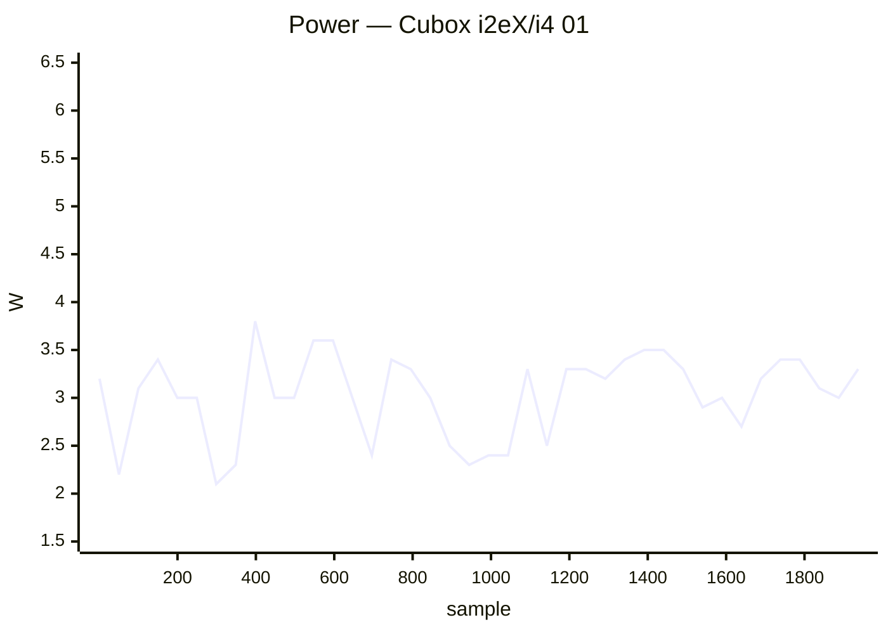

### ✅ Espressobin 01

`espressobin` · **inplace** · image `26.11.0-trunk.89` · 16 ✅ · 0 ❌ · 0 ⏭️

| Module | Status | Time | Detail |
|:--|:--:|--:|:--|
| upgrade | ✅ | 114 s | nightly · 26.11.0-trunk.90 → 26.11.0-trunk.90 |
| reboot | ✅ | 76 s | power-cycle · up 42 s |
| kernel-switch | ✅ | 334 s | branch=current · family=mvebu64 · installed=26.11.0-trunk.90 · boot_image=/boot/vmlinuz-6.18.56-current-mvebu64 · kernel_before=7.1.13-edge-mvebu64 |
| reboot | ✅ | 135 s | power-cycle · 2/2 boots · up 45 s |
| hw-performance | ✅ | 38 s | AES 371 · mem 2000 · disk W 9 / R 129 MB/s · None °C · 800 MHz |
| dvfs | ✅ | 35 s | ondemand · 200–800 MHz (peak 800) |
| network-iperf | ✅ | 111 s | lan0 ↑935/↓750 (1GE) Mbps |
| store-versions | ✅ | 7 s | 26.11.0-trunk.90 · 6.18.56-current-mvebu64 |
| kernel-switch | ✅ | 342 s | branch=edge · family=mvebu64 · installed=26.11.0-trunk.90 · boot_image=/boot/vmlinuz-7.1.13-edge-mvebu64 · kernel_before=6.18.56-current-mvebu64 |
| reboot | ✅ | 136 s | power-cycle · 2/2 boots · up 46 s |
| hw-performance | ✅ | 37 s | AES 370 · mem 2000 · disk W 10 / R 138 MB/s · None °C · 800 MHz |
| dvfs | ✅ | 35 s | ondemand · 200–800 MHz (peak 800) |
| network-iperf | ✅ | 108 s | lan0 ↑936/↓823 (1GE) Mbps |
| store-versions | ✅ | 8 s | 26.11.0-trunk.90 · 7.1.13-edge-mvebu64 |
| kernel-switch | ✅ | 345 s | branch=current · family=mvebu64 · installed=26.11.0-trunk.90 · boot_image=/boot/vmlinuz-6.18.56-current-mvebu64 · kernel_before=7.1.13-edge-mvebu64 |
| reboot | ✅ | 81 s | power-cycle · up 43 s |

### ✅ Helios4 01

`helios4` · **inplace** · image `26.11.0-trunk.89` · 14 ✅ · 0 ❌ · 2 ⏭️

| Module | Status | Time | Detail |
|:--|:--:|--:|:--|
| upgrade | ✅ | 55 s | nightly · 26.11.0-trunk.90 → 26.11.0-trunk.90 |
| reboot | ✅ | 119 s | warm · up 102 s |
| kernel-switch | ✅ | 34 s | branch=current · family=mvebu · installed=26.11.0-trunk.90 · boot_image=/boot/vmlinuz-6.18.56-current-mvebu · kernel_before=6.18.56-current-mvebu |
| reboot | ✅ | 233 s | warm · 2/2 boots · up 102 s |
| hw-performance | ✅ | 30 s | AES 43 · mem 3800 · disk W 21 / R 23 MB/s · 56.1 °C · None MHz |
| dvfs | ➖ | 2 s | no cpufreq |
| network-iperf | ✅ | 64 s | end1 ↑941/↓941 (1GE) Mbps |
| store-versions | ✅ | 5 s | 26.11.0-trunk.90 · 6.18.56-current-mvebu |
| kernel-switch | ✅ | 94 s | branch=edge · family=mvebu · installed=26.11.0-trunk.90 · boot_image=/boot/vmlinuz-7.2.10-edge-mvebu · kernel_before=6.18.56-current-mvebu |
| reboot | ✅ | 232 s | warm · 2/2 boots · up 101 s |
| hw-performance | ✅ | 30 s | AES 43 · mem 3800 · disk W 21 / R 22 MB/s · 57.5 °C · None MHz |
| dvfs | ➖ | 2 s | no cpufreq |
| network-iperf | ✅ | 64 s | end1 ↑941/↓942 (1GE) Mbps |
| store-versions | ✅ | 5 s | 26.11.0-trunk.90 · 7.2.10-edge-mvebu |
| kernel-switch | ✅ | 93 s | branch=current · family=mvebu · installed=26.11.0-trunk.90 · boot_image=/boot/vmlinuz-6.18.56-current-mvebu · kernel_before=7.2.10-edge-mvebu |
| reboot | ✅ | 119 s | warm · up 103 s |

### ✅ Inovato Quadra 01

`inovato-quadra` · **inplace** · image `26.11.0-trunk.90` · 16 ✅ · 0 ❌ · 0 ⏭️

| Module | Status | Time | Detail |
|:--|:--:|--:|:--|
| upgrade | ✅ | 58 s | nightly · 26.11.0-trunk.90 → 26.11.0-trunk.90 |
| reboot | ✅ | 58 s | power-cycle · up 22 s |
| kernel-switch | ✅ | 39 s | branch=current · family=sunxi64 · installed=26.11.0-trunk.90 · boot_image=/boot/vmlinuz-6.18.56-current-sunxi64 · kernel_before=6.18.56-current-sunxi64 |
| reboot | ✅ | 87 s | power-cycle · 2/2 boots · up 21 s |
| hw-performance | ✅ | 31 s | AES 794 · mem 2800 · disk W 11 / R 23 MB/s · 64 °C · 1704 MHz |
| dvfs | ✅ | 21 s | ondemand · 480–1704 MHz (peak 1704) |
| network-iperf | ✅ | 271 s | eth0 ↑94/↓94 (10/100ME) · wlan0 ↑10/↓20 (Wi-Fi 4) Mbps |
| store-versions | ✅ | 4 s | 26.11.0-trunk.90 · 6.18.56-current-sunxi64 |
| kernel-switch | ✅ | 112 s | branch=edge · family=sunxi64 · installed=26.11.0-trunk.90 · boot_image=/boot/vmlinuz-7.2.10-edge-sunxi64 · kernel_before=6.18.56-current-sunxi64 |
| reboot | ✅ | 86 s | power-cycle · 2/2 boots · up 21 s |
| hw-performance | ✅ | 31 s | AES 794 · mem 2800 · disk W 22 / R 2 MB/s · 65.7 °C · 1704 MHz |
| dvfs | ✅ | 22 s | ondemand · 480–1704 MHz (peak 1704) |
| network-iperf | ✅ | 271 s | eth0 ↑94/↓94 (10/100ME) · wlan0 ↑7/↓23 (Wi-Fi 4) Mbps |
| store-versions | ✅ | 5 s | 26.11.0-trunk.90 · 7.2.10-edge-sunxi64 |
| kernel-switch | ✅ | 110 s | branch=current · family=sunxi64 · installed=26.11.0-trunk.90 · boot_image=/boot/vmlinuz-6.18.56-current-sunxi64 · kernel_before=7.2.10-edge-sunxi64 |
| reboot | ✅ | 60 s | power-cycle · up 22 s |

**Power** — min 2.1 W · avg 3.8 W · peak 6.7 W · 1013 samples

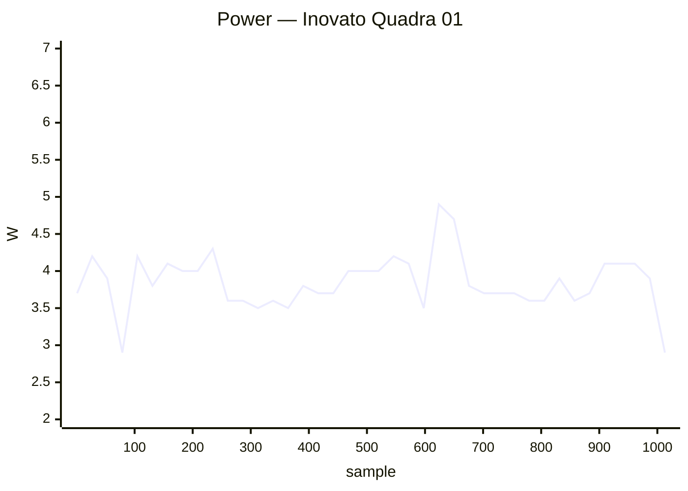

### ✅ Khadas Edge2 01

`khadas-edge2` · **inplace** · image `26.11.0-trunk.83` · 14 ✅ · 0 ❌ · 2 ⏭️

| Module | Status | Time | Detail |
|:--|:--:|--:|:--|
| upgrade | ✅ | 30 s | nightly · 26.11.0-trunk.90 → 26.11.0-trunk.90 |
| reboot | ✅ | 31 s | warm · up 14 s |
| kernel-switch | ✅ | 22 s | branch=vendor · family=rk35xx · installed=26.11.0-trunk.90 · boot_image=/boot/vmlinuz-6.1.172-vendor-rk35xx · kernel_before=6.1.172-vendor-rk35xx |
| reboot | ✅ | 49 s | warm · 2/2 boots · up 10 s |
| hw-performance | ✅ | 15 s | AES 1274 · mem 15000 · disk W 105 / R 261 MB/s · 35.2 °C · 1800 MHz |
| dvfs | ✅ | 18 s | ondemand · 1800–1800 MHz (peak 2256) |
| network-iperf | ⏭️ | 6 s | no cabled interfaces |
| store-versions | ✅ | 4 s | 26.11.0-trunk.90 · 6.1.172-vendor-rk35xx |
| kernel-switch | ✅ | 65 s | branch=current · family=rockchip64 · installed=26.11.0-trunk.90 · boot_image=/boot/vmlinuz-6.18.56-current-rockchip64 · kernel_before=6.1.172-vendor-rk35xx |
| reboot | ✅ | 48 s | warm · 2/2 boots · up 10 s |
| hw-performance | ✅ | 15 s | AES 1271 · mem 11000 · disk W 104 / R 238 MB/s · 37.9 °C · 1800 MHz |
| dvfs | ✅ | 16 s | ondemand · 408–1800 MHz (peak 2400) |
| network-iperf | ⏭️ | 7 s | no cabled interfaces |
| store-versions | ✅ | 5 s | 26.11.0-trunk.90 · 6.18.56-current-rockchip64 |
| kernel-switch | ✅ | 52 s | branch=vendor · family=rk35xx · installed=26.11.0-trunk.90 · boot_image=/boot/vmlinuz-6.1.172-vendor-rk35xx · kernel_before=6.18.56-current-rockchip64 |
| reboot | ✅ | 27 s | warm · up 10 s |

### ✅ Khadas VIM1 01

`khadas-vim1` · **inplace** · image `26.11.0-trunk.83` · 16 ✅ · 0 ❌ · 0 ⏭️

| Module | Status | Time | Detail |
|:--|:--:|--:|:--|
| upgrade | ✅ | 61 s | nightly · 26.11.0-trunk.90 → 26.11.0-trunk.90 |
| reboot | ✅ | 86 s | power-cycle · up 48 s |
| kernel-switch | ✅ | 47 s | branch=current · family=meson64 · installed=26.11.0-trunk.90 · boot_image=/boot/vmlinuz-6.18.56-current-meson64 · kernel_before=6.18.56-current-meson64 |
| reboot | ✅ | 111 s | power-cycle · 2/2 boots · up 36 s |
| hw-performance | ✅ | 30 s | AES 658 · mem 3600 · disk W 19 / R 22 MB/s · 50 °C · 1512 MHz |
| dvfs | ✅ | 23 s | ondemand · 500–1512 MHz (peak 1512) |
| network-iperf | ✅ | 273 s | end0 ↑94/↓94 (10/100ME) · wlan0 ↑35/↓33 (Wi-Fi 5) Mbps |
| store-versions | ✅ | 5 s | 26.11.0-trunk.90 · 6.18.56-current-meson64 |
| kernel-switch | ✅ | 158 s | branch=edge · family=meson64 · installed=26.11.0-trunk.90 · boot_image=/boot/vmlinuz-7.3.0-rc6-edge-meson64 · kernel_before=6.18.56-current-meson64 |
| reboot | ✅ | 120 s | power-cycle · 2/2 boots · up 37 s |
| hw-performance | ✅ | 31 s | AES 657 · mem 3600 · disk W 19 / R 22 MB/s · 51 °C · 1512 MHz |
| dvfs | ✅ | 25 s | ondemand · 500–1512 MHz (peak 1512) |
| network-iperf | ✅ | 96 s | end0 ↑94/↓94 (10/100ME) · wlan0 ↑28/↓29 (Wi-Fi 5) Mbps |
| store-versions | ✅ | 5 s | 26.11.0-trunk.90 · 7.3.0-rc6-edge-meson64 |
| kernel-switch | ✅ | 149 s | branch=current · family=meson64 · installed=26.11.0-trunk.90 · boot_image=/boot/vmlinuz-6.18.56-current-meson64 · kernel_before=7.3.0-rc6-edge-meson64 |
| reboot | ✅ | 73 s | power-cycle · up 34 s |

**Power** — min 1.2 W · avg 2.1 W · peak 3.7 W · 1024 samples

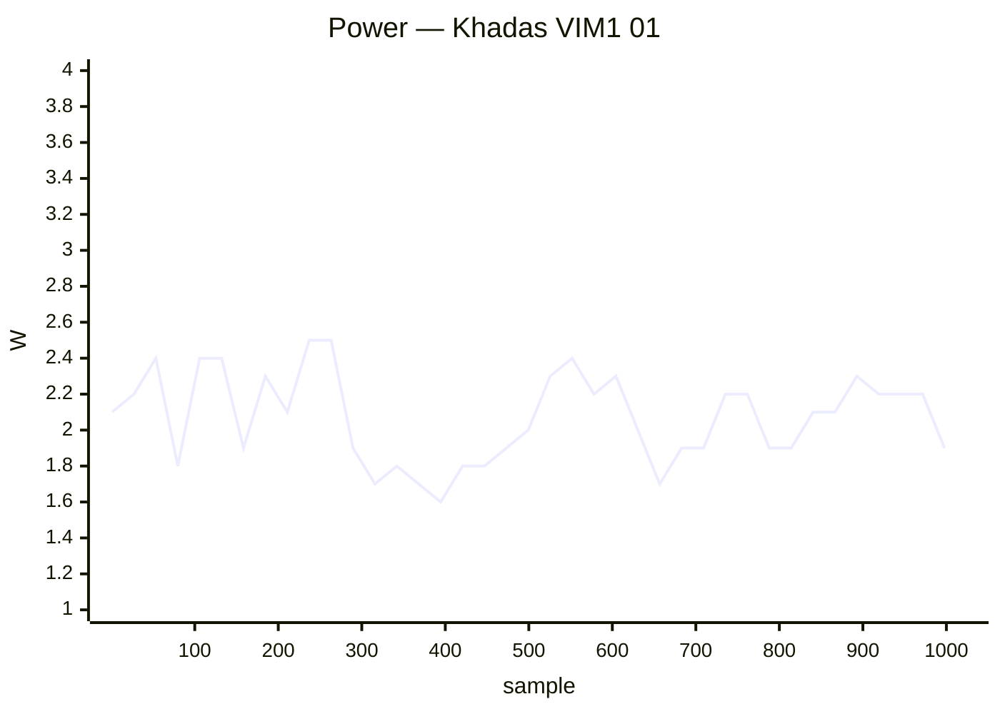

### ✅ Khadas VIM2 01

`khadas-vim2` · **inplace** · image `26.11.0-trunk.83` · 16 ✅ · 0 ❌ · 0 ⏭️

| Module | Status | Time | Detail |
|:--|:--:|--:|:--|
| upgrade | ✅ | 74 s | nightly · 26.11.0-trunk.90 → 26.11.0-trunk.90 |
| reboot | ✅ | 39 s | warm · up 22 s |
| kernel-switch | ✅ | 47 s | branch=current · family=meson64 · installed=26.11.0-trunk.90 · boot_image=/boot/vmlinuz-6.18.56-current-meson64 · kernel_before=6.18.56-current-meson64 |
| reboot | ✅ | 75 s | warm · 2/2 boots · up 25 s |
| hw-performance | ✅ | 24 s | AES 658 · mem 3600 · disk W 43 / R 151 MB/s · 56 °C · 1512 MHz |
| dvfs | ✅ | 25 s | ondemand · 500–1512 MHz (peak 1512) |
| network-iperf | ✅ | 97 s | eth0 ↑941/↓941 (1GE) · wlan0 ↑97/↓91 (Wi-Fi 5) Mbps |
| store-versions | ✅ | 6 s | 26.11.0-trunk.90 · 6.18.56-current-meson64 |
| kernel-switch | ✅ | 147 s | branch=edge · family=meson64 · installed=26.11.0-trunk.90 · boot_image=/boot/vmlinuz-7.3.0-rc6-edge-meson64 · kernel_before=6.18.56-current-meson64 |
| reboot | ✅ | 75 s | warm · 2/2 boots · up 25 s |
| hw-performance | ✅ | 24 s | AES 660 · mem 3500 · disk W 36 / R 138 MB/s · 57 °C · 1512 MHz |
| dvfs | ✅ | 29 s | ondemand · 500–1512 MHz (peak 1512) |
| network-iperf | ✅ | 233 s | eth0 ↑941/↓941 (1GE) · wlan0 ↑92/↓94 (Wi-Fi 5) Mbps |
| store-versions | ✅ | 6 s | 26.11.0-trunk.90 · 7.3.0-rc6-edge-meson64 |
| kernel-switch | ✅ | 146 s | branch=current · family=meson64 · installed=26.11.0-trunk.90 · boot_image=/boot/vmlinuz-6.18.56-current-meson64 · kernel_before=7.3.0-rc6-edge-meson64 |
| reboot | ✅ | 39 s | warm · up 20 s |

### ✅ Khadas VIM3 01

`khadas-vim3` · **inplace** · image `26.11.0-trunk.83` · 16 ✅ · 0 ❌ · 0 ⏭️

| Module | Status | Time | Detail |
|:--|:--:|--:|:--|
| upgrade | ✅ | 37 s | nightly · 26.11.0-trunk.90 → 26.11.0-trunk.90 |
| reboot | ✅ | 31 s | warm · up 16 s |
| kernel-switch | ✅ | 22 s | branch=current · family=meson64 · installed=26.11.0-trunk.90 · boot_image=/boot/vmlinuz-6.18.56-current-meson64 · kernel_before=6.18.56-current-meson64 |
| reboot | ✅ | 59 s | warm · 2/2 boots · up 17 s |
| hw-performance | ✅ | 16 s | AES 852 · mem 3900 · disk W 69 / R 159 MB/s · 59.7 °C · 2016 MHz |
| dvfs | ✅ | 17 s | ondemand · 1000–1512 MHz (peak 1512) |
| network-iperf | ✅ | 256 s | end0 ↑941/↓941 (1GE) · wlan0 ↑44/↓38 (Wi-Fi 5) Mbps |
| store-versions | ✅ | 4 s | 26.11.0-trunk.90 · 6.18.56-current-meson64 |
| kernel-switch | ✅ | 69 s | branch=edge · family=meson64 · installed=26.11.0-trunk.90 · boot_image=/boot/vmlinuz-7.3.0-rc6-edge-meson64 · kernel_before=6.18.56-current-meson64 |
| reboot | ✅ | 58 s | warm · 2/2 boots · up 16 s |
| hw-performance | ✅ | 16 s | AES 852 · mem 3900 · disk W 60 / R 158 MB/s · 60.7 °C · 2016 MHz |
| dvfs | ✅ | 20 s | ondemand · 1000–1512 MHz (peak 1512) |
| network-iperf | ✅ | 84 s | end0 ↑941/↓941 (1GE) · wlan0 ↑43/↓39 (Wi-Fi 5) Mbps |
| store-versions | ✅ | 4 s | 26.11.0-trunk.90 · 7.3.0-rc6-edge-meson64 |
| kernel-switch | ✅ | 67 s | branch=current · family=meson64 · installed=26.11.0-trunk.90 · boot_image=/boot/vmlinuz-6.18.56-current-meson64 · kernel_before=7.3.0-rc6-edge-meson64 |
| reboot | ✅ | 32 s | warm · up 17 s |

### ✅ Mekotronics R58HD 01

`mekotronics-r58hd` · **inplace** · image `26.11.0-trunk.75` · 6 ✅ · 0 ❌ · 0 ⏭️

| Module | Status | Time | Detail |
|:--|:--:|--:|:--|
| upgrade | ✅ | 24 s | nightly · 26.11.0-trunk.90 → 26.11.0-trunk.90 |
| reboot | ✅ | 49 s | power-cycle · up 16 s |
| hw-performance | ✅ | 14 s | AES 1301 · mem 16000 · disk W 255 / R 287 MB/s · 49.9 °C · 1800 MHz |
| dvfs | ✅ | 16 s | ondemand · 1800–1800 MHz (peak 2304) |
| network-iperf | ✅ | 224 s | end0 ↑559/↓940 (1GE) · enP3p49s0 ↑941/↓941 (1GE) Mbps |
| store-versions | ✅ | 55 s | 26.11.0-trunk.90 |

**Power** — min 3.5 W · avg 5.5 W · peak 12.2 W · 316 samples

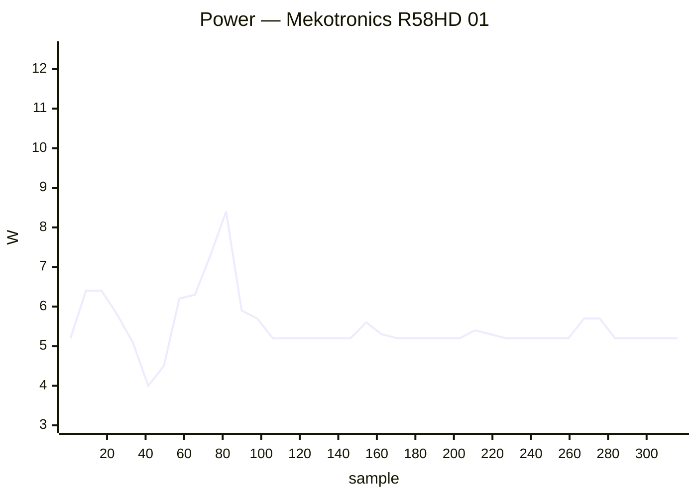

### ✅ Mekotronics R58S2 01

`mekotronics-r58s2` · **inplace** · image `26.11.0-trunk.83` · 5 ✅ · 0 ❌ · 1 ⏭️

| Module | Status | Time | Detail |
|:--|:--:|--:|:--|
| upgrade | ⏭️ | 11 s | — |
| reboot | ✅ | 51 s | power-cycle · up 16 s |
| hw-performance | ✅ | 14 s | AES 1276 · mem 15000 · disk W 226 / R 270 MB/s · 40.7 °C · 1800 MHz |
| dvfs | ✅ | 17 s | ondemand · 1800–1800 MHz (peak 2352) |
| network-iperf | ✅ | 55 s | end1 ↑941/↓941 (1GE) · wlan0 ↑57/↓158 (Wi-Fi 5) Mbps |
| store-versions | ✅ | 5 s | 26.11.0-trunk.90 · 6.1.172-vendor-rk35xx |

**Power** — min 0.6 W · avg 3.5 W · peak 10.5 W · 153 samples

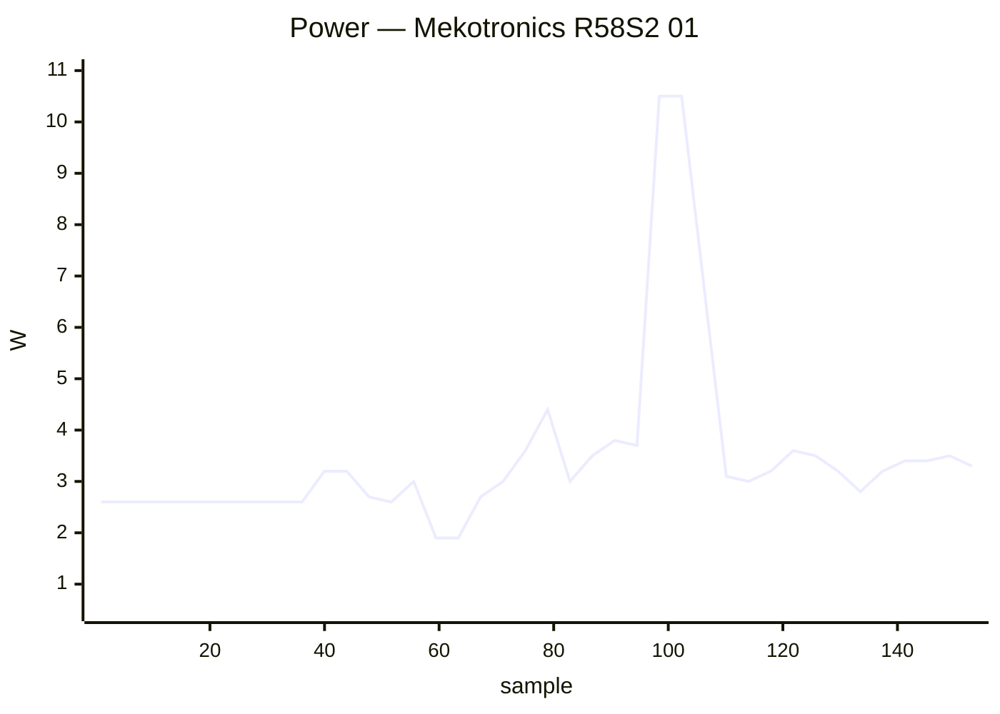

### ✅ NanoPC T6 Plus 01

`friendlyelec-rk3588` · **inplace** · image `26.8.10` · 15 ✅ · 0 ❌ · 1 ⏭️

| Module | Status | Time | Detail |
|:--|:--:|--:|:--|
| upgrade | ✅ | 27 s | nightly · 26.8.10 → 26.8.10 |
| reboot | ✅ | 58 s | power-cycle · up 23 s |
| kernel-switch | ✅ | 19 s | branch=vendor · family=rk35xx · installed=26.11.0-trunk.92 · boot_image=/boot/vmlinuz-6.1.172-vendor-rk35xx · kernel_before=6.1.172-vendor-rk35xx |
| reboot | ✅ | 89 s | power-cycle · 2/2 boots · up 21 s |
| hw-performance | ✅ | 15 s | AES 1330 · mem 14800 · disk W 180 / R 260 MB/s · 39.8 °C · 1800 MHz |
| dvfs | ✅ | 16 s | ondemand · 1800–1800 MHz (peak 2400) |
| network-iperf | ✅ | 33 s | wlP3p49s0 ↑476/↓333 (Wi-Fi 5) · lan1 ↑?/↓? · lan2 ↑?/↓? Mbps |
| store-versions | ✅ | 4 s | 26.8.10 · 6.1.172-vendor-rk35xx |
| kernel-switch | ✅ | 52 s | branch=current · family=rockchip64 · installed=26.11.0-trunk.92 · boot_image=/boot/vmlinuz-6.18.56-current-rockchip64 · kernel_before=6.1.172-vendor-rk35xx |
| reboot | ✅ | 242 s | power-cycle · 2/2 boots · up 105 s |
| hw-performance | ✅ | 15 s | AES 1344 · mem 7200 · disk W 170 / R 252 MB/s · 42.5 °C · 1800 MHz |
| dvfs | ✅ | 15 s | ondemand · 408–1800 MHz (peak 2400) |
| network-iperf | ⏭️ | 6 s | no cabled interfaces |
| store-versions | ✅ | 4 s | 26.8.10 · 6.18.56-current-rockchip64 |
| kernel-switch | ✅ | 39 s | branch=vendor · family=rk35xx · installed=26.11.0-trunk.92 · boot_image=/boot/vmlinuz-6.1.172-vendor-rk35xx · kernel_before=6.18.56-current-rockchip64 |
| reboot | ✅ | 48 s | power-cycle · up 21 s |

**Power** — min 2.3 W · avg 5.2 W · peak 11.0 W · 455 samples

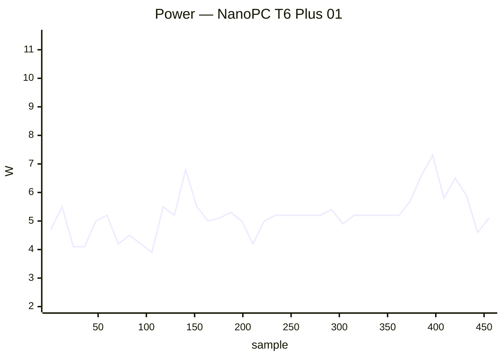

### ✅ NanoPi Fire3 01

`nanopifire3` · **inplace** · image `26.11.0-trunk.83` · 7 ✅ · 0 ❌ · 1 ⏭️

| Module | Status | Time | Detail |
|:--|:--:|--:|:--|
| upgrade | ✅ | 117 s | nightly · 26.11.0-trunk.90 → 26.11.0-trunk.90 |
| reboot | ✅ | 81 s | power-cycle · up 41 s |
| kernel-switch | ✅ | 63 s | branch=edge · family=s5p6818 · installed=26.11.0-trunk.90 · boot_image=/boot/vmlinuz-7.2.10-edge-s5p6818 · kernel_before=7.2.10-edge-s5p6818 |
| reboot | ✅ | 114 s | power-cycle · 2/2 boots · up 32 s |
| hw-performance | ✅ | 35 s | AES 374 · mem 2000 · disk W 20 / R 22 MB/s · 61 °C · None MHz |
| dvfs | ➖ | 3 s | no cpufreq |
| network-iperf | ✅ | 102 s | eth0 ↑94/↓94 (10/100ME) Mbps |
| store-versions | ✅ | 6 s | 26.11.0-trunk.90 · 7.2.10-edge-s5p6818 |

**Power** — min 2.0 W · avg 2.9 W · peak 3.9 W · 422 samples

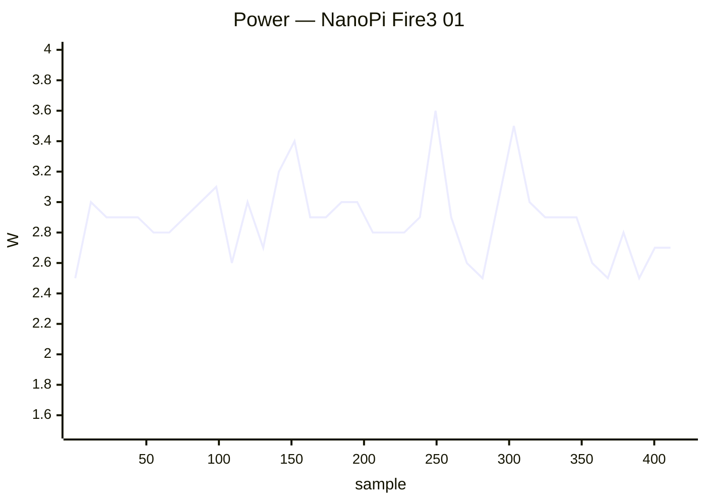

### ✅ NanoPi K2 01

`nanopik2-s905` · **inplace** · image `26.11.0-trunk.83` · 16 ✅ · 0 ❌ · 0 ⏭️

| Module | Status | Time | Detail |
|:--|:--:|--:|:--|
| upgrade | ✅ | 58 s | nightly · 26.11.0-trunk.90 → 26.11.0-trunk.90 |
| reboot | ✅ | 38 s | warm · up 19 s |
| kernel-switch | ✅ | 39 s | branch=current · family=meson64 · installed=26.11.0-trunk.90 · boot_image=/boot/vmlinuz-6.18.56-current-meson64 · kernel_before=6.18.56-current-meson64 |
| reboot | ✅ | 68 s | warm · 2/2 boots · up 21 s |
| hw-performance | ✅ | 31 s | AES 51 · mem 3700 · disk W 10 / R 41 MB/s · 59 °C · 2016 MHz |
| dvfs | ✅ | 21 s | ondemand · 500–1536 MHz (peak 1536) |
| network-iperf | ✅ | 129 s | end0 ↑936/↓941 (1GE) · wlan0 ↑12/↓14 (Wi-Fi 4) Mbps |
| store-versions | ✅ | 5 s | 26.11.0-trunk.90 · 6.18.56-current-meson64 |
| kernel-switch | ✅ | 156 s | branch=edge · family=meson64 · installed=26.11.0-trunk.90 · boot_image=/boot/vmlinuz-7.3.0-rc6-edge-meson64 · kernel_before=6.18.56-current-meson64 |
| reboot | ✅ | 66 s | warm · 2/2 boots · up 19 s |
| hw-performance | ✅ | 32 s | AES 51 · mem 3800 · disk W 9 / R 40 MB/s · 60 °C · 2016 MHz |
| dvfs | ✅ | 23 s | ondemand · 500–1536 MHz (peak 1536) |
| network-iperf | ✅ | 303 s | end0 ↑936/↓941 (1GE) · wlan0 ↑13/↓29 (Wi-Fi 4) Mbps |
| store-versions | ✅ | 5 s | 26.11.0-trunk.90 · 7.3.0-rc6-edge-meson64 |
| kernel-switch | ✅ | 156 s | branch=current · family=meson64 · installed=26.11.0-trunk.90 · boot_image=/boot/vmlinuz-6.18.56-current-meson64 · kernel_before=7.3.0-rc6-edge-meson64 |
| reboot | ✅ | 35 s | warm · up 19 s |

### ✅ NanoPi M4V2 01

`nanopim4v2` · **inplace** · image `26.11.0-trunk.83` · 16 ✅ · 0 ❌ · 0 ⏭️

| Module | Status | Time | Detail |
|:--|:--:|--:|:--|
| upgrade | ✅ | 41 s | nightly · 26.11.0-trunk.90 → 26.11.0-trunk.90 |
| reboot | ✅ | 64 s | power-cycle · up 34 s |
| kernel-switch | ✅ | 32 s | branch=current · family=rockchip64 · installed=26.11.0-trunk.90 · boot_image=/boot/vmlinuz-6.18.56-current-rockchip64 · kernel_before=6.18.56-current-rockchip64 |
| reboot | ✅ | 97 s | power-cycle · 2/2 boots · up 26 s |
| hw-performance | ✅ | 23 s | AES 1019 · mem 6600 · disk W 53 / R 45 MB/s · 42.2 °C · 1416 MHz |
| dvfs | ✅ | 21 s | ondemand · 408–1416 MHz (peak 1800) |
| network-iperf | ✅ | 192 s | end0 ↑940/↓941 (1GE) · wlan0 ↑119/↓157 (Wi-Fi 5) · wlx803f5d16af63 ↑12/↓10 (Wi-Fi 5) Mbps |
| store-versions | ✅ | 5 s | 26.11.0-trunk.90 · 6.18.56-current-rockchip64 |
| kernel-switch | ✅ | 95 s | branch=edge · family=rockchip64 · installed=26.11.0-trunk.90 · boot_image=/boot/vmlinuz-7.3.0-rc6-edge-rockchip64 · kernel_before=6.18.56-current-rockchip64 |
| reboot | ✅ | 95 s | power-cycle · 2/2 boots · up 25 s |
| hw-performance | ✅ | 22 s | AES 1018 · mem 6500 · disk W 53 / R 60 MB/s · 42.8 °C · 1416 MHz |
| dvfs | ✅ | 22 s | ondemand · 408–1416 MHz (peak 1800) |
| network-iperf | ✅ | 331 s | end0 ↑941/↓941 (1GE) · wlan0 ↑144/↓190 (Wi-Fi 5) · wlx803f5d16af63 ↑6/↓14 (Wi-Fi 5) Mbps |
| store-versions | ✅ | 5 s | 26.11.0-trunk.90 · 7.3.0-rc6-edge-rockchip64 |
| kernel-switch | ✅ | 93 s | branch=current · family=rockchip64 · installed=26.11.0-trunk.90 · boot_image=/boot/vmlinuz-6.18.56-current-rockchip64 · kernel_before=7.3.0-rc6-edge-rockchip64 |
| reboot | ✅ | 59 s | power-cycle · up 26 s |

**Power** — min 3.1 W · avg 6.5 W · peak 12.1 W · 952 samples

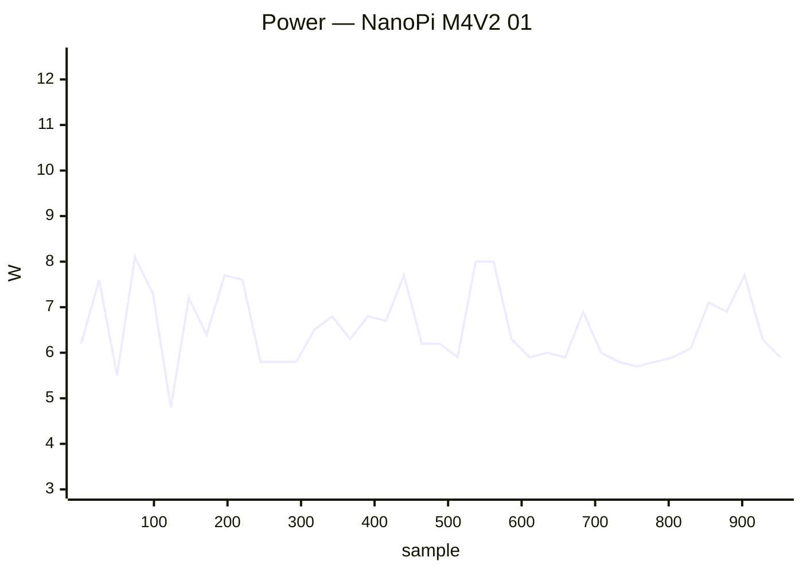

### ✅ NanoPi M5 01

`nanopi-m5` · **inplace** · image `26.11.0-trunk.75` · 22 ✅ · 0 ❌ · 0 ⏭️

| Module | Status | Time | Detail |
|:--|:--:|--:|:--|
| upgrade | ✅ | 37 s | nightly · 26.11.0-trunk.90 → 26.11.0-trunk.90 |
| reboot | ✅ | 48 s | power-cycle · up 23 s |
| kernel-switch | ✅ | 23 s | branch=vendor · family=rk35xx · installed=26.11.0-trunk.90 · boot_image=/boot/vmlinuz-6.1.172-vendor-rk35xx · kernel_before=6.1.172-vendor-rk35xx |
| reboot | ✅ | 78 s | power-cycle · 2/2 boots · up 23 s |
| hw-performance | ✅ | 18 s | AES 1275 · mem 8000 · disk W 67 / R 77 MB/s · 43.5 °C · 2016 MHz |
| dvfs | ✅ | 18 s | ondemand · 2016–2016 MHz (peak 2208) |
| network-iperf | ✅ | 115 s | end0 ↑941/↓941 (1GE) · end1 ↑941/↓942 (1GE) · wlan0 ↑40/↓77 (Wi-Fi 5) · wlx44334c47dec3 ↑27/↓15 (Wi-Fi 4) Mbps |
| store-versions | ✅ | 4 s | 26.11.0-trunk.90 · 6.1.172-vendor-rk35xx |
| kernel-switch | ✅ | 103 s | branch=current · family=rockchip64 · installed=26.11.0-trunk.90 · boot_image=/boot/vmlinuz-6.18.56-current-rockchip64 · kernel_before=6.1.172-vendor-rk35xx |
| reboot | ✅ | 86 s | power-cycle · 2/2 boots · up 27 s |
| hw-performance | ✅ | 27 s | AES 1326 · mem 9000 · disk W 20 / R 21 MB/s · 42.5 °C · 2016 MHz |
| dvfs | ✅ | 17 s | ondemand · 408–2016 MHz (peak 2208) |
| network-iperf | ✅ | 201 s | end0 ↑941/↓942 (1GE) · end1 ↑941/↓941 (1GE) · wlan0 ↑9/↓50 (Wi-Fi 5) · wlx44334c47dec3 ↑32/↓24 (Wi-Fi 4) Mbps |
| store-versions | ✅ | 4 s | 26.11.0-trunk.90 · 6.18.56-current-rockchip64 |
| kernel-switch | ✅ | 87 s | branch=edge · family=rockchip64 · installed=26.11.0-trunk.90 · boot_image=/boot/vmlinuz-7.3.0-rc6-edge-rockchip64 · kernel_before=6.18.56-current-rockchip64 |
| reboot | ✅ | 87 s | power-cycle · 2/2 boots · up 25 s |
| hw-performance | ✅ | 26 s | AES 1332 · mem 9000 · disk W 20 / R 21 MB/s · 44.4 °C · 2016 MHz |
| dvfs | ✅ | 19 s | ondemand · 408–2016 MHz (peak 2208) |
| network-iperf | ✅ | 187 s | end0 ↑941/↓942 (1GE) · end1 ↑941/↓941 (1GE) · wlan0 ↑58/↓145 (Wi-Fi 5) · wlx44334c47dec3 ↑28/↓21 (Wi-Fi 4) Mbps |
| store-versions | ✅ | 4 s | 26.11.0-trunk.90 · 7.3.0-rc6-edge-rockchip64 |
| kernel-switch | ✅ | 105 s | branch=vendor · family=rk35xx · installed=26.11.0-trunk.90 · boot_image=/boot/vmlinuz-6.1.172-vendor-rk35xx · kernel_before=7.3.0-rc6-edge-rockchip64 |
| reboot | ✅ | 50 s | power-cycle · up 23 s |

### ✅ NanoPi Neo 2 Black 01

`nanopineo2black` · **inplace** · image `26.11.0-trunk.83` · 16 ✅ · 0 ❌ · 0 ⏭️

| Module | Status | Time | Detail |
|:--|:--:|--:|:--|
| upgrade | ✅ | 63 s | nightly · 26.11.0-trunk.90 → 26.11.0-trunk.90 |
| reboot | ✅ | 55 s | power-cycle · up 17 s |
| kernel-switch | ✅ | 42 s | branch=current · family=sunxi64 · installed=26.11.0-trunk.90 · boot_image=/boot/vmlinuz-6.18.56-current-sunxi64 · kernel_before=6.18.56-current-sunxi64 |
| reboot | ✅ | 314 s | power-cycle · 1/2 boots · up 17 s |
| hw-performance | ✅ | 23 s | AES 635 · mem 3500 · disk W 43 / R 44 MB/s · 55.1 °C · 1368 MHz |
| dvfs | ✅ | 23 s | ondemand · 480–1368 MHz (peak 1368) |
| network-iperf | ✅ | 31 s | end0 ↑888/↓866 (1GE) Mbps |
| store-versions | ✅ | 6 s | 26.11.0-trunk.90 · 6.18.56-current-sunxi64 |
| kernel-switch | ✅ | 105 s | branch=edge · family=sunxi64 · installed=26.11.0-trunk.90 · boot_image=/boot/vmlinuz-7.2.10-edge-sunxi64 · kernel_before=6.18.56-current-sunxi64 |
| reboot | ✅ | 311 s | power-cycle · 1/2 boots · up 17 s |
| hw-performance | ✅ | 24 s | AES 632 · mem 3500 · disk W 43 / R 43 MB/s · 58.6 °C · 1368 MHz |
| dvfs | ✅ | 24 s | ondemand · 480–1368 MHz (peak 1368) |
| network-iperf | ✅ | 98 s | end0 ↑891/↓914 (1GE) Mbps |
| store-versions | ✅ | 6 s | 26.11.0-trunk.90 · 7.2.10-edge-sunxi64 |
| kernel-switch | ✅ | 105 s | branch=current · family=sunxi64 · installed=26.11.0-trunk.90 · boot_image=/boot/vmlinuz-6.18.56-current-sunxi64 · kernel_before=7.2.10-edge-sunxi64 |
| reboot | ✅ | 55 s | power-cycle · up 17 s |

**Power** — min 0.9 W · avg 2.5 W · peak 5.5 W · 1021 samples

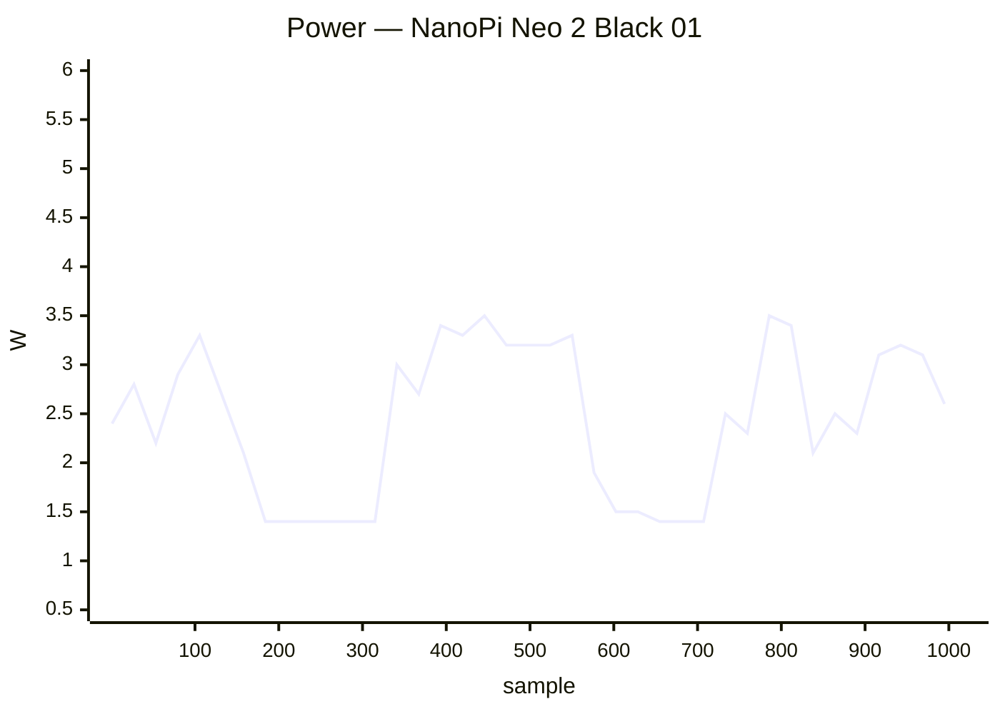

### ✅ NanoPi Neo 3 01

`nanopineo3` · **inplace** · image `26.11.0-trunk.83` · 16 ✅ · 0 ❌ · 0 ⏭️

| Module | Status | Time | Detail |
|:--|:--:|--:|:--|
| upgrade | ✅ | 84 s | nightly · 26.11.0-trunk.90 → 26.11.0-trunk.90 |
| reboot | ✅ | 66 s | power-cycle · up 27 s |
| kernel-switch | ✅ | 57 s | branch=current · family=rockchip64 · installed=26.11.0-trunk.90 · boot_image=/boot/vmlinuz-6.18.56-current-rockchip64 · kernel_before=6.18.56-current-rockchip64 |
| reboot | ✅ | 100 s | power-cycle · 2/2 boots · up 27 s |
| hw-performance | ✅ | 28 s | AES 597 · mem 2300 · disk W 1 / R 62 MB/s · 75.4 °C · 1296 MHz |
| dvfs | ✅ | 30 s | ondemand · 408–1296 MHz (peak 1296) |
| network-iperf | ✅ | 281 s | end0 ↑918/↓939 (1GE) · wlx7cdd905518f9 ↑24/↓18 (Wi-Fi 4) Mbps |
| store-versions | ✅ | 7 s | 26.11.0-trunk.90 · 6.18.56-current-rockchip64 |
| kernel-switch | ✅ | 171 s | branch=edge · family=rockchip64 · installed=26.11.0-trunk.90 · boot_image=/boot/vmlinuz-7.3.0-rc6-edge-rockchip64 · kernel_before=6.18.56-current-rockchip64 |
| reboot | ✅ | 99 s | power-cycle · 2/2 boots · up 25 s |
| hw-performance | ✅ | 29 s | AES 596 · mem 2400 · disk W 48 / R 63 MB/s · 79.2 °C · 1296 MHz |
| dvfs | ✅ | 33 s | ondemand · 408–1296 MHz (peak 1296) |
| network-iperf | ✅ | 146 s | end0 ↑919/↓940 (1GE) · wlx7cdd905518f9 ↑31/↓20 (Wi-Fi 4) Mbps |
| store-versions | ✅ | 7 s | 26.11.0-trunk.90 · 7.3.0-rc6-edge-rockchip64 |
| kernel-switch | ✅ | 169 s | branch=current · family=rockchip64 · installed=26.11.0-trunk.90 · boot_image=/boot/vmlinuz-6.18.56-current-rockchip64 · kernel_before=7.3.0-rc6-edge-rockchip64 |
| reboot | ✅ | 66 s | power-cycle · up 29 s |

**Power** — min 2.2 W · avg 4.5 W · peak 6.1 W · 1084 samples

```mermaid
xychart-beta
    title "Power — NanoPi Neo 3 01"
    x-axis "sample" 1 --> 1084
    y-axis "W" 2.0 --> 6.5
    line [4.4, 4.7, 4.6, 3.9, 5.0, 4.6, 3.9, 4.8, 4.4, 4.9, 4.7, 3.8, 4.0, 4.0, 4.5, 4.1, 3.9, 4.4, 4.1, 4.7, 5.0, 4.8, 4.6, 4.6, 4.2, 4.8, 4.1, 4.5, 4.8, 4.1, 4.8, 4.5, 4.2, 4.5, 5.2, 4.8, 4.6, 4.6, 4.4, 4.4]
```

### ✅ NanoPi R3S LTS 01

`nanopi-r3s-lts` · **inplace** · image `26.11.0-trunk.85` · 16 ✅ · 0 ❌ · 0 ⏭️

| Module | Status | Time | Detail |
|:--|:--:|--:|:--|
| upgrade | ✅ | 53 s | nightly · 26.11.0-trunk.90 → 26.11.0-trunk.90 |
| reboot | ✅ | 50 s | power-cycle · up 16 s |
| kernel-switch | ✅ | 34 s | branch=current · family=rockchip64 · installed=26.11.0-trunk.90 · boot_image=/boot/vmlinuz-6.18.56-current-rockchip64 · kernel_before=6.18.56-current-rockchip64 |
| reboot | ✅ | 70 s | power-cycle · 2/2 boots · up 16 s |
| hw-performance | ✅ | 19 s | AES 916 · mem 5100 · disk W 149 / R 166 MB/s · 40 °C · 1800 MHz |
| dvfs | ✅ | 21 s | ondemand · 408–1800 MHz (peak 1800) |
| network-iperf | ✅ | 143 s | lan ↑941/↓942 (1GE) · wan ↑941/↓942 (1GE) · wlx0087422045f0 ↑5/↓11 (Wi-Fi 4) Mbps |
| store-versions | ✅ | 5 s | 26.11.0-trunk.90 · 6.18.56-current-rockchip64 |
| kernel-switch | ✅ | 91 s | branch=edge · family=rockchip64 · installed=26.11.0-trunk.90 · boot_image=/boot/vmlinuz-7.3.0-rc6-edge-rockchip64 · kernel_before=6.18.56-current-rockchip64 |
| reboot | ✅ | 67 s | power-cycle · 2/2 boots · up 17 s |
| hw-performance | ✅ | 19 s | AES 907 · mem 5100 · disk W 152 / R 168 MB/s · 40 °C · 1800 MHz |
| dvfs | ✅ | 24 s | ondemand · 408–1800 MHz (peak 1800) |
| network-iperf | ✅ | 247 s | lan ↑941/↓942 (1GE) · wan ↑941/↓941 (1GE) · wlx0087422045f0 ↑7/↓12 (Wi-Fi 4) Mbps |
| store-versions | ✅ | 5 s | 26.11.0-trunk.90 · 7.3.0-rc6-edge-rockchip64 |
| kernel-switch | ✅ | 91 s | branch=current · family=rockchip64 · installed=26.11.0-trunk.90 · boot_image=/boot/vmlinuz-6.18.56-current-rockchip64 · kernel_before=7.3.0-rc6-edge-rockchip64 |
| reboot | ✅ | 50 s | power-cycle · up 17 s |

### ✅ NanoPi R6S 01

`nanopi-r6s` · **inplace** · image `26.11.0-trunk.83` · 22 ✅ · 0 ❌ · 0 ⏭️

| Module | Status | Time | Detail |
|:--|:--:|--:|:--|
| upgrade | ✅ | 28 s | nightly · 26.11.0-trunk.83 → 26.11.0-trunk.83 |
| reboot | ✅ | 41 s | power-cycle · up 15 s |
| kernel-switch | ✅ | 18 s | branch=vendor · family=rk35xx · installed=26.11.0-trunk.90 · boot_image=/boot/vmlinuz-6.1.172-vendor-rk35xx · kernel_before=6.1.172-vendor-rk35xx |
| reboot | ✅ | 65 s | power-cycle · 2/2 boots · up 16 s |
| hw-performance | ✅ | 15 s | AES 1280 · mem 15300 · disk W 212 / R 269 MB/s · 37 °C · 1800 MHz |
| dvfs | ✅ | 17 s | ondemand · 1800–1800 MHz (peak 2256) |
| network-iperf | ✅ | 107 s | lan2 ↑941/↓941 (1GE) · wan ↑2351/↓2328 (2.5GE) Mbps |
| store-versions | ✅ | 4 s | 26.11.0-trunk.83 · 6.1.172-vendor-rk35xx |
| kernel-switch | ✅ | 49 s | branch=current · family=rockchip64 · installed=26.11.0-trunk.90 · boot_image=/boot/vmlinuz-6.18.56-current-rockchip64 · kernel_before=6.1.172-vendor-rk35xx |
| reboot | ✅ | 75 s | power-cycle · 2/2 boots · up 15 s |
| hw-performance | ✅ | 15 s | AES 1272 · mem 10400 · disk W 142 / R 141 MB/s · 37.9 °C · 1800 MHz |
| dvfs | ✅ | 14 s | ondemand · 408–1800 MHz (peak 2400) |
| network-iperf | ✅ | 138 s | lan2 ↑941/↓941 (1GE) · wan ↑2350/↓2292 (2.5GE) Mbps |
| store-versions | ✅ | 4 s | 26.11.0-trunk.83 · 6.18.56-current-rockchip64 |
| kernel-switch | ✅ | 43 s | branch=edge · family=rockchip64 · installed=26.11.0-trunk.90 · boot_image=/boot/vmlinuz-7.3.0-rc6-edge-rockchip64 · kernel_before=6.18.56-current-rockchip64 |
| reboot | ✅ | 60 s | power-cycle · 2/2 boots · up 13 s |
| hw-performance | ✅ | 16 s | AES 1272 · mem 8100 · disk W 148 / R 150 MB/s · 38.8 °C · 1800 MHz |
| dvfs | ✅ | 17 s | ondemand · 408–1800 MHz (peak 2400) |
| network-iperf | ✅ | 106 s | lan2 ↑941/↓941 (1GE) · wan ↑2349/↓2262 (2.5GE) Mbps |
| store-versions | ✅ | 5 s | 26.11.0-trunk.83 · 7.3.0-rc6-edge-rockchip64 |
| kernel-switch | ✅ | 38 s | branch=vendor · family=rk35xx · installed=26.11.0-trunk.90 · boot_image=/boot/vmlinuz-6.1.172-vendor-rk35xx · kernel_before=7.3.0-rc6-edge-rockchip64 |
| reboot | ✅ | 41 s | power-cycle · up 15 s |

**Power** — min 2.5 W · avg 3.8 W · peak 9.2 W · 715 samples

```mermaid
xychart-beta
    title "Power — NanoPi R6S 01"
    x-axis "sample" 1 --> 715
    y-axis "W" 2.0 --> 9.5
    line [3.1, 4.3, 2.8, 3.7, 3.2, 3.2, 3.4, 4.4, 5.7, 3.7, 2.9, 3.0, 3.4, 3.6, 4.5, 3.7, 3.0, 3.3, 4.1, 5.6, 3.6, 3.8, 3.2, 3.2, 3.5, 4.2, 4.3, 4.5, 3.4, 3.9, 4.0, 5.7, 3.3, 3.2, 3.3, 4.0, 4.1, 4.6, 4.5, 3.5]
```

### ✅ NanoPi R76S 01

`nanopi-r76s` · **inplace** · image `26.8.3` · 16 ✅ · 0 ❌ · 0 ⏭️

| Module | Status | Time | Detail |
|:--|:--:|--:|:--|
| upgrade | ✅ | 124 s | nightly · 26.8.3 → 26.11.0-trunk.92 |
| reboot | ✅ | 64 s | power-cycle · up 24 s |
| kernel-switch | ✅ | 61 s | branch=vendor · family=rk35xx · installed=26.11.0-trunk.92 · boot_image=/boot/vmlinuz-6.1.172-vendor-rk35xx · kernel_before=7.3.0-rc6-edge-rockchip64 |
| reboot | ✅ | 103 s | power-cycle · 2/2 boots · up 26 s |
| hw-performance | ✅ | 16 s | AES 1271 · mem 7600 · disk W 197 / R 295 MB/s · 45.3 °C · 2016 MHz |
| dvfs | ✅ | 20 s | ondemand · 2016–2016 MHz (peak 2208) |
| network-iperf | ✅ | 107 s | end0 ↑2332/↓2352 (2.5GE) · end1 ↑2350/↓2353 (2.5GE) · wlan0 ↑45/↓94 (Wi-Fi 5) · wlxe0e1a933de37 ↑193/↓214 (Wi-Fi 5) Mbps |
| store-versions | ✅ | 12 s | 26.11.0-trunk.92 · 6.1.172-vendor-rk35xx |
| kernel-switch | ✅ | 82 s | branch=edge · family=rockchip64 · installed=26.11.0-trunk.92 · boot_image=/boot/vmlinuz-7.3.0-rc6-edge-rockchip64 · kernel_before=6.1.172-vendor-rk35xx |
| reboot | ✅ | 92 s | power-cycle · 2/2 boots · up 22 s |
| hw-performance | ✅ | 16 s | AES 1311 · mem 8700 · disk W 208 / R 291 MB/s · 45.3 °C · 2016 MHz |
| dvfs | ✅ | 21 s | ondemand · 408–2016 MHz (peak 2208) |
| network-iperf | ✅ | 105 s | end0 ↑2353/↓2354 (2.5GE) · end1 ↑2353/↓2258 (2.5GE) · wlan0 ↑94/↓179 (Wi-Fi 5) · wlxe0e1a933de37 ↑188/↓214 (Wi-Fi 5) Mbps |
| store-versions | ✅ | 5 s | 26.11.0-trunk.92 · 7.3.0-rc6-edge-rockchip64 |
| kernel-switch | ✅ | 56 s | branch=vendor · family=rk35xx · installed=26.11.0-trunk.92 · boot_image=/boot/vmlinuz-6.1.172-vendor-rk35xx · kernel_before=7.3.0-rc6-edge-rockchip64 |
| reboot | ✅ | 72 s | power-cycle · up 22 s |

**Power** — min 0.6 W · avg 4.5 W · peak 8.8 W · 642 samples

```mermaid
xychart-beta
    title "Power — NanoPi R76S 01"
    x-axis "sample" 1 --> 642
    y-axis "W" 0.5 --> 9.0
    line [4.5, 5.1, 5.0, 4.2, 5.4, 4.6, 2.8, 3.7, 5.2, 5.0, 4.6, 2.8, 4.0, 2.7, 4.8, 5.9, 4.9, 5.2, 4.8, 4.7, 5.3, 4.7, 5.2, 5.1, 5.0, 3.0, 4.3, 3.0, 4.7, 5.9, 4.5, 4.8, 4.8, 4.8, 4.6, 5.4, 5.1, 4.3, 2.7, 3.7]
```

### ✅ Odroid C2 01

`odroidc2` · **inplace** · image `26.11.0-trunk.75` · 16 ✅ · 0 ❌ · 0 ⏭️

| Module | Status | Time | Detail |
|:--|:--:|--:|:--|
| upgrade | ✅ | 54 s | nightly · 26.11.0-trunk.90 → 26.11.0-trunk.90 |
| reboot | ✅ | 33 s | warm · up 17 s |
| kernel-switch | ✅ | 37 s | branch=current · family=meson64 · installed=26.11.0-trunk.90 · boot_image=/boot/vmlinuz-6.18.56-current-meson64 · kernel_before=6.18.56-current-meson64 |
| reboot | ✅ | 61 s | warm · 2/2 boots · up 17 s |
| hw-performance | ✅ | 22 s | AES 51 · mem 3500 · disk W 33 / R 141 MB/s · 44 °C · 1536 MHz |
| dvfs | ✅ | 22 s | ondemand · 500–1536 MHz (peak 1536) |
| network-iperf | ✅ | 91 s | end0 ↑939/↓941 (1GE) Mbps |
| store-versions | ✅ | 6 s | 26.11.0-trunk.90 · 6.18.56-current-meson64 |
| kernel-switch | ✅ | 113 s | branch=edge · family=meson64 · installed=26.11.0-trunk.90 · boot_image=/boot/vmlinuz-7.3.0-rc6-edge-meson64 · kernel_before=6.18.56-current-meson64 |
| reboot | ✅ | 63 s | warm · 2/2 boots · up 18 s |
| hw-performance | ✅ | 23 s | AES 51 · mem 3500 · disk W 32 / R 139 MB/s · 44 °C · 1536 MHz |
| dvfs | ✅ | 24 s | ondemand · 500–1536 MHz (peak 1536) |
| network-iperf | ✅ | 31 s | end0 ↑940/↓941 (1GE) Mbps |
| store-versions | ✅ | 5 s | 26.11.0-trunk.90 · 7.3.0-rc6-edge-meson64 |
| kernel-switch | ✅ | 110 s | branch=current · family=meson64 · installed=26.11.0-trunk.90 · boot_image=/boot/vmlinuz-6.18.56-current-meson64 · kernel_before=7.3.0-rc6-edge-meson64 |
| reboot | ✅ | 33 s | warm · up 17 s |

### ✅ Odroid C4 01

`odroidc4` · **inplace** · image `26.11.0-trunk.89` · 16 ✅ · 0 ❌ · 0 ⏭️

| Module | Status | Time | Detail |
|:--|:--:|--:|:--|
| upgrade | ✅ | 44 s | nightly · 26.11.0-trunk.90 → 26.11.0-trunk.90 |
| reboot | ✅ | 49 s | power-cycle · up 17 s |
| kernel-switch | ✅ | 30 s | branch=current · family=meson64 · installed=26.11.0-trunk.90 · boot_image=/boot/vmlinuz-6.18.56-current-meson64 · kernel_before=6.18.56-current-meson64 |
| reboot | ✅ | 76 s | power-cycle · 2/2 boots · up 16 s |
| hw-performance | ✅ | 21 s | AES 980 · mem 5200 · disk W 31 / R 80 MB/s · 41 °C · 2100 MHz |
| dvfs | ✅ | 19 s | ondemand · 1000–2100 MHz (peak 2100) |
| network-iperf | ✅ | 147 s | end0 ↑941/↓942 (1GE) · wlx24050fdd332b ↑41/↓58 (Wi-Fi 4) Mbps |
| store-versions | ✅ | 4 s | 26.11.0-trunk.90 · 6.18.56-current-meson64 |
| kernel-switch | ✅ | 107 s | branch=edge · family=meson64 · installed=26.11.0-trunk.90 · boot_image=/boot/vmlinuz-7.3.0-rc6-edge-meson64 · kernel_before=6.18.56-current-meson64 |
| reboot | ✅ | 76 s | power-cycle · 2/2 boots · up 16 s |
| hw-performance | ✅ | 22 s | AES 980 · mem 5300 · disk W 31 / R 77 MB/s · 43.4 °C · 2100 MHz |
| dvfs | ✅ | 22 s | ondemand · 1000–2100 MHz (peak 2100) |
| network-iperf | ✅ | 117 s | end0 ↑941/↓942 (1GE) · wlx24050fdd332b ↑68/↓95 (Wi-Fi 4) Mbps |
| store-versions | ✅ | 5 s | 26.11.0-trunk.90 · 7.3.0-rc6-edge-meson64 |
| kernel-switch | ✅ | 105 s | branch=current · family=meson64 · installed=26.11.0-trunk.90 · boot_image=/boot/vmlinuz-6.18.56-current-meson64 · kernel_before=7.3.0-rc6-edge-meson64 |
| reboot | ✅ | 48 s | power-cycle · up 16 s |

### ✅ Odroid M1 01

`odroidm1` · **inplace** · image `26.11.0-trunk.88` · 16 ✅ · 0 ❌ · 0 ⏭️

| Module | Status | Time | Detail |
|:--|:--:|--:|:--|
| upgrade | ✅ | 144 s | nightly · 26.11.0-trunk.88 → 26.11.0-trunk.90 |
| reboot | ✅ | 58 s | power-cycle · up 19 s |
| kernel-switch | ✅ | 31 s | branch=current · family=rockchip64 · installed=26.11.0-trunk.90 · boot_image=/boot/vmlinuz-6.18.56-current-rockchip64 · kernel_before=6.18.56-current-rockchip64 |
| reboot | ✅ | 82 s | power-cycle · 2/2 boots · up 20 s |
| hw-performance | ✅ | 17 s | AES 918 · mem 5100 · disk W 1032 / R 1031 MB/s · 33.1 °C · 1992 MHz |
| dvfs | ✅ | 22 s | ondemand · 408–1992 MHz (peak 1992) |
| network-iperf | ✅ | 69 s | eth0 ↑485/↓941 (1GE) Mbps |
| store-versions | ✅ | 5 s | 26.11.0-trunk.90 · 6.18.56-current-rockchip64 |
| kernel-switch | ✅ | 85 s | branch=edge · family=rockchip64 · installed=26.11.0-trunk.90 · boot_image=/boot/vmlinuz-7.3.0-rc6-edge-rockchip64 · kernel_before=6.18.56-current-rockchip64 |
| reboot | ✅ | 86 s | power-cycle · 2/2 boots · up 24 s |
| hw-performance | ✅ | 18 s | AES 918 · mem 5100 · disk W 1039 / R 1055 MB/s · 34.4 °C · 1992 MHz |
| dvfs | ✅ | 24 s | ondemand · 408–1992 MHz (peak 1992) |
| network-iperf | ✅ | 63 s | eth0 ↑941/↓941 (1GE) Mbps |
| store-versions | ✅ | 5 s | 26.11.0-trunk.90 · 7.3.0-rc6-edge-rockchip64 |
| kernel-switch | ✅ | 85 s | branch=current · family=rockchip64 · installed=26.11.0-trunk.90 · boot_image=/boot/vmlinuz-6.18.56-current-rockchip64 · kernel_before=7.3.0-rc6-edge-rockchip64 |
| reboot | ✅ | 61 s | power-cycle · up 23 s |

**Power** — min 1.9 W · avg 5.4 W · peak 9.9 W · 652 samples

```mermaid
xychart-beta
    title "Power — Odroid M1 01"
    x-axis "sample" 1 --> 652
    y-axis "W" 1.5 --> 10.0
    line [5.0, 6.0, 6.1, 5.1, 5.3, 6.7, 5.7, 4.8, 6.9, 6.1, 4.8, 5.7, 5.3, 5.5, 4.9, 6.1, 4.8, 4.2, 4.4, 5.3, 5.3, 7.4, 5.1, 5.7, 4.0, 6.0, 3.9, 7.0, 5.0, 5.8, 4.8, 4.5, 4.1, 5.1, 6.6, 6.3, 5.1, 4.9, 4.9, 6.0]
```

### ✅ Odroid N2 01

`odroidn2` · **inplace** · image `26.11.0-trunk.83` · 16 ✅ · 0 ❌ · 0 ⏭️

| Module | Status | Time | Detail |
|:--|:--:|--:|:--|
| upgrade | ✅ | 38 s | nightly · 26.11.0-trunk.90 → 26.11.0-trunk.90 |
| reboot | ✅ | 64 s | power-cycle · up 29 s |
| kernel-switch | ✅ | 24 s | branch=current · family=meson64 · installed=26.11.0-trunk.90 · boot_image=/boot/vmlinuz-6.18.56-current-meson64 · kernel_before=6.18.56-current-meson64 |
| reboot | ✅ | 95 s | power-cycle · 2/2 boots · up 30 s |
| hw-performance | ✅ | 19 s | AES 1085 · mem 4900 · disk W 26 / R 134 MB/s · 38 °C · 1992 MHz |
| dvfs | ✅ | 17 s | performance · 1000–1992 MHz (peak 1992) |
| network-iperf | ✅ | 31 s | end0 ↑940/↓941 (1GE) Mbps |
| store-versions | ✅ | 4 s | 26.11.0-trunk.90 · 6.18.56-current-meson64 |
| kernel-switch | ✅ | 76 s | branch=edge · family=meson64 · installed=26.11.0-trunk.90 · boot_image=/boot/vmlinuz-7.3.0-rc6-edge-meson64 · kernel_before=6.18.56-current-meson64 |
| reboot | ✅ | 104 s | power-cycle · 2/2 boots · up 31 s |
| hw-performance | ✅ | 20 s | AES 1085 · mem 4900 · disk W 26 / R 137 MB/s · 39 °C · 1992 MHz |
| dvfs | ✅ | 19 s | performance · 1000–1992 MHz (peak 1992) |
| network-iperf | ✅ | 31 s | end0 ↑940/↓941 (1GE) Mbps |
| store-versions | ✅ | 4 s | 26.11.0-trunk.90 · 7.3.0-rc6-edge-meson64 |
| kernel-switch | ✅ | 77 s | branch=current · family=meson64 · installed=26.11.0-trunk.90 · boot_image=/boot/vmlinuz-6.18.56-current-meson64 · kernel_before=7.3.0-rc6-edge-meson64 |
| reboot | ✅ | 66 s | power-cycle · up 29 s |

**Power** — min 1.0 W · avg 3.8 W · peak 9.8 W · 532 samples

```mermaid
xychart-beta
    title "Power — Odroid N2 01"
    x-axis "sample" 1 --> 532
    y-axis "W" 0.5 --> 10.0
    line [3.9, 3.8, 3.9, 2.2, 2.9, 4.8, 4.2, 3.8, 2.8, 3.9, 2.8, 3.2, 4.0, 4.3, 5.5, 3.8, 3.3, 4.4, 4.1, 4.2, 4.1, 3.5, 2.7, 4.5, 3.0, 2.0, 3.8, 3.9, 3.9, 6.9, 3.4, 3.7, 4.2, 3.8, 4.2, 4.5, 3.7, 2.1, 2.4, 3.4]
```

### ✅ Odroid XU4 01

`odroidxu4` · **inplace** · image `26.8.1` · 16 ✅ · 0 ❌ · 0 ⏭️

| Module | Status | Time | Detail |
|:--|:--:|--:|:--|
| upgrade | ✅ | 186 s | nightly · 26.8.3 → 26.11.0-trunk.92 |
| reboot | ✅ | 65 s | power-cycle · up 32 s |
| kernel-switch | ✅ | 38 s | branch=current · family=odroidxu4 · installed=26.11.0-trunk.92 · boot_image=/boot/vmlinuz-6.6.155-current-odroidxu4 · kernel_before=6.6.155-current-odroidxu4 |
| reboot | ✅ | 110 s | power-cycle · 2/2 boots · up 31 s |
| hw-performance | ✅ | 30 s | AES 65 · mem 5300 · disk W 47 / R 61 MB/s · 65 °C · 1400 MHz |
| dvfs | ✅ | 32 s | ondemand · 600–1400 MHz (peak 2000) |
| network-iperf | ✅ | 37 s | end0 ↑924/↓941 Mbps |
| store-versions | ✅ | 7 s | 26.11.0-trunk.92 · 6.6.155-current-odroidxu4 |
| kernel-switch | ✅ | 95 s | branch=edge · family=odroidxu4 · installed=26.11.0-trunk.92 · boot_image=/boot/vmlinuz-7.2.10-edge-odroidxu4 · kernel_before=6.6.155-current-odroidxu4 |
| reboot | ✅ | 106 s | power-cycle · 2/2 boots · up 30 s |
| hw-performance | ✅ | 29 s | AES 65 · mem 5200 · disk W 42 / R 61 MB/s · 66 °C · 1400 MHz |
| dvfs | ✅ | 33 s | ondemand · 600–1200 MHz (peak 1800) |
| network-iperf | ✅ | 36 s | end0 ↑923/↓941 Mbps |
| store-versions | ✅ | 6 s | 26.11.0-trunk.92 · 7.2.10-edge-odroidxu4 |
| kernel-switch | ✅ | 90 s | branch=current · family=odroidxu4 · installed=26.11.0-trunk.92 · boot_image=/boot/vmlinuz-6.6.155-current-odroidxu4 · kernel_before=7.2.10-edge-odroidxu4 |
| reboot | ✅ | 68 s | power-cycle · up 31 s |

### ✅ Orange Pi 3 01

`orangepi3` · **inplace** · image `26.11.0-trunk.58` · 15 ✅ · 0 ❌ · 1 ⏭️

| Module | Status | Time | Detail |
|:--|:--:|--:|:--|
| upgrade | ⏭️ | 18 s | — |
| reboot | ✅ | 64 s | power-cycle · up 31 s |
| kernel-switch | ✅ | 37 s | branch=current · family=sunxi64 · installed=26.8.0-trunk.61 · boot_image=/boot/vmlinuz-6.18.33-current-sunxi64 · kernel_before=6.18.33-current-sunxi64 |
| reboot | ✅ | 313 s | power-cycle · 1/2 boots · up 24 s |
| hw-performance | ✅ | 28 s | AES 839 · mem 4600 · disk W 21 / R 23 MB/s · 46.1 °C · 1800 MHz |
| dvfs | ✅ | 20 s | ondemand · 480–1800 MHz (peak 1800) |
| network-iperf | ✅ | 149 s | end0 ↑912/↓941 (1GE) · wlan0 ↑32/↓105 (Wi-Fi 5) Mbps |
| store-versions | ✅ | 5 s | 26.11.0-trunk.58 · 6.18.33-current-sunxi64 |
| kernel-switch | ✅ | 101 s | branch=edge · family=sunxi64 · installed=26.8.0-trunk.61 · boot_image=/boot/vmlinuz-7.0.10-edge-sunxi64 · kernel_before=6.18.33-current-sunxi64 |
| reboot | ✅ | 332 s | power-cycle · 1/2 boots · up 24 s |
| hw-performance | ✅ | 28 s | AES 839 · mem 4600 · disk W 21 / R 23 MB/s · 47.1 °C · 1800 MHz |
| dvfs | ✅ | 20 s | ondemand · 480–1800 MHz (peak 1800) |
| network-iperf | ✅ | 58 s | end0 ↑913/↓941 (1GE) · wlan0 ↑8/↓21 (Wi-Fi 5) Mbps |
| store-versions | ✅ | 5 s | 26.11.0-trunk.58 · 7.0.10-edge-sunxi64 |
| kernel-switch | ✅ | 99 s | branch=current · family=sunxi64 · installed=26.8.0-trunk.61 · boot_image=/boot/vmlinuz-6.18.33-current-sunxi64 · kernel_before=7.0.10-edge-sunxi64 |
| reboot | ✅ | 57 s | power-cycle · up 24 s |

### ✅ Orange Pi 5 01

`orangepi5` · **inplace** · image `26.11.0-trunk.83` · 21 ✅ · 0 ❌ · 1 ⏭️

| Module | Status | Time | Detail |
|:--|:--:|--:|:--|
| upgrade | ⏭️ | 8 s | — |
| reboot | ✅ | 58 s | power-cycle · up 22 s |
| kernel-switch | ✅ | 84 s | branch=vendor · family=rk35xx · installed=26.11.0-trunk.90 · boot_image=/boot/vmlinuz-6.1.172-vendor-rk35xx · kernel_before=7.3.0-rc6-edge-rockchip64 |
| reboot | ✅ | 77 s | power-cycle · 2/2 boots · up 22 s |
| hw-performance | ✅ | 25 s | AES 1314 · mem 15900 · disk W 21 / R 23 MB/s · 43.5 °C · 1800 MHz |
| dvfs | ✅ | 16 s | ondemand · 1800–1800 MHz (peak 2304) |
| network-iperf | ✅ | 106 s | end0 ↑941/↓941 (1GE) Mbps |
| store-versions | ✅ | 5 s | 26.11.0-trunk.90 · 6.1.172-vendor-rk35xx |
| kernel-switch | ✅ | 107 s | branch=current · family=rockchip64 · installed=26.11.0-trunk.90 · boot_image=/boot/vmlinuz-6.18.56-current-rockchip64 · kernel_before=6.1.172-vendor-rk35xx |
| reboot | ✅ | 85 s | power-cycle · 2/2 boots · up 23 s |
| hw-performance | ✅ | 26 s | AES 1259 · mem 10200 · disk W 21 / R 22 MB/s · 45.3 °C · 1800 MHz |
| dvfs | ✅ | 15 s | ondemand · 408–1800 MHz (peak 2400) |
| network-iperf | ✅ | 59 s | end0 ↑940/↓941 (1GE) Mbps |
| store-versions | ✅ | 3 s | 26.11.0-trunk.90 · 6.18.56-current-rockchip64 |
| kernel-switch | ✅ | 86 s | branch=edge · family=rockchip64 · installed=26.11.0-trunk.90 · boot_image=/boot/vmlinuz-7.3.0-rc6-edge-rockchip64 · kernel_before=6.18.56-current-rockchip64 |
| reboot | ✅ | 86 s | power-cycle · 2/2 boots · up 22 s |
| hw-performance | ✅ | 26 s | AES 1257 · mem 8000 · disk W 20 / R 22 MB/s · 48.1 °C · 1800 MHz |
| dvfs | ✅ | 17 s | ondemand · 408–1800 MHz (peak 2400) |
| network-iperf | ✅ | 32 s | end0 ↑941/↓941 (1GE) Mbps |
| store-versions | ✅ | 4 s | 26.11.0-trunk.90 · 7.3.0-rc6-edge-rockchip64 |
| kernel-switch | ✅ | 82 s | branch=vendor · family=rk35xx · installed=26.11.0-trunk.90 · boot_image=/boot/vmlinuz-6.1.172-vendor-rk35xx · kernel_before=7.3.0-rc6-edge-rockchip64 |
| reboot | ✅ | 52 s | power-cycle · up 23 s |

**Power** — min 1.5 W · avg 2.8 W · peak 8.6 W · 800 samples

```mermaid
xychart-beta
    title "Power — Orange Pi 5 01"
    x-axis "sample" 1 --> 800
    y-axis "W" 1.0 --> 9.0
    line [2.5, 2.9, 3.3, 3.3, 3.1, 2.8, 2.5, 2.5, 2.3, 4.8, 1.6, 1.6, 1.8, 1.9, 2.3, 2.0, 2.4, 2.3, 2.2, 3.0, 3.1, 2.8, 4.2, 2.8, 2.3, 3.1, 2.9, 2.8, 3.1, 2.6, 2.8, 2.7, 3.0, 5.0, 2.9, 2.9, 2.8, 3.2, 2.5, 2.9]
```

### ✅ Orange Pi 5 Plus 01

`orangepi5-plus` · **inplace** · image `26.11.0-trunk.83` · 22 ✅ · 0 ❌ · 0 ⏭️

| Module | Status | Time | Detail |
|:--|:--:|--:|:--|
| upgrade | ✅ | 24 s | nightly · 26.11.0-trunk.90 → 26.11.0-trunk.90 |
| reboot | ✅ | 76 s | power-cycle · up 39 s |
| kernel-switch | ✅ | 17 s | branch=vendor · family=rk35xx · installed=26.11.0-trunk.90 · boot_image=/boot/vmlinuz-6.1.172-vendor-rk35xx · kernel_before=6.1.172-vendor-rk35xx |
| reboot | ✅ | 107 s | power-cycle · 2/2 boots · up 32 s |
| hw-performance | ✅ | 17 s | AES 1262 · mem 13700 · disk W 55 / R 62 MB/s · 59.2 °C · 1800 MHz |
| dvfs | ✅ | 16 s | ondemand · 1800–1800 MHz (peak 2256) |
| network-iperf | ✅ | 219 s | enP3p49s0 ↑2353/↓2352 (2.5GE) · enP4p65s0 ↑2347/↓2275 (2.5GE) · wlxe0e1a9380c53 ↑637/↓447 (Wi-Fi 6) Mbps |
| store-versions | ✅ | 4 s | 26.11.0-trunk.90 · 6.1.172-vendor-rk35xx |
| kernel-switch | ✅ | 95 s | branch=current · family=rockchip64 · installed=26.11.0-trunk.90 · boot_image=/boot/vmlinuz-6.18.56-current-rockchip64 · kernel_before=6.1.172-vendor-rk35xx |
| reboot | ✅ | 99 s | power-cycle · 2/2 boots · up 30 s |
| hw-performance | ✅ | 19 s | AES 1247 · mem 10000 · disk W 52 / R 57 MB/s · 62.8 °C · 1800 MHz |
| dvfs | ✅ | 15 s | ondemand · 408–1800 MHz (peak 2400) |
| network-iperf | ✅ | 162 s | enP3p49s0 ↑2352/↓2354 (2.5GE) · enP4p65s0 ↑2351/↓2289 (2.5GE) · wlxe0e1a9380c53 ↑106/↓67 (Wi-Fi 6) Mbps |
| store-versions | ✅ | 4 s | 26.11.0-trunk.90 · 6.18.56-current-rockchip64 |
| kernel-switch | ✅ | 69 s | branch=edge · family=rockchip64 · installed=26.11.0-trunk.90 · boot_image=/boot/vmlinuz-7.3.0-rc6-edge-rockchip64 · kernel_before=6.18.56-current-rockchip64 |
| reboot | ✅ | 98 s | power-cycle · 2/2 boots · up 28 s |
| hw-performance | ✅ | 19 s | AES 1246 · mem 8300 · disk W 52 / R 55 MB/s · 64.7 °C · 1800 MHz |
| dvfs | ✅ | 17 s | ondemand · 408–1800 MHz (peak 2400) |
| network-iperf | ✅ | 84 s | enP3p49s0 ↑2353/↓2354 (2.5GE) · enP4p65s0 ↑2349/↓2288 (2.5GE) · wlxe0e1a9380c53 ↑123/↓112 (Wi-Fi 6) Mbps |
| store-versions | ✅ | 5 s | 26.11.0-trunk.90 · 7.3.0-rc6-edge-rockchip64 |
| kernel-switch | ✅ | 64 s | branch=vendor · family=rk35xx · installed=26.11.0-trunk.90 · boot_image=/boot/vmlinuz-6.1.172-vendor-rk35xx · kernel_before=7.3.0-rc6-edge-rockchip64 |
| reboot | ✅ | 65 s | power-cycle · up 28 s |

**Power** — min 0.6 W · avg 7.2 W · peak 15.2 W · 839 samples

```mermaid
xychart-beta
    title "Power — Orange Pi 5 Plus 01"
    x-axis "sample" 1 --> 839
    y-axis "W" 0.5 --> 15.5
    line [7.6, 4.5, 5.2, 7.5, 4.2, 5.7, 5.5, 8.6, 6.6, 6.5, 6.5, 7.0, 6.6, 7.9, 9.1, 7.5, 7.7, 7.2, 5.0, 7.2, 6.1, 9.4, 7.8, 8.5, 8.4, 7.7, 8.2, 8.7, 8.7, 5.6, 6.8, 5.0, 9.2, 8.9, 9.0, 8.5, 8.8, 8.8, 5.7, 5.3]
```

### ✅ Orange Pi Lite 2 01

`orangepilite2` · **inplace** · image `26.11.0-trunk.83` · 16 ✅ · 0 ❌ · 0 ⏭️

| Module | Status | Time | Detail |
|:--|:--:|--:|:--|
| upgrade | ✅ | 55 s | nightly · 26.11.0-trunk.90 → 26.11.0-trunk.90 |
| reboot | ✅ | 43 s | warm · up 24 s |
| kernel-switch | ✅ | 36 s | branch=current · family=sunxi64 · installed=26.11.0-trunk.90 · boot_image=/boot/vmlinuz-6.18.56-current-sunxi64 · kernel_before=6.18.56-current-sunxi64 |
| reboot | ✅ | 79 s | warm · 2/2 boots · up 24 s |
| hw-performance | ✅ | 33 s | AES 772 · mem 4300 · disk W 14 / R 23 MB/s · 75.1 °C · 1800 MHz |
| dvfs | ✅ | 25 s | ondemand · 480–1704 MHz (peak 1704) |
| network-iperf | ✅ | 42 s | wlan0 ↑9/↓8 (Wi-Fi 5) Mbps |
| store-versions | ✅ | 5 s | 26.11.0-trunk.90 · 6.18.56-current-sunxi64 |
| kernel-switch | ✅ | 131 s | branch=edge · family=sunxi64 · installed=26.11.0-trunk.90 · boot_image=/boot/vmlinuz-7.2.10-edge-sunxi64 · kernel_before=6.18.56-current-sunxi64 |
| reboot | ✅ | 80 s | warm · 2/2 boots · up 24 s |
| hw-performance | ✅ | 33 s | AES 772 · mem 4300 · disk W 14 / R 23 MB/s · 75.1 °C · 1800 MHz |
| dvfs | ✅ | 26 s | ondemand · 480–1704 MHz (peak 1800) |
| network-iperf | ✅ | 49 s | wlan0 ↑11/↓20 (Wi-Fi 5) Mbps |
| store-versions | ✅ | 5 s | 26.11.0-trunk.90 · 7.2.10-edge-sunxi64 |
| kernel-switch | ✅ | 119 s | branch=current · family=sunxi64 · installed=26.11.0-trunk.90 · boot_image=/boot/vmlinuz-6.18.56-current-sunxi64 · kernel_before=7.2.10-edge-sunxi64 |
| reboot | ✅ | 44 s | warm · up 25 s |

### ✅ Orange Pi One+ 01

`orangepioneplus` · **inplace** · image `26.11.0-trunk.83` · 16 ✅ · 0 ❌ · 0 ⏭️

| Module | Status | Time | Detail |
|:--|:--:|--:|:--|
| upgrade | ✅ | 59 s | nightly · 26.11.0-trunk.90 → 26.11.0-trunk.90 |
| reboot | ✅ | 36 s | warm · up 20 s |
| kernel-switch | ✅ | 42 s | branch=current · family=sunxi64 · installed=26.11.0-trunk.90 · boot_image=/boot/vmlinuz-6.18.56-current-sunxi64 · kernel_before=6.18.56-current-sunxi64 |
| reboot | ✅ | 72 s | warm · 2/2 boots · up 23 s |
| hw-performance | ✅ | 29 s | AES 839 · mem 4600 · disk W 21 / R 2 MB/s · 63 °C · 1800 MHz |
| dvfs | ✅ | 23 s | ondemand · 480–1800 MHz (peak 1800) |
| network-iperf | ✅ | 93 s | end0 ↑912/↓941 (1GE) · wlx00e04c881724 ↑127/↓158 (Wi-Fi 5) Mbps |
| store-versions | ✅ | 5 s | 26.11.0-trunk.90 · 6.18.56-current-sunxi64 |
| kernel-switch | ✅ | 116 s | branch=edge · family=sunxi64 · installed=26.11.0-trunk.90 · boot_image=/boot/vmlinuz-7.2.10-edge-sunxi64 · kernel_before=6.18.56-current-sunxi64 |
| reboot | ✅ | 68 s | warm · 2/2 boots · up 20 s |
| hw-performance | ✅ | 29 s | AES 839 · mem 4600 · disk W 21 / R 23 MB/s · 66.8 °C · 1800 MHz |
| dvfs | ✅ | 23 s | ondemand · 480–1800 MHz (peak 1800) |
| network-iperf | ✅ | 66 s | end0 ↑913/↓940 (1GE) · wlx00e04c881724 ↑123/↓117 (Wi-Fi 5) Mbps |
| store-versions | ✅ | 5 s | 26.11.0-trunk.90 · 7.2.10-edge-sunxi64 |
| kernel-switch | ✅ | 118 s | branch=current · family=sunxi64 · installed=26.11.0-trunk.90 · boot_image=/boot/vmlinuz-6.18.56-current-sunxi64 · kernel_before=7.2.10-edge-sunxi64 |
| reboot | ✅ | 40 s | warm · up 23 s |

### ✅ Orange Pi PC + 01

`orangepipcplus` · **inplace** · image `26.11.0-trunk.83` · 16 ✅ · 0 ❌ · 0 ⏭️

| Module | Status | Time | Detail |
|:--|:--:|--:|:--|
| upgrade | ✅ | 116 s | nightly · 26.11.0-trunk.90 → 26.11.0-trunk.90 |
| reboot | ✅ | 48 s | warm · up 27 s |
| kernel-switch | ✅ | 75 s | branch=current · family=sunxi · installed=26.11.0-trunk.90 · boot_image=/boot/vmlinuz-6.18.56-current-sunxi · kernel_before=6.18.56-current-sunxi |
| reboot | ✅ | 88 s | warm · 2/2 boots · up 27 s |
| hw-performance | ✅ | 44 s | AES 25 · mem 2300 · disk W 8 / R 77 MB/s · 49.9 °C · 1296 MHz |
| dvfs | ✅ | 39 s | ondemand · 480–1296 MHz (peak 1296) |
| network-iperf | ✅ | 185 s | end0 ↑93/↓94 (10/100ME) · wlan0 ↑11/↓5 (Wi-Fi 4) · wlan1 ↑20/↓12 (Wi-Fi 4) Mbps |
| store-versions | ✅ | 8 s | 26.11.0-trunk.90 · 6.18.56-current-sunxi |
| kernel-switch | ✅ | 190 s | branch=edge · family=sunxi · installed=26.11.0-trunk.90 · boot_image=/boot/vmlinuz-7.2.10-edge-sunxi · kernel_before=6.18.56-current-sunxi |
| reboot | ✅ | 88 s | warm · 2/2 boots · up 27 s |
| hw-performance | ✅ | 45 s | AES 25 · mem 2200 · disk W 6 / R 78 MB/s · 54 °C · 1296 MHz |
| dvfs | ✅ | 42 s | ondemand · 480–1296 MHz (peak 1296) |
| network-iperf | ✅ | 126 s | end0 ↑94/↓94 (10/100ME) · wlan0 ↑25/↓1 (Wi-Fi 4) · wlan1 ↑29/↓2 (Wi-Fi 4) Mbps |
| store-versions | ✅ | 8 s | 26.11.0-trunk.90 · 7.2.10-edge-sunxi |
| kernel-switch | ✅ | 190 s | branch=current · family=sunxi · installed=26.11.0-trunk.90 · boot_image=/boot/vmlinuz-6.18.56-current-sunxi · kernel_before=7.2.10-edge-sunxi |
| reboot | ✅ | 47 s | warm · up 28 s |

### ✅ Orange Pi Zero2 01

`orangepizero2` · **inplace** · image `26.11.0-trunk.83` · 16 ✅ · 0 ❌ · 0 ⏭️

| Module | Status | Time | Detail |
|:--|:--:|--:|:--|
| upgrade | ✅ | 91 s | nightly · 26.11.0-trunk.90 → 26.11.0-trunk.90 |
| reboot | ✅ | 60 s | power-cycle · up 25 s |
| kernel-switch | ✅ | 69 s | branch=current · family=sunxi64 · installed=26.11.0-trunk.90 · boot_image=/boot/vmlinuz-6.18.56-current-sunxi64 · kernel_before=6.18.56-current-sunxi64 |
| reboot | ✅ | 94 s | power-cycle · 2/2 boots · up 23 s |
| hw-performance | ✅ | 32 s | AES 704 · mem 3000 · disk W 21 / R 23 MB/s · 62.6 °C · 1512 MHz |
| dvfs | ✅ | 26 s | ondemand · 480–1512 MHz (peak 1512) |
| network-iperf | ✅ | 145 s | end0 ↑863/↓935 (1GE) · wlx7c023a625db1 ↑25/↓22 (Wi-Fi 5) Mbps |
| store-versions | ✅ | 6 s | 26.11.0-trunk.90 · 6.18.56-current-sunxi64 |
| kernel-switch | ✅ | 152 s | branch=edge · family=sunxi64 · installed=26.11.0-trunk.90 · boot_image=/boot/vmlinuz-7.2.10-edge-sunxi64 · kernel_before=6.18.56-current-sunxi64 |
| reboot | ✅ | 92 s | power-cycle · 2/2 boots · up 24 s |
| hw-performance | ✅ | 33 s | AES 705 · mem 3000 · disk W 21 / R 23 MB/s · 63 °C · 1512 MHz |
| dvfs | ✅ | 26 s | ondemand · 480–1512 MHz (peak 1512) |
| network-iperf | ✅ | 75 s | end0 ↑875/↓942 (1GE) · wlx7c023a625db1 ↑35/↓18 (Wi-Fi 5) Mbps |
| store-versions | ✅ | 6 s | 26.11.0-trunk.90 · 7.2.10-edge-sunxi64 |
| kernel-switch | ✅ | 150 s | branch=current · family=sunxi64 · installed=26.11.0-trunk.90 · boot_image=/boot/vmlinuz-6.18.56-current-sunxi64 · kernel_before=7.2.10-edge-sunxi64 |
| reboot | ✅ | 60 s | power-cycle · up 25 s |

**Power** — min 1.9 W · avg 2.8 W · peak 4.0 W · 865 samples

```mermaid
xychart-beta
    title "Power — Orange Pi Zero2 01"
    x-axis "sample" 1 --> 865
    y-axis "W" 1.5 --> 4.5
    line [2.6, 2.6, 2.6, 2.6, 2.5, 3.1, 2.9, 2.9, 2.5, 3.2, 2.9, 2.6, 3.1, 2.6, 2.5, 2.1, 2.9, 3.3, 3.0, 2.8, 3.0, 2.9, 2.8, 2.7, 2.5, 3.0, 2.6, 2.9, 3.0, 2.8, 3.0, 3.1, 2.9, 2.8, 2.8, 2.6, 2.7, 2.6, 2.4, 2.7]
```

### ✅ OrangePi 3 LTS 01

`orangepi3-lts` · **inplace** · image `26.11.0-trunk.83` · 16 ✅ · 0 ❌ · 0 ⏭️

| Module | Status | Time | Detail |
|:--|:--:|--:|:--|
| upgrade | ✅ | 54 s | nightly · 26.11.0-trunk.90 → 26.11.0-trunk.90 |
| reboot | ✅ | 62 s | power-cycle · up 24 s |
| kernel-switch | ✅ | 36 s | branch=current · family=sunxi64 · installed=26.11.0-trunk.90 · boot_image=/boot/vmlinuz-6.18.56-current-sunxi64 · kernel_before=6.18.56-current-sunxi64 |
| reboot | ✅ | 96 s | power-cycle · 2/2 boots · up 25 s |
| hw-performance | ✅ | 20 s | AES 748 · mem 4100 · disk W 46 / R 127 MB/s · 68.9 °C · 1608 MHz |
| dvfs | ✅ | 21 s | ondemand · 480–1608 MHz (peak 1608) |
| network-iperf | ✅ | 64 s | end0 ↑916/↓940 (1GE) · wlan0 ↑142/↓128 (Wi-Fi 5) Mbps |
| store-versions | ✅ | 5 s | 26.11.0-trunk.90 · 6.18.56-current-sunxi64 |
| kernel-switch | ✅ | 93 s | branch=edge · family=sunxi64 · installed=26.11.0-trunk.90 · boot_image=/boot/vmlinuz-7.2.10-edge-sunxi64 · kernel_before=6.18.56-current-sunxi64 |
| reboot | ✅ | 93 s | power-cycle · 2/2 boots · up 24 s |
| hw-performance | ✅ | 22 s | AES 745 · mem 4100 · disk W 40 / R 127 MB/s · 71.2 °C · 1608 MHz |
| dvfs | ✅ | 23 s | ondemand · 480–1608 MHz (peak 1608) |
| network-iperf | ✅ | 94 s | end0 ↑919/↓940 (1GE) · wlan0 ↑134/↓89 (Wi-Fi 5) Mbps |
| store-versions | ✅ | 5 s | 26.11.0-trunk.90 · 7.2.10-edge-sunxi64 |
| kernel-switch | ✅ | 94 s | branch=current · family=sunxi64 · installed=26.11.0-trunk.90 · boot_image=/boot/vmlinuz-6.18.56-current-sunxi64 · kernel_before=7.2.10-edge-sunxi64 |
| reboot | ✅ | 62 s | power-cycle · up 24 s |

**Power** — min 1.0 W · avg 3.3 W · peak 4.7 W · 655 samples

```mermaid
xychart-beta
    title "Power — OrangePi 3 LTS 01"
    x-axis "sample" 1 --> 655
    y-axis "W" 0.5 --> 5.0
    line [3.1, 3.4, 3.4, 3.1, 2.9, 3.3, 3.3, 2.7, 3.5, 2.2, 2.6, 3.4, 3.9, 3.2, 3.5, 4.0, 3.6, 3.5, 3.5, 3.5, 3.4, 3.2, 2.7, 3.3, 1.9, 3.4, 3.5, 4.0, 3.2, 3.8, 3.5, 3.0, 3.5, 3.5, 3.8, 3.4, 3.4, 3.1, 2.2, 3.4]
```

### ✅ Radxa Dragon Q6A 01

`radxa-dragon-q6a` · **inplace** · image `26.11.0-trunk.75` · 16 ✅ · 0 ❌ · 0 ⏭️

| Module | Status | Time | Detail |
|:--|:--:|--:|:--|
| upgrade | ✅ | 25 s | nightly · 26.11.0-trunk.90 → 26.11.0-trunk.90 |
| reboot | ✅ | 147 s | power-cycle · up 112 s |
| kernel-switch | ✅ | 17 s | branch=current · family=qcs6490 · installed=26.11.0-trunk.90 · boot_image=/boot/vmlinuz-6.18.2-current-qcs6490 · kernel_before=6.18.2-current-qcs6490 |
| reboot | ✅ | 256 s | power-cycle · 2/2 boots · up 106 s |
| hw-performance | ✅ | 13 s | AES 1500 · mem 15500 · disk W 245 / R 1116 MB/s · 45.7 °C · 1958 MHz |
| dvfs | ✅ | 14 s | ondemand · 300–1958 MHz (peak 2707) |
| network-iperf | ✅ | 28 s | enp1s0 ↑941/↓940 (1GE) Mbps |
| store-versions | ✅ | 4 s | 26.11.0-trunk.90 · 6.18.2-current-qcs6490 |
| kernel-switch | ✅ | 80 s | branch=edge · family=qcs6490 · installed=26.11.0-trunk.90 · boot_image=/boot/vmlinuz-7.2.3-edge-qcs6490 · kernel_before=6.18.2-current-qcs6490 |
| reboot | ✅ | 258 s | power-cycle · 2/2 boots · up 113 s |
| hw-performance | ✅ | 13 s | AES 1522 · mem 18500 · disk W 242 / R 1169 MB/s · 47.3 °C · 1958 MHz |
| dvfs | ✅ | 15 s | ondemand · 300–1958 MHz (peak 2707) |
| network-iperf | ✅ | 28 s | enp1s0 ↑941/↓941 (1GE) Mbps |
| store-versions | ✅ | 4 s | 26.11.0-trunk.90 · 7.2.3-edge-qcs6490 |
| kernel-switch | ✅ | 80 s | branch=current · family=qcs6490 · installed=26.11.0-trunk.90 · boot_image=/boot/vmlinuz-6.18.2-current-qcs6490 · kernel_before=7.2.3-edge-qcs6490 |
| reboot | ✅ | 147 s | power-cycle · up 112 s |

**Power** — min 1.0 W · avg 2.4 W · peak 8.8 W · 900 samples

```mermaid
xychart-beta
    title "Power — Radxa Dragon Q6A 01"
    x-axis "sample" 1 --> 900
    y-axis "W" 0.5 --> 9.0
    line [2.7, 1.8, 2.4, 1.9, 2.0, 2.0, 2.7, 2.8, 1.8, 1.9, 1.9, 1.9, 2.7, 1.9, 2.0, 2.4, 3.7, 2.2, 3.5, 4.4, 2.5, 2.5, 1.9, 2.0, 1.8, 2.0, 2.3, 2.1, 1.8, 2.1, 4.0, 2.2, 3.4, 4.2, 3.0, 1.6, 2.6, 1.8, 1.8, 1.9]
```

### ✅ Radxa ZERO 3 01

`radxa-zero3` · **inplace** · image `26.5.1` · 4 ✅ · 0 ❌ · 2 ⏭️

| Module | Status | Time | Detail |
|:--|:--:|--:|:--|
| upgrade | ⏭️ | — | — |
| reboot | ⏭️ | — | reboot |
| hw-performance | ✅ | 33 s | AES 721 · mem 3900 · disk W 21 / R 23 MB/s · 51.2 °C · 1416 MHz |
| dvfs | ✅ | 25 s | ondemand · 408–1416 MHz (peak 1416) |
| network-iperf | ✅ | 70 s | wlan0 ↑45/↓135 (Wi-Fi 6) Mbps |
| store-versions | ✅ | 6 s | 26.5.1 · 6.18.44-current-rockchip64 |

### ✅ Raspberry Pi 3B

`rpi4b` · **inplace** · image `26.11.0-trunk.83` · 16 ✅ · 0 ❌ · 0 ⏭️

| Module | Status | Time | Detail |
|:--|:--:|--:|:--|
| upgrade | ✅ | 110 s | nightly · 26.11.0-trunk.90 → 26.11.0-trunk.90 |
| reboot | ✅ | 49 s | warm · up 30 s |
| kernel-switch | ✅ | 74 s | branch=current · family=bcm2711 · installed=26.11.0-trunk.90 · boot_image=/boot/vmlinuz-6.18.55-current-bcm2711 · kernel_before=6.18.55-current-bcm2711 |
| reboot | ✅ | 96 s | warm · 2/2 boots · up 31 s |
| hw-performance | ✅ | 41 s | AES 20 · mem 1400 · disk W 20 / R 22 MB/s · 54.8 °C · 1200 MHz |
| dvfs | ✅ | 36 s | ondemand · 600–1200 MHz (peak 1200) |
| network-iperf | ✅ | 82 s | enxb827eb253a53 ↑94/↓94 (10/100ME) · wlan0 ↑26/↓37 (Wi-Fi 4) Mbps |
| store-versions | ✅ | 8 s | 26.11.0-trunk.90 · 6.18.55-current-bcm2711 |
| kernel-switch | ✅ | 230 s | branch=edge · family=bcm2711 · installed=26.11.0-trunk.90 · boot_image=/boot/vmlinuz-7.2.9-edge-bcm2711 · kernel_before=6.18.55-current-bcm2711 |
| reboot | ✅ | 96 s | warm · 2/2 boots · up 31 s |
| hw-performance | ✅ | 45 s | AES 22 · mem 1300 · disk W 20 / R 22 MB/s · 55.3 °C · 1200 MHz |
| dvfs | ✅ | 40 s | ondemand · 600–1200 MHz (peak 1200) |
| network-iperf | ✅ | 81 s | enxb827eb253a53 ↑94/↓94 (10/100ME) · wlan0 ↑29/↓39 (Wi-Fi 4) Mbps |
| store-versions | ✅ | 9 s | 26.11.0-trunk.90 · 7.2.9-edge-bcm2711 |
| kernel-switch | ✅ | 227 s | branch=current · family=bcm2711 · installed=26.11.0-trunk.90 · boot_image=/boot/vmlinuz-6.18.55-current-bcm2711 · kernel_before=7.2.9-edge-bcm2711 |
| reboot | ✅ | 50 s | warm · up 30 s |

### ✅ Raspberry Pi 5B

`rpi4b` · **inplace** · image `26.11.0-trunk.83` · 16 ✅ · 0 ❌ · 0 ⏭️

| Module | Status | Time | Detail |
|:--|:--:|--:|:--|
| upgrade | ✅ | 17 s | nightly · 26.11.0-trunk.90 → 26.11.0-trunk.90 |
| reboot | ✅ | 48 s | power-cycle · up 21 s |
| kernel-switch | ✅ | 13 s | branch=current · family=bcm2711 · installed=26.11.0-trunk.90 · boot_image=/boot/vmlinuz-6.18.55-current-bcm2711 · kernel_before=6.18.55-current-bcm2711 |
| reboot | ✅ | 81 s | power-cycle · 2/2 boots · up 22 s |
| hw-performance | ✅ | 15 s | AES 1368 · mem 12100 · disk W 56 / R 80 MB/s · 65 °C · 2400 MHz |
| dvfs | ✅ | 13 s | ondemand · 1500–2400 MHz (peak 2400) |
| network-iperf | ✅ | 54 s | end0 ↑936/↓941 (1GE) · wlan0 ↑31/↓14 (Wi-Fi 5) Mbps |
| store-versions | ✅ | 4 s | 26.11.0-trunk.90 · 6.18.55-current-bcm2711 |
| kernel-switch | ✅ | 120 s | branch=edge · family=bcm2711 · installed=26.11.0-trunk.90 · boot_image=/boot/vmlinuz-7.2.9-edge-bcm2711 · kernel_before=6.18.55-current-bcm2711 |
| reboot | ✅ | 73 s | power-cycle · 2/2 boots · up 20 s |
| hw-performance | ✅ | 15 s | AES 1368 · mem 9200 · disk W 50 / R 82 MB/s · 70.5 °C · 2400 MHz |
| dvfs | ✅ | 14 s | ondemand · 1500–2400 MHz (peak 2400) |
| network-iperf | ✅ | 51 s | end0 ↑936/↓941 (1GE) · wlan0 ↑40/↓36 (Wi-Fi 5) Mbps |
| store-versions | ✅ | 3 s | 26.11.0-trunk.90 · 7.2.9-edge-bcm2711 |
| kernel-switch | ✅ | 120 s | branch=current · family=bcm2711 · installed=26.11.0-trunk.90 · boot_image=/boot/vmlinuz-6.18.55-current-bcm2711 · kernel_before=7.2.9-edge-bcm2711 |
| reboot | ✅ | 49 s | power-cycle · up 21 s |

**Power** — min 3.0 W · avg 6.1 W · peak 10.5 W · 537 samples

```mermaid
xychart-beta
    title "Power — Raspberry Pi 5B"
    x-axis "sample" 1 --> 537
    y-axis "W" 2.5 --> 11.0
    line [5.7, 6.0, 5.0, 5.8, 6.5, 6.1, 5.4, 3.6, 5.5, 6.2, 8.3, 6.5, 6.1, 5.3, 6.0, 5.5, 5.7, 8.1, 8.1, 6.2, 6.3, 6.2, 6.5, 5.3, 5.3, 6.4, 8.1, 5.7, 5.8, 5.6, 6.5, 5.5, 5.6, 6.8, 7.8, 6.6, 6.7, 5.8, 5.1, 5.6]
```

### ✅ Raspberry Pi Zero 2W

`rpi4b` · **inplace** · image `26.11.0-trunk.75` · 16 ✅ · 0 ❌ · 0 ⏭️

| Module | Status | Time | Detail |
|:--|:--:|--:|:--|
| upgrade | ✅ | 89 s | nightly · 26.11.0-trunk.90 → 26.11.0-trunk.90 |
| reboot | ✅ | 41 s | warm · up 22 s |
| kernel-switch | ✅ | 55 s | branch=current · family=bcm2711 · installed=26.11.0-trunk.90 · boot_image=/boot/vmlinuz-6.18.55-current-bcm2711 · kernel_before=6.18.55-current-bcm2711 |
| reboot | ✅ | 76 s | warm · 2/2 boots · up 22 s |
| hw-performance | ✅ | 34 s | AES 33 · mem 2200 · disk W 1 / R 23 MB/s · 54.8 °C · 1000 MHz |
| dvfs | ✅ | 28 s | ondemand · 600–1000 MHz (peak 1000) |
| network-iperf | ✅ | 47 s | wlan0 ↑26/↓35 (Wi-Fi 4) Mbps |
| store-versions | ✅ | 6 s | 26.11.0-trunk.90 · 6.18.55-current-bcm2711 |
| kernel-switch | ✅ | 194 s | branch=edge · family=bcm2711 · installed=26.11.0-trunk.90 · boot_image=/boot/vmlinuz-7.2.9-edge-bcm2711 · kernel_before=6.18.55-current-bcm2711 |
| reboot | ✅ | 76 s | warm · 2/2 boots · up 22 s |
| hw-performance | ✅ | 34 s | AES 33 · mem 2200 · disk W 1 / R 22 MB/s · 55.8 °C · 1000 MHz |
| dvfs | ✅ | 28 s | ondemand · 600–1000 MHz (peak 1000) |
| network-iperf | ✅ | 42 s | wlan0 ↑29/↓15 (Wi-Fi 4) Mbps |
| store-versions | ✅ | 6 s | 26.11.0-trunk.90 · 7.2.9-edge-bcm2711 |
| kernel-switch | ✅ | 192 s | branch=current · family=bcm2711 · installed=26.11.0-trunk.90 · boot_image=/boot/vmlinuz-6.18.55-current-bcm2711 · kernel_before=7.2.9-edge-bcm2711 |
| reboot | ✅ | 44 s | warm · up 25 s |

### ✅ Rock 5B 01

`rock-5b` · **inplace** · image `26.11.0-trunk.83` · 22 ✅ · 0 ❌ · 0 ⏭️

| Module | Status | Time | Detail |
|:--|:--:|--:|:--|
| upgrade | ✅ | 30 s | nightly · 26.11.0-trunk.90 → 26.11.0-trunk.90 |
| reboot | ✅ | 134 s | power-cycle · up 104 s |
| kernel-switch | ✅ | 23 s | branch=vendor · family=rk35xx · installed=26.11.0-trunk.90 · boot_image=/boot/vmlinuz-6.1.172-vendor-rk35xx · kernel_before=6.1.172-vendor-rk35xx |
| reboot | ✅ | 242 s | power-cycle · 2/2 boots · up 104 s |
| hw-performance | ✅ | 20 s | AES 1295 · mem 12600 · disk W 26 / R 71 MB/s · 53.6 °C · 1800 MHz |
| dvfs | ✅ | 17 s | ondemand · 1800–1800 MHz (peak 2352) |
| network-iperf | ✅ | 28 s | enP4p65s0 ↑2352/↓2354 (2.5GE) Mbps |
| store-versions | ✅ | 4 s | 26.11.0-trunk.90 · 6.1.172-vendor-rk35xx |
| kernel-switch | ✅ | 84 s | branch=current · family=rockchip64 · installed=26.11.0-trunk.90 · boot_image=/boot/vmlinuz-6.18.56-current-rockchip64 · kernel_before=6.1.172-vendor-rk35xx |
| reboot | ✅ | 240 s | power-cycle · 2/2 boots · up 101 s |
| hw-performance | ✅ | 20 s | AES 1288 · mem 6900 · disk W 24 / R 76 MB/s · 61 °C · 1800 MHz |
| dvfs | ✅ | 15 s | ondemand · 408–1800 MHz (peak 2400) |
| network-iperf | ✅ | 30 s | enP4p65s0 ↑2353/↓2354 (2.5GE) Mbps |
| store-versions | ✅ | 4 s | 26.11.0-trunk.90 · 6.18.56-current-rockchip64 |
| kernel-switch | ✅ | 69 s | branch=edge · family=rockchip64 · installed=26.11.0-trunk.90 · boot_image=/boot/vmlinuz-7.3.0-rc6-edge-rockchip64 · kernel_before=6.18.56-current-rockchip64 |
| reboot | ✅ | 237 s | power-cycle · 2/2 boots · up 102 s |
| hw-performance | ✅ | 20 s | AES 1285 · mem 5200 · disk W 26 / R 78 MB/s · 63.8 °C · 1800 MHz |
| dvfs | ✅ | 17 s | ondemand · 408–1800 MHz (peak 2400) |
| network-iperf | ✅ | 28 s | end0 ↑2353/↓2354 Mbps |
| store-versions | ✅ | 4 s | 26.11.0-trunk.90 · 7.3.0-rc6-edge-rockchip64 |
| kernel-switch | ✅ | 67 s | branch=vendor · family=rk35xx · installed=26.11.0-trunk.90 · boot_image=/boot/vmlinuz-6.1.172-vendor-rk35xx · kernel_before=7.3.0-rc6-edge-rockchip64 |
| reboot | ✅ | 143 s | power-cycle · up 105 s |

**Power** — min 0.8 W · avg 5.0 W · peak 12.8 W · 976 samples

```mermaid
xychart-beta
    title "Power — Rock 5B 01"
    x-axis "sample" 1 --> 976
    y-axis "W" 0.5 --> 13.0
    line [4.1, 4.0, 3.3, 3.2, 4.1, 4.2, 3.2, 3.4, 3.8, 3.2, 3.2, 5.1, 4.0, 4.2, 4.2, 4.7, 5.7, 5.7, 5.4, 5.9, 5.7, 6.1, 7.5, 6.6, 6.6, 6.2, 5.8, 5.7, 5.8, 5.3, 5.7, 5.7, 7.5, 6.9, 6.6, 6.8, 4.4, 4.0, 3.3, 3.4]
```

### ✅ Rock 5B Plus 01

`rock-5b-plus` · **inplace** · image `26.11.0-trunk.90` · 22 ✅ · 0 ❌ · 0 ⏭️

| Module | Status | Time | Detail |
|:--|:--:|--:|:--|
| upgrade | ✅ | 25 s | nightly · 26.11.0-trunk.90 → 26.11.0-trunk.90 |
| reboot | ✅ | 83 s | power-cycle · up 54 s |
| kernel-switch | ✅ | 22 s | branch=vendor · family=rk35xx · installed=26.11.0-trunk.90 · boot_image=/boot/vmlinuz-6.1.172-vendor-rk35xx · kernel_before=6.1.172-vendor-rk35xx |
| reboot | ✅ | 109 s | power-cycle · 2/2 boots · up 23 s |
| hw-performance | ✅ | 18 s | AES 1279 · mem 13800 · disk W 21 / R 82 MB/s · 57.3 °C · 1800 MHz |
| dvfs | ✅ | 16 s | ondemand · 1800–1800 MHz (peak 2304) |
| network-iperf | ✅ | 28 s | enP4p65s0 ↑2351/↓2354 (2.5GE) Mbps |
| store-versions | ✅ | 4 s | 26.11.0-trunk.90 · 6.1.172-vendor-rk35xx |
| kernel-switch | ✅ | 123 s | branch=current · family=rockchip64 · installed=26.11.0-trunk.90 · boot_image=/boot/vmlinuz-6.18.56-current-rockchip64 · kernel_before=6.1.172-vendor-rk35xx |
| reboot | ✅ | 82 s | power-cycle · 2/2 boots · up 23 s |
| hw-performance | ✅ | 19 s | AES 1277 · mem 6600 · disk W 68 / R 73 MB/s · 58.2 °C · 1800 MHz |
| dvfs | ✅ | 14 s | ondemand · 408–1800 MHz (peak 2400) |
| network-iperf | ✅ | 28 s | enP4p65s0 ↑2353/↓2354 (2.5GE) Mbps |
| store-versions | ✅ | 4 s | 26.11.0-trunk.90 · 6.18.56-current-rockchip64 |
| kernel-switch | ✅ | 65 s | branch=edge · family=rockchip64 · installed=26.11.0-trunk.90 · boot_image=/boot/vmlinuz-7.3.0-rc6-edge-rockchip64 · kernel_before=6.18.56-current-rockchip64 |
| reboot | ✅ | 120 s | power-cycle · 2/2 boots · up 22 s |
| hw-performance | ✅ | 20 s | AES 1275 · mem 8100 · disk W 26 / R 71 MB/s · 61 °C · 1800 MHz |
| dvfs | ✅ | 17 s | ondemand · 408–1800 MHz (peak 2400) |
| network-iperf | ✅ | 29 s | end0 ↑2353/↓2354 Mbps |
| store-versions | ✅ | 4 s | 26.11.0-trunk.90 · 7.3.0-rc6-edge-rockchip64 |
| kernel-switch | ✅ | 66 s | branch=vendor · family=rk35xx · installed=26.11.0-trunk.90 · boot_image=/boot/vmlinuz-6.1.172-vendor-rk35xx · kernel_before=7.3.0-rc6-edge-rockchip64 |
| reboot | ✅ | 84 s | power-cycle · up 53 s |

**Power** — min 0.6 W · avg 5.1 W · peak 12.3 W · 644 samples

```mermaid
xychart-beta
    title "Power — Rock 5B Plus 01"
    x-axis "sample" 1 --> 644
    y-axis "W" 0.5 --> 12.5
    line [4.4, 3.4, 3.9, 3.5, 4.3, 3.4, 4.1, 3.5, 3.6, 4.2, 5.8, 4.3, 4.2, 4.5, 3.8, 3.7, 4.0, 3.4, 6.0, 4.7, 6.5, 8.4, 6.7, 6.7, 6.6, 6.9, 3.9, 6.1, 5.9, 4.5, 5.8, 7.5, 7.5, 6.6, 6.6, 6.5, 6.8, 4.5, 4.3, 3.6]
```

### ✅ Rock 5T 01

`rock-5t` · **inplace** · image `26.11.0-trunk.90` · 15 ✅ · 0 ❌ · 1 ⏭️

| Module | Status | Time | Detail |
|:--|:--:|--:|:--|
| upgrade | ⏭️ | 9 s | — |
| reboot | ✅ | 50 s | power-cycle · up 23 s |
| kernel-switch | ✅ | 19 s | branch=current · family=rockchip64 · installed=26.11.0-trunk.92 · boot_image=/boot/vmlinuz-6.18.56-current-rockchip64 · kernel_before=6.18.56-current-rockchip64 |
| reboot | ✅ | 79 s | power-cycle · 2/2 boots · up 23 s |
| hw-performance | ✅ | 18 s | AES 1252 · mem 10200 · disk W 65 / R 82 MB/s · 52.7 °C · 1800 MHz |
| dvfs | ✅ | 16 s | ondemand · 408–1800 MHz (peak 2400) |
| network-iperf | ✅ | 78 s | enP3p49s0 ↑2351/↓2310 (2.5GE) · enP4p65s0 ↑2353/↓2354 (2.5GE) · wlP2p33s0 ↑640/↓240 (Wi-Fi 6) Mbps |
| store-versions | ✅ | 4 s | 26.11.0-trunk.92 · 6.18.56-current-rockchip64 |
| kernel-switch | ✅ | 74 s | branch=edge · family=rockchip64 · installed=26.11.0-trunk.92 · boot_image=/boot/vmlinuz-7.3.0-rc6-edge-rockchip64 · kernel_before=6.18.56-current-rockchip64 |
| reboot | ✅ | 85 s | power-cycle · 2/2 boots · up 22 s |
| hw-performance | ✅ | 17 s | AES 1261 · mem 8000 · disk W 60 / R 85 MB/s · 53.6 °C · 1800 MHz |
| dvfs | ✅ | 25 s | ondemand · 408–1800 MHz (peak 2400) |
| network-iperf | ✅ | 78 s | end0 ↑2353/↓2354 · end1 ↑2353/↓2163 · wlP2p33s0 ↑574/↓250 (Wi-Fi 6) Mbps |
| store-versions | ✅ | 11 s | 26.11.0-trunk.92 · 7.3.0-rc6-edge-rockchip64 |
| kernel-switch | ✅ | 65 s | branch=current · family=rockchip64 · installed=26.11.0-trunk.92 · boot_image=/boot/vmlinuz-6.18.56-current-rockchip64 · kernel_before=7.3.0-rc6-edge-rockchip64 |
| reboot | ✅ | 59 s | power-cycle · up 23 s |

**Power** — min 1.8 W · avg 7.1 W · peak 13.3 W · 468 samples

```mermaid
xychart-beta
    title "Power — Rock 5T 01"
    x-axis "sample" 1 --> 468
    y-axis "W" 1.5 --> 13.5
    line [7.3, 5.8, 5.9, 7.4, 7.5, 4.2, 7.4, 4.1, 7.5, 7.4, 9.5, 7.4, 7.8, 7.7, 8.4, 7.1, 7.5, 7.5, 7.5, 7.9, 7.0, 4.7, 7.4, 4.5, 6.9, 7.4, 8.0, 9.0, 7.6, 7.8, 7.9, 8.5, 7.0, 7.8, 7.9, 7.6, 7.8, 6.8, 4.7, 6.9]
```

### ✅ Rockpi E 01

`rockpi-e` · **inplace** · image `26.8.1` · 16 ✅ · 0 ❌ · 0 ⏭️

| Module | Status | Time | Detail |
|:--|:--:|--:|:--|
| upgrade | ✅ | 255 s | nightly · 26.8.1 → 26.11.0-trunk.90 |
| reboot | ✅ | 57 s | power-cycle · up 22 s |
| kernel-switch | ✅ | 39 s | branch=current · family=rockchip64 · installed=26.11.0-trunk.90 · boot_image=/boot/vmlinuz-6.18.56-current-rockchip64 · kernel_before=6.18.56-current-rockchip64 |
| reboot | ✅ | 88 s | power-cycle · 2/2 boots · up 22 s |
| hw-performance | ✅ | 31 s | AES 603 · mem 3300 · disk W 20 / R 23 MB/s · 59.5 °C · 1296 MHz |
| dvfs | ✅ | 23 s | ondemand · 408–1296 MHz (peak 1296) |
| network-iperf | ✅ | 88 s | end0 ↑941/↓941 (1GE) · end1 ↑94/↓94 (10/100ME) · wlx7ca7b020e87c ↑106/↓180 (Wi-Fi 5) Mbps |
| store-versions | ✅ | 5 s | 26.11.0-trunk.90 · 6.18.56-current-rockchip64 |
| kernel-switch | ✅ | 144 s | branch=edge · family=rockchip64 · installed=26.11.0-trunk.90 · boot_image=/boot/vmlinuz-7.3.0-rc6-edge-rockchip64 · kernel_before=6.18.56-current-rockchip64 |
| reboot | ✅ | 89 s | power-cycle · 2/2 boots · up 22 s |
| hw-performance | ✅ | 31 s | AES 603 · mem 3300 · disk W 21 / R 23 MB/s · 59.5 °C · 1296 MHz |
| dvfs | ✅ | 26 s | ondemand · 408–1296 MHz (peak 1296) |
| network-iperf | ✅ | 86 s | end0 ↑941/↓941 (1GE) · end1 ↑94/↓94 (10/100ME) · wlx7ca7b020e87c ↑65/↓140 (Wi-Fi 5) Mbps |
| store-versions | ✅ | 6 s | 26.11.0-trunk.90 · 7.3.0-rc6-edge-rockchip64 |
| kernel-switch | ✅ | 143 s | branch=current · family=rockchip64 · installed=26.11.0-trunk.90 · boot_image=/boot/vmlinuz-6.18.56-current-rockchip64 · kernel_before=7.3.0-rc6-edge-rockchip64 |
| reboot | ✅ | 57 s | power-cycle · up 22 s |

### ✅ Rockpi S 01

`rockpi-s` · **inplace** · image `26.11.0-trunk.83` · 16 ✅ · 0 ❌ · 0 ⏭️

| Module | Status | Time | Detail |
|:--|:--:|--:|:--|
| upgrade | ✅ | 119 s | nightly · 26.11.0-trunk.90 → 26.11.0-trunk.90 |
| reboot | ✅ | 69 s | power-cycle · up 30 s |
| kernel-switch | ✅ | 70 s | branch=current · family=rockchip64 · installed=26.11.0-trunk.90 · boot_image=/boot/vmlinuz-6.18.56-current-rockchip64 · kernel_before=6.18.56-current-rockchip64 |
| reboot | ✅ | 108 s | power-cycle · 2/2 boots · up 30 s |
| hw-performance | ✅ | 41 s | AES 218 · mem 1300 · disk W 21 / R 22 MB/s · 53.8 °C · 1008 MHz |
| dvfs | ✅ | 36 s | ondemand · 408–1008 MHz (peak 1008) |
| network-iperf | ✅ | 124 s | end0 ↑94/↓94 (10/100ME) · wlan0 ↑2/↓1 (Wi-Fi 4) Mbps |
| store-versions | ✅ | 8 s | 26.11.0-trunk.90 · 6.18.56-current-rockchip64 |
| kernel-switch | ✅ | 235 s | branch=edge · family=rockchip64 · installed=26.11.0-trunk.90 · boot_image=/boot/vmlinuz-7.3.0-rc6-edge-rockchip64 · kernel_before=6.18.56-current-rockchip64 |
| reboot | ✅ | 107 s | power-cycle · 2/2 boots · up 31 s |
| hw-performance | ✅ | 41 s | AES 219 · mem 1300 · disk W 20 / R 22 MB/s · 54.2 °C · 1008 MHz |
| dvfs | ✅ | 38 s | ondemand · 408–1008 MHz (peak 1008) |
| network-iperf | ✅ | 75 s | end0 ↑94/↓94 (10/100ME) · wlan0 ↑2/↓1 (Wi-Fi 4) Mbps |
| store-versions | ✅ | 8 s | 26.11.0-trunk.90 · 7.3.0-rc6-edge-rockchip64 |
| kernel-switch | ✅ | 234 s | branch=current · family=rockchip64 · installed=26.11.0-trunk.90 · boot_image=/boot/vmlinuz-6.18.56-current-rockchip64 · kernel_before=7.3.0-rc6-edge-rockchip64 |
| reboot | ✅ | 70 s | power-cycle · up 30 s |

**Power** — min 1.0 W · avg 1.4 W · peak 2.6 W · 1106 samples

```mermaid
xychart-beta
    title "Power — Rockpi S 01"
    x-axis "sample" 1 --> 1106
    y-axis "W" 0.5 --> 3.0
    line [1.4, 1.4, 1.4, 1.3, 1.5, 1.6, 1.5, 1.3, 1.6, 1.6, 1.5, 1.4, 1.3, 1.4, 1.3, 1.1, 1.4, 1.4, 1.6, 1.5, 1.4, 1.5, 1.5, 1.4, 1.6, 1.3, 1.5, 1.5, 1.5, 1.3, 1.6, 1.4, 1.5, 1.6, 1.5, 1.4, 1.5, 1.4, 1.3, 1.5]
```

### ✅ RockPro 64 01

`rockpro64` · **inplace** · image `26.11.0-trunk.83` · 16 ✅ · 0 ❌ · 0 ⏭️

| Module | Status | Time | Detail |
|:--|:--:|--:|:--|
| upgrade | ✅ | 41 s | nightly · 26.11.0-trunk.90 → 26.11.0-trunk.90 |
| reboot | ✅ | 149 s | power-cycle · up 47 s |
| kernel-switch | ✅ | 29 s | branch=current · family=rockchip64 · installed=26.11.0-trunk.90 · boot_image=/boot/vmlinuz-6.18.56-current-rockchip64 · kernel_before=6.18.56-current-rockchip64 |
| reboot | ✅ | 372 s | power-cycle · 1/2 boots · up 55 s |
| hw-performance | ✅ | 21 s | AES 1018 · mem 6600 · disk W 66 / R 115 MB/s · 49.4 °C · 1416 MHz |
| dvfs | ✅ | 22 s | ondemand · 408–1416 MHz (peak 1800) |
| network-iperf | ✅ | 62 s | end0 ↑94/↓94 (10/100ME) · wlan0 ↑78/↓89 (Wi-Fi 5) Mbps |
| store-versions | ✅ | 6 s | 26.11.0-trunk.90 · 6.18.56-current-rockchip64 |
| kernel-switch | ✅ | 110 s | branch=edge · family=rockchip64 · installed=26.11.0-trunk.90 · boot_image=/boot/vmlinuz-7.3.0-rc6-edge-rockchip64 · kernel_before=6.18.56-current-rockchip64 |
| reboot | ✅ | 333 s | power-cycle · 1/2 boots · up 30 s |
| hw-performance | ✅ | 21 s | AES 1018 · mem 6500 · disk W 66 / R 115 MB/s · 50 °C · 1416 MHz |
| dvfs | ✅ | 25 s | ondemand · 408–1416 MHz (peak 1800) |
| network-iperf | ✅ | 60 s | end0 ↑941/↓941 (10/100ME) · wlan0 ↑68/↓94 (Wi-Fi 5) Mbps |
| store-versions | ✅ | 12 s | 26.11.0-trunk.90 · 7.3.0-rc6-edge-rockchip64 |
| kernel-switch | ✅ | 112 s | branch=current · family=rockchip64 · installed=26.11.0-trunk.90 · boot_image=/boot/vmlinuz-6.18.56-current-rockchip64 · kernel_before=7.3.0-rc6-edge-rockchip64 |
| reboot | ✅ | 72 s | power-cycle · up 33 s |

**Power** — min 0.7 W · avg 4.5 W · peak 8.9 W · 1139 samples

```mermaid
xychart-beta
    title "Power — RockPro 64 01"
    x-axis "sample" 1 --> 1139
    y-axis "W" 0.5 --> 9.0
    line [4.4, 4.0, 3.4, 3.2, 4.3, 4.3, 4.4, 4.8, 4.8, 4.8, 4.8, 4.8, 4.2, 4.7, 3.8, 4.3, 4.6, 4.4, 4.8, 4.7, 4.2, 5.1, 4.6, 4.8, 4.8, 4.8, 4.8, 4.9, 4.9, 4.0, 4.2, 5.4, 5.6, 4.5, 4.9, 4.6, 4.7, 5.2, 4.5, 3.6]
```

### ✅ SpacemiT K3 Pico-ITX 01

`k3picoitx` · **inplace** · image `26.11.0-trunk.83` · 8 ✅ · 0 ❌ · 0 ⏭️

| Module | Status | Time | Detail |
|:--|:--:|--:|:--|
| upgrade | ✅ | 30 s | nightly · 26.11.0-trunk.90 → 26.11.0-trunk.90 |
| reboot | ✅ | 47 s | power-cycle · up 23 s |
| kernel-switch | ✅ | 19 s | branch=legacy · family=spacemit-k3 · installed=26.11.0-trunk.90 · boot_image=/boot/vmlinuz-6.18.3-legacy-spacemit-k3 · kernel_before=6.18.3-legacy-spacemit-k3 |
| reboot | ✅ | 88 s | power-cycle · 2/2 boots · up 23 s |
| hw-performance | ✅ | 13 s | AES 778 · mem 12600 · disk W 1246 / R 900 MB/s · 44 °C · 2150 MHz |
| dvfs | ✅ | 16 s | performance · 614–2150 MHz (peak 2150) |
| network-iperf | ✅ | 107 s | eth0 ↑941/↓941 (1GE) · eth1 ↑7412/↓5070 (10GE) · wlan0 ↑9/↓144 (Wi-Fi 6) Mbps |
| store-versions | ✅ | 4 s | 26.11.0-trunk.90 · 6.18.3-legacy-spacemit-k3 |

### ✅ SpacemiT MUSE Book 01

`musebook` · **inplace** · image `26.11.0-trunk.88` · 6 ✅ · 0 ❌ · 0 ⏭️

| Module | Status | Time | Detail |
|:--|:--:|--:|:--|
| upgrade | ✅ | 69 s | nightly · 26.11.0-trunk.88 → 26.11.0-trunk.88 |
| reboot | ✅ | 34 s | warm · up 17 s |
| hw-performance | ✅ | 27 s | AES 30 · mem 3400 · disk W 48 / R 80 MB/s · 42 °C · 1800 MHz |
| dvfs | ✅ | 24 s | performance · 614–1800 MHz (peak 1800) |
| network-iperf | ✅ | 38 s | wlan0 ↑454/↓399 (Wi-Fi 6) · eth0 ↑?/↓? Mbps |
| store-versions | ✅ | 13 s | 26.11.0-trunk.88 · 6.18.55-current-spacemit |

### ✅ Tinker Board 01

`tinkerboard` · **inplace** · image `26.11.0-trunk.83` · 16 ✅ · 0 ❌ · 0 ⏭️

| Module | Status | Time | Detail |
|:--|:--:|--:|:--|
| upgrade | ✅ | 40 s | nightly · 26.11.0-trunk.90 → 26.11.0-trunk.90 |
| reboot | ✅ | 66 s | power-cycle · up 29 s |
| kernel-switch | ✅ | 30 s | branch=current · family=rockchip · installed=26.11.0-trunk.90 · boot_image=/boot/vmlinuz-6.18.56-current-rockchip · kernel_before=6.18.56-current-rockchip |
| reboot | ✅ | 102 s | power-cycle · 2/2 boots · up 29 s |
| hw-performance | ✅ | 28 s | AES 67 · mem 3300 · disk W 14 / R 63 MB/s · 60.4 °C · 1800 MHz |
| dvfs | ✅ | 20 s | ondemand · 600–1800 MHz (peak 1800) |
| network-iperf | ✅ | 65 s | end0 ↑941/↓941 (1GE) · wlan0 ↑21/↓19 (Wi-Fi 4) Mbps |
| store-versions | ✅ | 5 s | 26.11.0-trunk.90 · 6.18.56-current-rockchip |
| kernel-switch | ✅ | 82 s | branch=edge · family=rockchip · installed=26.11.0-trunk.90 · boot_image=/boot/vmlinuz-7.3.0-rc6-edge-rockchip · kernel_before=6.18.56-current-rockchip |
| reboot | ✅ | 101 s | power-cycle · 2/2 boots · up 30 s |
| hw-performance | ✅ | 28 s | AES 67 · mem 3300 · disk W 14 / R 63 MB/s · 62.5 °C · 1800 MHz |
| dvfs | ✅ | 23 s | ondemand · 600–1800 MHz (peak 1800) |
| network-iperf | ✅ | 35 s | end0 ↑941/↓941 (1GE) Mbps |
| store-versions | ✅ | 5 s | 26.11.0-trunk.90 · 7.3.0-rc6-edge-rockchip |
| kernel-switch | ✅ | 79 s | branch=current · family=rockchip · installed=26.11.0-trunk.90 · boot_image=/boot/vmlinuz-6.18.56-current-rockchip · kernel_before=7.3.0-rc6-edge-rockchip |
| reboot | ✅ | 66 s | power-cycle · up 29 s |

**Power** — min 2.0 W · avg 3.9 W · peak 8.6 W · 610 samples

```mermaid
xychart-beta
    title "Power — Tinker Board 01"
    x-axis "sample" 1 --> 610
    y-axis "W" 1.5 --> 9.0
    line [4.1, 4.4, 3.3, 3.4, 2.8, 4.2, 4.0, 3.7, 3.0, 3.5, 3.2, 3.2, 4.8, 3.8, 5.6, 4.4, 4.0, 4.4, 3.8, 4.4, 3.9, 4.3, 4.2, 2.9, 3.8, 4.1, 2.9, 4.7, 4.2, 4.6, 3.6, 4.7, 3.9, 4.5, 3.6, 4.6, 4.0, 3.1, 3.2, 3.6]
```

### ✅ Udoo 01

`udoo` · **inplace** · image `26.11.0-trunk.72` · 16 ✅ · 0 ❌ · 0 ⏭️

| Module | Status | Time | Detail |
|:--|:--:|--:|:--|
| upgrade | ✅ | 149 s | nightly · 26.11.0-trunk.72 → 26.11.0-trunk.72 |
| reboot | ✅ | 76 s | power-cycle · up 34 s |
| kernel-switch | ✅ | 79 s | branch=current · family=imx6 · installed=26.11.0-trunk.72 · boot_image=/boot/vmlinuz-6.18.55-current-imx6 · kernel_before=6.18.55-current-imx6 |
| reboot | ✅ | 117 s | power-cycle · 2/2 boots · up 34 s |
| hw-performance | ✅ | 51 s | AES 26 · mem 756 · disk W 13 / R 20 MB/s · 54.9 °C · 996 MHz |
| dvfs | ✅ | 44 s | ondemand · 396–996 MHz (peak 996) |
| network-iperf | ✅ | 93 s | end0 ↑400/↓235 (1GE) · wlx7cdd903aa418 ↑33/↓9 (Wi-Fi 4) Mbps |
| store-versions | ✅ | 10 s | 26.11.0-trunk.72 · 6.18.55-current-imx6 |
| kernel-switch | ✅ | 901 s | branch=edge · family=imx6 · installed=26.11.0-trunk.72 · boot_image=/boot/vmlinuz-7.1.13-edge-imx6 · kernel_before=6.18.55-current-imx6 |
| reboot | ✅ | 138 s | power-cycle · 2/2 boots · up 35 s |
| hw-performance | ✅ | 52 s | AES 26 · mem 704 · disk W 13 / R 20 MB/s · 55.5 °C · 996 MHz |
| dvfs | ✅ | 47 s | ondemand · 396–996 MHz (peak 996) |
| network-iperf | ✅ | 100 s | end0 ↑399/↓228 (1GE) · wlx7cdd903aa418 ↑31/↓20 (Wi-Fi 4) Mbps |
| store-versions | ✅ | 10 s | 26.11.0-trunk.72 · 7.1.13-edge-imx6 |
| kernel-switch | ✅ | 1062 s | branch=current · family=imx6 · installed=26.11.0-trunk.72 · boot_image=/boot/vmlinuz-6.18.55-current-imx6 · kernel_before=7.1.13-edge-imx6 |
| reboot | ✅ | 90 s | power-cycle · up 35 s |

**Power** — min 1.3 W · avg 5.5 W · peak 8.5 W · 2467 samples

```mermaid
xychart-beta
    title "Power — Udoo 01"
    x-axis "sample" 1 --> 2467
    y-axis "W" 1.0 --> 9.0
    line [6.1, 6.1, 5.9, 6.1, 5.7, 6.0, 5.9, 6.2, 5.7, 5.1, 5.0, 5.0, 5.0, 5.0, 5.0, 5.0, 5.0, 6.0, 6.1, 6.0, 5.7, 5.8, 6.1, 5.7, 6.0, 5.4, 5.0, 5.0, 5.0, 5.0, 5.0, 5.0, 5.0, 5.0, 5.0, 5.1, 6.2, 6.0, 6.2, 5.5]
```

### ✅ UEFI arm64 01

`uefi-arm64` · **inplace** · image `26.11.0-trunk.74` · 16 ✅ · 0 ❌ · 0 ⏭️

| Module | Status | Time | Detail |
|:--|:--:|--:|:--|
| upgrade | ✅ | 51 s | nightly · 26.11.0-trunk.74 → 26.11.0-trunk.74 |
| reboot | ✅ | 53 s | warm · up 32 s |
| kernel-switch | ✅ | 16 s | branch=current · family=arm64 · installed=26.11.0-trunk.74 · boot_image=/boot/vmlinuz-6.18.55-current-arm64 · kernel_before=6.18.55-current-arm64 |
| reboot | ✅ | 96 s | warm · 2/2 boots · up 29 s |
| hw-performance | ✅ | 15 s | AES 1402 · mem 14000 · disk W 1537 / R 2140 MB/s · 47 °C · 2600 MHz |
| dvfs | ✅ | 17 s | ondemand · 800–2600 MHz (peak 2600) |
| network-iperf | ✅ | 202 s | enp1s0 ↑7267/↓2673 (10GE) · enp49s0 ↑7624/↓9373 (10GE) · wlp97s0 ↑78/↓58 (Wi-Fi 6) Mbps |
| store-versions | ✅ | 4 s | 26.11.0-trunk.74 · 6.18.55-current-arm64 |
| kernel-switch | ✅ | 74 s | branch=edge · family=arm64 · installed=26.11.0-trunk.74 · boot_image=/boot/vmlinuz-7.3.0-rc6-edge-arm64 · kernel_before=6.18.55-current-arm64 |
| reboot | ✅ | 95 s | warm · 2/2 boots · up 33 s |
| hw-performance | ✅ | 16 s | AES 1402 · mem 12000 · disk W 1528 / R 1859 MB/s · 46 °C · 2600 MHz |
| dvfs | ✅ | 21 s | ondemand · 800–2600 MHz (peak 2600) |
| network-iperf | ✅ | 114 s | enp1s0 ↑6571/↓2690 (10GE) · enp49s0 ↑7172/↓8882 (10GE) · wlp97s0 ↑60/↓24 (Wi-Fi 6) Mbps |
| store-versions | ✅ | 5 s | 26.11.0-trunk.74 · 7.3.0-rc6-edge-arm64 |
| kernel-switch | ✅ | 77 s | branch=current · family=arm64 · installed=26.11.0-trunk.74 · boot_image=/boot/vmlinuz-6.18.55-current-arm64 · kernel_before=7.3.0-rc6-edge-arm64 |
| reboot | ✅ | 56 s | warm · up 35 s |

### ✅ UEFI x86 01

`uefi-x86` · **inplace** · image `26.11.0-trunk.75` · 14 ✅ · 0 ❌ · 2 ⏭️

| Module | Status | Time | Detail |
|:--|:--:|--:|:--|
| upgrade | ✅ | 51 s | nightly · 26.11.0-trunk.90 → 26.11.0-trunk.90 |
| reboot | ✅ | 102 s | power-cycle · up 63 s |
| kernel-switch | ✅ | 35 s | branch=current · family=x86 · installed=26.11.0-trunk.90 · boot_image=/boot/vmlinuz-6.18.56-current-x86 · kernel_before=6.18.56-current-x86 |
| reboot | ✅ | 145 s | power-cycle · 2/2 boots · up 57 s |
| hw-performance | ✅ | 25 s | AES 237 · mem 5400 · disk W 26 / R 107 MB/s · 63 °C · 1920 MHz |
| dvfs | ➖ | 23 s | schedutil · 480–1920 MHz (peak 1743) · max_khz is single-core turbo, not an all-core target |
| network-iperf | ✅ | 72 s | enp1s0 ↑899/↓941 (1GE) · wlan0 ↑27/↓13 (Wi-Fi 5) Mbps |
| store-versions | ✅ | 5 s | 26.11.0-trunk.90 · 6.18.56-current-x86 |
| kernel-switch | ✅ | 164 s | branch=edge · family=x86 · installed=26.11.0-trunk.90 · boot_image=/boot/vmlinuz-7.3.0-rc6-edge-x86 · kernel_before=6.18.56-current-x86 |
| reboot | ✅ | 138 s | power-cycle · 2/2 boots · up 57 s |
| hw-performance | ✅ | 25 s | AES 237 · mem 5200 · disk W 26 / R 113 MB/s · 62 °C · 1920 MHz |
| dvfs | ➖ | 26 s | schedutil · 480–1920 MHz (peak 1680) · max_khz is single-core turbo, not an all-core target |
| network-iperf | ✅ | 68 s | enp1s0 ↑921/↓941 (1GE) · wlan0 ↑29/↓35 (Wi-Fi 5) Mbps |
| store-versions | ✅ | 6 s | 26.11.0-trunk.90 · 7.3.0-rc6-edge-x86 |
| kernel-switch | ✅ | 185 s | branch=current · family=x86 · installed=26.11.0-trunk.90 · boot_image=/boot/vmlinuz-6.18.56-current-x86 · kernel_before=7.3.0-rc6-edge-x86 |
| reboot | ✅ | 90 s | power-cycle · up 56 s |

**Power** — min 2.1 W · avg 4.1 W · peak 7.9 W · 912 samples

```mermaid
xychart-beta
    title "Power — UEFI x86 01"
    x-axis "sample" 1 --> 912
    y-axis "W" 2.0 --> 8.0
    line [3.8, 4.1, 4.2, 3.9, 5.6, 3.9, 3.6, 4.8, 3.7, 4.0, 5.2, 3.7, 4.1, 3.8, 3.6, 3.4, 4.5, 3.9, 4.1, 3.8, 3.8, 3.5, 4.5, 4.1, 4.2, 5.8, 3.8, 3.6, 3.8, 3.7, 4.0, 3.3, 4.4, 4.1, 4.2, 4.0, 3.7, 3.6, 4.4, 5.3]
```

### ✅ ZeroPi 01

`zeropi` · **inplace** · image `26.11.0-trunk.83` · 16 ✅ · 0 ❌ · 0 ⏭️

| Module | Status | Time | Detail |
|:--|:--:|--:|:--|
| upgrade | ✅ | 100 s | nightly · 26.11.0-trunk.90 → 26.11.0-trunk.90 |
| reboot | ✅ | 63 s | power-cycle · up 25 s |
| kernel-switch | ✅ | 63 s | branch=current · family=sunxi · installed=26.11.0-trunk.90 · boot_image=/boot/vmlinuz-6.18.56-current-sunxi · kernel_before=6.18.56-current-sunxi |
| reboot | ✅ | 96 s | power-cycle · 2/2 boots · up 25 s |
| hw-performance | ✅ | 39 s | AES 25 · mem 1500 · disk W 21 / R 23 MB/s · 44.7 °C · 1296 MHz |
| dvfs | ✅ | 34 s | ondemand · 480–1296 MHz (peak 1296) |
| network-iperf | ✅ | 45 s | end0 ↑628/↓941 (1GE) Mbps |
| store-versions | ✅ | 7 s | 26.11.0-trunk.90 · 6.18.56-current-sunxi |
| kernel-switch | ✅ | 172 s | branch=edge · family=sunxi · installed=26.11.0-trunk.90 · boot_image=/boot/vmlinuz-7.2.10-edge-sunxi · kernel_before=6.18.56-current-sunxi |
| reboot | ✅ | 97 s | power-cycle · 2/2 boots · up 25 s |
| hw-performance | ✅ | 40 s | AES 25 · mem 1500 · disk W 21 / R 22 MB/s · 46 °C · 1296 MHz |
| dvfs | ✅ | 37 s | ondemand · 480–1296 MHz (peak 1296) |
| network-iperf | ✅ | 39 s | end0 ↑633/↓938 (1GE) Mbps |
| store-versions | ✅ | 7 s | 26.11.0-trunk.90 · 7.2.10-edge-sunxi |
| kernel-switch | ✅ | 167 s | branch=current · family=sunxi · installed=26.11.0-trunk.90 · boot_image=/boot/vmlinuz-6.18.56-current-sunxi · kernel_before=7.2.10-edge-sunxi |
| reboot | ✅ | 63 s | power-cycle · up 25 s |

**Power** — min 1.0 W · avg 2.1 W · peak 3.1 W · 856 samples

```mermaid
xychart-beta
    title "Power — ZeroPi 01"
    x-axis "sample" 1 --> 856
    y-axis "W" 0.5 --> 3.5
    line [1.9, 2.2, 2.0, 2.1, 1.9, 2.0, 2.3, 2.0, 1.9, 2.4, 1.9, 2.4, 2.0, 2.2, 2.0, 2.0, 2.3, 2.2, 2.1, 2.0, 2.0, 2.0, 2.0, 1.8, 2.1, 1.9, 2.5, 2.0, 2.5, 2.0, 2.2, 2.1, 2.1, 2.1, 2.1, 2.1, 2.1, 2.0, 1.7, 2.1]
```


<!-- FLEET-STOP -->
