# Tested boards

Every board in the Armbian test datacenter runs an automated pipeline — a nightly **upgrade**, a **reboot**, hardware **performance** and **DVFS** checks and a **network** throughput test — before being restored to the stable release. Boards are grouped **failures first**, each with its per-module results, timings and power shown inline; use the table of contents on the right to jump straight to a board. The set is the **current status**: the most recent test of every board.

The list is refreshed automatically by the Armbian autotests fleet: a scheduled job reads the fleet's rolling test results and opens a pull request to update this page — the same mechanism used for the [datacenter boards](/status/boards/) and [Wi-Fi performance](/status/wifi-performance/) pages.

Legend: ✅ pass · ❌ fail · ⏭️ skipped · ➖ not run.

<!-- FLEET-START -->

**84** boards — **71** passed, **13** failed. Most recent test of every board; failures first.

## ❌ Failed (13)

### ❌ BananaPi W2 01

`bananapiw2` · **inplace** · image `26.11.0-trunk.110` · 0 ✅ · 1 ❌ · 0 ⏭️

| Module | Status | Time | Detail |
|:--|:--:|--:|:--|
| reachable | ❌ | — | ip=10.0.50.24 · reachable=False · port=22 |

**Power** — min 2.9 W · avg 2.9 W · peak 2.9 W · 42 samples

```mermaid
xychart-beta
    title "Power — BananaPi W2 01"
    x-axis "sample" 1 --> 42
    y-axis "W" 2.5 --> 3.0
    line [2.9, 2.9, 2.9, 2.9, 2.9, 2.9, 2.9, 2.9, 2.9, 2.9, 2.9, 2.9, 2.9, 2.9, 2.9, 2.9, 2.9, 2.9, 2.9, 2.9, 2.9, 2.9, 2.9, 2.9, 2.9, 2.9, 2.9, 2.9, 2.9, 2.9, 2.9, 2.9, 2.9, 2.9, 2.9, 2.9, 2.9, 2.9, 2.9, 2.9]
```

### ❌ Cubie A5E 01

`radxa-cubie-a5e` · **inplace** · image `26.11.0-trunk.110` · 12 ✅ · 1 ❌ · 3 ⏭️

| Module | Status | Time | Detail |
|:--|:--:|--:|:--|
| upgrade | ⏭️ | 165 s | — |
| reboot | ✅ | 150 s | power-cycle · up 113 s |
| kernel-switch | ✅ | 361 s | branch=current · family=sunxi64 · installed=26.11.0-trunk.110 · boot_image=? · kernel_before=7.3.0-edge-sunxi64 |
| reboot | ✅ | 284 s | power-cycle · 2/2 boots · up 115 s |
| hw-performance | ✅ | 32 s | AES 358 · mem 2000 · disk W 21 / R 23 MB/s · 69.7 °C · None MHz |
| dvfs | ➖ | 10 s | no cpufreq |
| network-iperf | ✅ | 65 s | end0 ↑823/↓941 (1GE) · end1 ↑941/↓941 (1GE) Mbps |
| store-versions | ✅ | 6 s | 26.11.0-trunk.110 · 7.3.0-edge-sunxi64 |
| kernel-switch | ❌ | 356 s | branch=edge · phase=install · dpkg_state=absent |
| reboot | ✅ | 282 s | power-cycle · 2/2 boots · up 113 s |
| hw-performance | ✅ | 32 s | AES 357 · mem 2000 · disk W 21 / R 23 MB/s · 69.7 °C · None MHz |
| dvfs | ➖ | 3 s | no cpufreq |
| network-iperf | ✅ | 58 s | end0 ↑821/↓940 (1GE) · end1 ↑941/↓941 (1GE) Mbps |
| store-versions | ✅ | 6 s | 26.11.0-trunk.110 · 7.3.0-edge-sunxi64 |
| kernel-switch | ✅ | 364 s | branch=current · family=sunxi64 · installed=26.11.0-trunk.110 · boot_image=? · kernel_before=7.3.0-edge-sunxi64 |
| reboot | ✅ | 159 s | power-cycle · up 115 s |

**Power** — min 1.8 W · avg 4.0 W · peak 5.9 W · 1908 samples

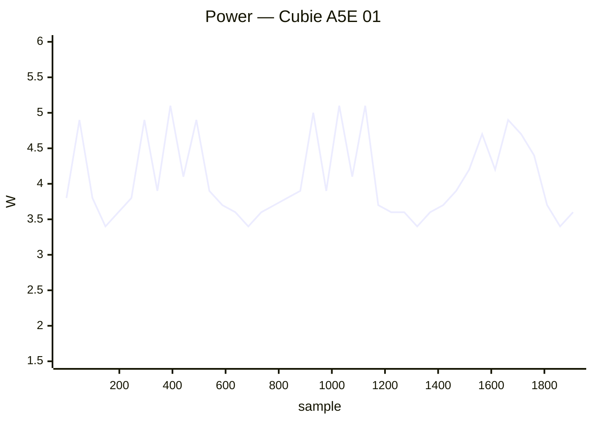

### ❌ Cubieboard 1 01

`cubieboard` · **inplace** · image `26.11.0-trunk.110` · 0 ✅ · 1 ❌ · 0 ⏭️

| Module | Status | Time | Detail |
|:--|:--:|--:|:--|
| reachable | ❌ | — | ip=10.0.50.86 · reachable=False · port=22 |

### ❌ Edge2 01

`khadas-edge2` · **inplace** · image `26.11.0-trunk.108` · 0 ✅ · 1 ❌ · 0 ⏭️

| Module | Status | Time | Detail |
|:--|:--:|--:|:--|
| reachable | ❌ | — | ip=10.0.50.121 · reachable=False · port=22 |

### ❌ MUSE Book 01

`musebook` · **inplace** · image `26.11.0-trunk` · 0 ✅ · 1 ❌ · 0 ⏭️

| Module | Status | Time | Detail |
|:--|:--:|--:|:--|
| reachable | ❌ | — | ip=10.0.50.29 · reachable=False · port=22 |

### ❌ MusePi Pro 01

`musepipro` · **inplace** · image `26.11.0-trunk.108` · 1 ✅ · 1 ❌ · 4 ⏭️

| Module | Status | Time | Detail |
|:--|:--:|--:|:--|
| upgrade | ✅ | 76 s | nightly · 26.11.0-trunk.110 → 26.11.0-trunk.110 |
| reboot | ❌ | 221 s | power-cycle |
| hw-perf | ⏭️ | — | board down after reboot/power-cycle |
| dvfs | ⏭️ | — | — |
| net-iperf | ⏭️ | — | board down after reboot/power-cycle |
| store-versions | ⏭️ | — | — |

**Power** — min 2.0 W · avg 3.3 W · peak 5.0 W · 237 samples

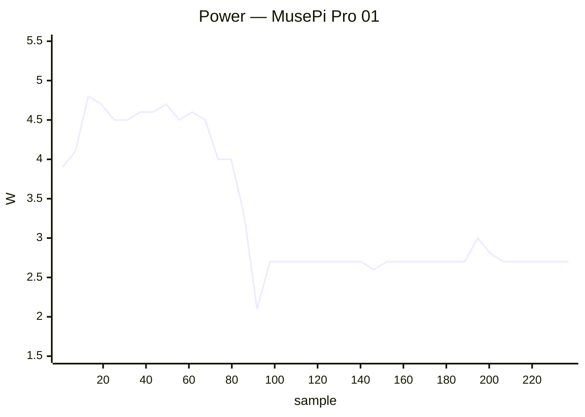

### ❌ NanoPi R76S 01

`nanopi-r76s` · **inplace** · image `26.11.0-trunk.108` · 0 ✅ · 1 ❌ · 15 ⏭️

| Module | Status | Time | Detail |
|:--|:--:|--:|:--|
| upgrade | ⏭️ | 11 s | — |
| reboot | ❌ | 148 s | power-cycle · up 104 s |
| kernel-switch | ⏭️ | — | skipped=board down after reboot/power-cycle |
| reboot | ⏭️ | — | reboot |
| hw-perf | ⏭️ | — | board down after reboot/power-cycle |
| dvfs | ⏭️ | — | — |
| net-iperf | ⏭️ | — | board down after reboot/power-cycle |
| store-versions | ⏭️ | — | — |
| kernel-switch | ⏭️ | — | skipped=board down after reboot/power-cycle |
| reboot | ⏭️ | — | reboot |
| hw-perf | ⏭️ | — | board down after reboot/power-cycle |
| dvfs | ⏭️ | — | — |
| net-iperf | ⏭️ | — | board down after reboot/power-cycle |
| store-versions | ⏭️ | — | — |
| kernel-switch | ⏭️ | — | skipped=board down after reboot/power-cycle |
| reboot | ⏭️ | — | reboot |

**Power** — min 0.6 W · avg 3.5 W · peak 5.2 W · 91 samples

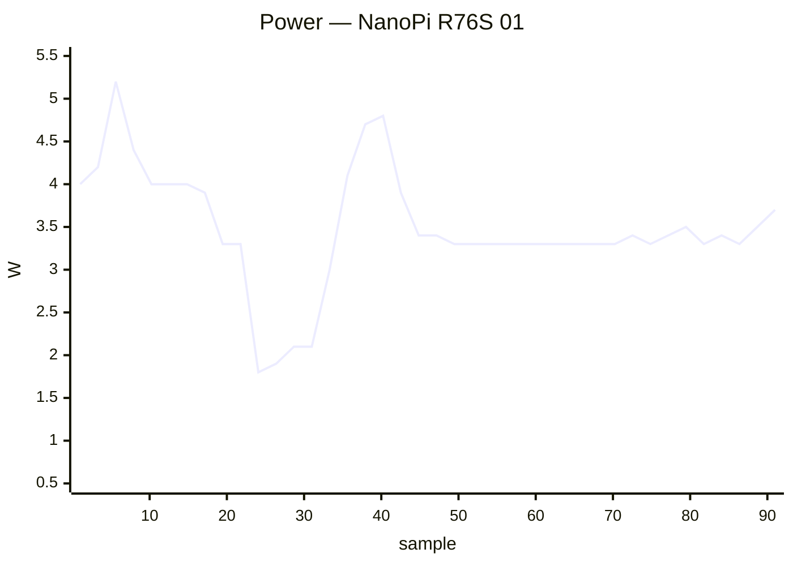

### ❌ Odroid XU4 01

`odroidxu4` · **inplace** · image `26.11.0-trunk.92` · 0 ✅ · 1 ❌ · 15 ⏭️

| Module | Status | Time | Detail |
|:--|:--:|--:|:--|
| upgrade | ⏭️ | 1 s | — |
| reboot | ❌ | 134 s | power-cycle · up 31 s |
| kernel-switch | ⏭️ | — | skipped=board down after reboot/power-cycle |
| reboot | ⏭️ | — | reboot |
| hw-perf | ⏭️ | — | board down after reboot/power-cycle |
| dvfs | ⏭️ | — | — |
| net-iperf | ⏭️ | — | board down after reboot/power-cycle |
| store-versions | ⏭️ | — | — |
| kernel-switch | ⏭️ | — | skipped=board down after reboot/power-cycle |
| reboot | ⏭️ | — | reboot |
| hw-perf | ⏭️ | — | board down after reboot/power-cycle |
| dvfs | ⏭️ | — | — |
| net-iperf | ⏭️ | — | board down after reboot/power-cycle |
| store-versions | ⏭️ | — | — |
| kernel-switch | ⏭️ | — | skipped=board down after reboot/power-cycle |
| reboot | ⏭️ | — | reboot |

### ❌ Orange Pi Prime 01

`orangepiprime` · **inplace** · image `26.11.0-trunk.92` · 7 ✅ · 2 ❌ · 7 ⏭️

| Module | Status | Time | Detail |
|:--|:--:|--:|:--|
| upgrade | ✅ | 174 s | nightly · 26.11.0-trunk.99 → 26.11.0-trunk.99 |
| reboot | ✅ | 51 s | warm · up 34 s |
| kernel-switch | ✅ | 58 s | branch=current · family=sunxi64 · installed=26.11.0-trunk.99 · boot_image=/boot/vmlinuz-6.18.57-current-sunxi64 · kernel_before=6.18.57-current-sunxi64 |
| reboot | ✅ | 92 s | warm · 2/2 boots · up 32 s |
| hw-performance | ✅ | 35 s | AES 379 · mem 2100 · disk W 13 / R 23 MB/s · 41.4 °C · None MHz |
| dvfs | ➖ | 3 s | no cpufreq |
| network-iperf | ❌ | 401 s | end0 ↑892/↓941 (1GE) · wlan0 ↑0/↓0 (Wi-Fi 4) Mbps |
| store-versions | ✅ | 5 s | 26.11.0-trunk.99 · 6.18.57-current-sunxi64 |
| kernel-switch | ✅ | 163 s | branch=edge · family=sunxi64 · installed=26.11.0-trunk.99 · boot_image=/boot/vmlinuz-7.2.11-edge-sunxi64 · kernel_before=6.18.57-current-sunxi64 |
| reboot | ❌ | 203 s | warm · 0/2 boots |
| hw-perf | ⏭️ | — | board down after reboot/power-cycle |
| dvfs | ⏭️ | — | — |
| net-iperf | ⏭️ | — | board down after reboot/power-cycle |
| store-versions | ⏭️ | — | — |
| kernel-switch | ⏭️ | — | skipped=board down after reboot/power-cycle |
| reboot | ⏭️ | — | reboot |

### ❌ Orange Pi+ 2E 02

`orangepiplus2e` · **inplace** · image `26.11.0-trunk` · 0 ✅ · 1 ❌ · 0 ⏭️

| Module | Status | Time | Detail |
|:--|:--:|--:|:--|
| reachable | ❌ | — | ip=10.0.50.85 · reachable=False · port=22 |

### ❌ Tinker Board 2 01

`tinkerboard-2` · **inplace** · image `26.11.0-trunk` · 10 ✅ · 3 ❌ · 3 ⏭️

| Module | Status | Time | Detail |
|:--|:--:|--:|:--|
| upgrade | ⏭️ | 22 s | — |
| reboot | ✅ | 60 s | power-cycle · up 27 s |
| kernel-switch | ✅ | 29 s | branch=current · family=rockchip64 · installed=26.11.0-trunk · boot_image=/boot/vmlinuz-6.18.58-current-rockchip64 · kernel_before=6.18.58-current-rockchip64 |
| reboot | ✅ | 89 s | power-cycle · 2/2 boots · up 25 s |
| hw-performance | ✅ | 31 s | AES 679 · mem 4500 · disk W 21 / R 22 MB/s · 43.9 °C · 1416 MHz |
| dvfs | ✅ | 25 s | ondemand · 408–1416 MHz (peak 1416) |
| network-iperf | ✅ | 32 s | end0 ↑940/↓941 (1GE) Mbps |
| store-versions | ✅ | 5 s | 26.11.0-trunk · 6.18.58-current-rockchip64 |
| kernel-switch | ❌ | 25 s | branch=edge · phase=install · dpkg_state=absent |
| reboot | ✅ | 92 s | power-cycle · 2/2 boots · up 24 s |
| hw-performance | ✅ | 31 s | AES 680 · mem 4500 · disk W 21 / R 1 MB/s · 44.4 °C · 1416 MHz |
| dvfs | ➖ | 107 s | ondemand · 408–1416 MHz · no freq read under load |
| network-iperf | ⏭️ | 20 s | no iperf3 on board |
| store-versions | ❌ | 13 s | — |
| kernel-switch | ❌ | 26 s | branch=current · phase=install · dpkg_state=absent |
| reboot | ✅ | 72 s | power-cycle · up 27 s |

**Power** — min 0.7 W · avg 5.2 W · peak 8.1 W · 550 samples

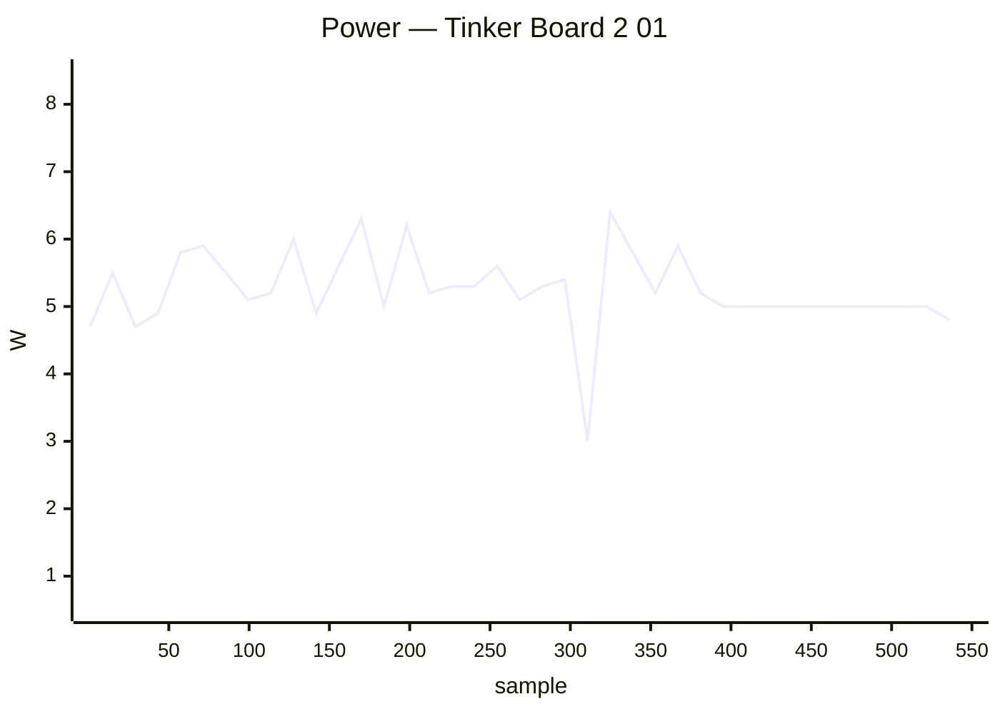

### ❌ UEFI/DT arm64 01

`jetson-nano` · **inplace** · image `26.11.0-trunk` · 0 ✅ · 1 ❌ · 0 ⏭️

| Module | Status | Time | Detail |
|:--|:--:|--:|:--|
| reachable | ❌ | — | ip=10.0.50.69 · reachable=False · port=22 |

### ❌ VIM3 01

`khadas-vim3` · **inplace** · image `26.11.0-trunk.108` · 0 ✅ · 1 ❌ · 0 ⏭️

| Module | Status | Time | Detail |
|:--|:--:|--:|:--|
| reachable | ❌ | — | ip=10.0.50.39 · reachable=False · port=22 |

## ✅ Passed (71)

### ✅ A64 OLinuXino 01

`lime-a64` · **inplace** · image `26.8.3` · 7 ✅ · 1 ❌ · 0 ⏭️

| Module | Status | Time | Detail |
|:--|:--:|--:|:--|
| upgrade | ✅ | 442 s | nightly · 26.8.3 → 26.11.0-trunk.110 |
| reboot | ✅ | 66 s | power-cycle · up 26 s |
| kernel-switch | ✅ | 55 s | branch=current · family=sunxi64 · installed=26.11.0-trunk.110 · boot_image=/boot/vmlinuz-6.18.57-current-sunxi64 · kernel_before=6.18.57-current-sunxi64 |
| reboot | ✅ | 98 s | power-cycle · 2/2 boots · up 28 s |
| hw-performance | ✅ | 32 s | AES 467 · mem 2600 · disk W 11 / R 66 MB/s · 43.7 °C · 1152 MHz |
| dvfs | ✅ | 23 s | performance · 648–1008 MHz (peak 1008) |
| network-iperf | ❌ | 488 s | end0 ↑920/↓846 (1GE) · wlan0 ↑0/↓0 (Wi-Fi 4) Mbps |
| store-versions | ✅ | 6 s | 26.11.0-trunk.110 · 6.18.57-current-sunxi64 |

### ✅ Banana Pi CM4IO 01

`bananapicm4io` · **inplace** · image `26.11.0-trunk.108` · 16 ✅ · 0 ❌ · 0 ⏭️

| Module | Status | Time | Detail |
|:--|:--:|--:|:--|
| upgrade | ✅ | 251 s | nightly · 26.11.0-trunk.108 → 26.11.0-trunk.110 |
| reboot | ✅ | 64 s | power-cycle · up 25 s |
| kernel-switch | ✅ | 25 s | branch=current · family=meson64 · installed=26.11.0-trunk.110 · boot_image=/boot/vmlinuz-6.18.57-current-meson64 · kernel_before=6.18.57-current-meson64 |
| reboot | ✅ | 87 s | power-cycle · 2/2 boots · up 25 s |
| hw-performance | ✅ | 32 s | AES 1365 · mem 6200 · disk W 8 / R 22 MB/s · 64.1 °C · 2016 MHz |
| dvfs | ✅ | 14 s | performance · 1000–2016 MHz (peak 2400) |
| network-iperf | ✅ | 53 s | end0 ↑937/↓941 (1GE) · wlan0 ↑9/↓33 (Wi-Fi 5) Mbps |
| store-versions | ✅ | 4 s | 26.11.0-trunk.110 · 6.18.57-current-meson64 |
| kernel-switch | ✅ | 121 s | branch=edge · family=meson64 · installed=26.11.0-trunk.110 · boot_image=/boot/vmlinuz-7.3.0-edge-meson64 · kernel_before=6.18.57-current-meson64 |
| reboot | ✅ | 88 s | power-cycle · 2/2 boots · up 28 s |
| hw-performance | ✅ | 32 s | AES 1362 · mem 6200 · disk W 8 / R 22 MB/s · 63.5 °C · 2016 MHz |
| dvfs | ✅ | 16 s | performance · 1000–2016 MHz (peak 2400) |
| network-iperf | ✅ | 52 s | end0 ↑938/↓941 (1GE) · wlan0 ↑22/↓36 (Wi-Fi 5) Mbps |
| store-versions | ✅ | 3 s | 26.11.0-trunk.110 · 7.3.0-edge-meson64 |
| kernel-switch | ✅ | 118 s | branch=current · family=meson64 · installed=26.11.0-trunk.110 · boot_image=/boot/vmlinuz-6.18.57-current-meson64 · kernel_before=7.3.0-edge-meson64 |
| reboot | ✅ | 64 s | power-cycle · up 28 s |

**Power** — min 1.9 W · avg 4.8 W · peak 11.0 W · 812 samples

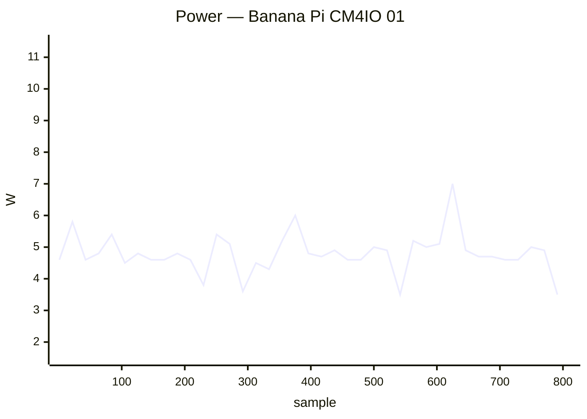

### ✅ Banana Pi M2 Ultra 01

`bananapim2ultra` · **inplace** · image `26.11.0-trunk.108` · 16 ✅ · 0 ❌ · 0 ⏭️

| Module | Status | Time | Detail |
|:--|:--:|--:|:--|
| upgrade | ✅ | 412 s | nightly · 26.11.0-trunk.108 → 26.11.0-trunk.110 |
| reboot | ✅ | 42 s | warm · up 24 s |
| kernel-switch | ✅ | 62 s | branch=current · family=sunxi · installed=26.11.0-trunk.110 · boot_image=/boot/vmlinuz-6.18.57-current-sunxi · kernel_before=6.18.57-current-sunxi |
| reboot | ✅ | 79 s | warm · 2/2 boots · up 25 s |
| hw-performance | ✅ | 31 s | AES 23 · mem 2100 · disk W 1 / R 42 MB/s · 53.2 °C · 1200 MHz |
| dvfs | ✅ | 25 s | ondemand · 720–1200 MHz (peak 1200) |
| network-iperf | ✅ | 66 s | end0 ↑807/↓940 (1GE) · wlan0 ↑10/↓24 (Wi-Fi 4) Mbps |
| store-versions | ✅ | 5 s | 26.11.0-trunk.110 · 6.18.57-current-sunxi |
| kernel-switch | ✅ | 185 s | branch=edge · family=sunxi · installed=26.11.0-trunk.110 · boot_image=/boot/vmlinuz-7.3.0-edge-sunxi · kernel_before=6.18.57-current-sunxi |
| reboot | ✅ | 78 s | warm · 2/2 boots · up 25 s |
| hw-performance | ✅ | 31 s | AES 23 · mem 2100 · disk W 1 / R 43 MB/s · 52.2 °C · 1200 MHz |
| dvfs | ✅ | 27 s | ondemand · 720–1200 MHz (peak 1200) |
| network-iperf | ✅ | 198 s | end0 ↑816/↓941 (1GE) · wlan0 ↑14/↓25 (Wi-Fi 4) Mbps |
| store-versions | ✅ | 6 s | 26.11.0-trunk.110 · 7.3.0-edge-sunxi |
| kernel-switch | ✅ | 182 s | branch=current · family=sunxi · installed=26.11.0-trunk.110 · boot_image=/boot/vmlinuz-6.18.57-current-sunxi · kernel_before=7.3.0-edge-sunxi |
| reboot | ✅ | 42 s | warm · up 25 s |

### ✅ Banana Pi M2Pro 01

`bananapim2pro` · **inplace** · image `26.11.0-trunk.108` · 16 ✅ · 0 ❌ · 0 ⏭️

| Module | Status | Time | Detail |
|:--|:--:|--:|:--|
| upgrade | ✅ | 178 s | nightly · 26.11.0-trunk.108 → 26.11.0-trunk.110 |
| reboot | ✅ | 140 s | power-cycle · up 101 s |
| kernel-switch | ✅ | 30 s | branch=current · family=meson64 · installed=26.11.0-trunk.110 · boot_image=/boot/vmlinuz-6.18.57-current-meson64 · kernel_before=6.18.57-current-meson64 |
| reboot | ✅ | 245 s | power-cycle · 2/2 boots · up 102 s |
| hw-performance | ✅ | 19 s | AES 981 · mem 5300 · disk W 34 / R 150 MB/s · 48.9 °C · 2100 MHz |
| dvfs | ✅ | 18 s | ondemand · 1000–2100 MHz (peak 2100) |
| network-iperf | ✅ | 29 s | end0 ↑941/↓941 (1GE) Mbps |
| store-versions | ✅ | 5 s | 26.11.0-trunk.110 · 6.18.57-current-meson64 |
| kernel-switch | ✅ | 94 s | branch=edge · family=meson64 · installed=26.11.0-trunk.110 · boot_image=/boot/vmlinuz-7.3.0-edge-meson64 · kernel_before=6.18.57-current-meson64 |
| reboot | ✅ | 246 s | power-cycle · 2/2 boots · up 101 s |
| hw-performance | ✅ | 19 s | AES 980 · mem 5300 · disk W 40 / R 151 MB/s · 48.8 °C · 2100 MHz |
| dvfs | ✅ | 19 s | ondemand · 1000–2100 MHz (peak 2100) |
| network-iperf | ✅ | 29 s | end0 ↑940/↓941 (1GE) Mbps |
| store-versions | ✅ | 4 s | 26.11.0-trunk.110 · 7.3.0-edge-meson64 |
| kernel-switch | ✅ | 94 s | branch=current · family=meson64 · installed=26.11.0-trunk.110 · boot_image=/boot/vmlinuz-6.18.57-current-meson64 · kernel_before=7.3.0-edge-meson64 |
| reboot | ✅ | 141 s | power-cycle · up 104 s |

**Power** — min 1.4 W · avg 3.0 W · peak 5.4 W · 1043 samples

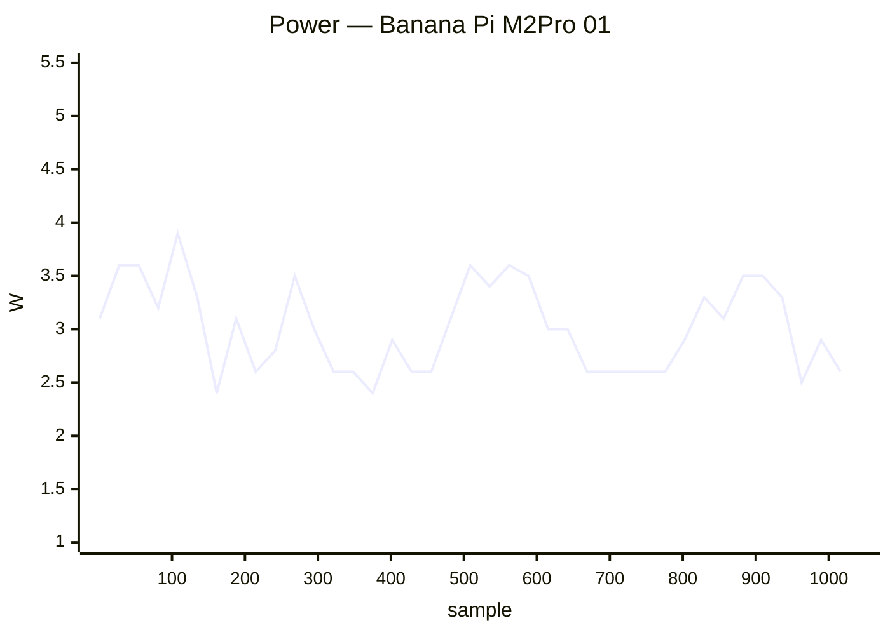

### ✅ Banana Pi M5 01

`bananapim5` · **inplace** · image `26.11.0-trunk.108` · 16 ✅ · 0 ❌ · 0 ⏭️

| Module | Status | Time | Detail |
|:--|:--:|--:|:--|
| upgrade | ✅ | 319 s | nightly · 26.11.0-trunk.108 → 26.11.0-trunk.110 |
| reboot | ✅ | 172 s | warm · up 156 s |
| kernel-switch | ✅ | 46 s | branch=current · family=meson64 · installed=26.11.0-trunk.110 · boot_image=/boot/vmlinuz-6.18.57-current-meson64 · kernel_before=6.18.57-current-meson64 |
| reboot | ✅ | 322 s | warm · 2/2 boots · up 146 s |
| hw-performance | ✅ | 38 s | AES 979 · mem 5200 · disk W 9 / R 15 MB/s · 53.4 °C · 2100 MHz |
| dvfs | ✅ | 19 s | ondemand · 1000–2100 MHz (peak 2100) |
| network-iperf | ✅ | 123 s | end0 ↑940/↓941 (1GE) · wlx000f13960190 ↑1/↓10 (Wi-Fi 4) Mbps |
| store-versions | ✅ | 4 s | 26.11.0-trunk.110 · 6.18.57-current-meson64 |
| kernel-switch | ✅ | 169 s | branch=edge · family=meson64 · installed=26.11.0-trunk.110 · boot_image=/boot/vmlinuz-7.3.0-edge-meson64 · kernel_before=6.18.57-current-meson64 |
| reboot | ✅ | 106 s | warm · 2/2 boots · up 25 s |
| hw-performance | ✅ | 38 s | AES 980 · mem 5100 · disk W 9 / R 15 MB/s · 54.6 °C · 2100 MHz |
| dvfs | ✅ | 20 s | ondemand · 1000–2100 MHz (peak 2100) |
| network-iperf | ✅ | 90 s | end0 ↑940/↓941 (1GE) · wlx000f13960190 ↑1/↓7 (Wi-Fi 4) Mbps |
| store-versions | ✅ | 4 s | 26.11.0-trunk.110 · 7.3.0-edge-meson64 |
| kernel-switch | ✅ | 164 s | branch=current · family=meson64 · installed=26.11.0-trunk.110 · boot_image=/boot/vmlinuz-6.18.57-current-meson64 · kernel_before=7.3.0-edge-meson64 |
| reboot | ✅ | 133 s | warm · up 117 s |

### ✅ Banana Pi M7 01

`bananapim7` · **inplace** · image `26.11.0-trunk.108` · 22 ✅ · 0 ❌ · 0 ⏭️

| Module | Status | Time | Detail |
|:--|:--:|--:|:--|
| upgrade | ✅ | 75 s | nightly · 26.11.0-trunk.108 → 26.11.0-trunk.110 |
| reboot | ✅ | 54 s | power-cycle · up 15 s |
| kernel-switch | ✅ | 18 s | branch=vendor · family=rk35xx · installed=26.11.0-trunk.110 · boot_image=/boot/vmlinuz-6.1.172-vendor-rk35xx · kernel_before=6.1.172-vendor-rk35xx |
| reboot | ✅ | 72 s | power-cycle · 2/2 boots · up 15 s |
| hw-performance | ✅ | 13 s | AES 1257 · mem 15300 · disk W 883 / R 1304 MB/s · 61 °C · 1800 MHz |
| dvfs | ✅ | 16 s | ondemand · 1800–1800 MHz (peak 2256) |
| network-iperf | ✅ | 53 s | enP2p33s0 ↑1007/↓2263 (2.5GE) · enP4p65s0 ↑2348/↓2346 (2.5GE) Mbps |
| store-versions | ✅ | 4 s | 26.11.0-trunk.110 · 6.1.172-vendor-rk35xx |
| kernel-switch | ✅ | 47 s | branch=current · family=rockchip64 · installed=26.11.0-trunk.110 · boot_image=/boot/vmlinuz-6.18.57-current-rockchip64 · kernel_before=6.1.172-vendor-rk35xx |
| reboot | ✅ | 230 s | power-cycle · 2/2 boots · up 96 s |
| hw-performance | ✅ | 13 s | AES 1252 · mem 10100 · disk W 879 / R 1159 MB/s · 63.8 °C · 1800 MHz |
| dvfs | ✅ | 13 s | ondemand · 408–1800 MHz (peak 2400) |
| network-iperf | ✅ | 87 s | enP2p33s0 ↑795/↓2348 (2.5GE) · enP4p65s0 ↑2351/↓2292 (2.5GE) Mbps |
| store-versions | ✅ | 4 s | 26.11.0-trunk.110 · 6.18.57-current-rockchip64 |
| kernel-switch | ✅ | 45 s | branch=edge · family=rockchip64 · installed=26.11.0-trunk.110 · boot_image=/boot/vmlinuz-7.3.0-edge-rockchip64 · kernel_before=6.18.57-current-rockchip64 |
| reboot | ✅ | 236 s | power-cycle · 2/2 boots · up 96 s |
| hw-performance | ✅ | 13 s | AES 1252 · mem 8000 · disk W 931 / R 1537 MB/s · 64.7 °C · 1800 MHz |
| dvfs | ✅ | 16 s | ondemand · 408–1800 MHz (peak 2400) |
| network-iperf | ✅ | 88 s | enP2p33s0 ↑970/↓2343 (2.5GE) · enP4p65s0 ↑2353/↓2260 (2.5GE) Mbps |
| store-versions | ✅ | 4 s | 26.11.0-trunk.110 · 7.3.0-edge-rockchip64 |
| kernel-switch | ✅ | 37 s | branch=vendor · family=rk35xx · installed=26.11.0-trunk.110 · boot_image=/boot/vmlinuz-6.1.172-vendor-rk35xx · kernel_before=7.3.0-edge-rockchip64 |
| reboot | ✅ | 46 s | power-cycle · up 16 s |

**Power** — min 0.6 W · avg 7.1 W · peak 15.4 W · 693 samples

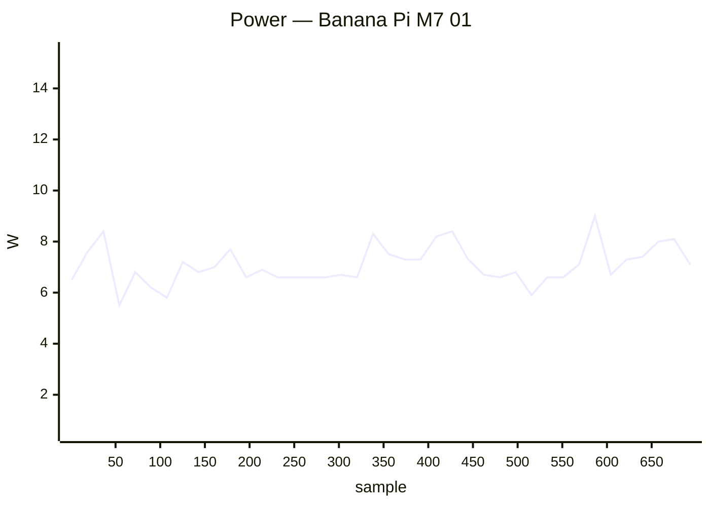

### ✅ Banana Pi R2 01

`bananapir2` · **inplace** · image `26.11.0-trunk.108` · 16 ✅ · 0 ❌ · 0 ⏭️

| Module | Status | Time | Detail |
|:--|:--:|--:|:--|
| upgrade | ✅ | 254 s | nightly · 26.11.0-trunk.108 → 26.11.0-trunk.110 |
| reboot | ✅ | 71 s | power-cycle · up 34 s |
| kernel-switch | ✅ | 53 s | branch=current · family=mt7623 · installed=26.11.0-trunk.110 · boot_image=/boot/vmlinuz-6.18.57-current-mt7623 · kernel_before=6.18.57-current-mt7623 |
| reboot | ✅ | 105 s | power-cycle · 2/2 boots · up 34 s |
| hw-performance | ✅ | 35 s | AES 25 · mem 1600 · disk W 1 / R 23 MB/s · 50.8 °C · 1300 MHz |
| dvfs | ✅ | 26 s | ondemand · 98–1300 MHz (peak 1300) |
| network-iperf | ✅ | 37 s | lan2 ↑939/↓921 Mbps |
| store-versions | ✅ | 6 s | 26.11.0-trunk.110 · 6.18.57-current-mt7623 |
| kernel-switch | ✅ | 131 s | branch=edge · family=mt7623 · installed=26.11.0-trunk.110 · boot_image=/boot/vmlinuz-7.2.11-edge-mt7623 · kernel_before=6.18.57-current-mt7623 |
| reboot | ✅ | 107 s | power-cycle · 2/2 boots · up 35 s |
| hw-performance | ✅ | 34 s | AES 25 · mem 1600 · disk W 20 / R 22 MB/s · 50.7 °C · 1300 MHz |
| dvfs | ✅ | 29 s | ondemand · 98–1300 MHz (peak 1300) |
| network-iperf | ✅ | 94 s | lan2 ↑926/↓930 Mbps |
| store-versions | ✅ | 6 s | 26.11.0-trunk.110 · 7.2.11-edge-mt7623 |
| kernel-switch | ✅ | 129 s | branch=current · family=mt7623 · installed=26.11.0-trunk.110 · boot_image=/boot/vmlinuz-6.18.57-current-mt7623 · kernel_before=7.2.11-edge-mt7623 |
| reboot | ✅ | 75 s | power-cycle · up 37 s |

**Power** — min 2.7 W · avg 5.2 W · peak 6.6 W · 957 samples

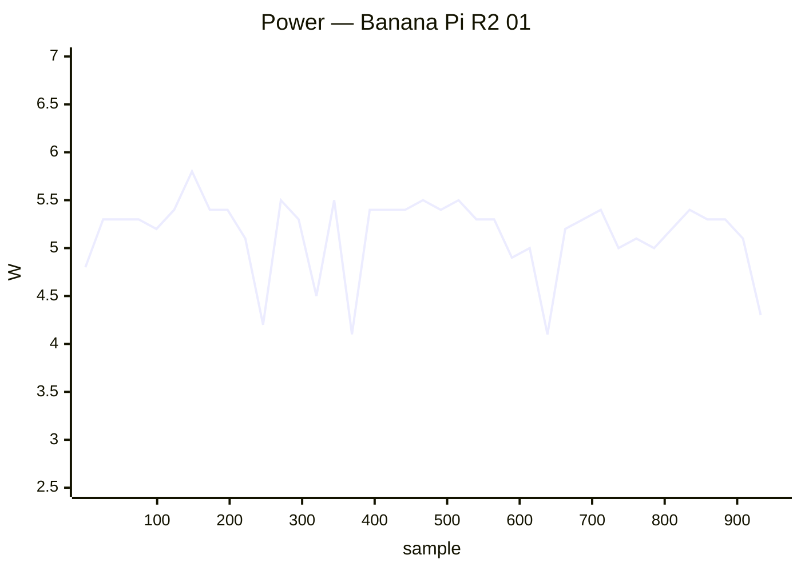

### ✅ Banana Pi R3 Mini 01

`bananapir3mini` · **inplace** · image `26.11.0-trunk.108` · 7 ✅ · 0 ❌ · 1 ⏭️

| Module | Status | Time | Detail |
|:--|:--:|--:|:--|
| upgrade | ✅ | 131 s | nightly · 26.11.0-trunk.108 → 26.11.0-trunk.110 |
| reboot | ✅ | 72 s | power-cycle · up 36 s |
| kernel-switch | ✅ | 32 s | branch=current · family=filogic-mt7986 · installed=26.11.0-trunk.110 · boot_image=/boot/vmlinuz-6.18.57-current-filogic-mt7986 · kernel_before=6.18.57-current-filogic-mt7986 |
| reboot | ✅ | 110 s | power-cycle · 2/2 boots · up 35 s |
| hw-performance | ✅ | 16 s | AES 934 · mem 3200 · disk W 650 / R 656 MB/s · 60.1 °C · None MHz |
| dvfs | ➖ | 2 s | no cpufreq |
| network-iperf | ✅ | 191 s | eth0 ↑892/↓2346 (2.5GE) · eth1 ↑2353/↓2255 (2.5GE) · wlan0 ↑13/↓35 (Wi-Fi 6) · wlan1 ↑41/↓109 (Wi-Fi 6) Mbps |
| store-versions | ✅ | 4 s | 26.11.0-trunk.110 · 6.18.57-current-filogic-mt7986 |

**Power** — min 0.9 W · avg 8.6 W · peak 12.6 W · 350 samples

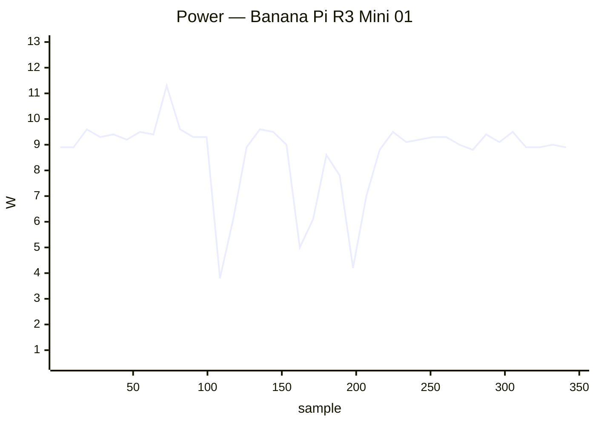

### ✅ Banana Pi R4 01

`bananapir4` · **inplace** · image `26.11.0-trunk.108` · 8 ✅ · 0 ❌ · 0 ⏭️

| Module | Status | Time | Detail |
|:--|:--:|--:|:--|
| upgrade | ✅ | 159 s | nightly · 26.11.0-trunk.108 → 26.11.0-trunk.110 |
| reboot | ✅ | 62 s | power-cycle · up 34 s |
| kernel-switch | ✅ | 32 s | branch=current · family=filogic · installed=26.11.0-trunk.110 · boot_image=/boot/vmlinuz-6.12.108-current-filogic · kernel_before=6.12.108-current-filogic |
| reboot | ✅ | 84 s | power-cycle · 2/2 boots · up 23 s |
| hw-performance | ✅ | 26 s | AES 1024 · mem 6100 · disk W 20 / R 22 MB/s · 40.6 °C · 1800 MHz |
| dvfs | ✅ | 16 s | schedutil · 800–1800 MHz (peak 1800) |
| network-iperf | ✅ | 75 s | eth2 ↑7538/↓5285 (10GE) · lan2 ↑941/↓941 (1GE) Mbps |
| store-versions | ✅ | 4 s | 26.11.0-trunk.110 · 6.12.108-current-filogic |

### ✅ BananaPi BPI-F3 01

`musepipro` · **inplace** · image `26.11.0-trunk.108` · 6 ✅ · 0 ❌ · 0 ⏭️

| Module | Status | Time | Detail |
|:--|:--:|--:|:--|
| upgrade | ✅ | 202 s | nightly · 26.11.0-trunk.108 → 26.11.0-trunk.110 |
| reboot | ✅ | 58 s | power-cycle · up 20 s |
| hw-performance | ✅ | 23 s | AES 27 · mem 3000 · disk W 66 / R 82 MB/s · 50 °C · 1600 MHz |
| dvfs | ✅ | 21 s | performance · 614–1600 MHz (peak 1600) |
| network-iperf | ✅ | 62 s | eth0 ↑933/↓942 (1GE) · wlan1 ↑26/↓244 (Wi-Fi 5) Mbps |
| store-versions | ✅ | 5 s | 26.11.0-trunk.110 · 6.18.58-current-spacemit |

**Power** — min 2.9 W · avg 5.2 W · peak 9.3 W · 300 samples

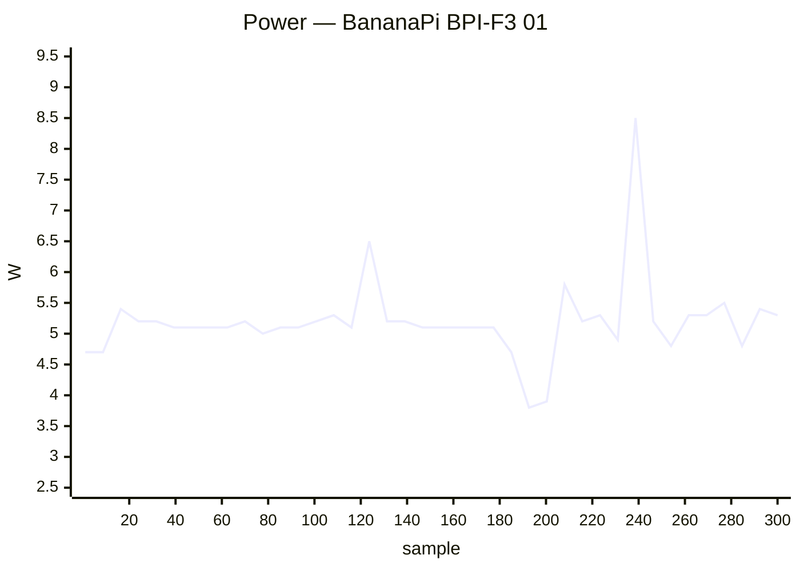

### ✅ BananaPi BPI-M4-Zero 01

`bananapim4zero` · **inplace** · image `26.11.0-trunk.108` · 4 ✅ · 0 ❌ · 2 ⏭️

| Module | Status | Time | Detail |
|:--|:--:|--:|:--|
| upgrade | ⏭️ | — | — |
| reboot | ⏭️ | — | reboot |
| hw-performance | ✅ | 34 s | AES 660 · mem 3600 · disk W 13 / R 22 MB/s · 52.9 °C · 1416 MHz |
| dvfs | ✅ | 20 s | ondemand · 480–1416 MHz (peak 1416) |
| network-iperf | ✅ | 35 s | wlan0 ↑20/↓93 (Wi-Fi 5) Mbps |
| store-versions | ✅ | 5 s | 26.11.0-trunk.110 · 6.18.57-current-sunxi64 |

### ✅ BananaPi M4 01

`bananapim4` · **inplace** · image `26.11.0-trunk` · 8 ✅ · 0 ❌ · 0 ⏭️

| Module | Status | Time | Detail |
|:--|:--:|--:|:--|
| upgrade | ✅ | 417 s | nightly · 26.11.0-trunk → 26.11.0-trunk.110 |
| reboot | ✅ | 61 s | power-cycle · up 26 s |
| kernel-switch | ✅ | 52 s | branch=current · family=realtek-rtd129x · installed=26.11.0-trunk.110 · boot_image=/boot/vmlinuz-6.18.57-current-realtek-rtd129x · kernel_before=6.18.57-current-realtek-rtd129x |
| reboot | ✅ | 98 s | power-cycle · 2/2 boots · up 28 s |
| hw-performance | ✅ | 28 s | AES 560 · mem 3300 · disk W 34 / R 38 MB/s · 62 °C · 1300 MHz |
| dvfs | ✅ | 26 s | schedutil · 300–1300 MHz (peak 1300) |
| network-iperf | ✅ | 231 s | eth0 ↑84/↓85 (10/100ME) · wlan0 ↑21/↓115 (Wi-Fi 5) Mbps |
| store-versions | ✅ | 6 s | 26.11.0-trunk.110 · 6.18.57-current-realtek-rtd129x |

**Power** — min 1.5 W · avg 4.1 W · peak 5.7 W · 745 samples

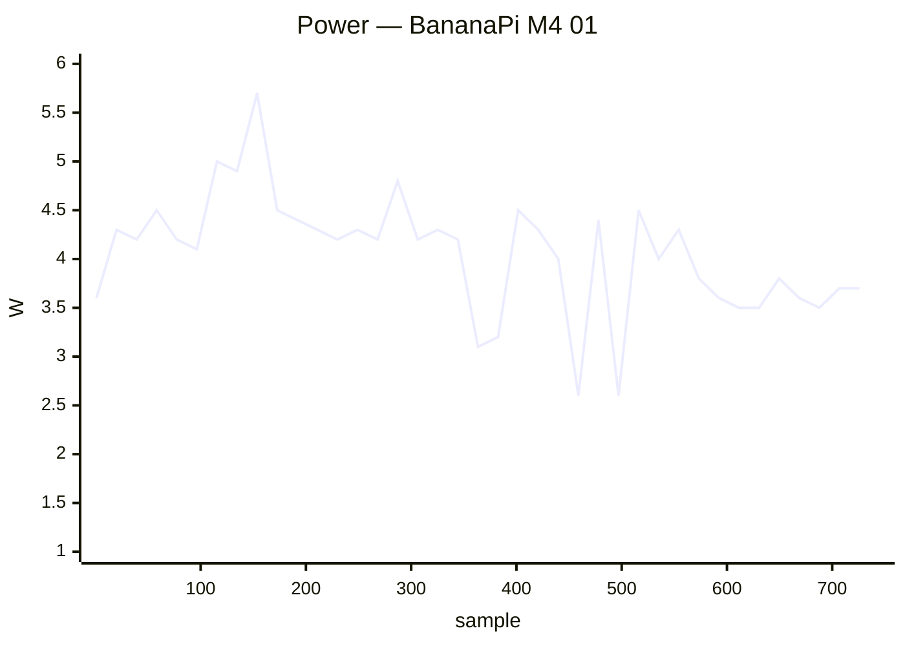

### ✅ Cubieboard 4 01

`cubieboard4` · **inplace** · image `26.11.0-trunk` · 4 ✅ · 0 ❌ · 2 ⏭️

| Module | Status | Time | Detail |
|:--|:--:|--:|:--|
| upgrade | ⏭️ | — | — |
| reboot | ⏭️ | — | reboot |
| hw-performance | ✅ | 35 s | AES 43 · mem 3900 · disk W 15 / R 65 MB/s · 44 °C · 1200 MHz |
| dvfs | ✅ | 32 s | ondemand · 480–1200 MHz (peak 1200) |
| network-iperf | ✅ | 70 s | end0 ↑918/↓940 (1GE) · wlan0 ↑16/↓15 (Wi-Fi 4) Mbps |
| store-versions | ✅ | 7 s | 26.11.0-trunk · 6.18.57-current-sunxi |

### ✅ Cubietruck 01

`cubietruck` · **inplace** · image `26.11.0-trunk.108` · 16 ✅ · 0 ❌ · 0 ⏭️

| Module | Status | Time | Detail |
|:--|:--:|--:|:--|
| upgrade | ✅ | 409 s | nightly · 26.11.0-trunk.108 → 26.11.0-trunk.110 |
| reboot | ✅ | 62 s | warm · up 43 s |
| kernel-switch | ✅ | 80 s | branch=current · family=sunxi · installed=26.11.0-trunk.110 · boot_image=/boot/vmlinuz-6.18.57-current-sunxi · kernel_before=6.18.57-current-sunxi |
| reboot | ✅ | 117 s | warm · 2/2 boots · up 41 s |
| hw-performance | ✅ | 44 s | AES 18 · mem 1700 · disk W 13 / R 22 MB/s · 50.1 °C · 960 MHz |
| dvfs | ✅ | 35 s | ondemand · 528–960 MHz (peak 960) |
| network-iperf | ✅ | 214 s | end0 ↑735/↓823 (1GE) · wlan0 ↑10/↓14 (Wi-Fi 4) Mbps |
| store-versions | ✅ | 7 s | 26.11.0-trunk.110 · 6.18.57-current-sunxi |
| kernel-switch | ✅ | 217 s | branch=edge · family=sunxi · installed=26.11.0-trunk.110 · boot_image=/boot/vmlinuz-7.3.0-edge-sunxi · kernel_before=6.18.57-current-sunxi |
| reboot | ✅ | 114 s | warm · 2/2 boots · up 40 s |
| hw-performance | ✅ | 43 s | AES 18 · mem 1700 · disk W 15 / R 22 MB/s · 50 °C · 960 MHz |
| dvfs | ✅ | 36 s | ondemand · 528–960 MHz (peak 960) |
| network-iperf | ✅ | 151 s | end0 ↑789/↓902 (1GE) · wlan0 ↑7/↓12 (Wi-Fi 4) Mbps |
| store-versions | ✅ | 7 s | 26.11.0-trunk.110 · 7.3.0-edge-sunxi |
| kernel-switch | ✅ | 212 s | branch=current · family=sunxi · installed=26.11.0-trunk.110 · boot_image=/boot/vmlinuz-6.18.57-current-sunxi · kernel_before=7.3.0-edge-sunxi |
| reboot | ✅ | 60 s | warm · up 39 s |

### ✅ Cubox i2eX/i4 01

`cubox-i` · **inplace** · image `26.11.0-trunk.73` · 16 ✅ · 0 ❌ · 0 ⏭️

| Module | Status | Time | Detail |
|:--|:--:|--:|:--|
| upgrade | ✅ | 634 s | nightly · 26.11.0-trunk.73 → 26.11.0-trunk.74 |
| reboot | ✅ | 88 s | power-cycle · up 48 s |
| kernel-switch | ✅ | 72 s | branch=current · family=imx6 · installed=26.11.0-trunk.74 · boot_image=/boot/vmlinuz-6.18.55-current-imx6 · kernel_before=6.18.55-current-imx6 |
| reboot | ✅ | 162 s | power-cycle · 2/2 boots · up 47 s |
| hw-performance | ✅ | 47 s | AES 26 · mem 782 · disk W 19 / R 20 MB/s · 54.3 °C · 996 MHz |
| dvfs | ✅ | 40 s | ondemand · 396–996 MHz (peak 996) |
| network-iperf | ✅ | 305 s | end0 ↑94/↓94 (10/100ME) · wlan0 ↑18/↓16 (Wi-Fi 4) Mbps |
| store-versions | ✅ | 9 s | 26.11.0-trunk.74 · 6.18.55-current-imx6 |
| kernel-switch | ✅ | 298 s | branch=edge · family=imx6 · installed=26.11.0-trunk.74 · boot_image=/boot/vmlinuz-7.1.13-edge-imx6 · kernel_before=6.18.55-current-imx6 |
| reboot | ✅ | 144 s | power-cycle · 2/2 boots · up 46 s |
| hw-performance | ✅ | 47 s | AES 25 · mem 727 · disk W 19 / R 20 MB/s · 56 °C · 996 MHz |
| dvfs | ✅ | 44 s | ondemand · 396–996 MHz (peak 996) |
| network-iperf | ✅ | 160 s | end0 ↑94/↓94 (10/100ME) · wlan0 ↑17/↓17 (Wi-Fi 4) Mbps |
| store-versions | ✅ | 9 s | 26.11.0-trunk.74 · 7.1.13-edge-imx6 |
| kernel-switch | ✅ | 280 s | branch=current · family=imx6 · installed=26.11.0-trunk.74 · boot_image=/boot/vmlinuz-6.18.55-current-imx6 · kernel_before=7.1.13-edge-imx6 |
| reboot | ✅ | 87 s | power-cycle · up 46 s |

**Power** — min 1.8 W · avg 3.0 W · peak 6.1 W · 1937 samples

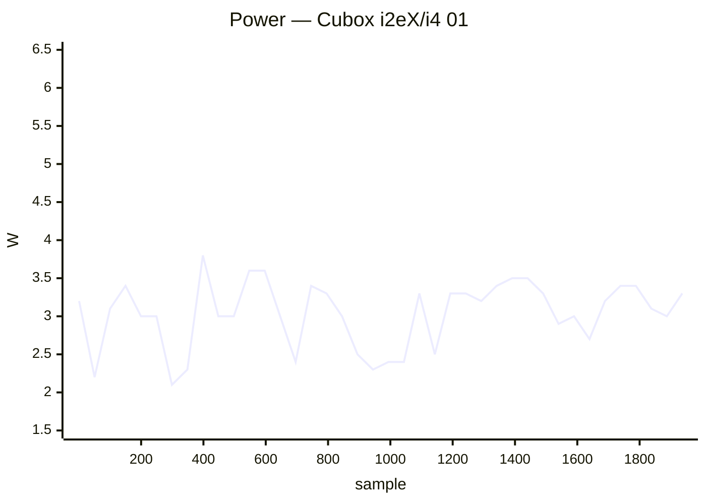

### ✅ Dragon Q6A 01

`radxa-dragon-q6a` · **inplace** · image `26.11.0-trunk.108` · 16 ✅ · 0 ❌ · 0 ⏭️

| Module | Status | Time | Detail |
|:--|:--:|--:|:--|
| upgrade | ✅ | 148 s | nightly · 26.11.0-trunk.108 → 26.11.0-trunk.110 |
| reboot | ✅ | 143 s | power-cycle · up 106 s |
| kernel-switch | ✅ | 17 s | branch=current · family=qcs6490 · installed=26.11.0-trunk.110 · boot_image=/boot/vmlinuz-6.18.2-current-qcs6490 · kernel_before=6.18.2-current-qcs6490 |
| reboot | ✅ | 248 s | power-cycle · 2/2 boots · up 105 s |
| hw-performance | ✅ | 13 s | AES 1520 · mem 19900 · disk W 233 / R 1047 MB/s · 45.3 °C · 1958 MHz |
| dvfs | ✅ | 14 s | ondemand · 300–1958 MHz (peak 2707) |
| network-iperf | ✅ | 56 s | enp1s0 ↑941/↓941 (1GE) Mbps |
| store-versions | ✅ | 4 s | 26.11.0-trunk.110 · 6.18.2-current-qcs6490 |
| kernel-switch | ✅ | 81 s | branch=edge · family=qcs6490 · installed=26.11.0-trunk.110 · boot_image=/boot/vmlinuz-7.2.3-edge-qcs6490 · kernel_before=6.18.2-current-qcs6490 |
| reboot | ✅ | 252 s | power-cycle · 2/2 boots · up 107 s |
| hw-performance | ✅ | 13 s | AES 1509 · mem 18400 · disk W 238 / R 1154 MB/s · 45.7 °C · 1958 MHz |
| dvfs | ✅ | 14 s | ondemand · 300–1958 MHz (peak 2707) |
| network-iperf | ✅ | 82 s | enp1s0 ↑941/↓941 (1GE) Mbps |
| store-versions | ✅ | 4 s | 26.11.0-trunk.110 · 7.2.3-edge-qcs6490 |
| kernel-switch | ✅ | 80 s | branch=current · family=qcs6490 · installed=26.11.0-trunk.110 · boot_image=/boot/vmlinuz-6.18.2-current-qcs6490 · kernel_before=7.2.3-edge-qcs6490 |
| reboot | ✅ | 142 s | power-cycle · up 106 s |

**Power** — min 1.1 W · avg 2.5 W · peak 9.3 W · 1041 samples

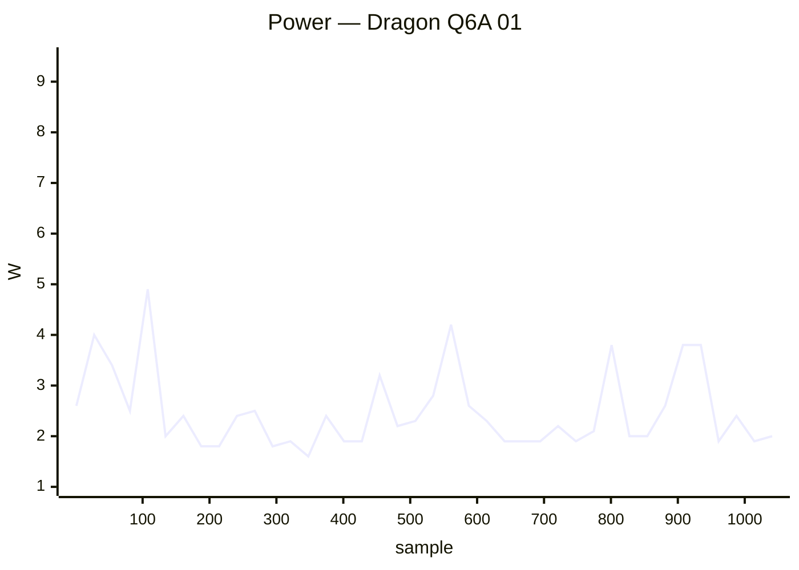

### ✅ Espressobin 01

`espressobin` · **inplace** · image `26.11.0-trunk.108` · 16 ✅ · 0 ❌ · 0 ⏭️

| Module | Status | Time | Detail |
|:--|:--:|--:|:--|
| upgrade | ✅ | 718 s | nightly · 26.11.0-trunk.108 → 26.11.0-trunk.110 |
| reboot | ✅ | 79 s | power-cycle · up 45 s |
| kernel-switch | ✅ | 72 s | branch=current · family=mvebu64 · installed=26.11.0-trunk.110 · boot_image=/boot/vmlinuz-6.18.57-current-mvebu64 · kernel_before=6.18.57-current-mvebu64 |
| reboot | ✅ | 130 s | power-cycle · 2/2 boots · up 43 s |
| hw-performance | ✅ | 31 s | AES 371 · mem 2000 · disk W 19 / R 133 MB/s · None °C · 800 MHz |
| dvfs | ✅ | 30 s | ondemand · 200–800 MHz (peak 800) |
| network-iperf | ✅ | 43 s | lan0 ↑931/↓728 (1GE) Mbps |
| store-versions | ✅ | 7 s | 26.11.0-trunk.110 · 6.18.57-current-mvebu64 |
| kernel-switch | ✅ | 345 s | branch=edge · family=mvebu64 · installed=26.11.0-trunk.110 · boot_image=/boot/vmlinuz-7.1.13-edge-mvebu64 · kernel_before=6.18.57-current-mvebu64 |
| reboot | ✅ | 127 s | power-cycle · 2/2 boots · up 41 s |
| hw-performance | ✅ | 36 s | AES 371 · mem 2000 · disk W 22 / R 138 MB/s · None °C · 800 MHz |
| dvfs | ✅ | 32 s | ondemand · 200–800 MHz (peak 800) |
| network-iperf | ✅ | 39 s | lan0 ↑935/↓733 (1GE) Mbps |
| store-versions | ✅ | 7 s | 26.11.0-trunk.110 · 7.1.13-edge-mvebu64 |
| kernel-switch | ✅ | 338 s | branch=current · family=mvebu64 · installed=26.11.0-trunk.110 · boot_image=/boot/vmlinuz-6.18.57-current-mvebu64 · kernel_before=7.1.13-edge-mvebu64 |
| reboot | ✅ | 72 s | power-cycle · up 40 s |

### ✅ Helios4 01

`helios4` · **inplace** · image `26.11.0-trunk.108` · 14 ✅ · 0 ❌ · 2 ⏭️

| Module | Status | Time | Detail |
|:--|:--:|--:|:--|
| upgrade | ✅ | 190 s | nightly · 26.11.0-trunk.108 → 26.11.0-trunk.110 |
| reboot | ✅ | 119 s | warm · up 103 s |
| kernel-switch | ✅ | 32 s | branch=current · family=mvebu · installed=26.11.0-trunk.110 · boot_image=/boot/vmlinuz-6.18.57-current-mvebu · kernel_before=6.18.57-current-mvebu |
| reboot | ✅ | 230 s | warm · 2/2 boots · up 102 s |
| hw-performance | ✅ | 26 s | AES 43 · mem 3800 · disk W 21 / R 23 MB/s · 60.4 °C · None MHz |
| dvfs | ➖ | 2 s | no cpufreq |
| network-iperf | ✅ | 59 s | end1 ↑941/↓941 (1GE) Mbps |
| store-versions | ✅ | 5 s | 26.11.0-trunk.110 · 6.18.57-current-mvebu |
| kernel-switch | ✅ | 96 s | branch=edge · family=mvebu · installed=26.11.0-trunk.110 · boot_image=/boot/vmlinuz-7.2.11-edge-mvebu · kernel_before=6.18.57-current-mvebu |
| reboot | ✅ | 231 s | warm · 2/2 boots · up 102 s |
| hw-performance | ✅ | 26 s | AES 43 · mem 3800 · disk W 20 / R 23 MB/s · 59.9 °C · None MHz |
| dvfs | ➖ | 2 s | no cpufreq |
| network-iperf | ✅ | 30 s | end1 ↑941/↓942 (1GE) Mbps |
| store-versions | ✅ | 4 s | 26.11.0-trunk.110 · 7.2.11-edge-mvebu |
| kernel-switch | ✅ | 91 s | branch=current · family=mvebu · installed=26.11.0-trunk.110 · boot_image=/boot/vmlinuz-6.18.57-current-mvebu · kernel_before=7.2.11-edge-mvebu |
| reboot | ✅ | 118 s | warm · up 102 s |

### ✅ K3 Pico-ITX 01

`k3picoitx` · **inplace** · image `26.11.0-trunk.108` · 8 ✅ · 0 ❌ · 0 ⏭️

| Module | Status | Time | Detail |
|:--|:--:|--:|:--|
| upgrade | ✅ | 79 s | nightly · 26.11.0-trunk.108 → 26.11.0-trunk.110 |
| reboot | ✅ | 50 s | power-cycle · up 25 s |
| kernel-switch | ✅ | 19 s | branch=legacy · family=spacemit-k3 · installed=26.11.0-trunk.110 · boot_image=/boot/vmlinuz-6.18.3-legacy-spacemit-k3 · kernel_before=6.18.3-legacy-spacemit-k3 |
| reboot | ✅ | 106 s | power-cycle · 2/2 boots · up 21 s |
| hw-performance | ✅ | 13 s | AES 778 · mem 12400 · disk W 1294 / R 1482 MB/s · 44 °C · 2150 MHz |
| dvfs | ✅ | 14 s | performance · 614–2150 MHz (peak 2150) |
| network-iperf | ✅ | 276 s | eth0 ↑941/↓941 (1GE) · eth1 ↑982/↓4977 (10GE) · wlan0 ↑13/↓71 (Wi-Fi 6) Mbps |
| store-versions | ✅ | 4 s | 26.11.0-trunk.110 · 6.18.3-legacy-spacemit-k3 |

### ✅ NanoPC T6 Plus 01

`friendlyelec-rk3588` · **inplace** · image `26.11.0-trunk.108` · 16 ✅ · 0 ❌ · 0 ⏭️

| Module | Status | Time | Detail |
|:--|:--:|--:|:--|
| upgrade | ✅ | 82 s | nightly · 26.11.0-trunk.108 → 26.11.0-trunk.110 |
| reboot | ✅ | 57 s | power-cycle · up 22 s |
| kernel-switch | ✅ | 19 s | branch=vendor · family=rk35xx · installed=26.11.0-trunk.110 · boot_image=/boot/vmlinuz-6.1.172-vendor-rk35xx · kernel_before=6.1.172-vendor-rk35xx |
| reboot | ✅ | 77 s | power-cycle · 2/2 boots · up 22 s |
| hw-performance | ✅ | 14 s | AES 1327 · mem 16000 · disk W 187 / R 256 MB/s · 41.6 °C · 1800 MHz |
| dvfs | ✅ | 16 s | ondemand · 1800–1800 MHz (peak 2400) |
| network-iperf | ✅ | 82 s | lan1 ↑697/↓2353 (2.5GE) · lan2 ↑963/↓2353 (2.5GE) · wlP3p49s0 ↑17/↓329 (Wi-Fi 5) Mbps |
| store-versions | ✅ | 3 s | 26.11.0-trunk.110 · 6.1.172-vendor-rk35xx |
| kernel-switch | ✅ | 50 s | branch=current · family=rockchip64 · installed=26.11.0-trunk.110 · boot_image=/boot/vmlinuz-6.18.57-current-rockchip64 · kernel_before=6.1.172-vendor-rk35xx |
| reboot | ✅ | 242 s | power-cycle · 2/2 boots · up 104 s |
| hw-performance | ✅ | 14 s | AES 1326 · mem 10700 · disk W 173 / R 279 MB/s · 43.5 °C · 1800 MHz |
| dvfs | ✅ | 14 s | ondemand · 408–1800 MHz (peak 2400) |
| network-iperf | ✅ | 80 s | lan1 ↑763/↓2354 (2.5GE) · lan2 ↑824/↓2340 (2.5GE) Mbps |
| store-versions | ✅ | 4 s | 26.11.0-trunk.110 · 6.18.57-current-rockchip64 |
| kernel-switch | ✅ | 40 s | branch=vendor · family=rk35xx · installed=26.11.0-trunk.110 · boot_image=/boot/vmlinuz-6.1.172-vendor-rk35xx · kernel_before=6.18.57-current-rockchip64 |
| reboot | ✅ | 55 s | power-cycle · up 22 s |

**Power** — min 2.4 W · avg 5.2 W · peak 10.9 W · 492 samples

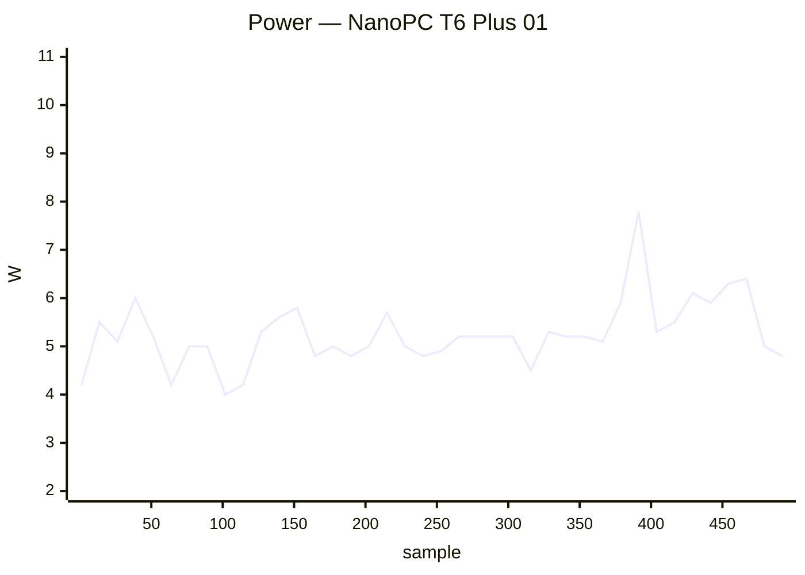

### ✅ NanoPi Fire3 01

`nanopifire3` · **inplace** · image `26.11.0-trunk.108` · 7 ✅ · 0 ❌ · 1 ⏭️

| Module | Status | Time | Detail |
|:--|:--:|--:|:--|
| upgrade | ✅ | 590 s | nightly · 26.11.0-trunk.108 → 26.11.0-trunk.110 |
| reboot | ✅ | 96 s | power-cycle · up 39 s |
| kernel-switch | ✅ | 61 s | branch=edge · family=s5p6818 · installed=26.11.0-trunk.110 · boot_image=/boot/vmlinuz-7.2.11-edge-s5p6818 · kernel_before=7.2.11-edge-s5p6818 |
| reboot | ✅ | 102 s | power-cycle · 2/2 boots · up 31 s |
| hw-performance | ✅ | 32 s | AES 373 · mem 2000 · disk W 19 / R 22 MB/s · 66 °C · None MHz |
| dvfs | ➖ | 3 s | no cpufreq |
| network-iperf | ✅ | 66 s | eth0 ↑94/↓94 (10/100ME) Mbps |
| store-versions | ✅ | 5 s | 26.11.0-trunk.110 · 7.2.11-edge-s5p6818 |

**Power** — min 2.0 W · avg 3.0 W · peak 4.2 W · 772 samples

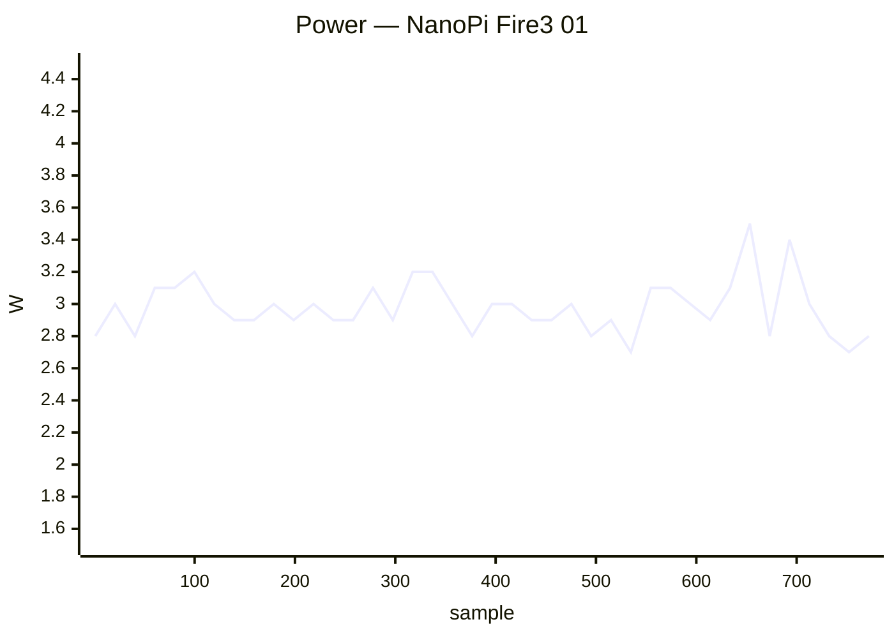

### ✅ NanoPi K2 01

`nanopik2-s905` · **inplace** · image `26.11.0-trunk.108` · 16 ✅ · 0 ❌ · 0 ⏭️

| Module | Status | Time | Detail |
|:--|:--:|--:|:--|
| upgrade | ✅ | 342 s | nightly · 26.11.0-trunk.108 → 26.11.0-trunk.110 |
| reboot | ✅ | 46 s | warm · up 31 s |
| kernel-switch | ✅ | 41 s | branch=current · family=meson64 · installed=26.11.0-trunk.110 · boot_image=/boot/vmlinuz-6.18.57-current-meson64 · kernel_before=6.18.57-current-meson64 |
| reboot | ✅ | 70 s | warm · 2/2 boots · up 19 s |
| hw-performance | ✅ | 33 s | AES 51 · mem 3800 · disk W 9 / R 41 MB/s · 61 °C · 2016 MHz |
| dvfs | ✅ | 19 s | ondemand · 500–1536 MHz (peak 1536) |
| network-iperf | ✅ | 57 s | end0 ↑936/↓941 (1GE) · wlan0 ↑6/↓16 (Wi-Fi 4) Mbps |
| store-versions | ✅ | 5 s | 26.11.0-trunk.110 · 6.18.57-current-meson64 |
| kernel-switch | ✅ | 165 s | branch=edge · family=meson64 · installed=26.11.0-trunk.110 · boot_image=/boot/vmlinuz-7.3.0-edge-meson64 · kernel_before=6.18.57-current-meson64 |
| reboot | ✅ | 72 s | warm · 2/2 boots · up 24 s |
| hw-performance | ✅ | 33 s | AES 51 · mem 3800 · disk W 8 / R 41 MB/s · 60 °C · 2016 MHz |
| dvfs | ✅ | 21 s | ondemand · 500–1536 MHz (peak 1536) |
| network-iperf | ✅ | 241 s | end0 ↑935/↓941 (1GE) · wlan0 ↑7/↓11 (Wi-Fi 4) Mbps |
| store-versions | ✅ | 5 s | 26.11.0-trunk.110 · 7.3.0-edge-meson64 |
| kernel-switch | ✅ | 166 s | branch=current · family=meson64 · installed=26.11.0-trunk.110 · boot_image=/boot/vmlinuz-6.18.57-current-meson64 · kernel_before=7.3.0-edge-meson64 |
| reboot | ✅ | 37 s | warm · up 20 s |

### ✅ NanoPi M4 03

`nanopim4` · **inplace** · image `26.11.0-trunk.110` · 8 ✅ · 0 ❌ · 0 ⏭️

| Module | Status | Time | Detail |
|:--|:--:|--:|:--|
| upgrade | ✅ | 217 s | nightly · 26.11.0-trunk.110 → 26.11.0-trunk.110 |
| reboot | ✅ | 58 s | power-cycle · up 20 s |
| kernel-switch | ✅ | 32 s | branch=current · family=rockchip64 · installed=26.11.0-trunk.110 · boot_image=/boot/vmlinuz-6.18.57-current-rockchip64 · kernel_before=6.18.57-current-rockchip64 |
| reboot | ✅ | 77 s | power-cycle · 2/2 boots · up 19 s |
| hw-performance | ✅ | 38 s | AES 1019 · mem 6600 · disk W 6 / R 61 MB/s · 35.6 °C · 1416 MHz |
| dvfs | ✅ | 19 s | ondemand · 408–1416 MHz (peak 1800) |
| network-iperf | ✅ | 163 s | end0 ↑940/↓941 (1GE) · wlan0 ↑11/↓84 (Wi-Fi 5) Mbps |
| store-versions | ✅ | 5 s | 26.11.0-trunk.110 · 6.18.57-current-rockchip64 |

**Power** — min 1.4 W · avg 4.3 W · peak 8.4 W · 493 samples

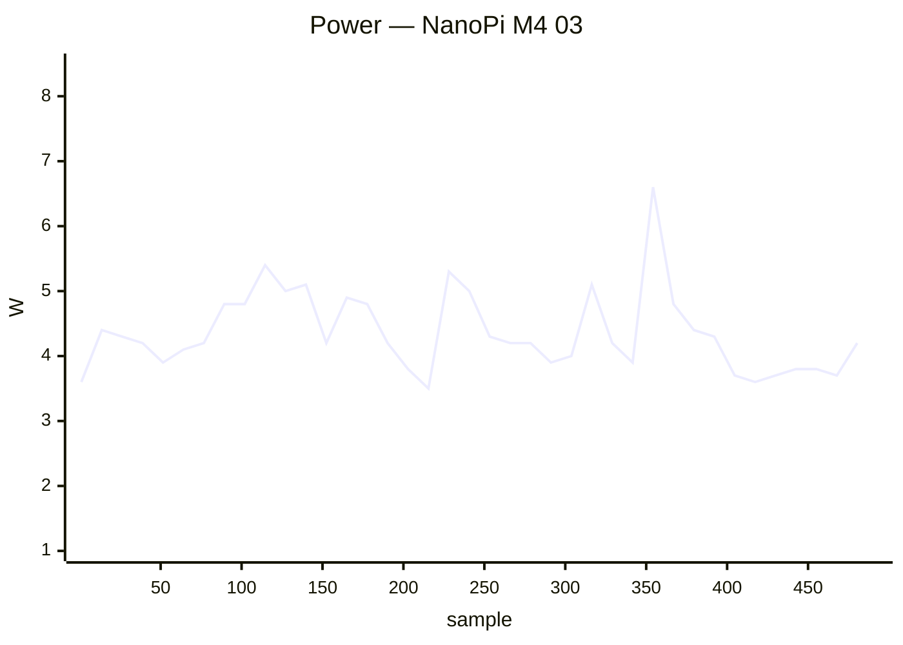

### ✅ NanoPi M4V2 01

`nanopim4v2` · **inplace** · image `26.11.0-trunk.110` · 16 ✅ · 0 ❌ · 0 ⏭️

| Module | Status | Time | Detail |
|:--|:--:|--:|:--|
| upgrade | ✅ | 123 s | nightly · 26.11.0-trunk.110 → 26.11.0-trunk.110 |
| reboot | ✅ | 54 s | power-cycle · up 18 s |
| kernel-switch | ✅ | 26 s | branch=current · family=rockchip64 · installed=26.11.0-trunk.110 · boot_image=/boot/vmlinuz-6.18.57-current-rockchip64 · kernel_before=6.18.57-current-rockchip64 |
| reboot | ✅ | 74 s | power-cycle · 2/2 boots · up 17 s |
| hw-performance | ✅ | 17 s | AES 1019 · mem 6500 · disk W 105 / R 156 MB/s · 45.6 °C · 1416 MHz |
| dvfs | ✅ | 18 s | ondemand · 408–1416 MHz (peak 1800) |
| network-iperf | ✅ | 206 s | end0 ↑940/↓941 (1GE) · wlan0 ↑26/↓190 (Wi-Fi 5) · wlx803f5d16af63 ↑22/↓172 (Wi-Fi 5) Mbps |
| store-versions | ✅ | 5 s | 26.11.0-trunk.110 · 6.18.57-current-rockchip64 |
| kernel-switch | ✅ | 73 s | branch=edge · family=rockchip64 · installed=26.11.0-trunk.110 · boot_image=/boot/vmlinuz-7.3.0-edge-rockchip64 · kernel_before=6.18.57-current-rockchip64 |
| reboot | ✅ | 79 s | power-cycle · 2/2 boots · up 17 s |
| hw-performance | ✅ | 18 s | AES 1018 · mem 6600 · disk W 99 / R 154 MB/s · 45 °C · 1416 MHz |
| dvfs | ✅ | 22 s | ondemand · 408–1416 MHz (peak 1800) |
| network-iperf | ✅ | 332 s | end0 ↑937/↓941 (1GE) · wlan0 ↑25/↓181 (Wi-Fi 5) · wlx803f5d16af63 ↑25/↓164 (Wi-Fi 5) Mbps |
| store-versions | ✅ | 5 s | 26.11.0-trunk.110 · 7.3.0-edge-rockchip64 |
| kernel-switch | ✅ | 72 s | branch=current · family=rockchip64 · installed=26.11.0-trunk.110 · boot_image=/boot/vmlinuz-6.18.57-current-rockchip64 · kernel_before=7.3.0-edge-rockchip64 |
| reboot | ✅ | 50 s | power-cycle · up 19 s |

**Power** — min 1.4 W · avg 6.0 W · peak 11.7 W · 935 samples

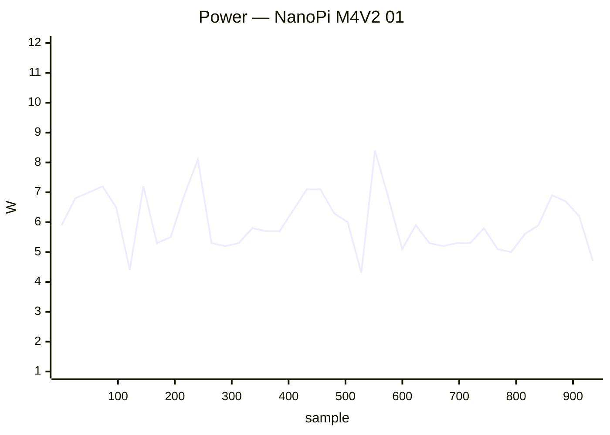

### ✅ NanoPi M5 01

`nanopi-m5` · **inplace** · image `26.11.0-trunk.108` · 22 ✅ · 0 ❌ · 0 ⏭️

| Module | Status | Time | Detail |
|:--|:--:|--:|:--|
| upgrade | ✅ | 178 s | nightly · 26.11.0-trunk.108 → 26.11.0-trunk.110 |
| reboot | ✅ | 50 s | power-cycle · up 23 s |
| kernel-switch | ✅ | 22 s | branch=vendor · family=rk35xx · installed=26.11.0-trunk.110 · boot_image=/boot/vmlinuz-6.1.172-vendor-rk35xx · kernel_before=6.1.172-vendor-rk35xx |
| reboot | ✅ | 76 s | power-cycle · 2/2 boots · up 23 s |
| hw-performance | ✅ | 17 s | AES 1273 · mem 7900 · disk W 63 / R 77 MB/s · 49 °C · 2016 MHz |
| dvfs | ✅ | 18 s | ondemand · 2016–2016 MHz (peak 2208) |
| network-iperf | ✅ | 144 s | end0 ↑941/↓941 (1GE) · end1 ↑941/↓941 (1GE) · wlan0 ↑22/↓86 (Wi-Fi 5) · wlx44334c47dec3 ↑10/↓23 (Wi-Fi 4) Mbps |
| store-versions | ✅ | 4 s | 26.11.0-trunk.110 · 6.1.172-vendor-rk35xx |
| kernel-switch | ✅ | 99 s | branch=current · family=rockchip64 · installed=26.11.0-trunk.110 · boot_image=/boot/vmlinuz-6.18.57-current-rockchip64 · kernel_before=6.1.172-vendor-rk35xx |
| reboot | ✅ | 80 s | power-cycle · 2/2 boots · up 24 s |
| hw-performance | ✅ | 26 s | AES 1329 · mem 9000 · disk W 20 / R 21 MB/s · 47.2 °C · 2016 MHz |
| dvfs | ✅ | 16 s | ondemand · 408–2016 MHz (peak 2208) |
| network-iperf | ✅ | 225 s | end0 ↑941/↓941 (1GE) · end1 ↑941/↓941 (1GE) · wlan0 ↑32/↓185 (Wi-Fi 5) · wlx44334c47dec3 ↑12/↓19 (Wi-Fi 4) Mbps |
| store-versions | ✅ | 4 s | 26.11.0-trunk.110 · 6.18.57-current-rockchip64 |
| kernel-switch | ✅ | 96 s | branch=edge · family=rockchip64 · installed=26.11.0-trunk.110 · boot_image=/boot/vmlinuz-7.3.0-edge-rockchip64 · kernel_before=6.18.57-current-rockchip64 |
| reboot | ✅ | 91 s | power-cycle · 2/2 boots · up 25 s |
| hw-performance | ✅ | 26 s | AES 1327 · mem 9000 · disk W 20 / R 21 MB/s · 46.2 °C · 2016 MHz |
| dvfs | ✅ | 18 s | ondemand · 408–2016 MHz (peak 2208) |
| network-iperf | ✅ | 159 s | end0 ↑939/↓941 (1GE) · end1 ↑941/↓941 (1GE) · wlan0 ↑31/↓165 (Wi-Fi 5) · wlx44334c47dec3 ↑8/↓21 (Wi-Fi 4) Mbps |
| store-versions | ✅ | 4 s | 26.11.0-trunk.110 · 7.3.0-edge-rockchip64 |
| kernel-switch | ✅ | 103 s | branch=vendor · family=rk35xx · installed=26.11.0-trunk.110 · boot_image=/boot/vmlinuz-6.1.172-vendor-rk35xx · kernel_before=7.3.0-edge-rockchip64 |
| reboot | ✅ | 49 s | power-cycle · up 23 s |

### ✅ Nanopi M6 01

`friendlyelec-rk3588` · **inplace** · image `26.8.10` · 16 ✅ · 0 ❌ · 0 ⏭️

| Module | Status | Time | Detail |
|:--|:--:|--:|:--|
| upgrade | ✅ | 169 s | nightly · 26.8.10 → 26.11.0-trunk.110 |
| reboot | ✅ | 50 s | power-cycle · up 18 s |
| kernel-switch | ✅ | 20 s | branch=vendor · family=rk35xx · installed=26.11.0-trunk.110 · boot_image=/boot/vmlinuz-6.1.172-vendor-rk35xx · kernel_before=6.1.172-vendor-rk35xx |
| reboot | ✅ | 73 s | power-cycle · 2/2 boots · up 19 s |
| hw-performance | ✅ | 16 s | AES 1275 · mem 12500 · disk W 49 / R 78 MB/s · 40.7 °C · 1800 MHz |
| dvfs | ✅ | 16 s | ondemand · 1800–1800 MHz (peak 2256) |
| network-iperf | ✅ | 58 s | lan ↑941/↓941 (1GE) · wlP3p49s0 ↑15/↓262 (Wi-Fi 5) Mbps |
| store-versions | ✅ | 4 s | 26.11.0-trunk.110 · 6.1.172-vendor-rk35xx |
| kernel-switch | ✅ | 120 s | branch=current · family=rockchip64 · installed=26.11.0-trunk.110 · boot_image=/boot/vmlinuz-6.18.57-current-rockchip64 · kernel_before=6.1.172-vendor-rk35xx |
| reboot | ✅ | 247 s | power-cycle · 2/2 boots · up 106 s |
| hw-performance | ✅ | 18 s | AES 1221 · mem 9900 · disk W 48 / R 56 MB/s · 41.6 °C · 1800 MHz |
| dvfs | ✅ | 15 s | ondemand · 408–1800 MHz (peak 2400) |
| network-iperf | ✅ | 56 s | lan ↑941/↓941 (1GE) Mbps |
| store-versions | ✅ | 3 s | 26.11.0-trunk.110 · 6.18.57-current-rockchip64 |
| kernel-switch | ✅ | 67 s | branch=vendor · family=rk35xx · installed=26.11.0-trunk.110 · boot_image=/boot/vmlinuz-6.1.172-vendor-rk35xx · kernel_before=6.18.57-current-rockchip64 |
| reboot | ✅ | 50 s | power-cycle · up 21 s |

**Power** — min 0.8 W · avg 2.8 W · peak 9.0 W · 790 samples

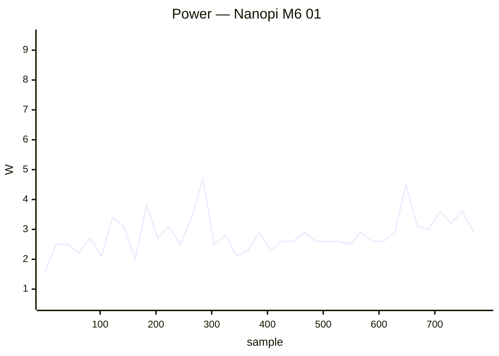

### ✅ Nanopi M6 V2 01

`friendlyelec-rk3588` · **inplace** · image `26.11.0-trunk.108` · 14 ✅ · 2 ❌ · 0 ⏭️

| Module | Status | Time | Detail |
|:--|:--:|--:|:--|
| upgrade | ✅ | 179 s | nightly · 26.11.0-trunk.108 → 26.11.0-trunk.110 |
| reboot | ✅ | 135 s | power-cycle · up 104 s |
| kernel-switch | ✅ | 21 s | branch=vendor · family=rk35xx · installed=26.11.0-trunk.110 · boot_image=/boot/vmlinuz-6.1.172-vendor-rk35xx · kernel_before=6.1.172-vendor-rk35xx |
| reboot | ✅ | 245 s | power-cycle · 2/2 boots · up 104 s |
| hw-performance | ✅ | 17 s | AES 1305 · mem 12500 · disk W 49 / R 76 MB/s · 52.7 °C · 1800 MHz |
| dvfs | ✅ | 15 s | ondemand · 1800–1800 MHz (peak 2304) |
| network-iperf | ❌ | 252 s | eth0 ↑941/↓941 (1GE) · wlP3p49s0 ↑0/↓0 (Wi-Fi 6) Mbps |
| store-versions | ✅ | 4 s | 26.11.0-trunk.110 · 6.1.172-vendor-rk35xx |
| kernel-switch | ✅ | 111 s | branch=current · family=rockchip64 · installed=26.11.0-trunk.110 · boot_image=/boot/vmlinuz-6.18.57-current-rockchip64 · kernel_before=6.1.172-vendor-rk35xx |
| reboot | ✅ | 252 s | power-cycle · 2/2 boots · up 107 s |
| hw-performance | ✅ | 17 s | AES 1244 · mem 6800 · disk W 47 / R 58 MB/s · 56.4 °C · 1800 MHz |
| dvfs | ✅ | 13 s | ondemand · 408–1800 MHz (peak 2400) |
| network-iperf | ❌ | 483 s | eth0 ↑939/↓941 (1GE) · wlP3p49s0 ↑0/↓0 (Wi-Fi 6) Mbps |
| store-versions | ✅ | 4 s | 26.11.0-trunk.110 · 6.18.57-current-rockchip64 |
| kernel-switch | ✅ | 71 s | branch=vendor · family=rk35xx · installed=26.11.0-trunk.110 · boot_image=/boot/vmlinuz-6.1.172-vendor-rk35xx · kernel_before=6.18.57-current-rockchip64 |
| reboot | ✅ | 138 s | power-cycle · up 107 s |

**Power** — min 2.2 W · avg 3.8 W · peak 12.1 W · 1573 samples

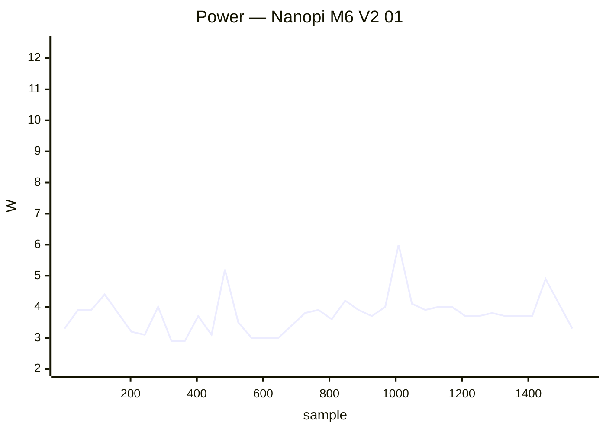

### ✅ NanoPi Neo 2 Black 01

`nanopineo2black` · **inplace** · image `26.11.0-trunk.108` · 16 ✅ · 0 ❌ · 0 ⏭️

| Module | Status | Time | Detail |
|:--|:--:|--:|:--|
| upgrade | ✅ | 186 s | nightly · 26.11.0-trunk.108 → 26.11.0-trunk.110 |
| reboot | ✅ | 55 s | power-cycle · up 17 s |
| kernel-switch | ✅ | 41 s | branch=current · family=sunxi64 · installed=26.11.0-trunk.110 · boot_image=/boot/vmlinuz-6.18.57-current-sunxi64 · kernel_before=6.18.57-current-sunxi64 |
| reboot | ✅ | 301 s | power-cycle · 1/2 boots · up 21 s |
| hw-performance | ✅ | 22 s | AES 619 · mem 3500 · disk W 43 / R 44 MB/s · 53.2 °C · 1368 MHz |
| dvfs | ✅ | 21 s | ondemand · 480–1368 MHz (peak 1368) |
| network-iperf | ✅ | 96 s | end0 ↑879/↓906 (1GE) Mbps |
| store-versions | ✅ | 4 s | 26.11.0-trunk.110 · 6.18.57-current-sunxi64 |
| kernel-switch | ✅ | 105 s | branch=edge · family=sunxi64 · installed=26.11.0-trunk.110 · boot_image=/boot/vmlinuz-7.3.0-edge-sunxi64 · kernel_before=6.18.57-current-sunxi64 |
| reboot | ✅ | 305 s | power-cycle · 1/2 boots · up 17 s |
| hw-performance | ✅ | 22 s | AES 633 · mem 3500 · disk W 43 / R 43 MB/s · 59 °C · 1368 MHz |
| dvfs | ✅ | 22 s | ondemand · 480–1368 MHz (peak 1368) |
| network-iperf | ✅ | 31 s | end0 ↑894/↓927 (1GE) Mbps |
| store-versions | ✅ | 5 s | 26.11.0-trunk.110 · 7.3.0-edge-sunxi64 |
| kernel-switch | ✅ | 105 s | branch=current · family=sunxi64 · installed=26.11.0-trunk.110 · boot_image=/boot/vmlinuz-6.18.57-current-sunxi64 · kernel_before=7.3.0-edge-sunxi64 |
| reboot | ✅ | 55 s | power-cycle · up 17 s |

**Power** — min 0.9 W · avg 2.5 W · peak 5.4 W · 1085 samples

```mermaid
xychart-beta
    title "Power — NanoPi Neo 2 Black 01"
    x-axis "sample" 1 --> 1085
    y-axis "W" 0.5 --> 5.5
    line [2.7, 3.3, 3.1, 3.9, 3.4, 2.7, 2.6, 3.5, 2.8, 2.3, 1.4, 1.4, 1.4, 1.4, 1.4, 2.4, 3.0, 3.7, 2.3, 1.6, 2.6, 3.0, 3.5, 3.0, 2.9, 2.3, 1.5, 1.4, 1.4, 1.4, 1.4, 2.9, 2.6, 3.5, 3.0, 3.3, 3.2, 3.2, 2.8, 2.8]
```

### ✅ NanoPi Neo 3 01

`nanopineo3` · **inplace** · image `26.11.0-trunk.108` · 16 ✅ · 0 ❌ · 0 ⏭️

| Module | Status | Time | Detail |
|:--|:--:|--:|:--|
| upgrade | ✅ | 281 s | nightly · 26.11.0-trunk.108 → 26.11.0-trunk.110 |
| reboot | ✅ | 65 s | power-cycle · up 27 s |
| kernel-switch | ✅ | 55 s | branch=current · family=rockchip64 · installed=26.11.0-trunk.110 · boot_image=/boot/vmlinuz-6.18.57-current-rockchip64 · kernel_before=6.18.57-current-rockchip64 |
| reboot | ✅ | 101 s | power-cycle · 2/2 boots · up 29 s |
| hw-performance | ✅ | 27 s | AES 599 · mem 2400 · disk W 1 / R 62 MB/s · 79.2 °C · 1296 MHz |
| dvfs | ✅ | 27 s | ondemand · 408–1296 MHz (peak 1296) |
| network-iperf | ✅ | 130 s | end0 ↑917/↓937 (1GE) · wlx7cdd905518f9 ↑9/↓11 (Wi-Fi 4) Mbps |
| store-versions | ✅ | 7 s | 26.11.0-trunk.110 · 6.18.57-current-rockchip64 |
| kernel-switch | ✅ | 169 s | branch=edge · family=rockchip64 · installed=26.11.0-trunk.110 · boot_image=/boot/vmlinuz-7.3.0-edge-rockchip64 · kernel_before=6.18.57-current-rockchip64 |
| reboot | ✅ | 98 s | power-cycle · 2/2 boots · up 26 s |
| hw-performance | ✅ | 26 s | AES 598 · mem 2300 · disk W 52 / R 62 MB/s · 80 °C · 1296 MHz |
| dvfs | ✅ | 30 s | ondemand · 408–1296 MHz (peak 1296) |
| network-iperf | ✅ | 136 s | end0 ↑913/↓941 (1GE) · wlx7cdd905518f9 ↑5/↓5 (Wi-Fi 4) Mbps |
| store-versions | ✅ | 6 s | 26.11.0-trunk.110 · 7.3.0-edge-rockchip64 |
| kernel-switch | ✅ | 170 s | branch=current · family=rockchip64 · installed=26.11.0-trunk.110 · boot_image=/boot/vmlinuz-6.18.57-current-rockchip64 · kernel_before=7.3.0-edge-rockchip64 |
| reboot | ✅ | 66 s | power-cycle · up 28 s |

**Power** — min 1.7 W · avg 4.6 W · peak 5.8 W · 1110 samples

```mermaid
xychart-beta
    title "Power — NanoPi Neo 3 01"
    x-axis "sample" 1 --> 1110
    y-axis "W" 1.5 --> 6.0
    line [4.6, 5.0, 4.8, 4.7, 4.6, 5.2, 4.9, 4.8, 4.4, 4.0, 5.0, 4.5, 4.6, 3.8, 5.1, 4.8, 4.8, 4.0, 4.5, 4.1, 4.9, 5.0, 4.7, 4.6, 4.6, 4.2, 4.5, 4.8, 4.7, 4.3, 4.3, 4.2, 4.5, 4.7, 4.8, 4.8, 4.6, 4.6, 4.4, 4.2]
```

### ✅ NanoPi R3S LTS 01

`nanopi-r3s-lts` · **inplace** · image `26.11.0-trunk.108` · 16 ✅ · 0 ❌ · 0 ⏭️

| Module | Status | Time | Detail |
|:--|:--:|--:|:--|
| upgrade | ✅ | 151 s | nightly · 26.11.0-trunk.108 → 26.11.0-trunk.110 |
| reboot | ✅ | 49 s | power-cycle · up 16 s |
| kernel-switch | ✅ | 32 s | branch=current · family=rockchip64 · installed=26.11.0-trunk.110 · boot_image=/boot/vmlinuz-6.18.57-current-rockchip64 · kernel_before=6.18.57-current-rockchip64 |
| reboot | ✅ | 73 s | power-cycle · 2/2 boots · up 15 s |
| hw-performance | ✅ | 17 s | AES 911 · mem 5000 · disk W 148 / R 164 MB/s · 44.4 °C · 1800 MHz |
| dvfs | ✅ | 20 s | ondemand · 408–1800 MHz (peak 1800) |
| network-iperf | ✅ | 113 s | lan ↑941/↓941 (1GE) · wan ↑941/↓942 (1GE) · wlx0087422045f0 ↑7/↓12 (Wi-Fi 4) Mbps |
| store-versions | ✅ | 4 s | 26.11.0-trunk.110 · 6.18.57-current-rockchip64 |
| kernel-switch | ✅ | 90 s | branch=edge · family=rockchip64 · installed=26.11.0-trunk.110 · boot_image=/boot/vmlinuz-7.3.0-edge-rockchip64 · kernel_before=6.18.57-current-rockchip64 |
| reboot | ✅ | 66 s | power-cycle · 2/2 boots · up 16 s |
| hw-performance | ✅ | 18 s | AES 915 · mem 5000 · disk W 151 / R 168 MB/s · 44.4 °C · 1800 MHz |
| dvfs | ✅ | 21 s | ondemand · 408–1800 MHz (peak 1800) |
| network-iperf | ✅ | 201 s | lan ↑941/↓941 (1GE) · wan ↑940/↓941 (1GE) · wlx0087422045f0 ↑6/↓10 (Wi-Fi 4) Mbps |
| store-versions | ✅ | 5 s | 26.11.0-trunk.110 · 7.3.0-edge-rockchip64 |
| kernel-switch | ✅ | 90 s | branch=current · family=rockchip64 · installed=26.11.0-trunk.110 · boot_image=/boot/vmlinuz-6.18.57-current-rockchip64 · kernel_before=7.3.0-edge-rockchip64 |
| reboot | ✅ | 49 s | power-cycle · up 16 s |

### ✅ NanoPi R6S 01

`nanopi-r6s` · **inplace** · image `26.11.0-trunk.83` · 22 ✅ · 0 ❌ · 0 ⏭️

| Module | Status | Time | Detail |
|:--|:--:|--:|:--|
| upgrade | ✅ | 64 s | nightly · 26.11.0-trunk.83 → 26.11.0-trunk.83 |
| reboot | ✅ | 50 s | power-cycle · up 16 s |
| kernel-switch | ✅ | 17 s | branch=vendor · family=rk35xx · installed=26.11.0-trunk.110 · boot_image=/boot/vmlinuz-6.1.172-vendor-rk35xx · kernel_before=6.1.172-vendor-rk35xx |
| reboot | ✅ | 63 s | power-cycle · 2/2 boots · up 16 s |
| hw-performance | ✅ | 14 s | AES 1277 · mem 8200 · disk W 207 / R 269 MB/s · 40.7 °C · 1800 MHz |
| dvfs | ✅ | 16 s | ondemand · 1800–1800 MHz (peak 2352) |
| network-iperf | ✅ | 52 s | lan2 ↑941/↓941 (1GE) · wan ↑2350/↓2313 (2.5GE) Mbps |
| store-versions | ✅ | 4 s | 26.11.0-trunk.83 · 6.1.172-vendor-rk35xx |
| kernel-switch | ✅ | 46 s | branch=current · family=rockchip64 · installed=26.11.0-trunk.110 · boot_image=/boot/vmlinuz-6.18.57-current-rockchip64 · kernel_before=6.1.172-vendor-rk35xx |
| reboot | ✅ | 62 s | power-cycle · 2/2 boots · up 15 s |
| hw-performance | ✅ | 14 s | AES 1269 · mem 6600 · disk W 150 / R 152 MB/s · 41.6 °C · 1800 MHz |
| dvfs | ✅ | 15 s | ondemand · 408–1800 MHz (peak 2400) |
| network-iperf | ✅ | 110 s | lan2 ↑941/↓941 (1GE) · wan ↑2352/↓2290 (2.5GE) Mbps |
| store-versions | ✅ | 4 s | 26.11.0-trunk.83 · 6.18.57-current-rockchip64 |
| kernel-switch | ✅ | 43 s | branch=edge · family=rockchip64 · installed=26.11.0-trunk.110 · boot_image=/boot/vmlinuz-7.3.0-edge-rockchip64 · kernel_before=6.18.57-current-rockchip64 |
| reboot | ✅ | 67 s | power-cycle · 2/2 boots · up 15 s |
| hw-performance | ✅ | 15 s | AES 1275 · mem 7900 · disk W 147 / R 155 MB/s · 41.6 °C · 1800 MHz |
| dvfs | ✅ | 16 s | ondemand · 408–1800 MHz (peak 2400) |
| network-iperf | ✅ | 115 s | lan2 ↑941/↓941 (1GE) · wan ↑2353/↓2281 (2.5GE) Mbps |
| store-versions | ✅ | 4 s | 26.11.0-trunk.83 · 7.3.0-edge-rockchip64 |
| kernel-switch | ✅ | 38 s | branch=vendor · family=rk35xx · installed=26.11.0-trunk.110 · boot_image=/boot/vmlinuz-6.1.172-vendor-rk35xx · kernel_before=7.3.0-edge-rockchip64 |
| reboot | ✅ | 49 s | power-cycle · up 15 s |

**Power** — min 2.5 W · avg 4.1 W · peak 10.3 W · 655 samples

```mermaid
xychart-beta
    title "Power — NanoPi R6S 01"
    x-axis "sample" 1 --> 655
    y-axis "W" 2.0 --> 10.5
    line [3.8, 4.2, 5.7, 3.8, 4.6, 3.9, 4.0, 3.5, 4.2, 4.6, 3.5, 3.7, 4.0, 4.5, 4.4, 3.1, 5.2, 4.2, 4.8, 3.4, 3.3, 3.2, 3.9, 4.2, 4.2, 4.5, 4.1, 3.7, 4.0, 3.6, 6.9, 3.7, 3.5, 3.2, 3.3, 3.8, 4.4, 4.2, 4.4, 3.7]
```

### ✅ Odroid C2 01

`odroidc2` · **inplace** · image `26.11.0-trunk.108` · 16 ✅ · 0 ❌ · 0 ⏭️

| Module | Status | Time | Detail |
|:--|:--:|--:|:--|
| upgrade | ✅ | 201 s | nightly · 26.11.0-trunk.108 → 26.11.0-trunk.110 |
| reboot | ✅ | 33 s | warm · up 17 s |
| kernel-switch | ✅ | 36 s | branch=current · family=meson64 · installed=26.11.0-trunk.110 · boot_image=/boot/vmlinuz-6.18.57-current-meson64 · kernel_before=6.18.57-current-meson64 |
| reboot | ✅ | 60 s | warm · 2/2 boots · up 16 s |
| hw-performance | ✅ | 20 s | AES 51 · mem 3500 · disk W 33 / R 152 MB/s · 45 °C · 1536 MHz |
| dvfs | ✅ | 20 s | ondemand · 500–1536 MHz (peak 1536) |
| network-iperf | ✅ | 90 s | end0 ↑940/↓941 (1GE) Mbps |
| store-versions | ✅ | 4 s | 26.11.0-trunk.110 · 6.18.57-current-meson64 |
| kernel-switch | ✅ | 113 s | branch=edge · family=meson64 · installed=26.11.0-trunk.110 · boot_image=/boot/vmlinuz-7.3.0-edge-meson64 · kernel_before=6.18.57-current-meson64 |
| reboot | ✅ | 64 s | warm · 2/2 boots · up 17 s |
| hw-performance | ✅ | 21 s | AES 51 · mem 3500 · disk W 32 / R 151 MB/s · 45 °C · 1536 MHz |
| dvfs | ✅ | 22 s | ondemand · 500–1536 MHz (peak 1536) |
| network-iperf | ✅ | 57 s | end0 ↑940/↓941 (1GE) Mbps |
| store-versions | ✅ | 5 s | 26.11.0-trunk.110 · 7.3.0-edge-meson64 |
| kernel-switch | ✅ | 111 s | branch=current · family=meson64 · installed=26.11.0-trunk.110 · boot_image=/boot/vmlinuz-6.18.57-current-meson64 · kernel_before=7.3.0-edge-meson64 |
| reboot | ✅ | 32 s | warm · up 16 s |

### ✅ Odroid C4 01

`odroidc4` · **inplace** · image `26.11.0-trunk.108` · 16 ✅ · 0 ❌ · 0 ⏭️

| Module | Status | Time | Detail |
|:--|:--:|--:|:--|
| upgrade | ✅ | 189 s | nightly · 26.11.0-trunk.108 → 26.11.0-trunk.110 |
| reboot | ✅ | 51 s | power-cycle · up 17 s |
| kernel-switch | ✅ | 29 s | branch=current · family=meson64 · installed=26.11.0-trunk.110 · boot_image=/boot/vmlinuz-6.18.57-current-meson64 · kernel_before=6.18.57-current-meson64 |
| reboot | ✅ | 75 s | power-cycle · 2/2 boots · up 16 s |
| hw-performance | ✅ | 20 s | AES 980 · mem 5300 · disk W 30 / R 78 MB/s · 44.5 °C · 2100 MHz |
| dvfs | ✅ | 17 s | ondemand · 1000–2100 MHz (peak 2100) |
| network-iperf | ✅ | 204 s | end0 ↑940/↓941 (1GE) · wlx24050fdd332b ↑46/↓127 (Wi-Fi 4) Mbps |
| store-versions | ✅ | 5 s | 26.11.0-trunk.110 · 6.18.57-current-meson64 |
| kernel-switch | ✅ | 108 s | branch=edge · family=meson64 · installed=26.11.0-trunk.110 · boot_image=/boot/vmlinuz-7.3.0-edge-meson64 · kernel_before=6.18.57-current-meson64 |
| reboot | ✅ | 77 s | power-cycle · 2/2 boots · up 16 s |
| hw-performance | ✅ | 22 s | AES 980 · mem 5200 · disk W 30 / R 76 MB/s · 44 °C · 2100 MHz |
| dvfs | ✅ | 19 s | ondemand · 1000–2100 MHz (peak 2100) |
| network-iperf | ✅ | 84 s | end0 ↑941/↓941 (1GE) · wlx24050fdd332b ↑36/↓95 (Wi-Fi 4) Mbps |
| store-versions | ✅ | 4 s | 26.11.0-trunk.110 · 7.3.0-edge-meson64 |
| kernel-switch | ✅ | 109 s | branch=current · family=meson64 · installed=26.11.0-trunk.110 · boot_image=/boot/vmlinuz-6.18.57-current-meson64 · kernel_before=7.3.0-edge-meson64 |
| reboot | ✅ | 48 s | power-cycle · up 16 s |

### ✅ Odroid M1 01

`odroidm1` · **inplace** · image `26.11.0-trunk.108` · 16 ✅ · 0 ❌ · 0 ⏭️

| Module | Status | Time | Detail |
|:--|:--:|--:|:--|
| upgrade | ✅ | 141 s | nightly · 26.11.0-trunk.108 → 26.11.0-trunk.110 |
| reboot | ✅ | 60 s | power-cycle · up 22 s |
| kernel-switch | ✅ | 30 s | branch=current · family=rockchip64 · installed=26.11.0-trunk.110 · boot_image=/boot/vmlinuz-6.18.57-current-rockchip64 · kernel_before=6.18.57-current-rockchip64 |
| reboot | ✅ | 85 s | power-cycle · 2/2 boots · up 22 s |
| hw-performance | ✅ | 15 s | AES 915 · mem 5000 · disk W 1025 / R 1060 MB/s · 35.6 °C · 1992 MHz |
| dvfs | ✅ | 19 s | ondemand · 408–1992 MHz (peak 1992) |
| network-iperf | ✅ | 87 s | eth0 ↑549/↓941 (1GE) Mbps |
| store-versions | ✅ | 4 s | 26.11.0-trunk.110 · 6.18.57-current-rockchip64 |
| kernel-switch | ✅ | 84 s | branch=edge · family=rockchip64 · installed=26.11.0-trunk.110 · boot_image=/boot/vmlinuz-7.3.0-edge-rockchip64 · kernel_before=6.18.57-current-rockchip64 |
| reboot | ✅ | 86 s | power-cycle · 2/2 boots · up 22 s |
| hw-performance | ✅ | 17 s | AES 915 · mem 5000 · disk W 1034 / R 1046 MB/s · 35.6 °C · 1992 MHz |
| dvfs | ✅ | 21 s | ondemand · 408–1992 MHz (peak 1992) |
| network-iperf | ✅ | 35 s | eth0 ↑941/↓941 (1GE) Mbps |
| store-versions | ✅ | 5 s | 26.11.0-trunk.110 · 7.3.0-edge-rockchip64 |
| kernel-switch | ✅ | 84 s | branch=current · family=rockchip64 · installed=26.11.0-trunk.110 · boot_image=/boot/vmlinuz-6.18.57-current-rockchip64 · kernel_before=7.3.0-edge-rockchip64 |
| reboot | ✅ | 62 s | power-cycle · up 24 s |

**Power** — min 1.9 W · avg 5.7 W · peak 11.7 W · 627 samples

```mermaid
xychart-beta
    title "Power — Odroid M1 01"
    x-axis "sample" 1 --> 627
    y-axis "W" 1.5 --> 12.0
    line [5.0, 6.2, 7.2, 5.5, 5.9, 7.6, 5.7, 5.0, 4.8, 7.8, 6.6, 5.1, 7.1, 5.0, 6.3, 5.1, 5.5, 4.4, 4.6, 4.3, 5.2, 5.4, 6.6, 5.9, 5.4, 5.3, 6.5, 5.6, 5.7, 5.6, 6.1, 5.7, 5.2, 4.9, 6.7, 6.2, 5.5, 5.7, 4.5, 7.1]
```

### ✅ Odroid N2 01

`odroidn2` · **inplace** · image `26.11.0-trunk.108` · 16 ✅ · 0 ❌ · 0 ⏭️

| Module | Status | Time | Detail |
|:--|:--:|--:|:--|
| upgrade | ✅ | 161 s | nightly · 26.11.0-trunk.108 → 26.11.0-trunk.110 |
| reboot | ✅ | 69 s | power-cycle · up 29 s |
| kernel-switch | ✅ | 23 s | branch=current · family=meson64 · installed=26.11.0-trunk.110 · boot_image=/boot/vmlinuz-6.18.57-current-meson64 · kernel_before=6.18.57-current-meson64 |
| reboot | ✅ | 97 s | power-cycle · 2/2 boots · up 29 s |
| hw-performance | ✅ | 18 s | AES 1085 · mem 4900 · disk W 27 / R 136 MB/s · 38.5 °C · 1992 MHz |
| dvfs | ✅ | 16 s | performance · 1000–1992 MHz (peak 1992) |
| network-iperf | ✅ | 28 s | end0 ↑940/↓941 (1GE) Mbps |
| store-versions | ✅ | 4 s | 26.11.0-trunk.110 · 6.18.57-current-meson64 |
| kernel-switch | ✅ | 80 s | branch=edge · family=meson64 · installed=26.11.0-trunk.110 · boot_image=/boot/vmlinuz-7.3.0-edge-meson64 · kernel_before=6.18.57-current-meson64 |
| reboot | ✅ | 100 s | power-cycle · 2/2 boots · up 31 s |
| hw-performance | ✅ | 20 s | AES 1085 · mem 4900 · disk W 27 / R 137 MB/s · 38.7 °C · 1992 MHz |
| dvfs | ✅ | 18 s | performance · 1000–1992 MHz (peak 1992) |
| network-iperf | ✅ | 59 s | end0 ↑940/↓942 (1GE) Mbps |
| store-versions | ✅ | 4 s | 26.11.0-trunk.110 · 7.3.0-edge-meson64 |
| kernel-switch | ✅ | 79 s | branch=current · family=meson64 · installed=26.11.0-trunk.110 · boot_image=/boot/vmlinuz-6.18.57-current-meson64 · kernel_before=7.3.0-edge-meson64 |
| reboot | ✅ | 66 s | power-cycle · up 29 s |

**Power** — min 1.0 W · avg 3.8 W · peak 10.0 W · 665 samples

```mermaid
xychart-beta
    title "Power — Odroid N2 01"
    x-axis "sample" 1 --> 665
    y-axis "W" 0.5 --> 10.5
    line [3.4, 3.8, 3.9, 3.9, 3.7, 5.3, 4.1, 4.2, 3.2, 1.6, 3.6, 4.7, 3.1, 3.6, 2.9, 2.7, 4.2, 5.5, 5.2, 3.4, 4.0, 3.9, 4.0, 4.0, 2.9, 4.3, 2.9, 4.0, 3.8, 6.4, 3.0, 3.0, 3.5, 3.7, 5.0, 4.0, 4.0, 3.4, 1.9, 3.9]
```

### ✅ Orange Pi 3 01

`orangepi3` · **inplace** · image `26.11.0-trunk.58` · 15 ✅ · 0 ❌ · 1 ⏭️

| Module | Status | Time | Detail |
|:--|:--:|--:|:--|
| upgrade | ⏭️ | 18 s | — |
| reboot | ✅ | 66 s | power-cycle · up 38 s |
| kernel-switch | ✅ | 37 s | branch=current · family=sunxi64 · installed=26.8.0-trunk.61 · boot_image=/boot/vmlinuz-6.18.33-current-sunxi64 · kernel_before=6.18.33-current-sunxi64 |
| reboot | ✅ | 320 s | power-cycle · 1/2 boots · up 26 s |
| hw-performance | ✅ | 27 s | AES 835 · mem 4600 · disk W 21 / R 23 MB/s · 44.6 °C · 1800 MHz |
| dvfs | ✅ | 19 s | ondemand · 480–1800 MHz (peak 1800) |
| network-iperf | ✅ | 58 s | end0 ↑917/↓941 (1GE) · wlan0 ↑30/↓96 (Wi-Fi 5) Mbps |
| store-versions | ✅ | 4 s | 26.11.0-trunk.58 · 6.18.33-current-sunxi64 |
| kernel-switch | ✅ | 105 s | branch=edge · family=sunxi64 · installed=26.8.0-trunk.61 · boot_image=/boot/vmlinuz-7.0.10-edge-sunxi64 · kernel_before=6.18.33-current-sunxi64 |
| reboot | ✅ | 308 s | power-cycle · 1/2 boots · up 24 s |
| hw-performance | ✅ | 27 s | AES 839 · mem 4600 · disk W 20 / R 23 MB/s · 43.8 °C · 1800 MHz |
| dvfs | ✅ | 19 s | ondemand · 480–1800 MHz (peak 1800) |
| network-iperf | ✅ | 62 s | end0 ↑918/↓941 (1GE) · wlan0 ↑22/↓110 (Wi-Fi 5) Mbps |
| store-versions | ✅ | 4 s | 26.11.0-trunk.58 · 7.0.10-edge-sunxi64 |
| kernel-switch | ✅ | 102 s | branch=current · family=sunxi64 · installed=26.8.0-trunk.61 · boot_image=/boot/vmlinuz-6.18.33-current-sunxi64 · kernel_before=7.0.10-edge-sunxi64 |
| reboot | ✅ | 56 s | power-cycle · up 23 s |

### ✅ Orange Pi 4 02

`orangepi4` · **inplace** · image `26.11.0-trunk` · 8 ✅ · 0 ❌ · 0 ⏭️

| Module | Status | Time | Detail |
|:--|:--:|--:|:--|
| upgrade | ✅ | 134 s | nightly · 26.11.0-trunk → 26.11.0-trunk.110 |
| reboot | ✅ | 56 s | power-cycle · up 17 s |
| kernel-switch | ✅ | 27 s | branch=current · family=rockchip64 · installed=26.11.0-trunk.110 · boot_image=/boot/vmlinuz-6.18.57-current-rockchip64 · kernel_before=6.18.57-current-rockchip64 |
| reboot | ✅ | 78 s | power-cycle · 2/2 boots · up 19 s |
| hw-performance | ✅ | 18 s | AES 1020 · mem 6600 · disk W 53 / R 257 MB/s · 58.9 °C · 1416 MHz |
| dvfs | ✅ | 19 s | ondemand · 408–1416 MHz (peak 1800) |
| network-iperf | ✅ | 96 s | eth0 ↑941/↓941 (1GE) · wlan0 ↑7/↓139 (Wi-Fi 5) Mbps |
| store-versions | ✅ | 5 s | 26.11.0-trunk.110 · 6.18.57-current-rockchip64 |

**Power** — min 0.9 W · avg 6.6 W · peak 12.3 W · 339 samples

```mermaid
xychart-beta
    title "Power — Orange Pi 4 02"
    x-axis "sample" 1 --> 339
    y-axis "W" 0.5 --> 12.5
    line [5.9, 7.3, 6.9, 10.0, 6.7, 7.5, 7.3, 7.3, 7.9, 8.8, 6.7, 7.9, 7.8, 6.2, 5.6, 3.1, 5.0, 7.3, 7.1, 7.3, 5.8, 6.4, 6.3, 6.5, 5.2, 4.6, 6.6, 7.1, 7.2, 7.6, 8.1, 6.4, 5.3, 5.2, 5.4, 6.3, 6.5, 5.7, 5.7, 6.7]
```

### ✅ Orange Pi 4 LTS 01

`orangepi4-lts` · **inplace** · image `26.8.3` · 8 ✅ · 0 ❌ · 0 ⏭️

| Module | Status | Time | Detail |
|:--|:--:|--:|:--|
| upgrade | ✅ | 165 s | nightly · 26.8.3 → 26.11.0-trunk.110 |
| reboot | ✅ | 60 s | power-cycle · up 22 s |
| kernel-switch | ✅ | 28 s | branch=current · family=rockchip64 · installed=26.11.0-trunk.110 · boot_image=/boot/vmlinuz-6.18.57-current-rockchip64 · kernel_before=6.18.57-current-rockchip64 |
| reboot | ✅ | 78 s | power-cycle · 2/2 boots · up 20 s |
| hw-performance | ✅ | 20 s | AES 1019 · mem 6600 · disk W 47 / R 62 MB/s · 56.1 °C · 1416 MHz |
| dvfs | ✅ | 18 s | ondemand · 408–1416 MHz (peak 1800) |
| network-iperf | ✅ | 65 s | eth0 ↑937/↓941 (1GE) · wlan0 ↑9/↓18 (Wi-Fi 5) Mbps |
| store-versions | ✅ | 4 s | 26.11.0-trunk.110 · 6.18.57-current-rockchip64 |

**Power** — min 0.7 W · avg 5.5 W · peak 12.0 W · 349 samples

```mermaid
xychart-beta
    title "Power — Orange Pi 4 LTS 01"
    x-axis "sample" 1 --> 349
    y-axis "W" 0.5 --> 12.5
    line [4.6, 5.7, 5.9, 5.0, 4.5, 4.8, 5.2, 6.2, 6.0, 6.3, 5.8, 7.0, 4.9, 5.6, 6.7, 5.8, 3.7, 2.8, 2.3, 5.1, 6.7, 6.2, 6.3, 5.0, 5.2, 7.4, 7.5, 4.6, 4.5, 5.8, 7.0, 4.7, 8.1, 7.4, 4.5, 6.0, 4.7, 4.4, 4.8, 4.8]
```

### ✅ Orange Pi 5 01

`orangepi5` · **inplace** · image `26.11.0-trunk.83` · 21 ✅ · 0 ❌ · 1 ⏭️

| Module | Status | Time | Detail |
|:--|:--:|--:|:--|
| upgrade | ⏭️ | 8 s | — |
| reboot | ✅ | 58 s | power-cycle · up 22 s |
| kernel-switch | ✅ | 84 s | branch=vendor · family=rk35xx · installed=26.11.0-trunk.90 · boot_image=/boot/vmlinuz-6.1.172-vendor-rk35xx · kernel_before=7.3.0-rc6-edge-rockchip64 |
| reboot | ✅ | 77 s | power-cycle · 2/2 boots · up 22 s |
| hw-performance | ✅ | 25 s | AES 1314 · mem 15900 · disk W 21 / R 23 MB/s · 43.5 °C · 1800 MHz |
| dvfs | ✅ | 16 s | ondemand · 1800–1800 MHz (peak 2304) |
| network-iperf | ✅ | 106 s | end0 ↑941/↓941 (1GE) Mbps |
| store-versions | ✅ | 5 s | 26.11.0-trunk.90 · 6.1.172-vendor-rk35xx |
| kernel-switch | ✅ | 107 s | branch=current · family=rockchip64 · installed=26.11.0-trunk.90 · boot_image=/boot/vmlinuz-6.18.56-current-rockchip64 · kernel_before=6.1.172-vendor-rk35xx |
| reboot | ✅ | 85 s | power-cycle · 2/2 boots · up 23 s |
| hw-performance | ✅ | 26 s | AES 1259 · mem 10200 · disk W 21 / R 22 MB/s · 45.3 °C · 1800 MHz |
| dvfs | ✅ | 15 s | ondemand · 408–1800 MHz (peak 2400) |
| network-iperf | ✅ | 59 s | end0 ↑940/↓941 (1GE) Mbps |
| store-versions | ✅ | 3 s | 26.11.0-trunk.90 · 6.18.56-current-rockchip64 |
| kernel-switch | ✅ | 86 s | branch=edge · family=rockchip64 · installed=26.11.0-trunk.90 · boot_image=/boot/vmlinuz-7.3.0-rc6-edge-rockchip64 · kernel_before=6.18.56-current-rockchip64 |
| reboot | ✅ | 86 s | power-cycle · 2/2 boots · up 22 s |
| hw-performance | ✅ | 26 s | AES 1257 · mem 8000 · disk W 20 / R 22 MB/s · 48.1 °C · 1800 MHz |
| dvfs | ✅ | 17 s | ondemand · 408–1800 MHz (peak 2400) |
| network-iperf | ✅ | 32 s | end0 ↑941/↓941 (1GE) Mbps |
| store-versions | ✅ | 4 s | 26.11.0-trunk.90 · 7.3.0-rc6-edge-rockchip64 |
| kernel-switch | ✅ | 82 s | branch=vendor · family=rk35xx · installed=26.11.0-trunk.90 · boot_image=/boot/vmlinuz-6.1.172-vendor-rk35xx · kernel_before=7.3.0-rc6-edge-rockchip64 |
| reboot | ✅ | 52 s | power-cycle · up 23 s |

**Power** — min 1.5 W · avg 2.8 W · peak 8.6 W · 800 samples

```mermaid
xychart-beta
    title "Power — Orange Pi 5 01"
    x-axis "sample" 1 --> 800
    y-axis "W" 1.0 --> 9.0
    line [2.5, 2.9, 3.3, 3.3, 3.1, 2.8, 2.5, 2.5, 2.3, 4.8, 1.6, 1.6, 1.8, 1.9, 2.3, 2.0, 2.4, 2.3, 2.2, 3.0, 3.1, 2.8, 4.2, 2.8, 2.3, 3.1, 2.9, 2.8, 3.1, 2.6, 2.8, 2.7, 3.0, 5.0, 2.9, 2.9, 2.8, 3.2, 2.5, 2.9]
```

### ✅ Orange Pi 5+ 01

`orangepi5-plus` · **inplace** · image `26.11.0-trunk.108` · 22 ✅ · 0 ❌ · 0 ⏭️

| Module | Status | Time | Detail |
|:--|:--:|--:|:--|
| upgrade | ✅ | 161 s | nightly · 26.11.0-trunk.108 → 26.11.0-trunk.110 |
| reboot | ✅ | 72 s | power-cycle · up 41 s |
| kernel-switch | ✅ | 20 s | branch=vendor · family=rk35xx · installed=26.11.0-trunk.110 · boot_image=/boot/vmlinuz-6.1.172-vendor-rk35xx · kernel_before=6.1.172-vendor-rk35xx |
| reboot | ✅ | 112 s | power-cycle · 2/2 boots · up 36 s |
| hw-performance | ✅ | 17 s | AES 1250 · mem 13900 · disk W 54 / R 62 MB/s · 60.1 °C · 1800 MHz |
| dvfs | ✅ | 16 s | ondemand · 1800–1800 MHz (peak 2256) |
| network-iperf | ✅ | 111 s | enP3p49s0 ↑1052/↓2354 (2.5GE) · enP4p65s0 ↑2347/↓2293 (2.5GE) · wlxe0e1a9380c53 ↑10/↓90 (Wi-Fi 6) Mbps |
| store-versions | ✅ | 4 s | 26.11.0-trunk.110 · 6.1.172-vendor-rk35xx |
| kernel-switch | ✅ | 97 s | branch=current · family=rockchip64 · installed=26.11.0-trunk.110 · boot_image=/boot/vmlinuz-6.18.57-current-rockchip64 · kernel_before=6.1.172-vendor-rk35xx |
| reboot | ✅ | 98 s | power-cycle · 2/2 boots · up 26 s |
| hw-performance | ✅ | 18 s | AES 1260 · mem 9900 · disk W 45 / R 58 MB/s · 61.9 °C · 1800 MHz |
| dvfs | ✅ | 15 s | ondemand · 408–1800 MHz (peak 2400) |
| network-iperf | ✅ | 80 s | enP3p49s0 ↑699/↓2351 (2.5GE) · enP4p65s0 ↑2351/↓2320 (2.5GE) · wlxe0e1a9380c53 ↑15/↓97 (Wi-Fi 6) Mbps |
| store-versions | ✅ | 4 s | 26.11.0-trunk.110 · 6.18.57-current-rockchip64 |
| kernel-switch | ✅ | 67 s | branch=edge · family=rockchip64 · installed=26.11.0-trunk.110 · boot_image=/boot/vmlinuz-7.3.0-edge-rockchip64 · kernel_before=6.18.57-current-rockchip64 |
| reboot | ✅ | 93 s | power-cycle · 2/2 boots · up 27 s |
| hw-performance | ✅ | 18 s | AES 1246 · mem 7900 · disk W 52 / R 62 MB/s · 63.8 °C · 1800 MHz |
| dvfs | ✅ | 17 s | ondemand · 408–1800 MHz (peak 2400) |
| network-iperf | ✅ | 192 s | enP3p49s0 ↑627/↓2340 (2.5GE) · enP4p65s0 ↑2352/↓2316 (2.5GE) · wlxe0e1a9380c53 ↑16/↓98 (Wi-Fi 6) Mbps |
| store-versions | ✅ | 4 s | 26.11.0-trunk.110 · 7.3.0-edge-rockchip64 |
| kernel-switch | ✅ | 70 s | branch=vendor · family=rk35xx · installed=26.11.0-trunk.110 · boot_image=/boot/vmlinuz-6.1.172-vendor-rk35xx · kernel_before=7.3.0-edge-rockchip64 |
| reboot | ✅ | 60 s | power-cycle · up 30 s |

**Power** — min 0.6 W · avg 7.2 W · peak 14.1 W · 742 samples

```mermaid
xychart-beta
    title "Power — Orange Pi 5+ 01"
    x-axis "sample" 1 --> 742
    y-axis "W" 0.5 --> 14.5
    line [7.2, 7.4, 7.0, 7.9, 7.0, 7.5, 4.7, 5.7, 7.5, 3.8, 6.1, 4.0, 7.4, 8.7, 7.7, 6.4, 7.3, 7.3, 7.2, 5.6, 5.3, 6.5, 9.2, 8.7, 8.5, 8.5, 8.6, 6.1, 5.1, 8.8, 9.2, 8.2, 7.9, 7.7, 8.0, 8.6, 8.4, 8.4, 7.7, 5.2]
```

### ✅ Orange Pi Lite 2 01

`orangepilite2` · **inplace** · image `26.11.0-trunk.108` · 16 ✅ · 0 ❌ · 0 ⏭️

| Module | Status | Time | Detail |
|:--|:--:|--:|:--|
| upgrade | ✅ | 306 s | nightly · 26.11.0-trunk.108 → 26.11.0-trunk.110 |
| reboot | ✅ | 45 s | warm · up 27 s |
| kernel-switch | ✅ | 39 s | branch=current · family=sunxi64 · installed=26.11.0-trunk.110 · boot_image=/boot/vmlinuz-6.18.57-current-sunxi64 · kernel_before=6.18.57-current-sunxi64 |
| reboot | ✅ | 74 s | warm · 2/2 boots · up 24 s |
| hw-performance | ✅ | 29 s | AES 771 · mem 4400 · disk W 22 / R 1 MB/s · 73.9 °C · 1800 MHz |
| dvfs | ✅ | 20 s | ondemand · 480–1704 MHz (peak 1704) |
| network-iperf | ✅ | 37 s | wlan0 ↑5/↓27 (Wi-Fi 5) Mbps |
| store-versions | ✅ | 4 s | 26.11.0-trunk.110 · 6.18.57-current-sunxi64 |
| kernel-switch | ✅ | 118 s | branch=edge · family=sunxi64 · installed=26.11.0-trunk.110 · boot_image=/boot/vmlinuz-7.3.0-edge-sunxi64 · kernel_before=6.18.57-current-sunxi64 |
| reboot | ✅ | 75 s | warm · 2/2 boots · up 25 s |
| hw-performance | ✅ | 31 s | AES 771 · mem 4300 · disk W 14 / R 1 MB/s · 78.2 °C · 1800 MHz |
| dvfs | ✅ | 22 s | ondemand · 480–1704 MHz (peak 1800) |
| network-iperf | ✅ | 37 s | wlan0 ↑9/↓19 (Wi-Fi 5) Mbps |
| store-versions | ✅ | 4 s | 26.11.0-trunk.110 · 7.3.0-edge-sunxi64 |
| kernel-switch | ✅ | 122 s | branch=current · family=sunxi64 · installed=26.11.0-trunk.110 · boot_image=/boot/vmlinuz-6.18.57-current-sunxi64 · kernel_before=7.3.0-edge-sunxi64 |
| reboot | ✅ | 40 s | warm · up 22 s |

### ✅ Orange Pi One+ 01

`orangepioneplus` · **inplace** · image `26.11.0-trunk.108` · 16 ✅ · 0 ❌ · 0 ⏭️

| Module | Status | Time | Detail |
|:--|:--:|--:|:--|
| upgrade | ✅ | 222 s | nightly · 26.11.0-trunk.108 → 26.11.0-trunk.110 |
| reboot | ✅ | 41 s | warm · up 23 s |
| kernel-switch | ✅ | 40 s | branch=current · family=sunxi64 · installed=26.11.0-trunk.110 · boot_image=/boot/vmlinuz-6.18.57-current-sunxi64 · kernel_before=6.18.57-current-sunxi64 |
| reboot | ✅ | 76 s | warm · 2/2 boots · up 25 s |
| hw-performance | ✅ | 27 s | AES 839 · mem 4600 · disk W 21 / R 23 MB/s · 64.8 °C · 1800 MHz |
| dvfs | ✅ | 20 s | ondemand · 480–1800 MHz (peak 1800) |
| network-iperf | ✅ | 89 s | end0 ↑912/↓940 (1GE) · wlx00e04c881724 ↑5/↓10 (Wi-Fi 5) Mbps |
| store-versions | ✅ | 4 s | 26.11.0-trunk.110 · 6.18.57-current-sunxi64 |
| kernel-switch | ✅ | 119 s | branch=edge · family=sunxi64 · installed=26.11.0-trunk.110 · boot_image=/boot/vmlinuz-7.3.0-edge-sunxi64 · kernel_before=6.18.57-current-sunxi64 |
| reboot | ✅ | 70 s | warm · 2/2 boots · up 23 s |
| hw-performance | ✅ | 27 s | AES 839 · mem 4600 · disk W 21 / R 23 MB/s · 66.4 °C · 1800 MHz |
| dvfs | ✅ | 21 s | ondemand · 480–1800 MHz (peak 1800) |
| network-iperf | ✅ | 57 s | end0 ↑911/↓929 (1GE) · wlx00e04c881724 ↑21/↓122 (Wi-Fi 5) Mbps |
| store-versions | ✅ | 5 s | 26.11.0-trunk.110 · 7.3.0-edge-sunxi64 |
| kernel-switch | ✅ | 113 s | branch=current · family=sunxi64 · installed=26.11.0-trunk.110 · boot_image=/boot/vmlinuz-6.18.57-current-sunxi64 · kernel_before=7.3.0-edge-sunxi64 |
| reboot | ✅ | 40 s | warm · up 24 s |

### ✅ Orange Pi PC + 01

`orangepipcplus` · **inplace** · image `26.11.0-trunk.83` · 16 ✅ · 0 ❌ · 0 ⏭️

| Module | Status | Time | Detail |
|:--|:--:|--:|:--|
| upgrade | ✅ | 116 s | nightly · 26.11.0-trunk.90 → 26.11.0-trunk.90 |
| reboot | ✅ | 48 s | warm · up 27 s |
| kernel-switch | ✅ | 75 s | branch=current · family=sunxi · installed=26.11.0-trunk.90 · boot_image=/boot/vmlinuz-6.18.56-current-sunxi · kernel_before=6.18.56-current-sunxi |
| reboot | ✅ | 88 s | warm · 2/2 boots · up 27 s |
| hw-performance | ✅ | 44 s | AES 25 · mem 2300 · disk W 8 / R 77 MB/s · 49.9 °C · 1296 MHz |
| dvfs | ✅ | 39 s | ondemand · 480–1296 MHz (peak 1296) |
| network-iperf | ✅ | 185 s | end0 ↑93/↓94 (10/100ME) · wlan0 ↑11/↓5 (Wi-Fi 4) · wlan1 ↑20/↓12 (Wi-Fi 4) Mbps |
| store-versions | ✅ | 8 s | 26.11.0-trunk.90 · 6.18.56-current-sunxi |
| kernel-switch | ✅ | 190 s | branch=edge · family=sunxi · installed=26.11.0-trunk.90 · boot_image=/boot/vmlinuz-7.2.10-edge-sunxi · kernel_before=6.18.56-current-sunxi |
| reboot | ✅ | 88 s | warm · 2/2 boots · up 27 s |
| hw-performance | ✅ | 45 s | AES 25 · mem 2200 · disk W 6 / R 78 MB/s · 54 °C · 1296 MHz |
| dvfs | ✅ | 42 s | ondemand · 480–1296 MHz (peak 1296) |
| network-iperf | ✅ | 126 s | end0 ↑94/↓94 (10/100ME) · wlan0 ↑25/↓1 (Wi-Fi 4) · wlan1 ↑29/↓2 (Wi-Fi 4) Mbps |
| store-versions | ✅ | 8 s | 26.11.0-trunk.90 · 7.2.10-edge-sunxi |
| kernel-switch | ✅ | 190 s | branch=current · family=sunxi · installed=26.11.0-trunk.90 · boot_image=/boot/vmlinuz-6.18.56-current-sunxi · kernel_before=7.2.10-edge-sunxi |
| reboot | ✅ | 47 s | warm · up 28 s |

### ✅ Orange Pi Zero2 01

`orangepizero2` · **inplace** · image `26.11.0-trunk.108` · 16 ✅ · 0 ❌ · 0 ⏭️

| Module | Status | Time | Detail |
|:--|:--:|--:|:--|
| upgrade | ✅ | 261 s | nightly · 26.11.0-trunk.108 → 26.11.0-trunk.110 |
| reboot | ✅ | 61 s | power-cycle · up 23 s |
| kernel-switch | ✅ | 67 s | branch=current · family=sunxi64 · installed=26.11.0-trunk.110 · boot_image=/boot/vmlinuz-6.18.57-current-sunxi64 · kernel_before=6.18.57-current-sunxi64 |
| reboot | ✅ | 94 s | power-cycle · 2/2 boots · up 24 s |
| hw-performance | ✅ | 30 s | AES 705 · mem 3000 · disk W 21 / R 23 MB/s · 64.5 °C · 1512 MHz |
| dvfs | ✅ | 23 s | ondemand · 480–1512 MHz (peak 1512) |
| network-iperf | ✅ | 66 s | end0 ↑875/↓941 (1GE) · wlx7c023a625db1 ↑9/↓21 (Wi-Fi 5) Mbps |
| store-versions | ✅ | 5 s | 26.11.0-trunk.110 · 6.18.57-current-sunxi64 |
| kernel-switch | ✅ | 147 s | branch=edge · family=sunxi64 · installed=26.11.0-trunk.110 · boot_image=/boot/vmlinuz-7.3.0-edge-sunxi64 · kernel_before=6.18.57-current-sunxi64 |
| reboot | ✅ | 94 s | power-cycle · 2/2 boots · up 24 s |
| hw-performance | ✅ | 30 s | AES 705 · mem 3000 · disk W 21 / R 22 MB/s · 67.5 °C · 1512 MHz |
| dvfs | ✅ | 25 s | ondemand · 480–1512 MHz (peak 1512) |
| network-iperf | ✅ | 241 s | end0 ↑864/↓941 (1GE) · wlx7c023a625db1 ↑7/↓12 (Wi-Fi 5) Mbps |
| store-versions | ✅ | 5 s | 26.11.0-trunk.110 · 7.3.0-edge-sunxi64 |
| kernel-switch | ✅ | 162 s | branch=current · family=sunxi64 · installed=26.11.0-trunk.110 · boot_image=/boot/vmlinuz-6.18.57-current-sunxi64 · kernel_before=7.3.0-edge-sunxi64 |
| reboot | ✅ | 58 s | power-cycle · up 23 s |

**Power** — min 1.6 W · avg 2.8 W · peak 4.2 W · 1078 samples

```mermaid
xychart-beta
    title "Power — Orange Pi Zero2 01"
    x-axis "sample" 1 --> 1078
    y-axis "W" 1.5 --> 4.5
    line [2.9, 2.8, 3.0, 2.8, 2.9, 3.0, 2.8, 2.9, 2.9, 3.0, 2.9, 2.9, 2.9, 2.6, 3.0, 3.0, 3.1, 3.1, 2.9, 3.0, 2.9, 2.7, 2.4, 2.9, 3.0, 3.2, 3.0, 2.3, 2.6, 2.4, 2.5, 2.6, 2.5, 2.8, 2.9, 3.0, 2.8, 2.9, 2.6, 2.8]
```

### ✅ OrangePi 3 LTS 01

`orangepi3-lts` · **inplace** · image `26.11.0-trunk.108` · 16 ✅ · 0 ❌ · 0 ⏭️

| Module | Status | Time | Detail |
|:--|:--:|--:|:--|
| upgrade | ✅ | 157 s | nightly · 26.11.0-trunk.108 → 26.11.0-trunk.110 |
| reboot | ✅ | 58 s | power-cycle · up 24 s |
| kernel-switch | ✅ | 35 s | branch=current · family=sunxi64 · installed=26.11.0-trunk.110 · boot_image=/boot/vmlinuz-6.18.57-current-sunxi64 · kernel_before=6.18.57-current-sunxi64 |
| reboot | ✅ | 92 s | power-cycle · 2/2 boots · up 24 s |
| hw-performance | ✅ | 19 s | AES 750 · mem 4100 · disk W 45 / R 128 MB/s · 68.7 °C · 1608 MHz |
| dvfs | ✅ | 19 s | ondemand · 480–1608 MHz (peak 1608) |
| network-iperf | ✅ | 58 s | end0 ↑915/↓940 (1GE) · wlan0 ↑25/↓133 (Wi-Fi 5) Mbps |
| store-versions | ✅ | 4 s | 26.11.0-trunk.110 · 6.18.57-current-sunxi64 |
| kernel-switch | ✅ | 89 s | branch=edge · family=sunxi64 · installed=26.11.0-trunk.110 · boot_image=/boot/vmlinuz-7.3.0-edge-sunxi64 · kernel_before=6.18.57-current-sunxi64 |
| reboot | ✅ | 92 s | power-cycle · 2/2 boots · up 24 s |
| hw-performance | ✅ | 19 s | AES 750 · mem 4100 · disk W 54 / R 126 MB/s · 72.2 °C · 1608 MHz |
| dvfs | ✅ | 21 s | ondemand · 480–1608 MHz (peak 1608) |
| network-iperf | ✅ | 114 s | end0 ↑915/↓938 (1GE) · wlan0 ↑24/↓112 (Wi-Fi 5) Mbps |
| store-versions | ✅ | 5 s | 26.11.0-trunk.110 · 7.3.0-edge-sunxi64 |
| kernel-switch | ✅ | 88 s | branch=current · family=sunxi64 · installed=26.11.0-trunk.110 · boot_image=/boot/vmlinuz-6.18.57-current-sunxi64 · kernel_before=7.3.0-edge-sunxi64 |
| reboot | ✅ | 58 s | power-cycle · up 24 s |

**Power** — min 1.0 W · avg 3.4 W · peak 4.9 W · 730 samples

```mermaid
xychart-beta
    title "Power — OrangePi 3 LTS 01"
    x-axis "sample" 1 --> 730
    y-axis "W" 0.5 --> 5.0
    line [3.2, 3.5, 3.4, 3.5, 3.9, 3.8, 3.6, 3.1, 2.8, 3.8, 3.5, 2.1, 3.5, 2.2, 3.3, 3.6, 3.5, 3.5, 3.5, 3.6, 3.7, 3.4, 3.4, 2.9, 3.5, 2.8, 3.8, 3.4, 3.7, 3.6, 3.6, 3.1, 3.0, 3.2, 3.7, 3.9, 3.5, 3.6, 2.6, 3.1]
```

### ✅ Quadra 01

`inovato-quadra` · **inplace** · image `26.11.0-trunk.108` · 16 ✅ · 0 ❌ · 0 ⏭️

| Module | Status | Time | Detail |
|:--|:--:|--:|:--|
| upgrade | ✅ | 217 s | nightly · 26.11.0-trunk.108 → 26.11.0-trunk.110 |
| reboot | ✅ | 61 s | power-cycle · up 24 s |
| kernel-switch | ✅ | 39 s | branch=current · family=sunxi64 · installed=26.11.0-trunk.110 · boot_image=/boot/vmlinuz-6.18.57-current-sunxi64 · kernel_before=6.18.57-current-sunxi64 |
| reboot | ✅ | 92 s | power-cycle · 2/2 boots · up 24 s |
| hw-performance | ✅ | 31 s | AES 794 · mem 2800 · disk W 14 / R 23 MB/s · 67.5 °C · 1704 MHz |
| dvfs | ✅ | 20 s | ondemand · 480–1704 MHz (peak 1704) |
| network-iperf | ✅ | 65 s | eth0 ↑94/↓94 (10/100ME) · wlan0 ↑5/↓14 (Wi-Fi 4) Mbps |
| store-versions | ✅ | 5 s | 26.11.0-trunk.110 · 6.18.57-current-sunxi64 |
| kernel-switch | ✅ | 106 s | branch=edge · family=sunxi64 · installed=26.11.0-trunk.110 · boot_image=/boot/vmlinuz-7.3.0-edge-sunxi64 · kernel_before=6.18.57-current-sunxi64 |
| reboot | ✅ | 89 s | power-cycle · 2/2 boots · up 24 s |
| hw-performance | ✅ | 32 s | AES 783 · mem 2900 · disk W 11 / R 23 MB/s · 69.5 °C · 1704 MHz |
| dvfs | ✅ | 21 s | ondemand · 480–1704 MHz (peak 1704) |
| network-iperf | ✅ | 118 s | eth0 ↑94/↓94 (10/100ME) · wlan0 ↑7/↓17 (Wi-Fi 4) Mbps |
| store-versions | ✅ | 4 s | 26.11.0-trunk.110 · 7.3.0-edge-sunxi64 |
| kernel-switch | ✅ | 109 s | branch=current · family=sunxi64 · installed=26.11.0-trunk.110 · boot_image=/boot/vmlinuz-6.18.57-current-sunxi64 · kernel_before=7.3.0-edge-sunxi64 |
| reboot | ✅ | 59 s | power-cycle · up 24 s |

**Power** — min 2.4 W · avg 4.1 W · peak 6.2 W · 839 samples

```mermaid
xychart-beta
    title "Power — Quadra 01"
    x-axis "sample" 1 --> 839
    y-axis "W" 2.0 --> 6.5
    line [4.0, 4.4, 3.9, 4.0, 4.2, 4.5, 4.1, 4.3, 4.2, 3.3, 3.9, 4.4, 3.5, 3.9, 3.7, 4.3, 4.3, 3.8, 3.9, 3.9, 4.4, 4.2, 4.2, 4.2, 3.6, 4.7, 3.9, 4.6, 4.7, 4.0, 3.6, 3.7, 3.7, 3.9, 4.2, 4.0, 4.1, 4.0, 3.9, 4.1]
```

### ✅ R58HD 01

`mekotronics-r58hd` · **inplace** · image `26.11.0-trunk.108` · 6 ✅ · 0 ❌ · 0 ⏭️

| Module | Status | Time | Detail |
|:--|:--:|--:|:--|
| upgrade | ✅ | 81 s | nightly · 26.11.0-trunk.108 → 26.11.0-trunk.110 |
| reboot | ✅ | 52 s | power-cycle · up 18 s |
| hw-performance | ✅ | 14 s | AES 1292 · mem 14000 · disk W 250 / R 290 MB/s · 48.1 °C · 1800 MHz |
| dvfs | ✅ | 17 s | ondemand · 1200–1800 MHz (peak 2304) |
| network-iperf | ✅ | 54 s | end0 ↑939/↓941 (1GE) · enP3p49s0 ↑941/↓941 (1GE) Mbps |
| store-versions | ✅ | 4 s | 26.11.0-trunk.110 · 6.1.172-vendor-rk35xx |

**Power** — min 3.3 W · avg 5.8 W · peak 11.4 W · 179 samples

```mermaid
xychart-beta
    title "Power — R58HD 01"
    x-axis "sample" 1 --> 179
    y-axis "W" 3.0 --> 11.5
    line [5.1, 5.7, 5.8, 6.3, 6.7, 6.8, 6.5, 6.3, 7.0, 6.3, 6.0, 11.4, 7.6, 6.3, 6.6, 6.0, 5.3, 5.4, 5.5, 3.6, 3.9, 4.5, 5.3, 4.9, 5.2, 5.5, 5.0, 5.9, 11.4, 5.0, 5.1, 4.9, 4.8, 4.9, 4.9, 4.8, 4.6, 4.5, 5.3, 5.3]
```

### ✅ R58S2 01

`mekotronics-r58s2` · **inplace** · image `26.11.0-trunk.108` · 5 ✅ · 0 ❌ · 1 ⏭️

| Module | Status | Time | Detail |
|:--|:--:|--:|:--|
| upgrade | ⏭️ | 10 s | — |
| reboot | ✅ | 54 s | power-cycle · up 16 s |
| hw-performance | ✅ | 14 s | AES 1283 · mem 14000 · disk W 209 / R 260 MB/s · 40.7 °C · 1800 MHz |
| dvfs | ✅ | 17 s | ondemand · 1800–1800 MHz (peak 2352) |
| network-iperf | ✅ | 58 s | end1 ↑941/↓941 (1GE) · wlan0 ↑16/↓114 (Wi-Fi 5) Mbps |
| store-versions | ✅ | 6 s | 26.11.0-trunk.108 · 6.1.172-vendor-rk35xx |

**Power** — min 0.6 W · avg 3.5 W · peak 10.4 W · 127 samples

```mermaid
xychart-beta
    title "Power — R58S2 01"
    x-axis "sample" 1 --> 127
    y-axis "W" 0.5 --> 10.5
    line [2.5, 2.5, 2.9, 3.6, 2.9, 2.5, 2.5, 3.9, 2.8, 0.6, 1.2, 2.3, 2.8, 3.3, 4.4, 4.4, 4.4, 4.4, 3.9, 3.4, 2.9, 7.9, 10.4, 2.9, 3.1, 3.5, 3.2, 3.2, 3.1, 3.3, 3.4, 3.4, 3.5, 3.6, 2.9, 3.3, 3.5, 3.1, 3.2, 3.4]
```

### ✅ Raspberry Pi 3B

`rpi4b` · **inplace** · image `26.11.0-trunk.108` · 16 ✅ · 0 ❌ · 0 ⏭️

| Module | Status | Time | Detail |
|:--|:--:|--:|:--|
| upgrade | ✅ | 352 s | nightly · 26.11.0-trunk.108 → 26.11.0-trunk.110 |
| reboot | ✅ | 54 s | warm · up 33 s |
| kernel-switch | ✅ | 68 s | branch=current · family=bcm2711 · installed=26.11.0-trunk.110 · boot_image=/boot/vmlinuz-6.18.58-current-bcm2711 · kernel_before=6.18.58-current-bcm2711 |
| reboot | ✅ | 96 s | warm · 2/2 boots · up 33 s |
| hw-performance | ✅ | 37 s | AES 22 · mem 1400 · disk W 20 / R 22 MB/s · 54.2 °C · 1200 MHz |
| dvfs | ✅ | 31 s | ondemand · 600–1200 MHz (peak 1200) |
| network-iperf | ✅ | 77 s | enxb827eb253a53 ↑94/↓94 (10/100ME) · wlan0 ↑7/↓28 (Wi-Fi 4) Mbps |
| store-versions | ✅ | 7 s | 26.11.0-trunk.110 · 6.18.58-current-bcm2711 |
| kernel-switch | ✅ | 232 s | branch=edge · family=bcm2711 · installed=26.11.0-trunk.110 · boot_image=/boot/vmlinuz-7.2.12-edge-bcm2711 · kernel_before=6.18.58-current-bcm2711 |
| reboot | ✅ | 92 s | warm · 2/2 boots · up 30 s |
| hw-performance | ✅ | 38 s | AES 20 · mem 1400 · disk W 20 / R 21 MB/s · 55.3 °C · 1200 MHz |
| dvfs | ✅ | 32 s | ondemand · 600–1200 MHz (peak 1200) |
| network-iperf | ✅ | 110 s | enxb827eb253a53 ↑94/↓94 (10/100ME) · wlan0 ↑8/↓29 (Wi-Fi 4) Mbps |
| store-versions | ✅ | 7 s | 26.11.0-trunk.110 · 7.2.12-edge-bcm2711 |
| kernel-switch | ✅ | 247 s | branch=current · family=bcm2711 · installed=26.11.0-trunk.110 · boot_image=/boot/vmlinuz-6.18.58-current-bcm2711 · kernel_before=7.2.12-edge-bcm2711 |
| reboot | ✅ | 53 s | warm · up 33 s |

### ✅ Raspberry Pi 5B

`rpi4b` · **inplace** · image `26.11.0-trunk.108` · 16 ✅ · 0 ❌ · 0 ⏭️

| Module | Status | Time | Detail |
|:--|:--:|--:|:--|
| upgrade | ✅ | 136 s | nightly · 26.11.0-trunk.108 → 26.11.0-trunk.110 |
| reboot | ✅ | 50 s | power-cycle · up 22 s |
| kernel-switch | ✅ | 13 s | branch=current · family=bcm2711 · installed=26.11.0-trunk.110 · boot_image=/boot/vmlinuz-6.18.58-current-bcm2711 · kernel_before=6.18.58-current-bcm2711 |
| reboot | ✅ | 71 s | power-cycle · 2/2 boots · up 18 s |
| hw-performance | ✅ | 14 s | AES 1368 · mem 12100 · disk W 54 / R 89 MB/s · 65 °C · 2400 MHz |
| dvfs | ✅ | 13 s | ondemand · 1500–2400 MHz (peak 2400) |
| network-iperf | ✅ | 52 s | end0 ↑936/↓941 (1GE) · wlan0 ↑10/↓29 (Wi-Fi 5) Mbps |
| store-versions | ✅ | 3 s | 26.11.0-trunk.110 · 6.18.58-current-bcm2711 |
| kernel-switch | ✅ | 128 s | branch=edge · family=bcm2711 · installed=26.11.0-trunk.110 · boot_image=/boot/vmlinuz-7.2.12-edge-bcm2711 · kernel_before=6.18.58-current-bcm2711 |
| reboot | ✅ | 72 s | power-cycle · 2/2 boots · up 18 s |
| hw-performance | ✅ | 15 s | AES 1368 · mem 9200 · disk W 50 / R 83 MB/s · 68.3 °C · 2400 MHz |
| dvfs | ✅ | 13 s | ondemand · 1500–2400 MHz (peak 2400) |
| network-iperf | ✅ | 330 s | end0 ↑936/↓941 (1GE) · wlan0 ↑11/↓17 (Wi-Fi 5) Mbps |
| store-versions | ✅ | 3 s | 26.11.0-trunk.110 · 7.2.12-edge-bcm2711 |
| kernel-switch | ✅ | 128 s | branch=current · family=bcm2711 · installed=26.11.0-trunk.110 · boot_image=/boot/vmlinuz-6.18.58-current-bcm2711 · kernel_before=7.2.12-edge-bcm2711 |
| reboot | ✅ | 48 s | power-cycle · up 21 s |

**Power** — min 2.5 W · avg 5.8 W · peak 10.7 W · 864 samples

```mermaid
xychart-beta
    title "Power — Raspberry Pi 5B"
    x-axis "sample" 1 --> 864
    y-axis "W" 2.0 --> 11.0
    line [6.0, 5.3, 8.0, 6.4, 6.8, 5.4, 4.6, 5.8, 6.0, 4.7, 7.2, 6.2, 5.3, 6.1, 5.9, 8.3, 6.4, 6.1, 6.0, 6.0, 7.1, 6.2, 4.9, 4.9, 5.0, 4.9, 4.9, 4.9, 5.5, 5.3, 4.9, 5.0, 4.9, 5.4, 5.7, 6.0, 7.7, 6.4, 6.1, 4.8]
```

### ✅ Raspberry Pi Zero 2W

`rpi4b` · **inplace** · image `26.11.0-trunk.108` · 16 ✅ · 0 ❌ · 0 ⏭️

| Module | Status | Time | Detail |
|:--|:--:|--:|:--|
| upgrade | ✅ | 293 s | nightly · 26.11.0-trunk.108 → 26.11.0-trunk.110 |
| reboot | ✅ | 41 s | warm · up 22 s |
| kernel-switch | ✅ | 53 s | branch=current · family=bcm2711 · installed=26.11.0-trunk.110 · boot_image=/boot/vmlinuz-6.18.58-current-bcm2711 · kernel_before=6.18.58-current-bcm2711 |
| reboot | ✅ | 80 s | warm · 2/2 boots · up 24 s |
| hw-performance | ✅ | 31 s | AES 33 · mem 2200 · disk W 1 / R 23 MB/s · 54.2 °C · 1000 MHz |
| dvfs | ✅ | 24 s | ondemand · 600–1000 MHz (peak 1000) |
| network-iperf | ✅ | 38 s | wlan0 ↑4/↓19 (Wi-Fi 4) Mbps |
| store-versions | ✅ | 6 s | 26.11.0-trunk.110 · 6.18.58-current-bcm2711 |
| kernel-switch | ✅ | 197 s | branch=edge · family=bcm2711 · installed=26.11.0-trunk.110 · boot_image=/boot/vmlinuz-7.2.12-edge-bcm2711 · kernel_before=6.18.58-current-bcm2711 |
| reboot | ✅ | 77 s | warm · 2/2 boots · up 25 s |
| hw-performance | ✅ | 32 s | AES 33 · mem 2200 · disk W 1 / R 22 MB/s · 55.8 °C · 1000 MHz |
| dvfs | ✅ | 26 s | ondemand · 600–1000 MHz (peak 1000) |
| network-iperf | ✅ | 40 s | wlan0 ↑8/↓19 (Wi-Fi 4) Mbps |
| store-versions | ✅ | 6 s | 26.11.0-trunk.110 · 7.2.12-edge-bcm2711 |
| kernel-switch | ✅ | 204 s | branch=current · family=bcm2711 · installed=26.11.0-trunk.110 · boot_image=/boot/vmlinuz-6.18.58-current-bcm2711 · kernel_before=7.2.12-edge-bcm2711 |
| reboot | ✅ | 44 s | warm · up 24 s |

### ✅ ROCK 2F 01

`rock-2f` · **inplace** · image `26.11.0-trunk` · 22 ✅ · 0 ❌ · 0 ⏭️

| Module | Status | Time | Detail |
|:--|:--:|--:|:--|
| upgrade | ✅ | 67 s | nightly · 26.11.0-trunk → 26.11.0-trunk |
| reboot | ✅ | 12 s | power-cycle |
| kernel-switch | ✅ | 594 s | branch=vendor · family=rk35xx · installed=26.11.0-trunk.110 · boot_image=/boot/vmlinuz-6.1.172-vendor-rk35xx · kernel_before=6.18.57-current-rockchip64 |
| reboot | ✅ | 61 s | power-cycle · 1/2 boots · up 20 s |
| hw-performance | ✅ | 30 s | AES 826 · mem 6000 · disk W 21 / R 23 MB/s · 57.2 °C · 2016 MHz |
| dvfs | ✅ | 24 s | ondemand · 408–2016 MHz (peak 2016) |
| network-iperf | ✅ | 38 s | wlan0 ↑24/↓263 (Wi-Fi 6) Mbps |
| store-versions | ✅ | 5 s | 26.11.0-trunk · 6.1.172-vendor-rk35xx |
| kernel-switch | ✅ | 852 s | branch=current · family=rockchip64 · installed=26.11.0-trunk.110 · boot_image=/boot/vmlinuz-6.18.57-current-rockchip64 · kernel_before=6.1.172-vendor-rk35xx |
| reboot | ✅ | 42 s | power-cycle · 1/2 boots · up 19 s |
| hw-performance | ✅ | 29 s | AES 890 · mem 4800 · disk W 21 / R 23 MB/s · 58.3 °C · 2016 MHz |
| dvfs | ✅ | 22 s | ondemand · 1200–2016 MHz (peak 2016) |
| network-iperf | ✅ | 39 s | wlan0 ↑27/↓264 (Wi-Fi 6) Mbps |
| store-versions | ✅ | 6 s | 26.11.0-trunk · 6.18.57-current-rockchip64 |
| kernel-switch | ✅ | 698 s | branch=edge · family=rockchip64 · installed=26.11.0-trunk.110 · boot_image=/boot/vmlinuz-7.3.0-edge-rockchip64 · kernel_before=6.18.57-current-rockchip64 |
| reboot | ✅ | 51 s | power-cycle · 1/2 boots · up 19 s |
| hw-performance | ✅ | 30 s | AES 886 · mem 4900 · disk W 21 / R 23 MB/s · 60.5 °C · 2016 MHz |
| dvfs | ✅ | 25 s | ondemand · 1200–2016 MHz (peak 2016) |
| network-iperf | ✅ | 45 s | wlan0 ↑24/↓258 (Wi-Fi 6) Mbps |
| store-versions | ✅ | 6 s | 26.11.0-trunk · 7.3.0-edge-rockchip64 |
| kernel-switch | ✅ | 598 s | branch=vendor · family=rk35xx · installed=26.11.0-trunk.110 · boot_image=/boot/vmlinuz-6.1.172-vendor-rk35xx · kernel_before=7.3.0-edge-rockchip64 |
| reboot | ✅ | 12 s | power-cycle |

### ✅ Rock 5B 01

`rock-5b` · **inplace** · image `26.11.0-trunk.108` · 21 ✅ · 1 ❌ · 0 ⏭️

| Module | Status | Time | Detail |
|:--|:--:|--:|:--|
| upgrade | ✅ | 146 s | nightly · 26.11.0-trunk.108 → 26.11.0-trunk.110 |
| reboot | ✅ | 144 s | power-cycle · up 112 s |
| kernel-switch | ✅ | 22 s | branch=vendor · family=rk35xx · installed=26.11.0-trunk.110 · boot_image=/boot/vmlinuz-6.1.172-vendor-rk35xx · kernel_before=6.1.172-vendor-rk35xx |
| reboot | ✅ | 266 s | power-cycle · 2/2 boots · up 113 s |
| hw-performance | ✅ | 20 s | AES 1293 · mem 15600 · disk W 26 / R 83 MB/s · 55.5 °C · 1800 MHz |
| dvfs | ✅ | 16 s | ondemand · 1800–1800 MHz (peak 2352) |
| network-iperf | ❌ | 547 s | enP4p65s0 ↑742/↓2354 (2.5GE) · wlP2p33s0 ↑0/↓0 (Wi-Fi 6) Mbps |
| store-versions | ✅ | 4 s | 26.11.0-trunk.110 · 6.1.172-vendor-rk35xx |
| kernel-switch | ✅ | 91 s | branch=current · family=rockchip64 · installed=26.11.0-trunk.110 · boot_image=/boot/vmlinuz-6.18.57-current-rockchip64 · kernel_before=6.1.172-vendor-rk35xx |
| reboot | ✅ | 239 s | power-cycle · 2/2 boots · up 102 s |
| hw-performance | ✅ | 20 s | AES 1286 · mem 10200 · disk W 24 / R 82 MB/s · 62.8 °C · 1800 MHz |
| dvfs | ✅ | 16 s | ondemand · 408–1800 MHz (peak 2400) |
| network-iperf | ✅ | 28 s | enP4p65s0 ↑681/↓2354 (2.5GE) Mbps |
| store-versions | ✅ | 4 s | 26.11.0-trunk.110 · 6.18.57-current-rockchip64 |
| kernel-switch | ✅ | 71 s | branch=edge · family=rockchip64 · installed=26.11.0-trunk.110 · boot_image=/boot/vmlinuz-7.3.0-edge-rockchip64 · kernel_before=6.18.57-current-rockchip64 |
| reboot | ✅ | 241 s | power-cycle · 2/2 boots · up 103 s |
| hw-performance | ✅ | 20 s | AES 1284 · mem 8800 · disk W 26 / R 80 MB/s · 65.6 °C · 1800 MHz |
| dvfs | ✅ | 17 s | ondemand · 408–1800 MHz (peak 2400) |
| network-iperf | ✅ | 28 s | end0 ↑629/↓2354 Mbps |
| store-versions | ✅ | 4 s | 26.11.0-trunk.110 · 7.3.0-edge-rockchip64 |
| kernel-switch | ✅ | 70 s | branch=vendor · family=rk35xx · installed=26.11.0-trunk.110 · boot_image=/boot/vmlinuz-6.1.172-vendor-rk35xx · kernel_before=7.3.0-edge-rockchip64 |
| reboot | ✅ | 141 s | power-cycle · up 102 s |

**Power** — min 0.8 W · avg 4.6 W · peak 12.8 W · 1228 samples

```mermaid
xychart-beta
    title "Power — Rock 5B 01"
    x-axis "sample" 1 --> 1228
    y-axis "W" 0.5 --> 13.0
    line [4.2, 4.6, 4.0, 3.8, 3.4, 4.2, 3.4, 3.0, 4.2, 3.2, 4.9, 3.5, 3.6, 3.3, 3.3, 3.4, 3.4, 3.4, 3.3, 3.4, 3.4, 4.0, 4.2, 5.6, 5.7, 5.7, 5.7, 6.0, 7.3, 6.7, 6.4, 5.9, 5.9, 5.8, 5.8, 7.3, 6.6, 6.8, 3.6, 3.4]
```

### ✅ Rock 5B 02

`rock-5b` · **inplace** · image `26.8.3` · 22 ✅ · 0 ❌ · 0 ⏭️

| Module | Status | Time | Detail |
|:--|:--:|--:|:--|
| upgrade | ✅ | 116 s | nightly · 26.8.3 → 26.11.0-trunk.110 |
| reboot | ✅ | 52 s | power-cycle · up 22 s |
| kernel-switch | ✅ | 15 s | branch=vendor · family=rk35xx · installed=26.11.0-trunk.110 · boot_image=/boot/vmlinuz-6.1.172-vendor-rk35xx · kernel_before=6.1.172-vendor-rk35xx |
| reboot | ✅ | 77 s | power-cycle · 2/2 boots · up 22 s |
| hw-performance | ✅ | 16 s | AES 1301 · mem 15900 · disk W 66 / R 82 MB/s · 59.2 °C · 1800 MHz |
| dvfs | ✅ | 15 s | ondemand · 1800–1800 MHz (peak 2352) |
| network-iperf | ✅ | 55 s | enP4p65s0 ↑911/↓2348 (2.5GE) · wlP2p33s0 ↑32/↓392 (Wi-Fi 6) Mbps |
| store-versions | ✅ | 4 s | 26.11.0-trunk.110 · 6.1.172-vendor-rk35xx |
| kernel-switch | ✅ | 79 s | branch=current · family=rockchip64 · installed=26.11.0-trunk.110 · boot_image=/boot/vmlinuz-6.18.57-current-rockchip64 · kernel_before=6.1.172-vendor-rk35xx |
| reboot | ✅ | 74 s | power-cycle · 2/2 boots · up 17 s |
| hw-performance | ✅ | 16 s | AES 1287 · mem 10200 · disk W 65 / R 73 MB/s · 61 °C · 1800 MHz |
| dvfs | ✅ | 14 s | ondemand · 408–1800 MHz (peak 2400) |
| network-iperf | ✅ | 172 s | enP4p65s0 ↑628/↓2354 (2.5GE) · wlP2p33s0 ↑35/↓373 (Wi-Fi 6) Mbps |
| store-versions | ✅ | 4 s | 26.11.0-trunk.110 · 6.18.57-current-rockchip64 |
| kernel-switch | ✅ | 62 s | branch=edge · family=rockchip64 · installed=26.11.0-trunk.110 · boot_image=/boot/vmlinuz-7.3.0-edge-rockchip64 · kernel_before=6.18.57-current-rockchip64 |
| reboot | ✅ | 71 s | power-cycle · 2/2 boots · up 17 s |
| hw-performance | ✅ | 16 s | AES 1283 · mem 8200 · disk W 67 / R 72 MB/s · 64.7 °C · 1800 MHz |
| dvfs | ✅ | 16 s | ondemand · 408–1800 MHz (peak 2400) |
| network-iperf | ✅ | 57 s | end0 ↑755/↓2354 · wlP2p33s0 ↑32/↓448 (Wi-Fi 6) Mbps |
| store-versions | ✅ | 4 s | 26.11.0-trunk.110 · 7.3.0-edge-rockchip64 |
| kernel-switch | ✅ | 64 s | branch=vendor · family=rk35xx · installed=26.11.0-trunk.110 · boot_image=/boot/vmlinuz-6.1.172-vendor-rk35xx · kernel_before=7.3.0-edge-rockchip64 |
| reboot | ✅ | 49 s | power-cycle · up 22 s |

**Power** — min 0.6 W · avg 5.7 W · peak 14.3 W · 562 samples

```mermaid
xychart-beta
    title "Power — Rock 5B 02"
    x-axis "sample" 1 --> 562
    y-axis "W" 0.5 --> 14.5
    line [4.9, 5.3, 5.2, 5.9, 5.0, 4.3, 5.2, 4.3, 4.1, 4.9, 6.5, 4.9, 4.7, 4.9, 5.1, 5.0, 5.0, 3.6, 6.1, 7.5, 6.6, 5.9, 5.7, 5.7, 5.9, 5.8, 6.2, 6.4, 6.9, 6.2, 5.7, 4.8, 6.5, 8.6, 6.4, 6.2, 7.0, 6.9, 6.5, 4.0]
```

### ✅ Rock 5T 01

`rock-5t` · **inplace** · image `26.11.0-trunk.108` · 15 ✅ · 0 ❌ · 1 ⏭️

| Module | Status | Time | Detail |
|:--|:--:|--:|:--|
| upgrade | ⏭️ | 9 s | — |
| reboot | ✅ | 59 s | power-cycle · up 23 s |
| kernel-switch | ✅ | 65 s | branch=current · family=rockchip64 · installed=26.11.0-trunk.110 · boot_image=/boot/vmlinuz-6.18.57-current-rockchip64 · kernel_before=6.18.57-current-rockchip64 |
| reboot | ✅ | 168 s | power-cycle · 2/2 boots · up 104 s |
| hw-performance | ✅ | 17 s | AES 1255 · mem 5800 · disk W 67 / R 82 MB/s · 51.8 °C · 1800 MHz |
| dvfs | ✅ | 15 s | ondemand · 408–1800 MHz (peak 2400) |
| network-iperf | ✅ | 51 s | enP3p49s0 ↑2352/↓2323 (2.5GE) · enP4p65s0 ↑443/↓2353 (2.5GE) Mbps |
| store-versions | ✅ | 4 s | 26.11.0-trunk.108 · 6.18.57-current-rockchip64 |
| kernel-switch | ✅ | 70 s | branch=edge · family=rockchip64 · installed=26.11.0-trunk.110 · boot_image=/boot/vmlinuz-7.3.0-edge-rockchip64 · kernel_before=6.18.57-current-rockchip64 |
| reboot | ✅ | 79 s | power-cycle · 2/2 boots · up 25 s |
| hw-performance | ✅ | 17 s | AES 1200 · mem 8300 · disk W 64 / R 81 MB/s · 52.7 °C · 1800 MHz |
| dvfs | ✅ | 17 s | ondemand · 408–1800 MHz (peak 2400) |
| network-iperf | ✅ | 106 s | end0 ↑400/↓2354 · end1 ↑2347/↓2284 · wlP2p33s0 ↑11/↓71 (Wi-Fi 6) Mbps |
| store-versions | ✅ | 4 s | 26.11.0-trunk.108 · 7.3.0-edge-rockchip64 |
| kernel-switch | ✅ | 68 s | branch=current · family=rockchip64 · installed=26.11.0-trunk.110 · boot_image=/boot/vmlinuz-6.18.57-current-rockchip64 · kernel_before=7.3.0-edge-rockchip64 |
| reboot | ✅ | 49 s | power-cycle · up 22 s |

**Power** — min 1.8 W · avg 6.8 W · peak 12.5 W · 417 samples

```mermaid
xychart-beta
    title "Power — Rock 5T 01"
    x-axis "sample" 1 --> 417
    y-axis "W" 1.5 --> 13.0
    line [7.2, 5.0, 4.9, 8.2, 8.0, 8.0, 7.9, 5.2, 7.6, 3.6, 6.5, 6.6, 6.6, 6.2, 6.1, 6.8, 7.6, 7.2, 7.0, 6.9, 6.8, 7.2, 5.0, 6.9, 4.6, 7.2, 7.4, 8.7, 7.4, 6.9, 7.2, 7.8, 7.6, 7.2, 7.7, 7.4, 8.0, 7.4, 5.2, 7.0]
```

### ✅ Rockpi 4B 01

`rockpi-4b` · **inplace** · image `26.11.0-trunk` · 16 ✅ · 0 ❌ · 0 ⏭️

| Module | Status | Time | Detail |
|:--|:--:|--:|:--|
| upgrade | ✅ | 203 s | nightly · 26.11.0-trunk → 26.11.0-trunk.110 |
| reboot | ✅ | 67 s | power-cycle · up 25 s |
| kernel-switch | ✅ | 33 s | branch=current · family=rockchip64 · installed=26.11.0-trunk.110 · boot_image=/boot/vmlinuz-6.18.57-current-rockchip64 · kernel_before=6.18.57-current-rockchip64 |
| reboot | ✅ | 93 s | power-cycle · 2/2 boots · up 24 s |
| hw-performance | ✅ | 29 s | AES 1019 · mem 6600 · disk W 21 / R 22 MB/s · 55.6 °C · 1416 MHz |
| dvfs | ✅ | 18 s | ondemand · 408–1416 MHz (peak 1800) |
| network-iperf | ✅ | 149 s | end0 ↑941/↓941 (1GE) · wlan0 ↑27/↓127 (Wi-Fi 5) Mbps |
| store-versions | ✅ | 4 s | 26.11.0-trunk.110 · 6.18.57-current-rockchip64 |
| kernel-switch | ✅ | 110 s | branch=edge · family=rockchip64 · installed=26.11.0-trunk.110 · boot_image=/boot/vmlinuz-7.3.0-edge-rockchip64 · kernel_before=6.18.57-current-rockchip64 |
| reboot | ✅ | 92 s | power-cycle · 2/2 boots · up 25 s |
| hw-performance | ✅ | 29 s | AES 1018 · mem 6500 · disk W 15 / R 22 MB/s · 57.2 °C · 1416 MHz |
| dvfs | ✅ | 21 s | ondemand · 408–1416 MHz (peak 1800) |
| network-iperf | ✅ | 122 s | end0 ↑941/↓941 (1GE) · wlan0 ↑23/↓129 (Wi-Fi 5) Mbps |
| store-versions | ✅ | 4 s | 26.11.0-trunk.110 · 7.3.0-edge-rockchip64 |
| kernel-switch | ✅ | 117 s | branch=current · family=rockchip64 · installed=26.11.0-trunk.110 · boot_image=/boot/vmlinuz-6.18.57-current-rockchip64 · kernel_before=7.3.0-edge-rockchip64 |
| reboot | ✅ | 63 s | power-cycle · up 24 s |

**Power** — min 2.4 W · avg 4.1 W · peak 9.3 W · 905 samples

```mermaid
xychart-beta
    title "Power — Rockpi 4B 01"
    x-axis "sample" 1 --> 905
    y-axis "W" 2.0 --> 9.5
    line [3.8, 3.7, 4.1, 4.7, 4.0, 4.6, 4.6, 4.0, 3.1, 4.1, 4.2, 4.0, 3.8, 4.6, 4.9, 4.3, 3.9, 3.4, 3.5, 3.4, 3.8, 4.8, 3.8, 4.6, 4.0, 3.6, 3.2, 5.4, 4.3, 5.1, 3.9, 3.3, 3.3, 3.7, 4.8, 4.3, 4.5, 5.0, 3.6, 4.5]
```

### ✅ Rockpi 4C 01

`rockpi-4c` · **inplace** · image `26.11.0-trunk.108` · 8 ✅ · 0 ❌ · 0 ⏭️

| Module | Status | Time | Detail |
|:--|:--:|--:|:--|
| upgrade | ✅ | 132 s | nightly · 26.11.0-trunk.108 → 26.11.0-trunk.110 |
| reboot | ✅ | 84 s | power-cycle · up 50 s |
| kernel-switch | ✅ | 28 s | branch=current · family=rockchip64 · installed=26.11.0-trunk.110 · boot_image=/boot/vmlinuz-6.18.57-current-rockchip64 · kernel_before=6.18.57-current-rockchip64 |
| reboot | ✅ | 143 s | power-cycle · 2/2 boots · up 48 s |
| hw-performance | ✅ | 20 s | AES 1019 · mem 6600 · disk W 73 / R 141 MB/s · 55.6 °C · 1416 MHz |
| dvfs | ✅ | 20 s | ondemand · 408–1416 MHz (peak 1800) |
| network-iperf | ✅ | 66 s | end0 ↑941/↓941 (1GE) · wlan0 ↑16/↓127 (Wi-Fi 5) Mbps |
| store-versions | ✅ | 5 s | 26.11.0-trunk.110 · 6.18.57-current-rockchip64 |

**Power** — min 1.6 W · avg 6.1 W · peak 11.6 W · 392 samples

```mermaid
xychart-beta
    title "Power — Rockpi 4C 01"
    x-axis "sample" 1 --> 392
    y-axis "W" 1.5 --> 12.0
    line [4.7, 6.0, 8.4, 6.1, 6.1, 6.1, 6.1, 7.1, 6.8, 6.0, 6.0, 6.2, 4.5, 3.0, 4.2, 4.1, 4.0, 8.6, 7.5, 8.2, 6.8, 5.7, 4.3, 4.2, 4.7, 7.5, 4.9, 4.1, 4.1, 4.2, 6.9, 8.0, 7.8, 10.6, 6.8, 6.9, 6.8, 6.8, 6.8, 6.8]
```

### ✅ Rockpi E 01

`rockpi-e` · **inplace** · image `26.11.0-trunk.108` · 16 ✅ · 0 ❌ · 0 ⏭️

| Module | Status | Time | Detail |
|:--|:--:|--:|:--|
| upgrade | ✅ | 269 s | nightly · 26.11.0-trunk.108 → 26.11.0-trunk.110 |
| reboot | ✅ | 57 s | power-cycle · up 24 s |
| kernel-switch | ✅ | 38 s | branch=current · family=rockchip64 · installed=26.11.0-trunk.110 · boot_image=/boot/vmlinuz-6.18.57-current-rockchip64 · kernel_before=6.18.57-current-rockchip64 |
| reboot | ✅ | 85 s | power-cycle · 2/2 boots · up 22 s |
| hw-performance | ✅ | 29 s | AES 603 · mem 3300 · disk W 21 / R 23 MB/s · 60.4 °C · 1296 MHz |
| dvfs | ✅ | 21 s | ondemand · 408–1296 MHz (peak 1296) |
| network-iperf | ✅ | 182 s | end0 ↑898/↓941 (1GE) · end1 ↑94/↓94 (10/100ME) · wlx7ca7b020e87c ↑24/↓192 (Wi-Fi 5) Mbps |
| store-versions | ✅ | 5 s | 26.11.0-trunk.110 · 6.18.57-current-rockchip64 |
| kernel-switch | ✅ | 154 s | branch=edge · family=rockchip64 · installed=26.11.0-trunk.110 · boot_image=/boot/vmlinuz-7.3.0-edge-rockchip64 · kernel_before=6.18.57-current-rockchip64 |
| reboot | ✅ | 82 s | power-cycle · 2/2 boots · up 22 s |
| hw-performance | ✅ | 30 s | AES 603 · mem 3300 · disk W 21 / R 23 MB/s · 63.8 °C · 1296 MHz |
| dvfs | ✅ | 25 s | ondemand · 408–1296 MHz (peak 1296) |
| network-iperf | ✅ | 84 s | end0 ↑941/↓941 (1GE) · end1 ↑94/↓94 (10/100ME) · wlx7ca7b020e87c ↑19/↓203 (Wi-Fi 5) Mbps |
| store-versions | ✅ | 5 s | 26.11.0-trunk.110 · 7.3.0-edge-rockchip64 |
| kernel-switch | ✅ | 150 s | branch=current · family=rockchip64 · installed=26.11.0-trunk.110 · boot_image=/boot/vmlinuz-6.18.57-current-rockchip64 · kernel_before=7.3.0-edge-rockchip64 |
| reboot | ✅ | 53 s | power-cycle · up 22 s |

### ✅ Rockpi S 01

`rockpi-s` · **inplace** · image `26.11.0-trunk.108` · 14 ✅ · 2 ❌ · 0 ⏭️

| Module | Status | Time | Detail |
|:--|:--:|--:|:--|
| upgrade | ✅ | 436 s | nightly · 26.11.0-trunk.108 → 26.11.0-trunk.110 |
| reboot | ✅ | 71 s | power-cycle · up 33 s |
| kernel-switch | ✅ | 67 s | branch=current · family=rockchip64 · installed=26.11.0-trunk.110 · boot_image=/boot/vmlinuz-6.18.57-current-rockchip64 · kernel_before=6.18.57-current-rockchip64 |
| reboot | ✅ | 110 s | power-cycle · 2/2 boots · up 33 s |
| hw-performance | ✅ | 36 s | AES 218 · mem 1300 · disk W 21 / R 22 MB/s · 54.6 °C · 1008 MHz |
| dvfs | ✅ | 29 s | ondemand · 408–1008 MHz (peak 1008) |
| network-iperf | ❌ | 415 s | end0 ↑94/↓94 (10/100ME) · wlan0 ↑0/↓0 (Wi-Fi 4) Mbps |
| store-versions | ✅ | 7 s | 26.11.0-trunk.110 · 6.18.57-current-rockchip64 |
| kernel-switch | ✅ | 254 s | branch=edge · family=rockchip64 · installed=26.11.0-trunk.110 · boot_image=/boot/vmlinuz-7.3.0-edge-rockchip64 · kernel_before=6.18.57-current-rockchip64 |
| reboot | ✅ | 108 s | power-cycle · 2/2 boots · up 29 s |
| hw-performance | ✅ | 39 s | AES 216 · mem 1300 · disk W 21 / R 22 MB/s · 55 °C · 1008 MHz |
| dvfs | ✅ | 34 s | ondemand · 408–1008 MHz (peak 1008) |
| network-iperf | ❌ | 416 s | end0 ↑94/↓94 (10/100ME) · wlan0 ↑0/↓0 (Wi-Fi 4) Mbps |
| store-versions | ✅ | 8 s | 26.11.0-trunk.110 · 7.3.0-edge-rockchip64 |
| kernel-switch | ✅ | 263 s | branch=current · family=rockchip64 · installed=26.11.0-trunk.110 · boot_image=/boot/vmlinuz-6.18.57-current-rockchip64 · kernel_before=7.3.0-edge-rockchip64 |
| reboot | ✅ | 80 s | power-cycle · up 33 s |

**Power** — min 0.8 W · avg 1.3 W · peak 2.2 W · 1920 samples

```mermaid
xychart-beta
    title "Power — Rockpi S 01"
    x-axis "sample" 1 --> 1920
    y-axis "W" 0.5 --> 2.5
    line [1.3, 1.4, 1.4, 1.3, 1.4, 1.6, 1.3, 1.3, 1.6, 1.4, 1.5, 1.6, 1.4, 1.1, 1.0, 1.1, 1.2, 1.0, 1.0, 1.3, 1.6, 1.5, 1.4, 1.4, 1.4, 1.6, 1.5, 1.3, 1.1, 1.0, 1.1, 1.1, 1.1, 1.0, 1.4, 1.4, 1.5, 1.4, 1.4, 1.4]
```

### ✅ RockPro 64 01

`rockpro64` · **inplace** · image `26.11.0-trunk.108` · 16 ✅ · 0 ❌ · 0 ⏭️

| Module | Status | Time | Detail |
|:--|:--:|--:|:--|
| upgrade | ✅ | 200 s | nightly · 26.11.0-trunk.108 → 26.11.0-trunk.110 |
| reboot | ✅ | 61 s | power-cycle · up 30 s |
| kernel-switch | ✅ | 27 s | branch=current · family=rockchip64 · installed=26.11.0-trunk.110 · boot_image=/boot/vmlinuz-6.18.57-current-rockchip64 · kernel_before=6.18.57-current-rockchip64 |
| reboot | ✅ | 94 s | power-cycle · 2/2 boots · up 28 s |
| hw-performance | ✅ | 19 s | AES 1019 · mem 6600 · disk W 66 / R 124 MB/s · 50 °C · 1416 MHz |
| dvfs | ✅ | 19 s | ondemand · 408–1416 MHz (peak 1800) |
| network-iperf | ✅ | 115 s | end0 ↑940/↓941 (1GE) · wlan0 ↑16/↓132 (Wi-Fi 5) Mbps |
| store-versions | ✅ | 5 s | 26.11.0-trunk.110 · 6.18.57-current-rockchip64 |
| kernel-switch | ✅ | 102 s | branch=edge · family=rockchip64 · installed=26.11.0-trunk.110 · boot_image=/boot/vmlinuz-7.3.0-edge-rockchip64 · kernel_before=6.18.57-current-rockchip64 |
| reboot | ✅ | 94 s | power-cycle · 2/2 boots · up 28 s |
| hw-performance | ✅ | 19 s | AES 1020 · mem 6600 · disk W 68 / R 123 MB/s · 51.1 °C · 1416 MHz |
| dvfs | ✅ | 21 s | ondemand · 408–1416 MHz (peak 1800) |
| network-iperf | ✅ | 91 s | end0 ↑941/↓941 (1GE) · wlan0 ↑14/↓100 (Wi-Fi 5) Mbps |
| store-versions | ✅ | 5 s | 26.11.0-trunk.110 · 7.3.0-edge-rockchip64 |
| kernel-switch | ✅ | 106 s | branch=current · family=rockchip64 · installed=26.11.0-trunk.110 · boot_image=/boot/vmlinuz-6.18.57-current-rockchip64 · kernel_before=7.3.0-edge-rockchip64 |
| reboot | ✅ | 65 s | power-cycle · up 29 s |

**Power** — min 1.3 W · avg 4.7 W · peak 10.0 W · 819 samples

```mermaid
xychart-beta
    title "Power — RockPro 64 01"
    x-axis "sample" 1 --> 819
    y-axis "W" 1.0 --> 10.5
    line [4.1, 4.6, 4.8, 5.6, 5.6, 5.0, 4.7, 5.5, 3.7, 3.9, 5.2, 4.3, 4.2, 3.7, 5.9, 5.8, 4.6, 4.4, 4.0, 4.1, 4.5, 5.8, 4.2, 5.3, 4.9, 4.3, 5.6, 4.0, 5.8, 5.6, 4.2, 3.9, 4.5, 4.4, 5.2, 4.5, 5.3, 5.0, 3.1, 4.2]
```

### ✅ Tinker Board 01

`tinkerboard` · **inplace** · image `26.11.0-trunk.108` · 15 ✅ · 1 ❌ · 0 ⏭️

| Module | Status | Time | Detail |
|:--|:--:|--:|:--|
| upgrade | ✅ | 173 s | nightly · 26.11.0-trunk.108 → 26.11.0-trunk.110 |
| reboot | ✅ | 60 s | power-cycle · up 30 s |
| kernel-switch | ✅ | 26 s | branch=current · family=rockchip · installed=26.11.0-trunk.110 · boot_image=/boot/vmlinuz-6.18.57-current-rockchip · kernel_before=6.18.57-current-rockchip |
| reboot | ✅ | 103 s | power-cycle · 2/2 boots · up 28 s |
| hw-performance | ✅ | 25 s | AES 67 · mem 3300 · disk W 13 / R 63 MB/s · 59.5 °C · 1800 MHz |
| dvfs | ✅ | 16 s | ondemand · 600–1800 MHz (peak 1800) |
| network-iperf | ❌ | 438 s | end0 ↑937/↓941 (1GE) · wlan0 ↑0/↓0 (Wi-Fi 4) Mbps |
| store-versions | ✅ | 4 s | 26.11.0-trunk.110 · 6.18.57-current-rockchip |
| kernel-switch | ✅ | 84 s | branch=edge · family=rockchip · installed=26.11.0-trunk.110 · boot_image=/boot/vmlinuz-7.3.0-edge-rockchip · kernel_before=6.18.57-current-rockchip |
| reboot | ✅ | 104 s | power-cycle · 2/2 boots · up 31 s |
| hw-performance | ✅ | 26 s | AES 67 · mem 3300 · disk W 13 / R 59 MB/s · 60.8 °C · 1800 MHz |
| dvfs | ✅ | 20 s | ondemand · 600–1800 MHz (peak 1800) |
| network-iperf | ✅ | 31 s | end0 ↑941/↓941 (1GE) Mbps |
| store-versions | ✅ | 4 s | 26.11.0-trunk.110 · 7.3.0-edge-rockchip |
| kernel-switch | ✅ | 81 s | branch=current · family=rockchip · installed=26.11.0-trunk.110 · boot_image=/boot/vmlinuz-6.18.57-current-rockchip · kernel_before=7.3.0-edge-rockchip |
| reboot | ✅ | 67 s | power-cycle · up 30 s |

**Power** — min 1.3 W · avg 3.6 W · peak 8.6 W · 1009 samples

```mermaid
xychart-beta
    title "Power — Tinker Board 01"
    x-axis "sample" 1 --> 1009
    y-axis "W" 1.0 --> 9.0
    line [3.8, 3.9, 4.1, 4.1, 3.6, 3.9, 3.0, 4.5, 3.4, 3.5, 2.9, 4.1, 5.4, 2.9, 3.4, 3.3, 2.9, 2.9, 2.9, 2.8, 3.0, 3.0, 2.9, 2.7, 2.9, 2.8, 3.2, 3.9, 4.4, 3.6, 4.1, 3.0, 4.0, 4.8, 4.1, 4.5, 3.9, 4.4, 3.6, 3.1]
```

### ✅ Udoo 01

`udoo` · **inplace** · image `26.11.0-trunk.72` · 16 ✅ · 0 ❌ · 0 ⏭️

| Module | Status | Time | Detail |
|:--|:--:|--:|:--|
| upgrade | ✅ | 149 s | nightly · 26.11.0-trunk.72 → 26.11.0-trunk.72 |
| reboot | ✅ | 76 s | power-cycle · up 34 s |
| kernel-switch | ✅ | 79 s | branch=current · family=imx6 · installed=26.11.0-trunk.72 · boot_image=/boot/vmlinuz-6.18.55-current-imx6 · kernel_before=6.18.55-current-imx6 |
| reboot | ✅ | 117 s | power-cycle · 2/2 boots · up 34 s |
| hw-performance | ✅ | 51 s | AES 26 · mem 756 · disk W 13 / R 20 MB/s · 54.9 °C · 996 MHz |
| dvfs | ✅ | 44 s | ondemand · 396–996 MHz (peak 996) |
| network-iperf | ✅ | 93 s | end0 ↑400/↓235 (1GE) · wlx7cdd903aa418 ↑33/↓9 (Wi-Fi 4) Mbps |
| store-versions | ✅ | 10 s | 26.11.0-trunk.72 · 6.18.55-current-imx6 |
| kernel-switch | ✅ | 901 s | branch=edge · family=imx6 · installed=26.11.0-trunk.72 · boot_image=/boot/vmlinuz-7.1.13-edge-imx6 · kernel_before=6.18.55-current-imx6 |
| reboot | ✅ | 138 s | power-cycle · 2/2 boots · up 35 s |
| hw-performance | ✅ | 52 s | AES 26 · mem 704 · disk W 13 / R 20 MB/s · 55.5 °C · 996 MHz |
| dvfs | ✅ | 47 s | ondemand · 396–996 MHz (peak 996) |
| network-iperf | ✅ | 100 s | end0 ↑399/↓228 (1GE) · wlx7cdd903aa418 ↑31/↓20 (Wi-Fi 4) Mbps |
| store-versions | ✅ | 10 s | 26.11.0-trunk.72 · 7.1.13-edge-imx6 |
| kernel-switch | ✅ | 1062 s | branch=current · family=imx6 · installed=26.11.0-trunk.72 · boot_image=/boot/vmlinuz-6.18.55-current-imx6 · kernel_before=7.1.13-edge-imx6 |
| reboot | ✅ | 90 s | power-cycle · up 35 s |

**Power** — min 1.3 W · avg 5.5 W · peak 8.5 W · 2467 samples

```mermaid
xychart-beta
    title "Power — Udoo 01"
    x-axis "sample" 1 --> 2467
    y-axis "W" 1.0 --> 9.0
    line [6.1, 6.1, 5.9, 6.1, 5.7, 6.0, 5.9, 6.2, 5.7, 5.1, 5.0, 5.0, 5.0, 5.0, 5.0, 5.0, 5.0, 6.0, 6.1, 6.0, 5.7, 5.8, 6.1, 5.7, 6.0, 5.4, 5.0, 5.0, 5.0, 5.0, 5.0, 5.0, 5.0, 5.0, 5.0, 5.1, 6.2, 6.0, 6.2, 5.5]
```

### ✅ UEFI arm64 01

`uefi-arm64` · **inplace** · image `26.11.0-trunk.108` · 16 ✅ · 0 ❌ · 0 ⏭️

| Module | Status | Time | Detail |
|:--|:--:|--:|:--|
| upgrade | ✅ | 141 s | nightly · 26.11.0-trunk.108 → 26.11.0-trunk.110 |
| reboot | ✅ | 51 s | warm · up 29 s |
| kernel-switch | ✅ | 16 s | branch=current · family=arm64 · installed=26.11.0-trunk.110 · boot_image=/boot/vmlinuz-6.18.57-current-arm64 · kernel_before=6.18.57-current-arm64 |
| reboot | ✅ | 94 s | warm · 2/2 boots · up 32 s |
| hw-performance | ✅ | 15 s | AES 1402 · mem 12000 · disk W 1544 / R 2096 MB/s · 44 °C · 2600 MHz |
| dvfs | ✅ | 16 s | ondemand · 800–2600 MHz (peak 2600) |
| network-iperf | ✅ | 203 s | enp1s0 ↑8059/↓2692 (10GE) · enp49s0 ↑7826/↓9242 (10GE) · wlp97s0 ↑15/↓64 (Wi-Fi 6) Mbps |
| store-versions | ✅ | 5 s | 26.11.0-trunk.110 · 6.18.57-current-arm64 |
| kernel-switch | ✅ | 72 s | branch=edge · family=arm64 · installed=26.11.0-trunk.110 · boot_image=/boot/vmlinuz-7.3.0-edge-arm64 · kernel_before=6.18.57-current-arm64 |
| reboot | ✅ | 94 s | warm · 2/2 boots · up 30 s |
| hw-performance | ✅ | 16 s | AES 1458 · mem 13000 · disk W 1456 / R 2009 MB/s · 45 °C · 2600 MHz |
| dvfs | ✅ | 21 s | ondemand · 800–2600 MHz (peak 2600) |
| network-iperf | ✅ | 89 s | enp1s0 ↑7399/↓2786 (10GE) · enp49s0 ↑7572/↓8547 (10GE) · wlp97s0 ↑12/↓64 (Wi-Fi 6) Mbps |
| store-versions | ✅ | 5 s | 26.11.0-trunk.110 · 7.3.0-edge-arm64 |
| kernel-switch | ✅ | 79 s | branch=current · family=arm64 · installed=26.11.0-trunk.110 · boot_image=/boot/vmlinuz-6.18.57-current-arm64 · kernel_before=7.3.0-edge-arm64 |
| reboot | ✅ | 56 s | warm · up 35 s |

### ✅ UEFI x86 01

`uefi-x86` · **inplace** · image `26.11.0-trunk.108` · 14 ✅ · 0 ❌ · 2 ⏭️

| Module | Status | Time | Detail |
|:--|:--:|--:|:--|
| upgrade | ✅ | 461 s | nightly · 26.11.0-trunk.108 → 26.11.0-trunk.110 |
| reboot | ✅ | 102 s | power-cycle · up 60 s |
| kernel-switch | ✅ | 34 s | branch=current · family=x86 · installed=26.11.0-trunk.110 · boot_image=/boot/vmlinuz-6.18.57-current-x86 · kernel_before=6.18.57-current-x86 |
| reboot | ✅ | 146 s | power-cycle · 2/2 boots · up 59 s |
| hw-performance | ✅ | 21 s | AES 237 · mem 5100 · disk W 59 / R 105 MB/s · 65 °C · 1920 MHz |
| dvfs | ➖ | 23 s | schedutil · 480–1920 MHz (peak 1680) · max_khz is single-core turbo, not an all-core target |
| network-iperf | ✅ | 93 s | enp1s0 ↑904/↓940 (1GE) · wlan0 ↑6/↓23 (Wi-Fi 5) Mbps |
| store-versions | ✅ | 5 s | 26.11.0-trunk.110 · 6.18.57-current-x86 |
| kernel-switch | ✅ | 170 s | branch=edge · family=x86 · installed=26.11.0-trunk.110 · boot_image=/boot/vmlinuz-7.3.0-edge-x86 · kernel_before=6.18.57-current-x86 |
| reboot | ✅ | 144 s | power-cycle · 2/2 boots · up 58 s |
| hw-performance | ✅ | 24 s | AES 237 · mem 5100 · disk W 29 / R 105 MB/s · 65 °C · 1920 MHz |
| dvfs | ➖ | 25 s | schedutil · 480–1920 MHz (peak 1680) · max_khz is single-core turbo, not an all-core target |
| network-iperf | ✅ | 60 s | enp1s0 ↑922/↓941 (1GE) · wlan0 ↑7/↓31 (Wi-Fi 5) Mbps |
| store-versions | ✅ | 5 s | 26.11.0-trunk.110 · 7.3.0-edge-x86 |
| kernel-switch | ✅ | 195 s | branch=current · family=x86 · installed=26.11.0-trunk.110 · boot_image=/boot/vmlinuz-6.18.57-current-x86 · kernel_before=7.3.0-edge-x86 |
| reboot | ✅ | 95 s | power-cycle · up 56 s |

**Power** — min 2.5 W · avg 4.1 W · peak 8.4 W · 1272 samples

```mermaid
xychart-beta
    title "Power — UEFI x86 01"
    x-axis "sample" 1 --> 1272
    y-axis "W" 2.0 --> 8.5
    line [3.9, 4.2, 4.0, 4.2, 4.3, 3.9, 4.3, 3.8, 4.1, 3.4, 4.2, 3.9, 4.1, 4.8, 4.5, 4.2, 4.8, 4.3, 4.3, 3.7, 3.5, 3.9, 4.0, 3.7, 4.1, 3.8, 3.7, 4.7, 4.1, 4.8, 4.2, 3.9, 3.0, 3.8, 4.2, 4.2, 4.2, 3.7, 3.6, 5.4]
```

### ✅ UNO Q 01

`arduino-uno-q` · **inplace** · image `26.11.0-trunk.110` · 8 ✅ · 0 ❌ · 0 ⏭️

| Module | Status | Time | Detail |
|:--|:--:|--:|:--|
| upgrade | ✅ | 155 s | nightly · 26.11.0-trunk.110 → 26.11.0-trunk.110 |
| reboot | ✅ | 74 s | power-cycle · up 41 s |
| kernel-switch | ✅ | 42 s | branch=edge · family=qrb2210 · installed=26.11.0-trunk.110 · boot_image=? · kernel_before=7.2.3-edge-qrb2210 |
| reboot | ✅ | 116 s | power-cycle · 2/2 boots · up 37 s |
| hw-performance | ✅ | 24 s | AES 940 · mem 5100 · disk W 185 / R 260 MB/s · 41.8 °C · 2016 MHz |
| dvfs | ✅ | 31 s | schedutil · 300–2016 MHz (peak 2016) |
| network-iperf | ✅ | 44 s | wlan0 ↑17/↓19 (Wi-Fi 5) · usb0 ↑?/↓? Mbps |
| store-versions | ✅ | 7 s | 26.11.0-trunk.110 · 7.2.3-edge-qrb2210 |

### ✅ VIM1 01

`khadas-vim1` · **inplace** · image `26.11.0-trunk.108` · 16 ✅ · 0 ❌ · 0 ⏭️

| Module | Status | Time | Detail |
|:--|:--:|--:|:--|
| upgrade | ✅ | 321 s | nightly · 26.11.0-trunk.108 → 26.11.0-trunk.110 |
| reboot | ✅ | 77 s | power-cycle · up 37 s |
| kernel-switch | ✅ | 44 s | branch=current · family=meson64 · installed=26.11.0-trunk.110 · boot_image=/boot/vmlinuz-6.18.57-current-meson64 · kernel_before=6.18.57-current-meson64 |
| reboot | ✅ | 105 s | power-cycle · 2/2 boots · up 35 s |
| hw-performance | ✅ | 30 s | AES 659 · mem 3600 · disk W 19 / R 22 MB/s · 54 °C · 1512 MHz |
| dvfs | ✅ | 21 s | ondemand · 500–1512 MHz (peak 1512) |
| network-iperf | ✅ | 61 s | end0 ↑94/↓94 (10/100ME) · wlan0 ↑7/↓31 (Wi-Fi 5) Mbps |
| store-versions | ✅ | 5 s | 26.11.0-trunk.110 · 6.18.57-current-meson64 |
| kernel-switch | ✅ | 165 s | branch=edge · family=meson64 · installed=26.11.0-trunk.110 · boot_image=/boot/vmlinuz-7.3.0-edge-meson64 · kernel_before=6.18.57-current-meson64 |
| reboot | ✅ | 113 s | power-cycle · 2/2 boots · up 31 s |
| hw-performance | ✅ | 32 s | AES 653 · mem 3600 · disk W 17 / R 22 MB/s · 54 °C · 1512 MHz |
| dvfs | ✅ | 25 s | ondemand · 500–1512 MHz (peak 1512) |
| network-iperf | ✅ | 61 s | end0 ↑94/↓94 (10/100ME) · wlan0 ↑8/↓36 (Wi-Fi 5) Mbps |
| store-versions | ✅ | 5 s | 26.11.0-trunk.110 · 7.3.0-edge-meson64 |
| kernel-switch | ✅ | 161 s | branch=current · family=meson64 · installed=26.11.0-trunk.110 · boot_image=/boot/vmlinuz-6.18.57-current-meson64 · kernel_before=7.3.0-edge-meson64 |
| reboot | ✅ | 80 s | power-cycle · up 41 s |

**Power** — min 1.2 W · avg 2.2 W · peak 3.6 W · 1032 samples

```mermaid
xychart-beta
    title "Power — VIM1 01"
    x-axis "sample" 1 --> 1032
    y-axis "W" 1.0 --> 4.0
    line [2.2, 2.5, 2.3, 2.2, 2.2, 2.2, 2.6, 2.1, 2.4, 2.3, 2.0, 1.9, 2.4, 2.0, 2.2, 2.0, 2.3, 2.1, 2.1, 1.8, 2.1, 2.5, 2.2, 2.2, 2.2, 2.4, 2.1, 2.1, 2.3, 2.2, 2.4, 1.8, 2.2, 2.3, 2.4, 2.4, 2.2, 2.2, 1.9, 2.2]
```

### ✅ VIM1S 01

`khadas-vim1s` · **inplace** · image `26.11.0-trunk.108` · 7 ✅ · 0 ❌ · 1 ⏭️

| Module | Status | Time | Detail |
|:--|:--:|--:|:--|
| upgrade | ⏭️ | 142 s | — |
| reboot | ✅ | 80 s | power-cycle · up 32 s |
| kernel-switch | ✅ | 107 s | branch=edge · family=meson-s4t7 · installed=26.11.0-trunk.110 · boot_image=/boot/vmlinuz-7.3.0-edge-meson-s4t7 · kernel_before=7.3.0-edge-meson-s4t7 |
| reboot | ✅ | 133 s | power-cycle · 2/2 boots · up 32 s |
| hw-performance | ✅ | 38 s | AES 290 · mem 1500 · disk W 41 / R 134 MB/s · 58 °C · 2004 MHz |
| dvfs | ✅ | 35 s | performance · 100–2004 MHz (peak 2004) |
| network-iperf | ✅ | 115 s | eth0 ↑94/↓94 (10/100ME) · wlan0 ↑21/↓66 (Wi-Fi 5) Mbps |
| store-versions | ✅ | 7 s | 26.11.0-trunk.108 · 7.3.0-edge-meson-s4t7 |

**Power** — min 1.1 W · avg 2.6 W · peak 3.5 W · 512 samples

```mermaid
xychart-beta
    title "Power — VIM1S 01"
    x-axis "sample" 1 --> 512
    y-axis "W" 1.0 --> 4.0
    line [2.4, 2.6, 2.5, 2.7, 2.7, 2.6, 2.5, 2.6, 2.5, 2.2, 2.5, 2.1, 2.5, 3.1, 3.2, 3.1, 2.7, 2.7, 2.6, 2.6, 2.6, 2.1, 2.0, 2.9, 3.2, 2.1, 2.1, 2.8, 3.1, 3.3, 2.5, 3.0, 2.6, 2.7, 2.4, 2.4, 2.2, 2.1, 2.4, 2.5]
```

### ✅ VIM2 01

`khadas-vim2` · **inplace** · image `26.11.0-trunk.108` · 16 ✅ · 0 ❌ · 0 ⏭️

| Module | Status | Time | Detail |
|:--|:--:|--:|:--|
| upgrade | ✅ | 259 s | nightly · 26.11.0-trunk.108 → 26.11.0-trunk.110 |
| reboot | ✅ | 41 s | warm · up 24 s |
| kernel-switch | ✅ | 46 s | branch=current · family=meson64 · installed=26.11.0-trunk.110 · boot_image=/boot/vmlinuz-6.18.57-current-meson64 · kernel_before=6.18.57-current-meson64 |
| reboot | ✅ | 72 s | warm · 2/2 boots · up 23 s |
| hw-performance | ✅ | 22 s | AES 656 · mem 3600 · disk W 38 / R 149 MB/s · 61 °C · 1512 MHz |
| dvfs | ✅ | 23 s | ondemand · 500–1512 MHz (peak 1512) |
| network-iperf | ✅ | 89 s | eth0 ↑940/↓941 (1GE) · wlan0 ↑19/↓98 (Wi-Fi 5) Mbps |
| store-versions | ✅ | 5 s | 26.11.0-trunk.110 · 6.18.57-current-meson64 |
| kernel-switch | ✅ | 159 s | branch=edge · family=meson64 · installed=26.11.0-trunk.110 · boot_image=/boot/vmlinuz-7.3.0-edge-meson64 · kernel_before=6.18.57-current-meson64 |
| reboot | ✅ | 74 s | warm · 2/2 boots · up 25 s |
| hw-performance | ✅ | 24 s | AES 655 · mem 3500 · disk W 42 / R 150 MB/s · 61 °C · 1512 MHz |
| dvfs | ✅ | 27 s | ondemand · 500–1512 MHz (peak 1512) |
| network-iperf | ✅ | 62 s | eth0 ↑940/↓941 (1GE) · wlan0 ↑21/↓83 (Wi-Fi 5) Mbps |
| store-versions | ✅ | 6 s | 26.11.0-trunk.110 · 7.3.0-edge-meson64 |
| kernel-switch | ✅ | 157 s | branch=current · family=meson64 · installed=26.11.0-trunk.110 · boot_image=/boot/vmlinuz-6.18.57-current-meson64 · kernel_before=7.3.0-edge-meson64 |
| reboot | ✅ | 42 s | warm · up 24 s |

### ✅ VIM4 01

`khadas-vim4` · **inplace** · image `26.11.0-trunk.108` · 8 ✅ · 0 ❌ · 0 ⏭️

| Module | Status | Time | Detail |
|:--|:--:|--:|:--|
| upgrade | ✅ | 126 s | nightly · 26.11.0-trunk.108 → 26.11.0-trunk.110 |
| reboot | ✅ | 62 s | power-cycle · up 23 s |
| kernel-switch | ✅ | 26 s | branch=edge · family=meson-s4t7 · installed=26.11.0-trunk.110 · boot_image=/boot/vmlinuz-7.3.0-edge-meson-s4t7 · kernel_before=7.3.0-edge-meson-s4t7 |
| reboot | ✅ | 89 s | power-cycle · 2/2 boots · up 23 s |
| hw-performance | ✅ | 19 s | AES 1252 · mem 5600 · disk W 63 / R 138 MB/s · 47.9 °C · 2208 MHz |
| dvfs | ✅ | 23 s | performance · 500–2208 MHz (peak 2208) |
| network-iperf | ✅ | 184 s | eth0 ↑937/↓941 (1GE) · wlan0 ↑24/↓194 (Wi-Fi 5) Mbps |
| store-versions | ✅ | 5 s | 26.11.0-trunk.110 · 7.3.0-edge-meson-s4t7 |

**Power** — min 1.8 W · avg 4.2 W · peak 8.9 W · 423 samples

```mermaid
xychart-beta
    title "Power — VIM4 01"
    x-axis "sample" 1 --> 423
    y-axis "W" 1.5 --> 9.0
    line [4.0, 4.5, 4.7, 4.3, 4.5, 4.5, 5.8, 4.4, 4.3, 4.4, 3.8, 3.7, 2.6, 4.5, 4.5, 4.8, 4.1, 3.3, 4.3, 4.0, 3.4, 3.7, 4.6, 4.4, 5.2, 5.0, 4.3, 4.4, 3.7, 3.8, 3.9, 3.9, 4.1, 3.8, 4.1, 4.0, 3.7, 3.7, 4.0, 4.2]
```

### ✅ ZERO 3 01

`radxa-zero3` · **inplace** · image `26.5.1` · 4 ✅ · 0 ❌ · 2 ⏭️

| Module | Status | Time | Detail |
|:--|:--:|--:|:--|
| upgrade | ⏭️ | — | — |
| reboot | ⏭️ | — | reboot |
| hw-performance | ✅ | 31 s | AES 719 · mem 4000 · disk W 17 / R 23 MB/s · 50.6 °C · 1416 MHz |
| dvfs | ✅ | 22 s | ondemand · 408–1416 MHz (peak 1416) |
| network-iperf | ✅ | 100 s | wlan0 ↑25/↓180 (Wi-Fi 6) Mbps |
| store-versions | ✅ | 5 s | 26.5.1 · 6.18.44-current-rockchip64 |

### ✅ ZeroPi 01

`zeropi` · **inplace** · image `26.11.0-trunk.108` · 16 ✅ · 0 ❌ · 0 ⏭️

| Module | Status | Time | Detail |
|:--|:--:|--:|:--|
| upgrade | ✅ | 317 s | nightly · 26.11.0-trunk.108 → 26.11.0-trunk.110 |
| reboot | ✅ | 61 s | power-cycle · up 25 s |
| kernel-switch | ✅ | 59 s | branch=current · family=sunxi · installed=26.11.0-trunk.110 · boot_image=/boot/vmlinuz-6.18.57-current-sunxi · kernel_before=6.18.57-current-sunxi |
| reboot | ✅ | 93 s | power-cycle · 2/2 boots · up 25 s |
| hw-performance | ✅ | 34 s | AES 25 · mem 1400 · disk W 21 / R 23 MB/s · 48.2 °C · 1296 MHz |
| dvfs | ✅ | 27 s | ondemand · 480–1296 MHz (peak 1296) |
| network-iperf | ✅ | 35 s | end0 ↑693/↓941 (1GE) Mbps |
| store-versions | ✅ | 6 s | 26.11.0-trunk.110 · 6.18.57-current-sunxi |
| kernel-switch | ✅ | 177 s | branch=edge · family=sunxi · installed=26.11.0-trunk.110 · boot_image=/boot/vmlinuz-7.3.0-edge-sunxi · kernel_before=6.18.57-current-sunxi |
| reboot | ✅ | 95 s | power-cycle · 2/2 boots · up 24 s |
| hw-performance | ✅ | 35 s | AES 25 · mem 1500 · disk W 1 / R 22 MB/s · 48.7 °C · 1296 MHz |
| dvfs | ✅ | 30 s | ondemand · 480–1296 MHz (peak 1296) |
| network-iperf | ✅ | 35 s | end0 ↑670/↓941 (1GE) Mbps |
| store-versions | ✅ | 6 s | 26.11.0-trunk.110 · 7.3.0-edge-sunxi |
| kernel-switch | ✅ | 187 s | branch=current · family=sunxi · installed=26.11.0-trunk.110 · boot_image=/boot/vmlinuz-6.18.57-current-sunxi · kernel_before=7.3.0-edge-sunxi |
| reboot | ✅ | 61 s | power-cycle · up 24 s |

**Power** — min 0.9 W · avg 2.1 W · peak 3.5 W · 1013 samples

```mermaid
xychart-beta
    title "Power — ZeroPi 01"
    x-axis "sample" 1 --> 1013
    y-axis "W" 0.5 --> 4.0
    line [2.0, 2.1, 2.3, 2.1, 2.1, 2.2, 2.5, 2.2, 2.1, 2.1, 1.9, 2.1, 2.3, 2.1, 1.9, 2.0, 2.5, 2.0, 2.3, 2.1, 2.2, 2.2, 2.1, 2.1, 2.1, 2.1, 2.0, 2.0, 2.5, 2.1, 2.3, 2.4, 2.3, 2.2, 2.2, 2.2, 2.1, 2.2, 1.9, 1.9]
```


<!-- FLEET-STOP -->
