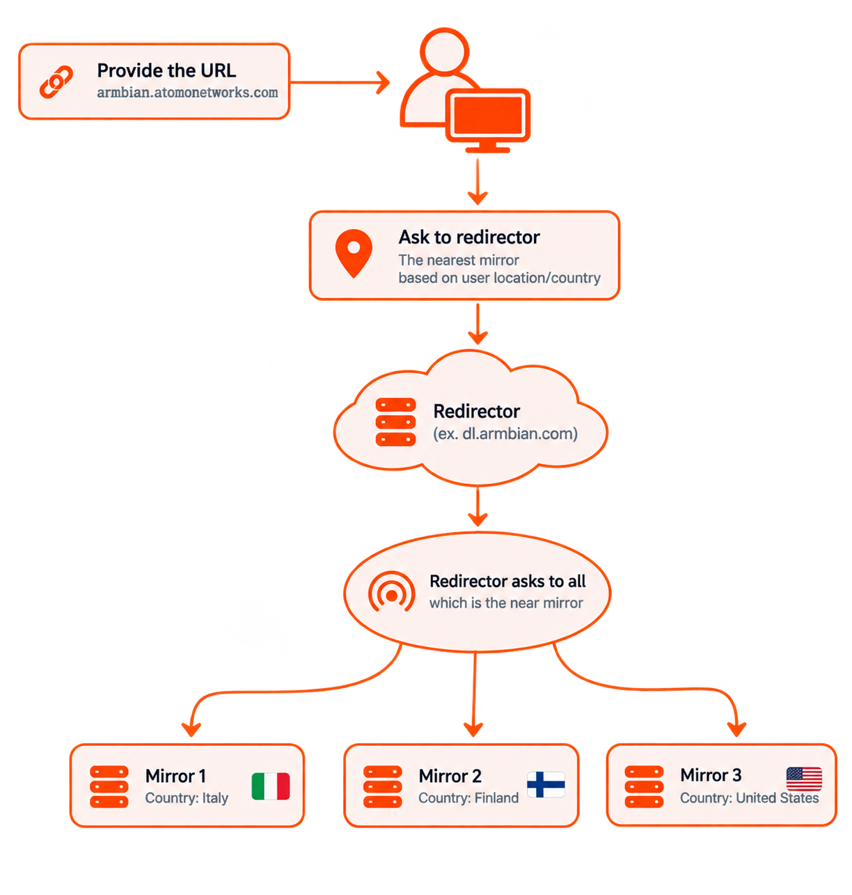

# Mirrors

The [Armbian mirror system](https://github.com/armbian/armbian-router) distributes files efficiently, routing each user to the best available server by geographic proximity and server health. Pick a nearby mirror from the list below, or read on for how the system works. Want to host a mirror? See [**Run a mirror**](/contribute/run-a-mirror/).

<!-- mirrors:start -->
## Current Mirrors

| Site | Flag | Packages | Images | Archive | Rsync |
|:-----|------|:--------:|:------:|:-------:|:-----:|
<!-- mirrors:end -->

## How it works

1. **Request** — a user starts a download (image, package, ...) from a standard URL such as `https://dl.armbian.com`.
2. **Routing** — the redirector picks the best mirror based on the user's location, each mirror's status and load, and whether it holds the requested file.
3. **Redirect** — the user is sent straight to the chosen mirror.
4. **Download** — the file is served directly from that mirror, keeping downloads fast and taking load off the core infrastructure.

The result is **load balancing** across many servers, **faster downloads** from a nearby mirror, and **redundancy** — if a mirror is unavailable, the redirector automatically routes around it.

## Host a mirror

Want to help serve Armbian's downloads? See [**Run a mirror**](/contribute/run-a-mirror/) for the requirements, the `rsync` sync commands and how to register your server.
